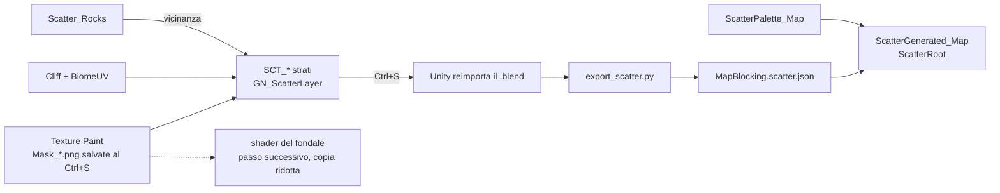

# Scatter procedurale dei biomi

| Versione | Autore | Data | Stato |
|---|---|---|---|
| 1.1 | Claude | 2026-11-18 | implementata |

## Overview
Strumento di dressing per Manu (designer, dall'editor). Flora e rocce minori si distribuiscono in Blender con Geometry Nodes sulla mappa (`MapBlocking.blend`). Ogni **strato** (rocce piccole, rocce medie, penne, bambù, spugne…) è un oggetto con un modificatore che espone tutti i parametri nel pannello: asset, densità, maschera dipinta, variazione, pendenza, regola di vicinanza ad altri strati. La densità si dipinge a mano in Blender su maschere in scala di grigi proiettate dall'alto (bianco aggiunge, nero cancella). Unity ricostruisce le istanze come prefab veri (LOD, collider, script) e le rigenera da solo a ogni salvataggio del blend, così niente resta sospeso o interrato. Il dressing a mano resta per punti d'interesse, strutture e ritocchi.

Zone (nomenclatura del 2026-11-18): Z0 Tutorial (crinale), Z1 Center (hub), Z2 Lizardfish (lobo ovest), Z3 Viperfish (braccio est), Z4 Leviathan (gola e Torre).

## Goals
- `G1` Salvare `MapBlocking.blend` fa comparire in `SCN_Gameplay`, senza altri passi, gli stessi oggetti come istanze dei prefab Unity, con posizione entro 2 cm e asse su entro 1° rispetto a Blender.
- `G2` Modificare la forma del terreno in Blender e salvare: dopo il reimport ogni istanza generata sta alla distanza dal terreno prevista dal suo strato (`Surface Offset`), perché le istanze vengono dalla geometria valutata.
- `G3` Una palette (ScriptableObject) associa il nome dell'oggetto sorgente in Blender a un prefab Unity; un nome senza voce viene saltato con un warning che lo nomina, mai un errore che blocca l'import.
- `G4` **Pittura della densità, per punto:** ogni strato ha una maschera in scala di grigi 4096 × 4096 (PNG accanto al blend, 0,1 m/px). Si dipinge in Blender in Texture Paint direttamente sul `Cliff`. Ogni punto distribuito sopravvive con probabilità uguale al valore della maschera nel suo pixel: la risoluzione è quella dell'immagine, non quella della mesh. Dove la maschera è nera lo strato non genera niente. Nel nodo non esistono aree fisse: la zona la decide solo la pittura.
- `G5` **Stabilità:** dipingere un'area A cambia solo le istanze dentro A. Fuori da A posizioni e numero restano identici, perché i punti si distribuiscono sempre allo stesso modo e la maschera li filtra solo dopo.
- `G6` **Strati leggibili:** un solo gruppo di nodi `GN_ScatterLayer` con l'interfaccia divisa in pannelli (Asset, Densità e maschera, Vicinanza, Variazione, Filtri). Si regola tutto dal pannello del modificatore senza aprire l'editor dei nodi; dentro il gruppo i nodi stanno in riquadri con nome, in colonna da sinistra a destra.
- `G7` **Aggiungere un tipo di asset** costa: importare gli FBX come singoli oggetti mesh nella collection `ScatterSources/<Strato>`, duplicare un oggetto strato e cambiare collection, maschera e parametri nel pannello, aggiungere le voci in palette. Nessun nodo da toccare, nessun codice.
- `G8` **Regola di vicinanza** per strato: menu `Nessuna / Vicino / Lontano` con una collection bersaglio e due soglie in metri, misurate dal punto alla superficie delle istanze bersaglio. `Vicino`: distanza fra `Distanza min` e `Distanza max` (bambù e spugne attorno alle rocce, come il dressing del crinale); con `Sfuma` attivo la probabilità di tenere il punto cala linearmente da 1 a `Distanza min` a 0 a `Distanza max` (più fitto attaccato alla roccia). `Lontano`: distanza oltre `Distanza min` (penne che non entrano nelle rocce).
- `G9` `Surface Offset` per strato, in metri lungo l'asse su locale dell'istanza e proporzionale alla sua scala. Rocce piccole e medie sono strati separati, con offset e densità propri.
- `G10` Gli oggetti generati stanno in una radice dedicata (`ScatterGenerated_Map`) separata dall'istanza del blend; si rigenera solo quella radice e il dressing a mano non viene mai toccato. Gli oggetti strato (`SCT_*`) non arrivano in Unity e non producono warning.
- `G11` **Ctrl+S salva anche la pittura:** uno script integrato nel blend salva le maschere modificate prima di ogni salvataggio, così un solo Ctrl+S aggiorna maschere, scatter e Unity. Le maschere restano lato Blender (cartella ignorata da Unity); la proiezione è fissata (U cresce con la x di Unity, V con la z) per lo shader del fondale, che più avanti ne farà una copia ridotta.
- `G12` Una build non dipende da Blender: il JSON delle istanze è un asset versionato e la scena salvata contiene già gli oggetti.

## Non-goals
- Pennello di scatter dentro Unity (stile Polybrush): il controllo in tempo reale è quello di Blender.
- Cancellare o spostare una singola istanza: si dipinge la maschera o si fa dressing a mano.
- Regola di vicinanza verso oggetti che esistono solo in Unity (le rocce piazzate a mano nel crinale): il bersaglio è una collection di Blender.
- Shader del fondale che legge le maschere: passo successivo, con una sua texture ridotta ricavata dalle maschere (G11).
- Istanze GPU senza GameObject; chunk, streaming, occlusion culling (mappa 1208 triangoli; far clip in M7).
- Rigenerazione automatica quando cambia la palette: si usa `Deeplonauts/Scatter/Rigenera tutto`.
- Ritocchi a mano sugli oggetti generati: si perdono alla rigenerazione.
- Togliere `ScatterRoot` dalla build: in build restano i riferimenti a JSON (~20 KB) e palette, nessun metodo (tutti in `#if UNITY_EDITOR`).

## Vincoli e assunzioni
- Unity 6000.3.19f1, URP. Blender 5.3 in `Z:\Blender\stable\blender-5.3.0-stable.02f0899d78e3\blender.exe`.
- **Verificato il 2026-11-17:** l'import di un `.blend` in Unity scarta le istanze di Geometry Nodes; `depsgraph.object_instances` da riga di comando le esporta tutte.
- **Verificato:** asse Blender → Unity `(x, y, z) → (-x, z, -y)`, `M_unity = C · M_blender · C⁻¹`.
- **Verificato il 2026-11-17:** l'export legge la geometria di **viewport**, come l'import Unity del terreno. Il `Cliff` ha `Subdivision` 1 in viewport e 2 in render: lo scatter si controlla in viewport, non con F12.
- **Verificato il 2026-11-17:** con Unity senza focus `EditorApplication.delayCall` non gira; l'export parte al ritorno del focus.
- **Verificato il 2026-11-18:** una collection esclusa dal view layer (`ScatterSources`) non arriva in Unity. Un oggetto mesh vuoto con GN (`Scatter_Z2`) arriva come GameObject con mesh vuota, con un warning sulle tangenti.
- **Verificato il 2026-11-18:** FBX e prefab di penne e rocce hanno la stessa trasformazione di radice. La palette deve puntare ai **prefab** (`Assets/_Project/Prefabs/...`), non agli FBX, che non hanno i materiali di gioco né la `GroundBlendProbe`.
- **Verificato il 2026-11-18:** `wm.save_mainfile` **non** salva nel blend i pixel modificati di un'immagine impacchettata (`is_dirty` resta in memoria, il file riaperto ha i pixel vecchi). Per questo le maschere sono PNG esterni e le salva lo script del G11.
- **Script nel blend:** text block `scatter_masks_save.py` con *Register* attivo, handler `save_pre` che salva (`image.save()`) le immagini `Mask_*` con `is_dirty`. Blender lo esegue solo con *Auto Run Python Scripts* attivo per il file (Preferenze › Save & Load, o fidandosi del file all'apertura); senza, Blender mostra il suo avviso e si salva a mano con Alt+S. L'export in background (`--factory-startup`, senza `-y`) non lo esegue.
- **Scartato il 2026-11-18:** il nodo Essentials `Scatter on Surface`. `Selection`, `Distribution Mask` e `Image Mask` agiscono sulla densità per vertice del `Cliff` (triangoli di 5–7 m in viewport): pittura sgranata e istanze che si spostano anche fuori dall'area dipinta. Per questo G4 e G5 filtrano i punti **dopo** la distribuzione.
- **Proiezione delle maschere:** 4096 × 4096 px su un quadrato di 400 m in coordinate Unity, x −215 → 185, z −345 → 55; copre i bounds del `Cliff` (x −181 → 136, z −330 → 52). `U = (x_u + 215) / 400`, `V = (z_u + 345) / 400`, in Blender `U = (215 − x_b) / 400`, `V = (345 − y_b) / 400`. Nell'Image Editor di Blender la maschera appare ruotata di 180° rispetto alla vista dall'alto: si dipinge sul `Cliff` in 3D, non nell'Image Editor.
- **Verificato il 2026-11-18 (passo 1, sulla copia di prova):** una UV statica sulla mesh di base **non** coincide con la proiezione dopo la `Subdivision` (scarto fino a 17 m): il `Cliff` ha edge con crease, che spostano le posizioni ma non le UV. Soluzione adottata: `BiomeUV` resta sulla mesh di base (serve per sceglierla in Texture Paint, *Single Image*) e un modificatore GN `BiomeUV` in fondo allo stack del `Cliff` (gruppo `GN_BiomeUV`: `Self Object` → `Transform Point` → `Store Named Attribute` FLOAT2 su CORNER) la riscrive con la proiezione esatta della posizione valutata: scarto massimo 0,02 mm. Il `Cliff` importato in Unity resta di 1208 triangoli. Il GN degli strati non legge la UV: calcola la stessa proiezione dalla posizione del punto. Resta da vedere a mano che il pennello dipinga dove si aspetta (T7).
- **Verificato il 2026-11-18 (passo 1):** un oggetto **Point Cloud** con modificatore GN che genera istanze non viene esportato nell'FBX da Unity: nessun GameObject, nessun warning. Gli strati `SCT_*` sono Point Cloud; nessun codice di esclusione in Unity.
- Dipendenze nuove: nessuna. Niente add-on, niente pacchetti.

## Architettura
- **Strato = oggetto + modificatore.** Ogni strato è un oggetto `SCT_<Strato>` di tipo Point Cloud (non arriva in Unity, vedi Vincoli) nella collection `Scatter`, con un modificatore `GN_ScatterLayer`. Trasformazioni bloccate (`lock_location/rotation/scale`) e `Object Info` / `Collection Info` in spazio `Relative`, così duplicare o spostare l'oggetto per errore non sposta le istanze. Duplicare l'oggetto è il modo di aggiungere un tipo di asset (G7).
- **Collection:** `Scatter/Scatter_Rocks/{Scatter_Rocks_Small, Scatter_Rocks_Medium}` e `Scatter/Scatter_Flora`. Ogni collection può fare da bersaglio della vicinanza; una collection padre include le figlie. Uno strato non deve puntare a una collection che lo contiene (dipendenza circolare).
- **Catena di `GN_ScatterLayer`:** `Object Info(Superficie)` → `Distribute Points on Faces` a densità piena (sempre Poisson: con `Distanza minima` 0 equivale al Random; nessuna selezione). L'attributo `id` dei punti resta dopo `Delete Geometry`, quindi asset, rotazione e scala di un punto non cambiano se ne spariscono altri (T6) → filtri sul singolo punto con `Delete Geometry` (maschera, pendenza, vicinanza) → `Instance on Points` (indice casuale nella collection) → rotazione e scala casuali → `Translate Instances` locale per l'offset → uscita.
  - *Maschera:* UV dalla posizione del punto (formula dei Vincoli) → `Image Texture` (Linear, estensione Clip: bordo dei tratti morbido) → il punto resta se `Random Value(ID, seed dello strato) < maschera`. Senza immagine il valore è 0 e lo strato è vuoto: un duplicato senza maschera non riempie la mappa.
  - *Pendenza:* resta se `Normal.z ≥ cos(Pendenza max)`; esclude anche sottosquadri e soffitti.
  - *Vicinanza:* `Collection Info(Bersaglio)` → `Realize Instances` → `Geometry Proximity` (facce) sulla posizione del punto. Con bersaglio senza facce, `Vicino` scarta tutto e `Lontano` tiene tutto. La distanza non ha segno, quindi un punto sotto una roccia può stare oltre `Distanza min`: un `Raycast` verso l'alto (10 m) sul bersaglio scarta i punti coperti, sia in `Vicino` sia in `Lontano`.
- **Maschere:** PNG in scala di grigi 4096 × 4096 in `Assets/_Project/Assets/Models/Blends/MapBlocking_Masks~/Mask_<Strato>.png` (Unity ignora le cartelle che finiscono con `~`, git le versiona), referenziati dal blend con percorso relativo. Più strati possono condividere la stessa maschera. Si dipingono in Texture Paint sul `Cliff` (modalità *Single Image*, UV `BiomeUV`).
- **Export lato Unity:** invariato. Un `AssetPostprocessor` vede il reimport del blend e lancia `export_scatter.py` in background, che legge le maschere dal disco.
- **JSON come asset intermedio**, palette in ScriptableObject, radice `ScatterRoot`, tutto fuori dal ciclo di import (`delayCall`): invariati dalla v1.0, con le correzioni del passo 2.

## Componenti

### `GN_ScatterLayer` (gruppo Geometry Nodes, in `MapBlocking.blend`)
- **Responsabilità:** genera le istanze di uno strato sul `Cliff`.
- **Input del modificatore (default):**
  - *Asset:* `Superficie` (Object, `Cliff`), `Collection` (Collection), `Seed` (Int, 0).
  - *Densità e maschera:* `Densità` (Float, 0.01 per m², dove la maschera è bianca), `Maschera` (Image), `Distanza minima` (Float, 0 m).
  - *Vicinanza:* `Regola` (Menu `Nessuna / Vicino / Lontano`, `Nessuna`), `Bersaglio` (Collection), `Distanza min` (Float, 0.2 m), `Distanza max` (Float, 2 m), `Sfuma` (Bool, true; solo con `Vicino`).
  - *Variazione:* `Scala` (Float, 1), `Scala casuale` (Float, 0.3, ±), `Rotazione casuale` (Vector, (0, 0, 360°)), `Allinea alla normale` (Bool, true), `Surface Offset` (Float, 0 m, locale e proporzionale alla scala).
  - *Filtri:* `Pendenza max` (Float, 40°).

### `scatter_setup.py` (Blender, `Assets/_Project/Code/Editor/Scatter/`)
- **Responsabilità:** strumento da riga di comando, idempotente, che costruisce in `MapBlocking.blend` quello che non conviene fare a mano: gruppo `GN_ScatterLayer` con layout e pannelli, text block `scatter_masks_save.py`, UV `BiomeUV` e modificatore `GN_BiomeUV` sul `Cliff`, collection, strati iniziali, maschere iniziali. Un pezzo che esiste già resta com'è; un'opzione `--rebuild-group` ricostruisce solo il gruppo, senza toccare strati e maschere.

### `export_scatter.py` (Blender)
- Come v1.0, in più: arrotonda `p`, `q`, `s` a 5 decimali e ordina le istanze per `(host, asset, p)`, così il JSON non cambia se le istanze non cambiano. Una maschera usata da uno strato che manca su disco produce un warning con il nome e non blocca l'export.

### `ScatterPalette`, `ScatterRoot`
- Invariati. Palette canonica: `Assets/_Project/Entities/Profiles/ScatterPalette_Map.asset`.

### `ScatterPostprocessor` / `ScatterExport` (Editor)
- `ScatterExport.Run` importa il JSON solo se l'export l'ha riscritto (`SCATTER_OK` senza `invariato`): un salvataggio senza modifiche allo scatter non rigenera e non sporca la scena.
- `RefreshGroundProbes()` gira **dopo** la rigenerazione, anche in `Rigenera tutto` (oggi gira prima, e le rocce appena create fanno il probe nell'origine).

## API pubblica ed eventi
- `ScatterRoot.Regenerate(): int`, `ScatterExport.Run(string blendPath): bool`: firme invariate.
- Nessun evento runtime: tutto è editor.

## Test e casi limite

| ID | Goal | Dato / Quando | Atteso |
|---|---|---|---|
| T1 | G1 | Prova `ScatterSpike` | **Passato il 2026-11-17** |
| T2 | G1 | Scatter in Z2 su `MapBlocking.blend` | **Passato il 2026-11-18:** 56 istanze, tutte a contatto (scarto max 0,4 mm), salvataggio del blend → export e rigenerazione automatici, dressing a mano intatto (531 figli del `Cliff`, 532 aggiunti) |
| T3 | G2 | Alzo una collina di 5 m e salvo | Il pivot di ogni istanza dista dal terreno, lungo l'asse su, `Surface Offset × scala ± 0.05 m` |
| T4 | G3 | Sorgente senza voce in palette | Saltata, un warning con nome e numero |
| T5 | G4 | Maschera nera ovunque tranne un disco bianco di 10 m | Istanze solo nel disco, entro due pixel (0,2 m) dal bordo dipinto |
| T6 | G5 | Dipingo di nero un'area A, Ctrl+S | Spariscono solo le istanze in A; le altre hanno le stesse righe nel JSON |
| T7 | G4 | Dipingo un punto di 4 px sul `Cliff`, densità alta | Le istanze nascono entro 0,2 m dal punto dipinto, anche su una parete in pendenza e vicino a un bordo smussato dal `Bevel` |
| T8 | G6 | Apro il modificatore di uno strato | Tutti gli input sono nei pannelli con nome; nessun nodo sovrapposto nel gruppo |
| T9 | G7 | Aggiungo lo strato spugne seguendo solo il G7 | Le spugne compaiono in Unity col prefab giusto, senza toccare nodi né codice |
| T10 | G8 | Bambù `Vicino` a `Scatter_Rocks`, 0.2–1.5 m | Ogni bambù dista dalla superficie della roccia più vicina fra 0.2 e 1.5 m; con `Sfuma` la metà interna della fascia ha più istanze della metà esterna |
| T11 | G8 | Penne `Lontano` da `Scatter_Rocks`, 0.3 m | Nessuna penna a meno di 0.3 m da una roccia |
| T12 | G8 | Bersaglio vuoto (rocce tutte cancellate) | `Vicino`: nessun bambù; `Lontano`: penne come senza regola |
| T13 | G8 | Bersaglio che contiene lo strato stesso | Blender segnala la dipendenza circolare; documentato |
| T14 | G9 | Rocce medie con `Surface Offset` −0.15 m e `Scala casuale` 0.3 | Ogni pivot sta `0.15 × scala` sotto la superficie lungo il suo asse su |
| T15 | G10 | Reimport del blend | Nessun GameObject `SCT_*` nel modello, nessun warning sulle tangenti |
| T16 | G1 | Salvo il blend senza cambiare lo scatter | JSON non riscritto, nessuna rigenerazione, scena non sporcata |
| T17 | G1 | Due reimport nello stesso aggiornamento dell'AssetDatabase | Un solo export (due salvataggi separati fanno due export: accettato) |
| T18 | G4 | Strato con maschera mancante su disco | Strato vuoto, warning col nome nel log dell'export |
| T19 | G11 | Dipingo e salvo solo con Ctrl+S, Auto Run attivo | PNG aggiornato su disco prima della scrittura del blend; l'export usa la maschera nuova. Senza Auto Run: avviso di Blender, Alt+S a mano (scritto nella guida) |
| T20 | G12 | Build senza Blender | Scena con gli oggetti generati, nessun metodo di scatter nel player |

## Piano

1. **Verifiche tecniche sulla copia di prova** (`Prototype/ScatterSpike/MapScatterTest.blend`): `BiomeUV` esatta, oggetto Point Cloud con GN importato da Unity. **Fatto il 2026-11-18**, esito nei Vincoli (UV statica scartata, modificatore `GN_BiomeUV`; T15 passato sulla copia).
2. **`scatter_setup.py`, `GN_ScatterLayer` e correzioni Unity.** Gruppo con pannelli e layout; strati `SCT_Rocks_Small`, `SCT_Rocks_Medium`, `SCT_Pens` al posto di `Scatter_Z2` (spento, non cancellato: lo toglie Manu); maschere iniziali bianche sulla Z2 (stesso riquadro di oggi, poi solo pittura). `export_scatter.py` deterministico; `ScatterExport.Run` e `RefreshGroundProbes` corretti. Verifica: T2 rifatto, T3, T4, T5, T6, T8, T14, T15, T16, T17, T18. **Fatto il 2026-11-18** in Blender (copia headless e file aperto da Manu, non salvato da Claude): 15 + 17 rocce, 11 penne, istanze nel riquadro Z2, nessun warning dei nodi; correzioni Unity compilate. Da fare dopo il salvataggio di Manu: T2 rifatto in scena, T5-T8, T14-T18.
3. **Vicinanza e nuovi asset.** Sorgenti bambù e spugne in `ScatterSources`, strati `SCT_Bamboo`, `SCT_Sponges` vicino alle rocce, penne lontano; voci in palette verso i prefab. Verifica: T9, T10, T11, T12, T13. **Fatto il 2026-11-18:** sorgenti dal LOD2 degli FBX, 43 bambù (`Vicino` 0.1-2 m), 41 spugne (`Vicino` 0.05-1.5 m), nessuna istanza coperta né oltre il massimo; T12 passato (bersaglio vuoto: `Vicino` 0, `Lontano` 214 su 214); palette a 11 voci. T13 non provato.
4. **Documentazione.** `documentation/Scatter.md` con la struttura standard e una guida d'uso in Blender (dipingere e salvare, aggiungere uno strato, regole), catalogo in `documentation/README.md`, `check_catalog.py` a 0; rimozione di `Assets/_Project/Prototype/ScatterSpike/`. Verifica: T19 descritto, T20. **In corso il 2026-11-18:** catalogo aggiornato, `ScatterSpike` nel Cestino di Windows, reference affidata ad Antigravity.

Dopo questa versione, dalla v1.0: riordino della gerarchia di `SCN_Gameplay` (i 532 oggetti a mano), `GroundAnchor` sul dressing a mano, shader del fondale che legge le maschere.

## Domande aperte
Nessuna. Risposte di Manu del 2026-11-18:
1. Salvataggio della pittura: script integrato che salva le maschere al Ctrl+S (G11).
2. Bersaglio della vicinanza solo in Blender: sì; il crinale diventerà procedurale più avanti.
3. `Sfuma`: sì, da subito.
4. Maschere 4096: restano lato Blender, non vanno in Unity.
5. Penne in Z2: solo una prova. Il contenuto iniziale degli strati riprende la Z2 di oggi per non perdere la verifica; il primo dressing vero sarà la zona del viperfish (Z3).

## Registro
- 1.0 2026-11-17: prima versione, dopo la prova del flusso in `Assets/_Project/Prototype/ScatterSpike/`. Critica di Antigravity (Argon, `1c61be9d`) applicata.
- 1.1 2026-11-18: dopo la prova in Z2 sulla mappa vera (T2 passato). Strati come oggetti con `GN_ScatterLayer`; densità dipinta su maschere PNG filtrando i punti dopo la distribuzione (niente riquadro fisso, `Scatter on Surface` scartato); regola di vicinanza per strato; `Surface Offset` locale; oggetti `SCT_*` esclusi in Unity; palette verso i prefab in `Entities/Profiles`; export deterministico. Critica di Antigravity (Argon, `7ca91226`): applicati i punti 1-17 e 19 (con verifica propria sul salvataggio delle immagini impacchettate); scartato il 20 (campi di `ScatterRoot` in build, peso trascurabile). Il punto 18 è coperto dalle sotto-collection. Nuova nomenclatura delle zone. Raggio «coperto dal bersaglio» aggiunto nella costruzione (punti sotto le rocce). Blender 5.3: i valori del modificatore si scrivono con `mod.properties.inputs.<id>.value`. Approvata con le risposte di Manu (script al Ctrl+S, `Sfuma`, maschere 4096 fuori da Unity).
- 1.1 2026-11-18, implementata: passi 2-4 fatti. Passati sulla copia T6, T12, T14, T16, T18; grafo senza nodi sovrapposti (T8 lato codice). Revisione di Antigravity (Argon, risposta parziale per errore di rete): corretti la maschera su disco riscritta dal setup, il riconoscimento di `invariato` e il `-0.0` nel JSON; documentato lo strato nascosto che sparisce in Unity. Da verificare con Manu: rigenerazione in `SCN_Gameplay` dopo il salvataggio del blend, T7 (pittura), T9 (orientamento di bambù e spugne in Unity), T19, T20.
