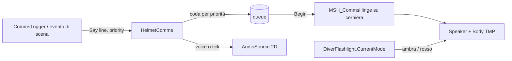

# Comms
Ultima verifica: 2026-11-24

## Scopo e confini
Schermo comunicazioni del casco: le battute di H.E.L.M. e BATHY appaiono su un pannello montato su una cerniera dentro il casco, che si ribalta verso il giocatore quando c'è un messaggio, scrive a macchina il nome di chi parla e la battuta, suona la voce se c'è e si richiude. È il sottotitolo diegetico del gioco (GDD: voci solo in inglese, testo in italiano e inglese) e sostituisce, per il gameplay, i sottotitoli su Timeline del prologo (`SubtitlePanel`/`SubtitleTrack`, deprecati, vedi [Prologue.md](Prologue.md)).

Non scrive le battute (sono asset `SubtitleLine` con testi nella tabella `Comms`) e non decide quando parlano: lo fanno i `CommsTrigger` in scena o chiunque chiami `HelmetComms.Say`.

## File e componenti
- `Assets/_Project/Code/Comms/HelmetComms.cs`: enum `CommsPriority` e componente `HelmetComms` (pannello, testi, coda, audio).
- `Assets/_Project/Code/Comms/CommsTrigger.cs`: manda una o più battute allo schermo all'ingresso del diver in un trigger, quando guarda un oggetto, o da un `UnityEvent` di scena.
- `Assets/_Project/Code/Comms/FaunaCommsCue.cs`: battuta critica alla prima allerta di una creatura stealth mentre il giocatore tiene in mano una cella accesa.
- `Assets/_Project/Code/Prologue/SubtitleLine.cs`: asset della battuta, condiviso col prologo (vedi [Prologue.md](Prologue.md)); il campo `voice` serve solo qui.
- Asset: modello `Assets/_Project/Assets/Models/Helmet/SM_CommsPanel.fbx` (radice `MSH_CommsHinge` = cerniera e perno della rotazione, figli `MSH_ScreenChassist` = telaio, `MSH_Screen` = schermo, `MSH_Glass` = vetro; importer con `preserveHierarchy` attivo, altrimenti Unity fonde la radice unica del FBX con l'oggetto del prefab), tabella stringhe `Assets/_Project/Localization/Comms.asset` (+ `Comms_en`, `Comms_it`), battute in `Assets/_Project/Comms/Lines/`, font `Assets/_Project/Assets/Fonts/VT323 SDF.asset` (VT323, licenza OFL in `VT323_OFL.txt`).

## Dipendenze e flusso dati
- **Unity Localization**: `SubtitleLine.speaker` e `.text` sono `LocalizedString`, risolte con `GetLocalizedString()` all'inizio di ogni messaggio (lingua di sistema, `en` di riserva).
- **TextMeshPro 3D**: due `TMP_Text` sulla faccia del pannello; la scrittura a macchina usa `maxVisibleCharacters`.
- **`DiverFlashlight`** (`Deeploration.Player`): con la torcia in modalità `Red` l'inchiostro passa da ambra a rosso emergenza, come gli altri strumenti del casco.

## Componenti

### CommsPriority
Enum, in ordine crescente (GDD, «Concorrenza degli avvisi»):
- `Hint = 0`: consiglio da tutorial. In coda scade dopo `hintExpirySeconds`; se interrotto si scarta.
- `Dialogue = 1`: narrazione. Se interrotta torna in testa alla coda e riparte dall'inizio della frase.
- `Critical = 2`: interrompe tutto, resta sullo schermo `criticalSeconds`.

### HelmetComms
- **Responsabilità e ciclo di vita**:
  - `Awake()`: trova `DiverFlashlight` se vuoto, aggiunge un `AudioSource` 2D se `voiceSource` è vuoto, sintetizza il tick se `typeTick` è vuoto e il bip se `incomingBeep` è vuoto, memorizza la rotazione locale del pannello come posa aperta, chiude il pannello e svuota i testi.
  - `Update()` (tempo non scalato): scarta i consigli scaduti, avvia il prossimo messaggio passato `gapSeconds` dalla fine del precedente, suona `incomingBeep` quando il pannello comincia ad aprirsi (passaggio da chiuso ad aperto, non quando un messaggio arriva a pannello già aperto), muove l'apertura verso 1 o 0 in `flipSeconds` con SmoothStep, applica il colore dell'inchiostro. A pannello aperto scrive una parola intera alla volta: con la voce al ritmo `caratteri / (durata del clip − voiceTailSeconds)`, così le parole seguono il parlato; senza voce a `charsPerSecond` con un tick per parola. Il testo che non entra va su più pagine (`bodyText` in overflow `Page`): con la voce la pagina volta alla prima parola che non ci sta, senza voce c'è prima una pausa di `max(minHoldSeconds, caratteri della pagina × readSecondsPerChar)`. Finita la scrittura tiene la battuta `criticalSeconds` (critici) o `max(minHoldSeconds, caratteri dell'ultima pagina × readSecondsPerChar)` e comunque finché la voce suona. Poi il pannello resta aperto `lingerSeconds`: un messaggio che arriva in quel tempo parte senza richiudere e riaprire.
  - I testi sono accesi solo a pannello tutto aperto: lo shader TMP (`TMP_SDF-Mobile`) usa `ZTest [unity_GUIZTestMode]`, globale, che la UI può lasciare ad Always; un testo acceso mentre il pannello scende dietro il bordo del casco si vedrebbe sopra il casco senza il pannello (segnalato da Manu il 2026-11-24). `Begin` accende `bodyText` solo per misurare la battuta (TMP non conta i caratteri di un testo spento).
  - Testo vuoto (chiave mancante nella tabella): niente scrittura, si chiude dopo `minHoldSeconds`.
  - La voce non parte in `Begin`: parte nel primo `Update` a pannello tutto aperto (`voicePending`), insieme alla prima parola e dopo il bip, che dura 0.21 s contro 0.45 s di ribaltamento.
- **Campi Inspector**:
  - `Transform panel` (`null`): pannello che ruota. Importato in posa aperta: quella posa è angolo 0.
  - `float closedAngle` (`-162.5`): angolo del pannello chiuso attorno all'asse X del genitore, in gradi. Riproduce la posa chiusa di `Helmet.blend`.
  - `float flipSeconds` (`0.45`, min 0.05): durata del ribaltamento.
  - `TMP_Text speakerText`, `TMP_Text bodyText` (`null`): nome di chi parla e battuta.
  - `float charsPerSecond` (`40`): velocità della scrittura senza voce.
  - `float voiceTailSeconds` (`0.5`): coda di riverbero a fine clip esclusa dalla sincronia (ambiente `scafo` di `robot.py`).
  - `float readSecondsPerChar` (`0.045`), `float minHoldSeconds` (`1.5`): tempo di lettura dopo la scrittura e fra le pagine.
  - `float lingerSeconds` (`3`): quanto il pannello resta aperto dopo un messaggio.
  - `AudioSource voiceSource` (`null` = aggiunta in `Awake`): sorgente 2D di voce e tick.
  - `AudioClip typeTick` (`null` = 12 ms di rumore sintetizzato), `float tickVolume` (`0.25`).
  - `AudioClip incomingBeep` (`null` = bip sintetizzato: due toni quadri smussati da 90 ms, 1320 Hz poi 880 Hz, 30 ms di pausa), `float beepVolume` (`0.5`): avviso di comunicazione in arrivo, sulla stessa `voiceSource`.
  - `float criticalSeconds` (`4.5`), `float hintExpirySeconds` (`8`), `float gapSeconds` (`0.4`), `float repeatBlockSeconds` (`10`): regole della coda.
  - `DiverFlashlight flashlight` (`null` = `FindFirstObjectByType`).
- **API pubbliche**:
  - `public bool IsBusy { get; }`: vero con un messaggio sullo schermo o in coda.
  - `public void Say(SubtitleLine line, CommsPriority priority = CommsPriority.Dialogue)`: mette in coda. Ignora la battuta se è identica a quella sullo schermo, a una già in coda o a una mostrata da meno di `repeatBlockSeconds`. Con priorità maggiore del messaggio corrente lo interrompe subito (dialogo interrotto rimesso in testa, consiglio interrotto perso, voce fermata). A pari priorità l'ordine è di arrivo.
- **Riferimenti obbligatori**: `panel`, `speakerText`, `bodyText`. Senza `panel` il pannello non si muove; senza i testi `Begin` lancia `NullReferenceException`. Battuta nulla o senza testo: `Debug.LogError` e scartata.

### CommsTrigger
- **Responsabilità e ciclo di vita**: `Start()` cerca `HelmetComms` in scena (`Debug.LogError` se manca). `OnTriggerEnter`/`OnTriggerExit` tengono traccia di dentro/fuori del diver (collider con `CharacterController` nei genitori; niente `OnTriggerStay`). Con `playOnEnter` (e `playOnGaze` spento) l'ingresso chiama `Play()`. Con `playOnGaze`, `Update()` accumula il tempo in cui il diver, dentro il volume, guarda `gazeTarget`: camera principale, angolo fra `forward` e direzione al bersaglio < `gazeAngle`, linea libera (raycast dalla camera al bersaglio; il primo collider non-trigger, ignorando quelli del diver, deve essere del bersaglio o di un suo figlio). Il tempo si azzera appena lo sguardo si interrompe e all'uscita; a `gazeSeconds` chiama `Play()`. Serve un collider con `isTrigger` sullo stesso oggetto.
  - **Scelta di progetto:** con `playOnGaze` attivo l'ingresso da solo non fa partire la battuta, anche con `playOnEnter` acceso: lo sguardo prevale (altrimenti il cartello parlerebbe prima di essere visto).
- **Campi Inspector**:
  - `SubtitleLine[] lines` (vuoto): battute mandate in ordine.
  - `CommsPriority priority` (`Dialogue`).
  - `bool once` (`true`): parte una volta sola per partita.
  - `bool playOnEnter` (`true`): parte all'ingresso nel trigger; spento, solo da `Play()`. Ignorato se `playOnGaze` è attivo.
  - `bool playOnGaze` (`false`): parte quando il diver, dentro il trigger, guarda `gazeTarget` per `gazeSeconds` di fila.
  - `Transform gazeTarget` (`null`): oggetto guardato (es. il cartello). Senza, lo sguardo non scatta mai.
  - `float gazeSeconds` (`1`, min 0): secondi continui di sguardo.
  - `float gazeAngle` (`10`, 1-90): semi-angolo in gradi fra `forward` della camera e direzione verso il bersaglio.
- **API pubbliche**: `public void Play()`: mette in coda tutte le battute (una volta sola con `once`). Collegabile da `UnityEvent` (es. `GrabSocket.onRejected`, raccolta del modulo luce rossa).

### FaunaCommsCue
- **Responsabilità e ciclo di vita**: componente di scena. `OnEnable`/`OnDisable` si iscrivono a `CreatureStealth.AnyAlertChanged` (evento statico: le creature sono in pool). Alla prima transizione verso `Investigate` o `Attack` (qualunque livello diverso da `Neutral`), se il giocatore tiene in mano una cella accesa, manda `line` a `HelmetComms.Say(line, CommsPriority.Critical)` e non lo rifà (con `once`).
- **Cella accesa**: `PlayerGrab.Held` con `Grabbable.IsHeld` vero e che emette davvero uno stimolo: il componente chiama `Grabbable.EmitStimuli` su una lista di prova e cerca uno stimolo `WeakLight` con `FromPlayer`. Si usa `IsHeld`, non `AlertsCreatures` (vero anche per una cella lanciata e ancora in moto). Un `Grabbable` con `stimulusReach` 0 non è una cella e non fa scattare.
- **Campi Inspector**: `SubtitleLine line` (`null`; senza, non fa nulla), `bool once` (`true`): una volta sola per partita.
- **API pubbliche**: nessuna.
- **Riferimenti obbligatori**: `HelmetComms` e `PlayerGrab` cercati in scena al primo bisogno; senza `HelmetComms` `Debug.LogError`.

## Setup in Unity
1. Istanziare `SM_CommsPanel.fbx` come figlio di `Helmet` con transform locale nullo (il FBX è esportato nello spazio del casco, in posa aperta).
2. Un materiale per mesh: `PH_Metal` su `MSH_CommsHinge` e `MSH_ScreenChassist`, `PH_Screen` su `MSH_Screen`, `PH_Glass` su `MSH_Glass` (spento, come gli altri vetri del casco). Schermo e telaio sono mesh separate in `Helmet.blend`: con un solo mesh a due materiali il bevel portava il colore dello schermo sugli spigoli dell'incasso. Mai `PH_Screen` sul telaio: diventa un rettangolo olivastro che sembra UI senza pannello.
3. Sotto `MSH_Screen` un figlio `CommsTexts`, 1 mm davanti al centro dello schermo (95×34 mm), con due `TextMeshPro` larghi 89 mm: `Speaker` (Jersey15 SDF, 0.08, in alto) e `Body` (VT323 SDF, 0.08, 3 righe, interlinea −15, a capo, overflow `Page`). Ombre spente.
4. `HelmetComms` sulla radice `SM_CommsPanel`, con `panel = MSH_CommsHinge` e i due testi.
5. Battuta nuova: voci `SPK_*` e testo nella tabella `Comms` (en e it), asset `SubtitleLine` in `Assets/_Project/Comms/Lines/`, voce in inglese opzionale (H.E.L.M. con `robot.py`, preset `helm`).

## Configurazione verificata in prefab e scene
- `Player.prefab`: `MainCamera/HelmetVisualPivot/Helmet/SM_CommsPanel` con `HelmetComms` collegato a `MSH_CommsHinge`, `Speaker`, `Body`; valori di default.
- `SM_CommsPanel.fbx`: pannello largo 109 mm (accorciato all'85% in `Helmet.blend` il 2026-11-24 perché si sovrapponeva al CRT di profondità); telaio, schermo e vetro separati da Manu lo stesso giorno (prima un solo mesh `Plane` con `PH_Screen` su tutto); box di testo larghi 89 mm sullo schermo. Verificato in Play: ribaltamento sulla cerniera e testo sullo schermo.
- Tabella `Comms`: `SPK_HELM`, `SPK_BATHY`, `TEST_001` e le battute della Z0 `HELM_WAKE_01-02`, `HELM_BRIEF_01-04`, `HELM_FISH_01-02`, `HELM_O2_01-02`, `HELM_RED_01-02` (en e it, bozze da rifinire con Manu). Un asset `SubtitleLine` per chiave in `Assets/_Project/Comms/Lines/`.
- Voci di H.E.L.M. in `Assets/_Project/Assets/Audio/VO/HELM/` (`<id>.wav`, `robot.py` preset `helm`), sorgente `_lines_z0.csv` e `_manifest.csv` di `robot.py` accanto. Per rigenerarle: `python Z:\_PROJECTS\GitHub\HarnessSystem\skills\voce\robot.py batch _lines_z0.csv -d <questa cartella>`.
- Battute FAUNA PROTOCOL (Z2, **bozze da rifinire con Manu**, 2026-11-24), en e it nella tabella `Comms`, un `SubtitleLine` per chiave con voce collegata: `HELM_FAUNA_01` «Fauna protocol.» / «Protocollo fauna.»; `HELM_FAUNA_02` «Thaladyne reminds you: the fauna is not company property. You are.» / «La Thaladyne ricorda: la fauna non è proprietà aziendale. Tu sì.»; `HELM_DROP_01` «Drop the cell. Hold still.» / «Molla la cella. Resta fermo.». Voci generate con `_lines_z2.csv` (stessa cartella HELM); `_manifest.csv` di `robot.py` viene sovrascritto a ogni batch: le righe Z0 e Z2 sono state riunite a mano, rilanciando un batch bisogna rifarlo. Montate in scena il 2026-11-24 (sotto).
- `SCN_Gameplay`, `Zones/Z3_Viperfish/Comms_Z2` (zona Z2, la gerarchia usa ancora il vecchio nome):
  - `Comms_Fauna`: `BoxCollider` trigger 8×4×8 m a (45.2, −19.5, −129.3), davanti al cartello FAUNA PROTOCOL (`SignPost_Fauna`, 49.2, −129.0; vedi [Environment.md](Environment.md)); `CommsTrigger` con `lines` = `HELM_FAUNA_01`, `HELM_FAUNA_02`, `priority` Dialogue, `once` vero, `playOnGaze` vero, `gazeTarget` = `Sign_FAUNA_PROTOCOL`, `gazeSeconds` 1, `gazeAngle` 10. Il `Housing` del cartello ha un `BoxCollider` non trigger (verificato), quindi la linea libera conta.
  - `FaunaCommsCue`: `line` = `HELM_DROP_01`, `once` vero.
- `SCN_Gameplay`, `Z0_Tutorial/Comms_Z0`:
  - `PlayerWakeUpSequence.wakeUpSubtitle` = `HELM_WAKE_01`; il suo `onCompleted` chiama `Comms_Brief.Play` (`HELM_WAKE_02`, `HELM_BRIEF_01-04`, senza collider).
  - `Comms_Fish`: trigger 30×30×3 m a (−5, 1, −10), appena fuori dal portello, prima del banco di lanternfish a z −14.
  - `Comms_O2`: trigger 30×30×4 m a (−13, −6, −64), prima della stazione O₂ 1 (−12.6, −78.7).
  - `Comms_Red`: senza collider, chiamato da `RedLightModule` (`SimpleInteractable.onInteracted`, override sull'istanza di scena).
- Verificato in Play: il risveglio manda `HELM_WAKE_01` con la voce e mette in coda le 5 battute del briefing.

## Estensione del sistema
- Nuovo parlante: chiave `SPK_<NOME>` nella tabella `Comms`.
- Battuta da codice: tenere un riferimento a `HelmetComms` e chiamare `Say(line, priority)`.

## Limiti e problemi noti
- Implementato e verificato in Play il 2026-11-24: ribaltamento, scrittura a macchina, leggibilità a 1280×720, inchiostro rosso con la torcia rossa, lingua di sistema.
- Verificato in Play il 2026-11-24 (pomeriggio): parole in sincronia con la voce, pannello che resta su fra battute in coda.
- Bip di comunicazione in arrivo (2026-11-24 sera): verificato da codice in Play, frame per frame con `EditorApplication.Step`: il bip parte con il pannello ad apertura 0.04. L'avvio della voce ad apertura 1 non è stato colto frame per frame (con l'editor a passi l'audio non avanza): letto dopo, a pannello aperto, `voicePending` falso e voce in riproduzione. Non ascoltato: volume e timbro da sentire in cuffia. Un messaggio critico che interrompe a pannello già aperto non suona il bip.
- Pianificato: LED ambra sulla cerniera che lampeggia insieme al bip (mesh da modellare in `Helmet.blend`).
- Non verificati (2026-11-24): `playOnGaze` e `FaunaCommsCue` compilano e sono montati in scena (`Comms_Z2`) ma non sono stati provati in Play; voci FAUNA non ascoltate.
- Non verificati: interruzioni, cambio pagina, sovrapposizione con la cella portata (16.5° sotto la linea di vista).
- **Temporaneo (2026-11-24):** in `LocalizationSettings` il `SpecificLocaleSelector(en)` è in testa ai selettori d'avvio, così il gioco parte sempre in inglese per i playtest. Per tornare alla lingua di sistema rimetterlo dopo `SystemLocaleSelector`.
- Pianificato: prefisso «— Interrupting.» sul messaggio che interrompe (GDD); migrazione del prologo da `SubtitleTrack` a `HelmetComms`; battute vere e voci di H.E.L.M. e BATHY.
- La lingua si legge a inizio messaggio: un cambio di lingua non aggiorna il messaggio già sullo schermo.

## Verifica
- In Play: `FindFirstObjectByType<HelmetComms>().Say(asset)` da `unity_execute_code`; lo stato interno (`openness`, `typedChars`, `totalChars`) si legge per reflection. Con l'editor non a fuoco Unity non avanza i frame: impostare `Application.runInBackground = true`.

## Sistemi collegati
- [Prologue.md](Prologue.md): `SubtitleLine`, sottotitoli su Timeline deprecati.
- [Creatures.md](Creatures.md): `CreatureStealth.AnyAlertChanged` (evento statico ascoltato da `FaunaCommsCue`), `Grabbable`.
- `DiverFlashlight` e `HelmetInstruments` (strumenti del casco, stessi colori ambra e rosso).
