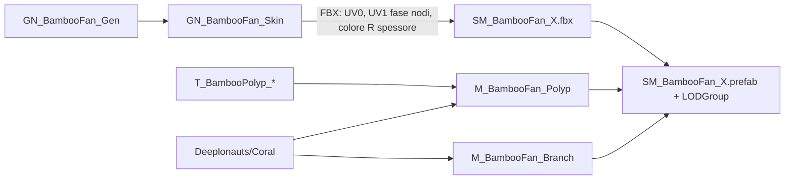

# Coral — organismi sessili procedurali (corallo bambù, spugna di vetro, penne di mare)
Ultima verifica: 2026-10-11

## Scopo e confini
Organismi sessili del pool M1, pronti da scatterare sul fondale: corallo bambù (famiglia Isididae), spugna di vetro tubolare a reticolo (Hexactinellida) e toppe di penne di mare (Pennatulacea: penne piumate tipo *Pennatula* e fruste tipo *Funiculina*), ognuno in tre varianti con LOD. Copre lo shader condiviso `Deeplonauts/Coral`, i materiali, i modelli importati, i prefab e il componente `SeaPenTouchGlow` che fa accendere le penne di mare dove passa il sub e le fa scansare dai suoi piedi.

Non coperto: la generazione in Blender, che sta fuori dal repository (vedi *Estensione del sistema*); lo scatter in scena (task M1 successiva, vedi [EnvironmentShading.md](EnvironmentShading.md) per Polybrush); il post-processing (vedi [Rendering.md](Rendering.md)).

Stato: **implementato**; **verificato** con cluster temporanei in `SCN_Gameplay` sotto `PostFX_Style_Analog` (vedi Verifica). Coralli scatterati nel canyon di `SCN_Gameplay` (commit `46d0d40`). Penne di mare **implementate** e **verificate** con toppe temporanee in `SCN_Gameplay` (2026-10-11), non ancora scatterate. Bioluminescenza delle penne al passaggio del sub **implementata**, solo visiva, **verificata** nello shader con punti di tocco simulati, **non verificata in Play**. **Pianificato**: scatter delle toppe di penne di mare (fitte attorno ai futuri scarichi, sempre più rade allontanandosi), ruolo nel gameplay della bioluminescenza delle penne (allarme per le creature o conforto contro il buio: due ipotesi in roadmap, M4/M7), texture del ramo da Painter, collare a rete dell'apertura delle spugne.

## File e componenti
- `Assets/_Project/Rendering/Shaders/Coral.shader`: shader `Deeplonauts/Coral` (URP, scritto a mano).
- `Assets/_Project/Code/Environment/SeaPenTouchGlow.cs`: componente sul `PlayerCapsule` del prefab `Player`, pubblica i punti di tocco per la bioluminescenza e la posizione dei piedi per lo spostamento.
- `Assets/_Project/Materials/Environment/Organisms/BambooFan/`:
  - `SM_BambooFan_A.fbx`, `SM_BambooFan_B.fbx`, `SM_BambooFan_C.fbx`: modelli, ognuno con `MSH_BambooFan_<X>_LOD0/1/2`;
  - `M_BambooFan_Branch.mat`, `M_BambooFan_Polyp.mat`: materiali;
  - `T_BambooPolyp_Albedo.png` (RGBA, sRGB), `T_BambooPolyp_Normal.png` (Normal Map), `T_BambooPolyp_Mask.png` (lineare, R = glow): atlante 2×2 dei polipi, 1024².
- `Assets/_Project/Materials/Environment/Organisms/GlassSponge/`:
  - `SM_GlassSponge_A.fbx`, `SM_GlassSponge_B.fbx`, `SM_GlassSponge_C.fbx`: modelli, ognuno con `MSH_GlassSponge_<X>_LOD0/1/2`;
  - `M_GlassSponge.mat`: materiale;
  - `T_GlassSponge_Albedo.png` (sRGB), `T_GlassSponge_Normal.png` (Normal Map), `T_GlassSponge_Mask.png` (lineare, G = profondità dei fori, B = barrette di silice): reticolo a nido d'ape tileabile, 1024², 12 × 12 celle con barrette spesse (devono reggere il pixel filter) con jitter forte, celle allungate lungo il tubo e distorsione del dominio a frequenze intere (resta tileabile).
- `Assets/_Project/Materials/Environment/Organisms/SeaPen/`:
  - `SM_SeaPen_A.fbx`, `SM_SeaPen_B.fbx`, `SM_SeaPen_C.fbx`: modelli, ognuno con `MSH_SeaPen_<X>_LOD0/1/2`;
  - `M_SeaPen.mat`: materiale;
  - `T_SeaPen_Albedo.png` (RGBA, sRGB, alpha = copertura), `T_SeaPen_Normal.png` (Normal Map), `T_SeaPen_Mask.png` (lineare, R = intensità della bioluminescenza, G = 1 sulle fruste): atlante 1024 × 2048 disegnato da script (vedi *Componenti*).
- `Assets/_Project/Prefabs/Organisms/SM_BambooFan_A.prefab`, `_B.prefab`, `_C.prefab`, `SM_GlassSponge_A.prefab`, `_B.prefab`, `_C.prefab`, `SM_SeaPen_A.prefab`, `_B.prefab`, `_C.prefab`.

## Dipendenze e flusso dati
1. Blender (`GN_BambooFan_Gen` → `GN_BambooFan_Skin`) esporta una mesh per LOD con due submesh: tubi dei rami e card a X dei polipi.
2. Canali che lo shader legge dalla mesh:
   - UV0: per i rami coordinate in metri (U = circonferenza, V = lunghezza), per i polipi coordinate nell'atlante;
   - UV1.x: fase dei nodi del bambù, che cresce di 1 a ogni nodo (un nodo ogni 1.6 diametri, mai più fitti di 18 mm);
   - colore di vertice R: spessore del ramo (1 = raggio 15 mm o più, salvato in sRGB), solo sui rami;
   - posizione in object space: Y = altezza, base della colonia a Y = 0.
3. Spugna: Blender (`GN_GlassSponge_Gen` → `GN_GlassSponge_Skin`) esporta una mesh per LOD con una sola submesh. UV0: U ripete la texture un numero intero di volte attorno a ogni tubo (`Tiles Around` = 1, cioè 12 celle per giro e celle di circa 3 cm: a 3 ripetizioni le celle da 9 mm diventavano rumore sotto `PostFX_Style_Analog`; niente cucitura), V nella stessa misura di cella lungo il tubo; ogni tubo ha un offset casuale e una torsione a spirale (`Twist` 0.25), così due tubi non mostrano lo stesso disegno. UV1.x = numero casuale per tubo (`UV_Tube`), usato per sfasare gli impulsi del glow. Niente colore di vertice.
4. Penne di mare: Blender (`GN_SeaPen_Gen` → `GN_SeaPen_Skin`) esporta una mesh per LOD con una sola submesh, che contiene tre tipi di elemento: tubi degli steli veri (tutte le penne piumate e le fruste più alte di 30 cm), card piatte del ciuffo delle penne piumate (nel piano della piuma) e ciuffi di fruste basse come due card incrociate a X. UV0 = coordinate nell'atlante; UV1.x = numero casuale per stelo o ciuffo (fase dell'ondeggiamento), UV1.y = posizione lungo l'elemento (0 radice, 1 punta). Niente colore di vertice. Le mesh sono dritte: l'inclinazione con la corrente la aggiunge lo shader, così resta coerente con qualunque rotazione delle istanze.
5. Il `ModelImporter` crea da solo il `LODGroup` grazie ai suffissi `_LOD0/1/2`; i prefab lo tarano.
6. Bioluminescenza e spostamento: `SeaPenTouchGlow` (sul `PlayerCapsule`) registra un punto ogni `stampSpacing` metri percorsi in orizzontale, spostato di `lookAhead` metri avanti nella direzione di marcia, e pubblica come globali degli shader gli ultimi 12 punti (`_SeaPenTouchPoints`, xyz = posizione, w = `Time.time`), il loro numero (`_SeaPenTouchCount`), l'ora corrente (`_SeaPenTouchTime`) e la posizione attuale dei piedi (`_SeaPenPlayer`, w = 1 finché il componente è attivo). I materiali con `_CORAL_TOUCH_GLOW` calcolano da lì le onde di luce per pixel, quelli con `_PushStrength` > 0 piegano i vertici via dai piedi. Nessun collider: conta solo la distanza.

## Componenti

### Shader `Deeplonauts/Coral`
- Responsabilità: superficie lit URP con due modalità.
  - Ramo (`_CORAL_BRANCH`): albedo = `_BaseMap` × `_BaseColor` × gradiente da `_BottomColor` a `_TopColor` sull'altezza in object space, più le bande dei nodi calcolate per pixel da `frac(UV1.x)`. Le bande si attenuano sui rametti sottili in base al colore di vertice R.
  - Polipo (`_ALPHATEST_ON`): atlante con alpha clip, doppia faccia con normale ribaltata sul retro.
  - Entrambe: normal map opzionale, emissione = `_GlowColor` × `_GlowStrength` × `_MaskMap.r`, ondeggiamento con la corrente, bordo luminoso opzionale (`_RimStrength`), tinta delle facce posteriori (`_BackfaceTint`) glow del reticolo (maschera B: base costante più un impulso che risale lungo UV0.y con fronte netto e coda esponenziale; fase per istanza dalla posizione mondo e per tubo da UV1.x) e modalità traslucida (`_CORAL_TRANSLUCENT`: colore finale = mescola tra lo sfondo della Opaque Texture, con rifrazione e finta parete interna, e il colore illuminato, in base a opacità per angolo e maschera G dei fori). Aggiunti il 2026-10-11 per la spugna, con default neutri.
- Ondeggiamento: spostamento in world space lungo `_SwayDirection` pari a (Y / `_SwayHeight`)² × (`_SwayAmount` × oscillazione + `_SwayLean`). L'oscillazione è la somma di due seni a `_SwayFrequency` e 2.3×. La fase dipende dalla posizione mondo dell'oggetto, quindi istanze diverse non si muovono all'unisono; a questa si sommano UV1.x × `_SwayPhaseUV1` giri (fase per elemento, per mesh che contengono molti steli) e un'onda che avanza lungo la corrente (posizione mondo del vertice proiettata su `_SwayDirection` × `_SwayWave`). `_SwayLean`, `_SwayPhaseUV1` e `_SwayWave` sono stati aggiunti il 2026-10-11 per le penne di mare con default 0, che lasciano invariati gli altri materiali (sul corallo UV1.x è la fase dei nodi e non deve entrare nell'ondeggiamento). Lo stesso spostamento è applicato in tutti i pass, che per questo leggono anche UV1, così ombre e profondità restano allineate.
- Bioluminescenza al tocco (`_CORAL_TOUCH_GLOW`, aggiunta il 2026-10-11 per le penne di mare, spenta di default): per ogni punto di tocco ancora vivo parte un fronte d'onda che si allarga a `_TouchSpeed` (gaussiana larga `_TouchWidth`), con una luce residua `_TouchAfterglow` dietro il fronte; il tutto svanisce in `_TouchLifetime` (al quadrato), si spegne oltre `_TouchRadius` e a più di 1–1.5 m di dislivello dal punto. UV1.x ritarda il fronte di `_TouchJitter` metri per elemento e sfasa uno sfarfallio a `_TouchFlicker`, così la luce salta da stelo a stelo. Fra i punti vale il massimo, non la somma. Emissione = colore × livello × maschera R × onda × `_TouchGlowStrength`. Il colore in punta è `_TouchGlowColor` dove la maschera G vale 0 e `_TouchGlowColor2` dove vale 1; scendendo verso la radice (UV1.y da 1 a 0) sfuma verso `_TouchGlowBaseColor` e il livello scende a `_TouchBaseLevel`, in proporzione a `_TouchGradient` (0 = colore e livello uniformi). Solo nel pass `ForwardLit`. Senza `SeaPenTouchGlow` attivo il numero di punti è 0 e non si accende niente.
- Spostamento dal sub (`_PushStrength`, aggiunto il 2026-10-11 per le penne di mare, 0 di default): nel calcolo dell'ondeggiamento si somma uno spostamento orizzontale che allontana ogni vertice dai piedi del sub (`_SeaPenPlayer`), pieno entro il 30% di `_PushRadius` e nullo oltre, con lo stesso peso (Y / `_SwayHeight`)² dell'ondeggiamento (radici ferme) e solo entro 1–1.5 m di dislivello. Vale in tutti i pass, quindi anche ombre e profondità seguono. Lo spostamento orizzontale totale (ondeggiamento, inclinazione e spostamento) abbassa anche il vertice di |offset|² / (2 × Y in object space), così lo stelo si piega ad arco invece di allungarsi: vale per tutti i materiali, ma con l'ondeggiamento di corallo e spugna (3–5 cm) l'abbassamento è sotto il millimetro.
- Pass: `ForwardLit` (luce principale e aggiuntive, ombre, SSAO, nebbia, cookie, LOD cross-fade), `ShadowCaster`, `DepthOnly`, `DepthNormals` (questi tre con alpha clip quando attivo). Compatibile con SRP Batcher e GPU instancing.
- Proprietà:

| Proprietà | Tipo | Default | Significato |
|---|---|---|---|
| `_BaseMap` | 2D | white | Albedo (atlante per i polipi, tileabile per i rami) |
| `_BaseColor` | Color | (1,1,1,1) | Tinta e moltiplicatore dell'alpha |
| `_BumpMap` / `_BumpScale` | 2D / Float | bump / 1 | Normal map |
| `_MaskMap` | 2D | black | R = intensità del glow |
| `_Smoothness` | Range 0–1 | 0.25 | Lucidità |
| `_TexScale` | Float | 1 | Moltiplicatore di UV0 (per i rami: ripetizioni per metro) |
| `_Cull` | Enum CullMode | 2 (Back) | 0 sui polipi (doppia faccia) |
| `_AlphaClip` | Toggle `_ALPHATEST_ON` | 0 | Attiva l'alpha clip |
| `_Cutoff` | Range 0–1 | 0.5 | Soglia dell'alpha |
| `_Branch` | Toggle `_CORAL_BRANCH` | 0 | Modalità ramo |
| `_BottomColor` / `_TopColor` | Color | (0.70,0.64,0.50) / (0.92,0.90,0.84) | Gradiente in altezza |
| `_GradientHeight` | Float | 1 | Altezza (m) a cui si arriva a `_TopColor` |
| `_NodeColor` | Color | (0.16,0.09,0.08) | Colore delle bande |
| `_NodeWidth` / `_NodeSoftness` | Range | 0.05 / 0.02 | Mezza larghezza della banda e sfumatura, in fase |
| `_NodeFadeMin` / `_NodeFadeMax` | Range 0–1 | 0.25 / 0.58 | Colore R (sRGB) a cui le bande sono spente / piene: circa 0.75 e 4.5 mm di raggio |
| `_GlowColor` | HDR Color | (0.25,0.85,1) | Colore del glow |
| `_GlowStrength` | Range 0–4 | 0.15 | Intensità del glow |
| `_LatticeGlowColor` | HDR Color | (0.55,0.85,1) | Colore del glow del reticolo (maschera B) |
| `_LatticeGlow` | Range 0–2 | 0 | Glow costante sulle barrette |
| `_PulseStrength` | Range 0–4 | 0 | Intensità dell'impulso che risale il tubo |
| `_PulseSpeed` | Float | 0.3 | Velocità dell'impulso, in unità di UV0.y al secondo |
| `_PulseSpacing` | Float | 3 | Distanza fra due impulsi, in UV0.y |
| `_PulseTail` | Range 0.01–1 | 0.15 | Lunghezza della coda, in frazione di `_PulseSpacing` |
| `_RimColor` | Color | (0.85,0.95,1) | Colore del bordo luminoso |
| `_RimStrength` | Range 0–4 | 0 | Intensità del bordo, moltiplicata per quanto il pixel è già illuminato (al buio resta spento) |
| `_RimPower` | Range 0.5–8 | 3 | Strettezza del bordo (Fresnel) |
| `_BackfaceTint` | Color | (1,1,1) | Moltiplica l'albedo delle facce posteriori (interni dei tubi visti dall'apertura) |
| `_Translucent` | Toggle `_CORAL_TRANSLUCENT` | 0 | Parete sottile traslucida: richiede coda Transparent (3000) e la Opaque Texture di URP (attiva in `PC_RPAsset`) |
| `_OpacityFacing` / `_OpacityGrazing` | Range 0–1 | 0.55 / 0.95 | Opacità della parete vista di fronte / di taglio |
| `_HoleTransmission` | Range 0–1 | 0.6 | Quanto i fori (maschera G) lasciano passare lo sfondo |
| `_TransmissionTint` | Color | (0.85,0.92,1) | Tinta dello sfondo visto attraverso |
| `_Refraction` | Range 0–0.1 | 0.02 | Spostamento dello sfondo dato dalla normal map (in UV di schermo) |
| `_InteriorFill` | Range 0–1 | 0.55 | Finta parete interna dietro i fori: la Opaque Texture non contiene l'oggetto stesso, quindi senza questo si vedrebbe il fondale invece del retro del tubo |
| `_SwayDirection` | Vector | (1,0,0,0) | Direzione della corrente in world space; (0,0,0) spegne l'ondeggiamento |
| `_SwayAmount` | Range 0–0.3 | 0.03 | Spostamento (m) alla quota `_SwayHeight` |
| `_SwayFrequency` | Range 0–2 | 0.2 | Frequenza principale (Hz) |
| `_SwayHeight` | Float | 1 | Quota (m) di normalizzazione dell'ondeggiamento |
| `_SwayLean` | Range 0–0.5 | 0 | Inclinazione statica lungo la corrente: spostamento (m) alla quota `_SwayHeight`, con lo stesso profilo quadratico |
| `_SwayPhaseUV1` | Range 0–1 | 0 | Giri di fase aggiunti per ogni unità di UV1.x; 0 = spento |
| `_SwayWave` | Range 0–10 | 0 | Onda lungo la corrente, in radianti per metro; 0 = spenta |
| `_TouchGlow` | Toggle `_CORAL_TOUCH_GLOW` | 0 | Attiva la bioluminescenza al tocco (serve `SeaPenTouchGlow` sul player) |
| `_TouchGlowColor` / `_TouchGlowColor2` | HDR Color | (0.02,1,0.25) / (0,0.55,1) | Colore dove la maschera G vale 0 / 1 |
| `_TouchGlowBaseColor` | HDR Color | (0,0.25,1) | Colore alla radice degli steli, comune alle due specie |
| `_TouchGradient` | Range 0–1 | 0 | Quanto pesa il gradiente dal basso verso l'alto (0 = colore e livello uniformi) |
| `_TouchBaseLevel` | Range 0–1 | 0.25 | Livello del glow alla radice, rispetto alla punta |
| `_TouchGlowStrength` | Range 0–8 | 1 | Intensità |
| `_TouchRadius` | Float | 1.2 | Distanza (m) oltre la quale un tocco non accende più niente |
| `_TouchSpeed` | Float | 1.2 | Velocità del fronte (m/s) |
| `_TouchWidth` | Float | 0.25 | Larghezza del fronte (m) |
| `_TouchAfterglow` | Range 0–1 | 0.3 | Luce residua dietro il fronte |
| `_TouchLifetime` | Float | 2.5 | Durata (s) di un tocco |
| `_TouchJitter` | Float | 0.3 | Ritardo massimo del fronte per elemento, in metri, da UV1.x |
| `_TouchFlicker` | Float | 9 | Velocità dello sfarfallio (rad/s) |
| `_PushStrength` | Range 0–0.5 | 0 | Spostamento (m) alla quota `_SwayHeight` dei vertici vicini ai piedi del sub; 0 = spento |
| `_PushRadius` | Float | 0.7 | Distanza (m) dai piedi oltre la quale non c'è spostamento |

- Globali letti (non proprietà del materiale, scritti da `SeaPenTouchGlow`): `_SeaPenTouchPoints` (float4[12], la dimensione `CORAL_TOUCH_POINTS` deve coincidere con `SeaPenTouchGlow.MaxPoints`), `_SeaPenTouchCount`, `_SeaPenTouchTime`, `_SeaPenPlayer`.
- Riferimenti obbligatori: nessuno. Senza UV1 le bande prendono la fase 0 (banda piena ovunque sui rami spessi); senza colore di vertice le bande restano spente.

### M_BambooFan_Branch
Shader `Deeplonauts/Coral`, `_Branch` = 1, `_Cull` = Back, `_GlowStrength` = 0, `_Smoothness` = 0.3, `_BottomColor` (0.62, 0.61, 0.57), `_TopColor` (0.84, 0.85, 0.84), instancing attivo. Nessuna texture: colore dal gradiente e dalle bande. Gradiente tarato in Play il 2026-10-11: i default dello shader (avorio 0.92) saturavano con la torcia al massimo a meno di 2 m e il dithering cancellava le bande; un avorio caldo più scuro perdeva il bianco freddo; scelto un bianco neutro-freddo a metà strada.

### M_BambooFan_Polyp
Shader `Deeplonauts/Coral`, `_AlphaClip` = 1, `_Cutoff` = 0.5, `_Cull` = Off, atlante su `_BaseMap`, `_BumpMap`, `_MaskMap`, `_BaseColor` (0.88, 0.89, 0.91), `_GlowStrength` = 0.3, `_Smoothness` = 0.25 (stesso motivo del ramo: con il bianco pieno e 0.35 di smoothness i polipi saturavano e sembravano lucine), render queue 2450 (AlphaTest), tag `RenderType` = `TransparentCutout`, **pass `ShadowCaster` disattivato** (le card dei polipi non proiettano ombra), instancing attivo.

### Modelli SM_BambooFan_A / B / C
Import: `bakeAxisConversion` attivo, normali importate, tangenti MikkTSpace, `generateSecondaryUV` **spento** (altrimenti sovrascriverebbe UV1), camere, luci, blend shape e animazione spenti, materiali rimappati sui due `.mat` qui sopra.

| Variante | Forma | Misure (L × H × P) | Triangoli LOD0 / LOD1 / LOD2 |
|---|---|---|---|
| A | ventaglio adulto | 1.14 × 0.98 × 0.31 m | 5134 / 2960 / 1306 |
| B | colonia giovane | 0.70 × 0.56 × 0.13 m | 1958 / 1114 / 444 |
| C | candelabro a dita parallele | 0.61 × 0.94 × 0.14 m | 4666 / 2714 / 816 |

La LOD2 non ha polipi (una sola submesh, il ramo).

### Prefab SM_BambooFan_A / B / C
Varianti del modello. `LODGroup`: passaggi a 0.30, 0.10 e 0.02 di altezza relativa sullo schermo, `fadeTransitionWidth` 0.15, `fadeMode` CrossFade con `animateCrossFading`. Ombre proiettate da LOD0 e LOD1 (solo i rami, vedi materiale polipi), spente su LOD2.

### M_GlassSponge
Shader `Deeplonauts/Coral`, modalità ramo e alpha clip spente, **modalità traslucida attiva** (coda 3000, tag `RenderType` = `Transparent`, `_OpacityFacing` 0.8, `_OpacityGrazing` 1, `_HoleTransmission` 0.55, `_InteriorFill` 0.7, `_Refraction` 0.02), glow del reticolo tarato da Manu in Play (`_LatticeGlow` 0.006, `_PulseStrength` 0.08, `_PulseSpeed` 1, `_PulseSpacing` 4, `_PulseTail` 0.07), `_Cull` = Off (si vede l'interno dei tubi), `_BaseMap`/`_BumpMap`/`_MaskMap` (G = fori, B = barrette) del reticolo, `_BaseColor` (0.92, 0.94, 0.95), `_Smoothness` 0.35, `_RimStrength` 1.2, `_RimPower` 3, `_RimColor` (0.85, 0.95, 1), `_BackfaceTint` (0.78, 0.80, 0.84), `_GlowStrength` 0, `_SwayAmount` 0.05 con `_SwayDirection` (1,0,0) e `_SwayFrequency` 0.2: licenza artistica scelta da Manu il 2026-10-11 per dare vita all'ambiente (lo scheletro di spicole di silice fuse in realtà è rigido), instancing attivo.

### M_SeaPen
Shader `Deeplonauts/Coral`, `_AlphaClip` = 1, `_Cutoff` = 0.5, `_Cull` = Off (card a doppia faccia), ramo e traslucenza spenti, atlante su `_BaseMap`/`_BumpMap`/`_MaskMap`, `_BaseColor` bianco, `_Smoothness` 0.25, `_GlowStrength` 0 (la maschera R serve alla bioluminescenza al tocco, non al glow costante), `_RimStrength` 0, `_BackfaceTint` (0.9, 0.9, 0.9), render queue 2450 (AlphaTest), tag `RenderType` = `TransparentCutout`, instancing attivo. Ondeggiamento: `_SwayDirection` (1,0,0), `_SwayAmount` 0.04, `_SwayFrequency` 0.25, `_SwayHeight` 0.5, `_SwayLean` 0.08 (circa 10° in media, di più in punta), `_SwayPhaseUV1` 0.35, `_SwayWave` 1.2. A differenza di `M_BambooFan_Polyp` il pass `ShadowCaster` resta attivo: steli e card proiettano ombre lunghe sul fango sotto la torcia. Bioluminescenza al tocco attiva con i colori reali delle due specie: `_TouchGlowColor` verde (0.02, 1, 0.25) per le piume (*Pennatula phosphorea*, picco di emissione a 510 nm) e `_TouchGlowColor2` azzurro (0, 0.55, 1) per le fruste (*Funiculina quadrangularis*, 485 nm); `_TouchGlowStrength` 1.5. Licenze stilistiche chieste da Manu il 2026-10-11 per comunicare meglio l'effetto: `_TouchRadius` 1.6 (con il `lookAhead` del componente le penne si accendono fino a circa 2.4 m davanti al sub, quindi le vedi illuminarsi prima di arrivarci), gradiente dal basso verso l'alto (`_TouchGradient` 1, `_TouchGlowBaseColor` blu profondo (0, 0.25, 1), `_TouchBaseLevel` 0.25: le piume vanno dal blu al verde, le fruste dal blu scuro all'azzurro), spostamento dai piedi (`_PushStrength` 0.22, `_PushRadius` 0.7, poco più del raggio del `CharacterController`, 0.5). Gli altri parametri ai default dello shader. A riposo il prato resta scuro: in natura le penne di mare si accendono solo quando vengono disturbate, con onde di lampi che corrono lungo la colonia.

Atlante (UV con origine in basso a sinistra), disegnato a 2× e ridotto, ogni tratto rasterizzato in modo analitico con normale arrotondata sulla larghezza. Ogni rettangolo viene campionato con un margine di 0.003 in UV per non leggere i vicini nei mip:

| Zona UV | Contenuto |
|---|---|
| U 0–0.5, V 0–0.5 e 0.5–1 | due tile di ciuffi di fruste (7 fruste ciascuna, crema o rosa pallido, polipi rosa sulla parte alta), usate dalle card a X, anche specchiate |
| U 0.5–0.75 e 0.75–1, V 0.5–1 | due ciuffi di *Pennatula*: rachide rosso scuro, 18 coppie di foglie ruggine che schiariscono verso il bordo, frangia dentellata di polipi bianchi (maschera R); una tinta arancio-ruggine e una rosso scuro |
| U 0.5–0.625, V 0–0.5 | striscia dei tubi delle fruste: gradiente dalla base scura al crema, polipi rosa in file oblique |
| U 0.625–0.75, V 0–0.5 | striscia degli steli delle penne: carne pallido in basso, rosso del rachide da V 0.40–0.48 (`Feather Start` del generatore = 0.45) |
| U 0.75–1, V 0–0.5 | libera |

Maschera: R = intensità della bioluminescenza (polipi 1, corpo delle fruste 0.45, corpo delle foglie 0.25, rachide e stelo delle piume 0); G = 1 sulle zone delle fruste (ciuffi e striscia dei tubi delle fruste), che prendono il secondo colore.

Import delle texture: albedo con `mipMapsPreserveCoverage` attivo (riferimento 0.5, stesso valore del cutoff), così le fruste sottili non si cancellano nei mip; wrap Clamp, max 2048.

### Modelli e prefab SM_SeaPen_A / B / C
Stesse impostazioni di import del corallo, materiale rimappato su `M_SeaPen`. `LODGroup` dei prefab: passaggi a 0.25, 0.08 e 0.015, `fadeTransitionWidth` 0.15, cross-fade animato; ombre su LOD0 e LOD1, spente su LOD2. Pivot al centro della toppa, alla base (Y min −0.021: le radici affondano di 2 cm). LOD0: tubi a 4 lati e 7 anelli, card della piuma a 6 punti, card dei ciuffi a 4; LOD1: 3 lati e 5 anelli, 4 e 3 punti; LOD2: 3 lati e 3 anelli, 3 e 2 punti.

| Variante | Densità | Misure (L × H × P) | Steli veri / card piuma / ciuffi | Triangoli LOD0 / LOD1 / LOD2 |
|---|---|---|---|---|
| A | densa | 1.28 × 0.56 × 1.37 m | 50 / 30 / 16 | 2892 / 1508 / 784 |
| B | media | 1.33 × 0.52 × 1.30 m | 34 / 18 / 9 | 1920 / 996 / 516 |
| C | rada | 1.22 × 0.47 × 1.40 m | 10 / 6 / 4 | 588 / 308 / 160 |

La prima versione, tutta in geometria con foglioline a lama, costava 11 038 triangoli al LOD0 per la toppa A, quasi tutti nelle foglioline: siccome le foglie di una piuma stanno su un piano, la card dà la stessa silhouette con circa 10 triangoli.

### Modelli e prefab SM_GlassSponge_A / B / C
Stesse impostazioni di import del corallo, materiale rimappato su `M_GlassSponge`. `LODGroup` dei prefab: passaggi a 0.25, 0.08 e 0.015, cross-fade animato; ombre su LOD0 e LOD1, spente su LOD2. Pivot alla base (Y min −0.02: la base affonda di 2 cm nel fango).

| Variante | Forma | Misure (L × H × P) | Triangoli LOD0 / LOD1 / LOD2 |
|---|---|---|---|
| A | mazzo di 9 tubi a fuso | 0.50 × 0.50 × 0.44 m | 5508 / 2080 / 840 |
| B | gruppo giovane di 4 tubi | 0.24 × 0.27 × 0.21 m | 2748 / 1040 / 420 |
| C | 6 tubi alti e stretti | 0.41 × 0.68 × 0.33 m | 3852 / 1456 / 588 |

## Setup in Unity
1. Trascinare un prefab di `Prefabs/Organisms/` sul fondale; il pivot è alla base.
2. Scatter consigliato (task M1 successiva): cluster su roccia, creste e bordi del canyon; ventagli con la stessa rotazione (perpendicolari alla corrente) ±15°; mix indicativo 60% B, 30% A, 10% C, scala 0.8–1.2.
3. Spugne: sulla piana fangosa, isolate o a coppie, rotazione Y libera.
4. Penne di mare: toppe sulla piana fangosa, rotazione Y libera (l'inclinazione la dà lo shader lungo la corrente). Gradiente di densità scelto il 2026-10-11 (licenza artistica: il what if del mare pieno di scarichi che fanno crescere la flora): A fitte e sovrapposte attorno ai futuri scarichi, poi B, poi C isolate. Le toppe hanno bordi già sfumati, quindi possono sovrapporsi di 0.3–0.5 m senza che si vedano cerchi. Sotto le spugne fanno da tappeto; restano fuori dalle rocce del canyon, che sono dei coralli bambù.
5. Per cambiare la corrente: `_SwayDirection` e `_SwayAmount` su tutti i materiali degli organismi, con la stessa direzione, così rami, polipi, spugne e penne si muovono insieme.

## Configurazione verificata in prefab e scene
Prefab e materiali come descritti sopra. `SeaPenTouchGlow` aggiunto al `PlayerCapsule` del prefab `Player` il 2026-10-11 (`stampSpacing` 0.4, `lookAhead` 0.8 di default dal codice); l'istanza in `SCN_Gameplay` lo eredita dal prefab. Nessuna istanza salvata in scena: il test del 2026-10-11 in `SCN_Gameplay` era temporaneo e la scena è stata riaperta senza salvare.

## Estensione del sistema
- **Rigenerare le mesh:** in Blender, file `C:\Users\manue\Desktop\Coral.blend`. Per ogni variante `SKL_BambooFan_<X>` contiene il generatore (`GN_BambooFan_Gen`) e le tre `MSH_BambooFan_<X>_LOD*` lo vestono (`GN_BambooFan_Skin`, polipi inclusi). L'exporter della collezione `EXP_BambooFan_<X>` scrive `Desktop\Deeplonauts\Export\BambooFan\SM_BambooFan_<X>.fbx`, da copiare sopra il file in `Organisms/BambooFan/` mantenendo il `.meta`.
- **Texture custom dei polipi:** sostituire i PNG dell'atlante mantenendo nomi e layout (4 tile da 512, polipo dritto con la base in basso al centro, alpha attorno). Le sorgenti high-poly sono nella scena `TEX_BambooPolyp` del `.blend`.
- **Texture custom dei rami:** materiale tileabile (Painter o Designer) su `_BaseMap`/`_BumpMap` di `M_BambooFan_Branch`, con `_TexScale` = ripetizioni per metro. Le bande dei nodi restano dello shader.
- **Spugna di vetro:** nello stesso `Coral.blend`, collezione `GlassSponge`: `SKL_GlassSponge_<X>` con `GN_GlassSponge_Gen` (numero di tubi, apertura, schiacciamento a ventaglio, profilo a fuso con collo e svasatura, curvatura, base), `MSH_GlassSponge_<X>_LOD*` con `GN_GlassSponge_Skin` (lati, anelli, ripetizioni della texture attorno al tubo). Exporter in `EXP_GlassSponge_<X>` → `Export\GlassSponge\`. Texture generate da script in `Painter\MTL_GlassSponge\`.
- **Penne di mare:** nello stesso `Coral.blend`, collezione `SeaPen`: `SKL_SeaPen_<X>` (in `WIP_SeaPen`) con `GN_SeaPen_Gen` (numero di steli, raggio e forma della toppa, concentrazione al centro, quota di piume, altezze, soglia `Hero Whip Height` sotto la quale le fruste diventano ciuffi, spessori, curvatura, larghezza del ciuffo della piuma, numero e misura dei ciuffi di fruste), `MSH_SeaPen_<X>_LOD*` con `GN_SeaPen_Skin` (lati e anelli dei tubi, punti delle card). `Lean` del generatore serve solo per l'anteprima in Blender e va lasciato a 0 per l'export. Exporter in `EXP_SeaPen_<X>` → `Export\SeaPen\`. Atlante generato da `Painter\MTL_SeaPen\seapen_atlas.py` (Python con numpy, Pillow e scipy: `python seapen_atlas.py <cartella di uscita>`), colori e layout in testa allo script.
- **Bioluminescenza su altri organismi:** attivare `_TouchGlow` sul materiale e dipingere la maschera R (dove si accende) e G (quale dei due colori). Per un uso nel gameplay (le due ipotesi in roadmap) il punto di partenza è `SeaPenTouchGlow.Touch(Vector3)`, che si può chiamare anche da altri sistemi.
- **Altri organismi:** riusare lo shader. Le bande si spengono togliendo `_Branch`, il glow con `_GlowStrength` = 0.

## Limiti e problemi noti
- L'ondeggiamento sposta i vertici solo in base all'altezza: tutta la colonia si inclina insieme, i rami non si piegano in modo indipendente.
- Le bande usano la fase per vertice interpolata: su rami campionati ogni 4.5 cm (LOD0) restano nitide, ma la LOD2 (10 cm) può mostrare bande leggermente oblique.
- Il colore di vertice R è esportato in sRGB, quindi `_NodeFadeMin`/`_NodeFadeMax` sono valori sRGB.
- Nessun bake di AO: le giunture dei rami non si scuriscono.
- La LOD2 ha i rametti a segmenti dritti, da usare solo da lontano.
- Spugna: le pareti dei tubi non hanno spessore (superficie singola a doppia faccia), il bordo dell'apertura è una linea sottile. Manca il collare a rete delle reference.
- Spugna: i tubi del mazzo possono compenetrarsi, come in natura, ma senza fusione nel punto di contatto.
- Penne di mare: le fruste basse sono dipinte su card, quindi ondeggiano un ciuffo alla volta e da vicino, viste di taglio, si nota che sono piatte. Anche il ciuffo della piuma è una card: perde l'arricciatura delle foglie.
- Penne di mare: l'inclinazione dello shader è uno spostamento orizzontale proporzionale a (Y / `_SwayHeight`)², quindi allunga un po' gli steli invece di ruotarli. Con 0.08 m non si nota.
- Penne di mare: fruste più spesse del vero rapporto altezza/diametro di una *Funiculina* giovane (raggio circa 3.3 mm in texture, 3.5 mm sui tubi): a 2 mm si spezzavano in puntini sotto il pixel filter già a 2–3 m.
- Bioluminescenza: i punti sono 12, uno ogni 0.4 m, quindi un punto viene sovrascritto prima di spegnersi (2.5 s) solo sopra 1.9 m/s, più del passo del diver. Il tocco è la posizione dei piedi, spostata in avanti, non un contatto vero: il prato si accende anche se il sub ci passa accanto entro `_TouchRadius`. Da fermo non nascono punti nuovi, quindi il prato si spegne anche se il sub resta in mezzo alle penne.
- Spostamento: segue la posizione attuale dei piedi senza inerzia, quindi gli steli tornano dritti appena il sub si allontana, senza ritorno elastico; lo scansa solo il sub (non creature né oggetti). Le card dei ciuffi di fruste si piegano tutte intere. Il glow segue la nebbia (`MixFog`), quindi da lontano sparisce.
- Modalità traslucida: l'oggetto sta nella coda Transparent, quindi non entra nella depth texture (niente SSAO su di lui) e attraverso la parete non si vedono gli altri tubi dello stesso mazzo né altri oggetti trasparenti. La Opaque Texture è a metà risoluzione (`_2xBilinear`): lo sfondo attraverso è sfocato, cosa che qui aiuta l'effetto lattiginoso.

## Verifica
Eseguita il 2026-10-11 in Unity 6000.3.19f1:
- `Deeplonauts/Coral` compila senza messaggi; console senza errori dopo import e render;
- import: 3 LOD per modello, `LODGroup` creato dall'importer, UV1 e colori presenti, pivot a Y ≈ 0 (−0.001), assi corretti (altezza su Y);
- colore R dei vertici del ramo nell'intervallo 0.21–1, coerente con le soglie delle bande;
- render da una camera temporanea con torcia simulata (spot 6, raggio 15 m, 57°), con e senza post-processing: rametti e polipi leggibili a 3–4 m sotto `PostFX_Style_Analog`, glow dei polipi visibile fuori dal cono della torcia.

- Spugna (2026-10-11): 3 LOD per modello con `LODGroup` automatico, pivot alla base; render di prova con 4 spugne sul fango, torcia simulata e `PostFX_Style_Analog`: silhouette a mazzo leggibile, reticolo reso come porosità fine dal dithering. Interni troppo neri alla prima prova, `_BackfaceTint` alzato da 0.55 a 0.78. Seconda prova con la modalità traslucida: senza `_InteriorFill` i fori mostravano il fondale e i tubi in ombra sembravano vuoti; con finta parete interna 0.55 e opacità 0.8/1 le spugne restano lattiginose, la trasparenza si concentra nei fori. Nella prova le spugne sparivano al primo render della camera nuova: era il cross-fade animato delle LOD che partiva da zero, non lo shader. Terza prova, al buio sulle spugne piazzate da Manu: con glow base 0.06 il reticolo sembrava illuminato, portato a 0.015; impulsi prima quasi sincroni (fronte orizzontale da linea di scansione), sfasati con UV1.x per tubo; coda ridotta a 0.07 e spaziatura 4. Il glow del reticolo è una **licenza artistica**: le spugne di vetro non sono note per emettere luce, ma le loro spicole conducono la luce come fibre ottiche.

- Penne di mare (2026-10-11): 3 LOD per modello con `LODGroup` automatico, UV1 presente, pivot alla base, `Deeplonauts/Coral` compila senza messaggi dopo l'estensione dell'ondeggiamento. Render da camera temporanea con 5 toppe sulla piana accanto alle spugne, torcia simulata (spot 6, 55°) e `PostFX_Style_Analog`: piume rosse leggibili come accento di colore, inclinazione uniforme con la corrente, toppe scure fuori dalla torcia come previsto. Alla prima prova le fruste dei ciuffi, larghe 4 mm, si spezzavano in puntini e l'inclinazione (0.12) era eccessiva: fruste ingrossate e `_SwayLean` portato a 0.08. Istanze temporanee rimosse, scena non sporcata. Dopo, Manu ha notato in Blender una piuma con il rachide sul bordo e le foglie da un solo lato: `Merge by Distance` faceva la media degli attributi dei due steli fusi, e la scelta della tile valeva 0.5 (card a cavallo di due tile). Ora gli attributi casuali vengono estratti dopo la fusione; controllato che ogni elemento delle tre toppe legga un solo rettangolo dell'atlante.

- Bioluminescenza (2026-10-11): `SeaPenTouchGlow` compila senza errori, `Deeplonauts/Coral` senza messaggi. Test in edit mode con le 5 toppe temporanee e 6 punti di tocco scritti a mano lungo un percorso a 1 m/s, render al buio a 0.8, 1.6, 2.6 e 4.5 s e uno con la torcia: le piume si accendono in verde e le fruste in azzurro lungo la scia, il resto del prato resta buio, a 4.5 s è tutto spento. Globali azzerati e istanze rimosse dopo il test. Seconda prova, stesso metodo, con `lookAhead` 0.8, raggio 1.6, gradiente e spostamento: in visuale dal sub, al buio, le penne davanti si accendono prima che il sub ci arrivi, blu alla base e verdi o azzurre in punta; dall'alto i piedi aprono una radura nel prato (confronto con lo spostamento spento). Il primo render di ogni prova a volte esce senza glow: i globali vanno scritti prima di ogni render della camera temporanea, in Play li riscrive il componente a ogni frame.

Non verificato: transizioni del cross-fade in movimento, costo con decine di istanze, spugne in Play, ondeggiamento delle penne in Play (fase per stelo e onda lungo la corrente compilano ma non sono state viste animate), `SeaPenTouchGlow` in Play con il sub che cammina davvero nel prato (le toppe non sono ancora in scena).

## Sistemi collegati
- [EnvironmentShading.md](EnvironmentShading.md): fondale, rocce e scatter con Polybrush.
- [PlayerMovement.md](PlayerMovement.md): `PlayerCapsule`, su cui sta `SeaPenTouchGlow` (pivot ai piedi).
- [Rendering.md](Rendering.md): post-processing `PostFX_Style_Analog`.
- [Landmark.md](Landmark.md): altro shader scritto a mano del progetto.
