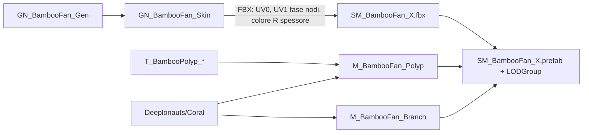

# Coral — corallo bambù procedurale
Ultima verifica: 2026-10-11

## Scopo e confini
Organismo sessile del pool M1: corallo bambù (famiglia Isididae) in tre varianti con LOD, pronto da scatterare sul fondale. Copre lo shader `Deeplonauts/Coral`, i due materiali, i tre modelli importati e i tre prefab.

Non coperto: la generazione in Blender, che sta fuori dal repository (vedi *Estensione del sistema*); lo scatter in scena (task M1 successiva, vedi [EnvironmentShading.md](EnvironmentShading.md) per Polybrush); il post-processing (vedi [Rendering.md](Rendering.md)).

Stato: **implementato**; **verificato** con un cluster temporaneo in `SCN_Gameplay` sotto `PostFX_Style_Analog` (vedi Verifica). **Pianificato**: scatter in `ENV_M1`, texture del ramo da Painter.

## File e componenti
- `Assets/_Project/Rendering/Shaders/Coral.shader`: shader `Deeplonauts/Coral` (URP, scritto a mano).
- `Assets/_Project/Materials/Environment/Organisms/BambooFan/`:
  - `SM_BambooFan_A.fbx`, `SM_BambooFan_B.fbx`, `SM_BambooFan_C.fbx`: modelli, ognuno con `MSH_BambooFan_<X>_LOD0/1/2`;
  - `M_BambooFan_Branch.mat`, `M_BambooFan_Polyp.mat`: materiali;
  - `T_BambooPolyp_Albedo.png` (RGBA, sRGB), `T_BambooPolyp_Normal.png` (Normal Map), `T_BambooPolyp_Mask.png` (lineare, R = glow): atlante 2×2 dei polipi, 1024².
- `Assets/_Project/Prefabs/Organisms/SM_BambooFan_A.prefab`, `_B.prefab`, `_C.prefab`.

## Dipendenze e flusso dati
1. Blender (`GN_BambooFan_Gen` → `GN_BambooFan_Skin`) esporta una mesh per LOD con due submesh: tubi dei rami e card a X dei polipi.
2. Canali che lo shader legge dalla mesh:
   - UV0: per i rami coordinate in metri (U = circonferenza, V = lunghezza), per i polipi coordinate nell'atlante;
   - UV1.x: fase dei nodi del bambù, che cresce di 1 a ogni nodo (un nodo ogni 1.6 diametri, mai più fitti di 18 mm);
   - colore di vertice R: spessore del ramo (1 = raggio 15 mm o più, salvato in sRGB), solo sui rami;
   - posizione in object space: Y = altezza, base della colonia a Y = 0.
3. Il `ModelImporter` crea da solo il `LODGroup` grazie ai suffissi `_LOD0/1/2`; i prefab lo tarano.

## Componenti

### Shader `Deeplonauts/Coral`
- Responsabilità: superficie lit URP con due modalità.
  - Ramo (`_CORAL_BRANCH`): albedo = `_BaseMap` × `_BaseColor` × gradiente da `_BottomColor` a `_TopColor` sull'altezza in object space, più le bande dei nodi calcolate per pixel da `frac(UV1.x)`. Le bande si attenuano sui rametti sottili in base al colore di vertice R.
  - Polipo (`_ALPHATEST_ON`): atlante con alpha clip, doppia faccia con normale ribaltata sul retro.
  - Entrambe: normal map opzionale, emissione = `_GlowColor` × `_GlowStrength` × `_MaskMap.r`, ondeggiamento con la corrente.
- Ondeggiamento: spostamento in world space lungo `_SwayDirection`, ampiezza `_SwayAmount` × (Y / `_SwayHeight`)², somma di due seni a `_SwayFrequency` e 2.3×. La fase dipende dalla posizione mondo dell'oggetto, quindi istanze diverse non si muovono all'unisono. Lo stesso spostamento è applicato in tutti i pass, così ombre e profondità restano allineate.
- Pass: `ForwardLit` (luce principale e aggiuntive, ombre, SSAO, nebbia, cookie, LOD cross-fade), `ShadowCaster`, `DepthOnly`, `DepthNormals` (questi tre con alpha clip quando attivo). Compatibile con SRP Batcher e GPU instancing.
- Proprietà:

| Proprietà | Tipo | Default | Significato |
|---|---|---|---|
| `_BaseMap` | 2D | white | Albedo (atlante per i polipi, tileabile per i rami) |
| `_BaseColor` | Color | (1,1,1,1) | Tinta e moltiplicatore dell'alpha |
| `_BumpMap` / `_BumpScale` | 2D / Float | bump / 1 | Normal map |
| `_MaskMap` | 2D | black | R = intensità del glow |
| `_Smoothness` | Range 0–1 | 0.25 | Lucidità |
| `_TexScale` | Float | 1 | Moltiplicatore di UV0 (per i rami: ripetizioni per metro) |
| `_Cull` | Enum CullMode | 2 (Back) | 0 sui polipi (doppia faccia) |
| `_AlphaClip` | Toggle `_ALPHATEST_ON` | 0 | Attiva l'alpha clip |
| `_Cutoff` | Range 0–1 | 0.5 | Soglia dell'alpha |
| `_Branch` | Toggle `_CORAL_BRANCH` | 0 | Modalità ramo |
| `_BottomColor` / `_TopColor` | Color | (0.70,0.64,0.50) / (0.92,0.90,0.84) | Gradiente in altezza |
| `_GradientHeight` | Float | 1 | Altezza (m) a cui si arriva a `_TopColor` |
| `_NodeColor` | Color | (0.16,0.09,0.08) | Colore delle bande |
| `_NodeWidth` / `_NodeSoftness` | Range | 0.05 / 0.02 | Mezza larghezza della banda e sfumatura, in fase |
| `_NodeFadeMin` / `_NodeFadeMax` | Range 0–1 | 0.25 / 0.58 | Colore R (sRGB) a cui le bande sono spente / piene: circa 0.75 e 4.5 mm di raggio |
| `_GlowColor` | HDR Color | (0.25,0.85,1) | Colore del glow |
| `_GlowStrength` | Range 0–4 | 0.15 | Intensità del glow |
| `_SwayDirection` | Vector | (1,0,0,0) | Direzione della corrente in world space; (0,0,0) spegne l'ondeggiamento |
| `_SwayAmount` | Range 0–0.3 | 0.03 | Spostamento (m) alla quota `_SwayHeight` |
| `_SwayFrequency` | Range 0–2 | 0.2 | Frequenza principale (Hz) |
| `_SwayHeight` | Float | 1 | Quota (m) di normalizzazione dell'ondeggiamento |

- Riferimenti obbligatori: nessuno. Senza UV1 le bande prendono la fase 0 (banda piena ovunque sui rami spessi); senza colore di vertice le bande restano spente.

### M_BambooFan_Branch
Shader `Deeplonauts/Coral`, `_Branch` = 1, `_Cull` = Back, `_GlowStrength` = 0, `_Smoothness` = 0.3, `_BottomColor` (0.62, 0.61, 0.57), `_TopColor` (0.84, 0.85, 0.84), instancing attivo. Nessuna texture: colore dal gradiente e dalle bande. Gradiente tarato in Play il 2026-10-11: i default dello shader (avorio 0.92) saturavano con la torcia al massimo a meno di 2 m e il dithering cancellava le bande; un avorio caldo più scuro perdeva il bianco freddo; scelto un bianco neutro-freddo a metà strada.

### M_BambooFan_Polyp
Shader `Deeplonauts/Coral`, `_AlphaClip` = 1, `_Cutoff` = 0.5, `_Cull` = Off, atlante su `_BaseMap`, `_BumpMap`, `_MaskMap`, `_BaseColor` (0.88, 0.89, 0.91), `_GlowStrength` = 0.3, `_Smoothness` = 0.25 (stesso motivo del ramo: con il bianco pieno e 0.35 di smoothness i polipi saturavano e sembravano lucine), render queue 2450 (AlphaTest), tag `RenderType` = `TransparentCutout`, **pass `ShadowCaster` disattivato** (le card dei polipi non proiettano ombra), instancing attivo.

### Modelli SM_BambooFan_A / B / C
Import: `bakeAxisConversion` attivo, normali importate, tangenti MikkTSpace, `generateSecondaryUV` **spento** (altrimenti sovrascriverebbe UV1), camere, luci, blend shape e animazione spenti, materiali rimappati sui due `.mat` qui sopra.

| Variante | Forma | Misure (L × H × P) | Triangoli LOD0 / LOD1 / LOD2 |
|---|---|---|---|
| A | ventaglio adulto | 1.14 × 0.98 × 0.31 m | 5134 / 2960 / 1306 |
| B | colonia giovane | 0.70 × 0.56 × 0.13 m | 1958 / 1114 / 444 |
| C | candelabro a dita parallele | 0.61 × 0.94 × 0.14 m | 4666 / 2714 / 816 |

La LOD2 non ha polipi (una sola submesh, il ramo).

### Prefab SM_BambooFan_A / B / C
Varianti del modello. `LODGroup`: passaggi a 0.30, 0.10 e 0.02 di altezza relativa sullo schermo, `fadeTransitionWidth` 0.15, `fadeMode` CrossFade con `animateCrossFading`. Ombre proiettate da LOD0 e LOD1 (solo i rami, vedi materiale polipi), spente su LOD2.

## Setup in Unity
1. Trascinare un prefab di `Prefabs/Organisms/` sul fondale; il pivot è alla base.
2. Scatter consigliato (task M1 successiva): cluster su roccia, creste e bordi del canyon; ventagli con la stessa rotazione (perpendicolari alla corrente) ±15°; mix indicativo 60% B, 30% A, 10% C, scala 0.8–1.2.
3. Per cambiare la corrente: `_SwayDirection` e `_SwayAmount` su entrambi i materiali, con gli stessi valori, così rami e polipi si muovono insieme.

## Configurazione verificata in prefab e scene
Prefab e materiali come descritti sopra. Nessuna istanza salvata in scena: il test del 2026-10-11 in `SCN_Gameplay` era temporaneo e la scena è stata riaperta senza salvare.

## Estensione del sistema
- **Rigenerare le mesh:** in Blender, file `C:\Users\manue\Desktop\Coral.blend`. Per ogni variante `SKL_BambooFan_<X>` contiene il generatore (`GN_BambooFan_Gen`) e le tre `MSH_BambooFan_<X>_LOD*` lo vestono (`GN_BambooFan_Skin`, polipi inclusi). L'exporter della collezione `EXP_BambooFan_<X>` scrive `Desktop\Deeplonauts\Export\BambooFan\SM_BambooFan_<X>.fbx`, da copiare sopra il file in `Organisms/BambooFan/` mantenendo il `.meta`.
- **Texture custom dei polipi:** sostituire i PNG dell'atlante mantenendo nomi e layout (4 tile da 512, polipo dritto con la base in basso al centro, alpha attorno). Le sorgenti high-poly sono nella scena `TEX_BambooPolyp` del `.blend`.
- **Texture custom dei rami:** materiale tileabile (Painter o Designer) su `_BaseMap`/`_BumpMap` di `M_BambooFan_Branch`, con `_TexScale` = ripetizioni per metro. Le bande dei nodi restano dello shader.
- **Altri organismi** (spugna di vetro): riusare lo shader. Le bande si spengono togliendo `_Branch`, il glow con `_GlowStrength` = 0.

## Limiti e problemi noti
- L'ondeggiamento sposta i vertici solo in base all'altezza: tutta la colonia si inclina insieme, i rami non si piegano in modo indipendente.
- Le bande usano la fase per vertice interpolata: su rami campionati ogni 4.5 cm (LOD0) restano nitide, ma la LOD2 (10 cm) può mostrare bande leggermente oblique.
- Il colore di vertice R è esportato in sRGB, quindi `_NodeFadeMin`/`_NodeFadeMax` sono valori sRGB.
- Nessun bake di AO: le giunture dei rami non si scuriscono.
- La LOD2 ha i rametti a segmenti dritti, da usare solo da lontano.

## Verifica
Eseguita il 2026-10-11 in Unity 6000.3.19f1:
- `Deeplonauts/Coral` compila senza messaggi; console senza errori dopo import e render;
- import: 3 LOD per modello, `LODGroup` creato dall'importer, UV1 e colori presenti, pivot a Y ≈ 0 (−0.001), assi corretti (altezza su Y);
- colore R dei vertici del ramo nell'intervallo 0.21–1, coerente con le soglie delle bande;
- render da una camera temporanea con torcia simulata (spot 6, raggio 15 m, 57°), con e senza post-processing: rametti e polipi leggibili a 3–4 m sotto `PostFX_Style_Analog`, glow dei polipi visibile fuori dal cono della torcia.

Non verificato: ondeggiamento in Play, transizioni del cross-fade in movimento, costo con decine di istanze.

## Sistemi collegati
- [EnvironmentShading.md](EnvironmentShading.md): fondale, rocce e scatter con Polybrush.
- [Rendering.md](Rendering.md): post-processing `PostFX_Style_Analog`.
- [Landmark.md](Landmark.md): altro shader scritto a mano del progetto.
