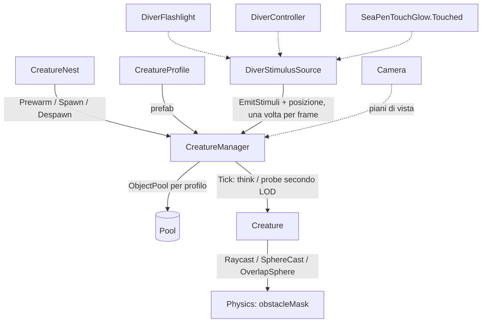

# Creatures
Ultima verifica: 2026-10-13

## Scopo e confini
Fa vivere la fauna della slice: le creature escono dai nidi, vagano attorno a casa evitando rocce e fondale e reagiscono agli stimoli del sub: la luce della torcia, il rumore dei passi e la scia luminosa del prato di penne. Il sistema è progettato per molte creature a basso costo: un solo componente per creatura, un solo ciclo di aggiornamento per tutta la scena, livelli di dettaglio dell'intelligenza (LOD) e pool senza allocazioni a regime.

Sostituisce il vecchio Entity System (`Assets/_Project/Code/EntitySystem/`, 22 script, circa 4500 righe), rimosso il 2026-10-13 nella task 1 di M2 e recuperabile dalla storia di Git. Rispetto al vecchio sistema non c'è più la catena alimentare simulata (salute, fame, stamina, danni tra pesci, `PlayerStatus`/`PlayerProfile`): la "vita propria" delle creature arriverà dallo stesso sistema di stimoli che serve per il sub (vedi *Estensione del sistema*).

Stato:
- **Implementato e verificato (2026-10-13):** profilo di specie, creatura con stati `Wander` e `Flee`, moto cinematico con evitamento ostacoli, quota sopra il fondale e soffitto per nido, manager con pool per profilo e LOD, nido base, sonda di benchmark (task 1 di M2). Stimoli del sub (task 2, che assorbe la task 3 della torcia rossa): luce del fascio in Full e Low, nessuna luce in Red, rumore dalla velocità e dall'atterraggio, scia del prato di penne; percezione con portata, sensibilità di specie, fascio, alone e linea di vista.
- **Provvisorio:** qualunque stimolo percepito fa scappare. Le reazioni per tipo e intensità (avvicinarsi alla luce debole, fuggire dal flash) arrivano con la task 4.
- **Pianificato (M2):** reazioni alla luce, catena di joint procedurale, nidi completi (spawn fuori vista, uscita a nuoto, despawn), pesci ambientali, viperfish, isopode, stimoli emessi dalle creature stesse (via `IStimulusSource` e `CreatureManager.AddSource`).

## File e componenti
Tutti in `Assets/_Project/Code/Creatures/`, namespace `Deeploration.Creatures`:
1. `CreatureProfile.cs`: ScriptableObject con i dati di una specie, prefab compreso.
2. `Creature.cs`: componente unico sul prefab della creatura; percezione, macchina a stati e moto.
3. `CreatureManager.cs`: uno per scena; pool, lista delle creature attive, LOD, ciclo di aggiornamento.
4. `CreatureNest.cs`: punto della mappa da cui escono le creature di una specie.
5. `CreatureEnums.cs`: enum `CreatureState`, `StimulusKind` e `CreatureLod`.
6. `CreatureStimulus.cs`: struct `CreatureStimulus` (uno stimolo del frame) e interfaccia `IStimulusSource`.
7. `DiverStimulusSource.cs`: sul `PlayerCapsule`, traduce torcia, passi e prato di penne in stimoli.
8. `Debug/CreatureBenchmark.cs`: sonda che misura il costo per frame in Play.

Asset:
- `Assets/_Project/Entities/Profiles/Creature_TestCube.asset`: profilo di prova (valori di default del codice).
- `Assets/_Project/Entities/Prefabs/Creature_TestCube.prefab`: cubo 0.3 × 0.2 × 0.6 sul layer `Entity`, senza collider, con `Creature`. Resta per i benchmark.
- `Assets/_Project/Entities/Profiles/Creature_Lanternfish.asset`: profilo del lanternfish (default del codice tranne `heightAboveFloor` 1.5, `heightTolerance` 0.75, `bodyRadius` 0.125).
- `Assets/_Project/Entities/Prefabs/Creature_Lanternfish_Placeholder.prefab`: `Creature` alla radice e come figlio il prefab annidato `fish_1_v1` del pacchetto *Backrock Studios / LowPoly-Animals* (428 triangoli, Animator con `Fish_1_Swim_clip` in loop). Il figlio è scalato a 0.0472, lungo 31 cm (25 cm più la licenza del 25%) e centrato sul pivot, con l'Animator in `CullCompletely` e tutto sul layer `Entity`. È provvisorio: il modello definitivo e la catena di joint lo sostituiscono.

Placeholder scelti il 2026-10-13 tra i pesci del pacchetto, per sagoma: lanternfish = Fish-1, pesce ascia = Fish-3 o Fish-5, tripode = Fish-6, viperfish = Shark; per l'isopode non c'è niente. Sono da barriera corallina e low-poly, con scale incoerenti (Fish-1 e Fish-2 lunghi circa 6.5 m, gli altri 4-16 cm). Fish-4 e Fish-6 hanno circa 10k triangoli. La testa punta a +Z. Fish-3 non ha Animator. Solo il lanternfish è montato; gli altri entrano con le task delle loro specie.

Licenza di stile (decisa da Manu il 2026-10-13): ogni pesce può essere fino al 25% più grande della sua taglia reale, per leggersi meglio nel buio. Vale per i placeholder e per i modelli definitivi.

## Dipendenze e flusso dati
- `CreatureNest` chiede al manager `Prewarm` e `Spawn` all'avvio, `Despawn` quando si disabilita.
- `CreatureManager.Update` raccoglie gli stimoli del frame chiedendoli una volta a ogni sorgente registrata (`IStimulusSource.EmitStimuli`), legge la posizione del sub (riferimento serializzato, mai cercato), calcola i piani della camera e, per ogni creatura attiva, sceglie il LOD e chiama `Creature.Tick(deltaTime, think, probe)`.
- `DiverStimulusSource` legge `DiverFlashlight` (modalità, `SpotLight`), `DiverController` (`CurrentSpeed`, `IsGrounded`) e l'evento `SeaPenTouchGlow.Touched`.
- `Creature.Tick`: se `think`, aggiorna percezione e stato; se `probe`, lancia i raggi verso il fondale e in avanti e ne conserva i risultati; poi muove sempre, usando l'ultimo stato e gli ultimi raggi.
- Dipendenze verso altri sistemi: solo `DiverStimulusSource`, che legge `Deeploration.Player` (`DiverFlashlight`, `DiverController`) e `Deeploration.Environment` (`SeaPenTouchGlow`). Nessuno di quei sistemi dipende dalle creature.

## Componenti

### CreatureProfile
- Responsabilità e ciclo di vita: dati immutabili di una specie, condivisi da tutte le istanze. Il manager indicizza i pool per profilo. Menu: *Create → Deeploration → Creature Profile*.
- Campi Inspector (tutti pubblici):

| Campo | Tipo | Default | Significato |
|---|---|---|---|
| `prefab` | `Creature` | null | Prefab istanziato dal pool, con `Creature` alla radice |
| `cruiseSpeed` | float [0.1, 10] | 1.2 | Velocità mentre vaga (m/s) |
| `fleeSpeed` | float [0.5, 20] | 4 | Velocità di fuga (m/s) |
| `acceleration` | float [0.1, 20] | 3 | Variazione di velocità (m/s²) |
| `turnRate` | float [10, 720] | 90 | Virata massima (°/s) |
| `heightAboveFloor` | float [0, 30] | 2.5 | Altezza preferita sopra il fondale (m) |
| `heightTolerance` | float [0, 10] | 1 | Scarto di quota tollerato prima di correggere (m) |
| `wanderTurn` | float [0, 360] | 45 | Virata massima del vagare (°/s) |
| `wanderFrequency` | float [0.01, 2] | 0.15 | Frequenza dei cambi di direzione (Hz) |
| `lightSensitivity` | float [0, 3] | 1 | Moltiplica la portata delle luci percepite; 0 = cieca alla luce |
| `hearingSensitivity` | float [0, 3] | 1 | Moltiplica la portata dei rumori percepiti; 0 = sorda |
| `calmDelay` | float [0, 30] | 3 | Secondi senza percepire stimoli prima di tornare a vagare |

I campi `sightRange`, `fovAngle`, `hearingRange` e `fleeDistance` della task 1 sono stati tolti il 2026-10-13 con la task 2: al buio il corpo del sub non si vede, quindi le creature percepiscono solo la sua luce e il suo rumore.
| `bodyRadius` | float [0.05, 5] | 0.3 | Raggio d'ingombro per ostacoli e spawn (m) |
| `lookAhead` | float [0.2, 5] | 1.5 | Secondi di strada controllati in avanti |

- API pubbliche: solo i campi.
- Riferimenti obbligatori: `prefab`. Senza, `CreatureManager.Spawn` registra un errore e ritorna null.

### Creature
- Responsabilità e ciclo di vita: non ha `Update`. Esce dal pool attivata dal manager, che chiama `OnSpawn` (reset di rotta, velocità a metà crociera, stato `Wander`, quota sconosciuta, seme del rumore casuale) e poi `Tick` a ogni frame. Non ha Rigidbody né collider: si muove scrivendo il transform (`SetPositionAndRotation`), quindi non spinge il sub e non viene spinta.
- Stati (`CreatureState`):
  - `Wander`: la rotta ruota attorno all'asse verticale secondo un rumore di Perlin (`wanderTurn`, `wanderFrequency`). Oltre il guinzaglio (`leashRadius` del nido) piega verso casa, tanto più quanto più è lontana.
  - `Flee`: scappa dalla sorgente dello stimolo percepito a `fleeSpeed`, anche oltre il guinzaglio. Torna a `Wander` dopo `calmDelay` secondi senza percepire stimoli.
- Percezione (in `think`): fra gli stimoli del frame (`CreatureManager.Stimuli`) sceglie il più forte, cioè quello con il rapporto distanza / portata più basso, dove la portata è `Radius` × sensibilità della specie (`lightSensitivity` per le luci, `hearingSensitivity` per i rumori). Un rumore conta se la creatura è entro la portata, attraverso gli ostacoli. Una luce conta se la creatura è entro la portata **e** dentro il fascio (`ConeCos`) o entro l'alone (`HaloRadius` × sensibilità), **e** se il raggio dalla sorgente alla creatura (lungo distanza meno `bodyRadius`) non tocca `obstacleMask`. Il raggio parte solo quando i controlli economici sono passati e lo stimolo batterebbe il migliore trovato. Reazione provvisoria: qualunque stimolo percepito porta in `Flee`.
- Raggi (in `probe`):
  - raggio verso il basso (100 m) per la quota del fondale. Se non trova niente ma dall'alto c'è una superficie, la creatura è finita sotto il terreno e viene riportata all'altezza preferita (paracadute);
  - `OverlapSphereNonAlloc` sul corpo: se è dentro un ostacolo (per esempio nell'involucro di un collider convesso) esce allontanandosi dal centro del collider e verso l'alto;
  - altrimenti `SphereCast` in avanti lungo `bodyRadius + max(1, speed × lookAhead)`: se colpisce, scivola lungo la superficie staccandosene, solo sul piano orizzontale e con peso crescente man mano che si avvicina. La quota resta decisa dalla correzione di quota: così un pendio che sale oltre il soffitto diventa una parete da aggirare, non una rampa.
- Moto (ogni frame): la rotta orizzontale viene dallo stato, la componente verticale dalla correzione di quota (limitata a ±0.5). La correzione punta a `fondale + heightAboveFloor`, ma mai sopra il soffitto ricevuto dal nido; sopra il soffitto la creatura scende sempre, anche dentro `heightTolerance`. Vicino a un ostacolo la velocità scende fino al 40% e la virata sale fino al triplo. La rotta ruota verso quella desiderata a `turnRate`, la velocità tende al bersaglio con `acceleration`, la posizione non scende mai sotto `fondale + bodyRadius`.
- Campi Inspector (solo per il modello provvisorio; tutto il resto arriva da profilo e nido):

| Campo | Tipo | Default | Significato |
|---|---|---|---|
| `swimAnimator` | `Animator` | null | Animator con la clip di nuoto del modello provvisorio. Vuoto = nessuna animazione |
| `swimAnimationSpeed` | float ≥ 0 | 1 | Velocità della clip alla velocità di crociera. Scala con `speed / cruiseSpeed`, minimo 0.3 |

  Quando arriva la catena di joint procedurale (task 5 di M2) questi campi vengono tolti.
- API pubbliche:
  - `CreatureProfile Profile { get; }`
  - `CreatureState State { get; }`
  - `CreatureLod Lod { get; }`: livello assegnato dal manager nell'ultimo frame.
  - `StimulusKind Perceived { get; }`: tipo dello stimolo percepito nell'ultimo ragionamento (`None` se nessuno).
  - `float Speed { get; }`: velocità attuale (m/s).
  - Interne (`internal`, usate dal manager): `OnSpawn(CreatureManager, CreatureProfile, Vector3 home, float leash, float ceiling)`, `Tick(float deltaTime, bool think, bool probe)`, `ActiveIndex`, `Slot`.
- Gizmo (selezionata): rotta (ciano in `Wander`, rossa in `Flee`), in `Flee` una linea verso la sorgente (gialla per la luce, arancione per il rumore), guinzaglio attorno a casa, direzione di evitamento (magenta).
- Riferimenti obbligatori: va presa dal pool con `CreatureManager.Spawn`. Una `Creature` messa a mano in scena resta ferma, perché nessuno chiama `Tick`.

### CreatureManager
- Responsabilità e ciclo di vita: uno per scena. In `Awake` crea il figlio `CreaturePool` che contiene tutte le istanze; in `Start` prende `Camera.main` se `viewCamera` è vuota; in `OnDestroy` libera i pool. In `Update` fa avanzare tutte le creature attive (dall'ultima alla prima).
- LOD (calcolato a ogni frame per ogni creatura, dalla posizione del sub o, se manca, della camera):
  - `Near`: entro `nearDistance` e dentro l'inquadratura (più `visibilityMargin`). Ragiona e lancia raggi a ogni frame.
  - `Mid`: entro `farDistance`, oppure vicina ma fuori inquadratura. Ragiona e lancia raggi un frame ogni `midInterval`.
  - `Far`: oltre `farDistance`. Ragiona un frame ogni `farInterval` e non lancia raggi.
  - I ragionamenti sono sfasati con `(Time.frameCount + Slot) % intervallo`, così il costo si distribuisce sui frame invece di concentrarsi in picchi.
- Pool: un `UnityEngine.Pool.ObjectPool<Creature>` per profilo, creato al primo uso, `collectionCheck` spento, capacità iniziale 16, massimo 1024 istanze inattive. `Despawn` toglie la creatura dalla lista attiva in O(1), scambiandola con l'ultima.
- Campi Inspector:

| Campo | Tipo | Default | Significato |
|---|---|---|---|
| `player` | `DiverStimulusSource` | null | Sorgente degli stimoli del sub, sul `PlayerCapsule`; registrata come prima sorgente in `Awake`. Senza, nessuno stimolo del sub e LOD calcolato dalla camera (warning in `Awake`) |
| `viewCamera` | `Camera` | null | Camera per la visibilità; vuota = `Camera.main` in `Start` |
| `obstacleMask` | `LayerMask` | Default, Obstacle, Seafloor (1153) | Layer che bloccano vista e moto. Non includere Player ed Entity |
| `nearDistance` | float ≥ 1 | 25 | Raggio del livello `Near` (m) |
| `farDistance` | float ≥ 1 | 60 | Oltre questa distanza, livello `Far` (m) |
| `midInterval` | int [1, 30] | 4 | Livello `Mid`: un frame ogni N |
| `farInterval` | int [1, 120] | 16 | Livello `Far`: un frame ogni N |
| `visibilityMargin` | float ≥ 0 | 1 | Margine attorno all'inquadratura (m) |

- API pubbliche:
  - `bool HasPlayer { get; }`
  - `Vector3 PlayerPosition { get; }`: posizione del sub letta all'inizio del frame.
  - `IReadOnlyList<CreatureStimulus> Stimuli { get; }`: stimoli raccolti all'inizio del frame.
  - `void AddSource(IStimulusSource source)` / `void RemoveSource(IStimulusSource source)`: registra o toglie altre sorgenti di stimoli (per le creature luminose); i duplicati sono ignorati.
  - `LayerMask ObstacleMask { get; }`
  - `int ActiveCount { get; }`
  - `int CountAtLod(CreatureLod lod)`: creature nel livello durante l'ultimo frame.
  - `void Prewarm(CreatureProfile profile, int count)`: porta a `count` le istanze inattive della specie.
  - `Creature Spawn(CreatureProfile profile, Vector3 position, Quaternion rotation, Vector3 home, float leashRadius, float ceilingY = float.PositiveInfinity)`: `ceilingY` è la quota assoluta che la creatura non supera. Ritorna null (con errore in console) se il profilo è nullo o senza prefab.
  - `void Despawn(Creature creature)`: ignora creature nulle o già nel pool.
- Gizmo (selezionato): sfere di `nearDistance` e `farDistance` attorno al sub.

### CreatureNest
- Responsabilità e ciclo di vita: in `Start` fa uscire `count` creature (dopo `Prewarm`); se viene riabilitato le rifà uscire; in `OnDisable` le rimette nel pool. Ogni punto di spawn è scelto a caso nella sfera `spawnRadius`, abbassato sotto il soffitto e scartato se è sepolto (guardando dall'alto la prima superficie sta sopra il punto meno `bodyRadius`) o se il corpo tocca un ostacolo. Dopo 8 tentativi falliti usa il centro del nido. Versione base: spawn fuori vista, uscita a nuoto e despawn per distanza arrivano con la task dei nidi.
- Campi Inspector:

| Campo | Tipo | Default | Significato |
|---|---|---|---|
| `manager` | `CreatureManager` | null | Manager della scena |
| `profile` | `CreatureProfile` | null | Specie del nido |
| `count` | int ≥ 0 | 5 | Creature fatte uscire all'avvio |
| `spawnRadius` | float ≥ 0 | 3 | Sfera di spawn attorno al nido (m) |
| `leashRadius` | float ≥ 1 | 20 | Oltre questa distanza dal nido le creature tornano indietro (m) |
| `maxHeightAboveNest` | float ≥ 0 | 4 | Soffitto: quota massima delle creature sopra il nido (m). Dove il fondale sale oltre, lo aggirano |

- API pubbliche:
  - `int SpawnedCount { get; }`
  - `void Respawn(int newCount)`: cambia il numero e rifà uscire il nido da capo (usato per i benchmark).
- Gizmo: sfera di spawn (sempre); guinzaglio e piano del soffitto (selezionato).
- Riferimenti obbligatori: `manager` e `profile`. Se mancano, errore in console e nessuno spawn.

### CreatureEnums
- `CreatureState`: `Wander`, `Flee`. Cresce con le task di M2.
- `StimulusKind`: `None`, `Light`, `Noise`.
- `CreatureLod`: `Near`, `Mid`, `Far` (vedi `CreatureManager`).

### CreatureStimulus e IStimulusSource
- `CreatureStimulus` (struct): `Kind` (`StimulusKind`), `Position`, `Radius` (portata a sensibilità 1), `Direction` e `ConeCos` (fascio; `Omnidirectional` = -2 per un punto), `HaloRadius`, `FromPlayer`. Costruttori statici: `Noise(position, radius, fromPlayer)`, `PointLight(position, radius, fromPlayer)` (alone = portata), `Beam(position, direction, radius, halfAngle°, haloRadius, fromPlayer)`.
- `IStimulusSource`: `void EmitStimuli(List<CreatureStimulus> output)`, chiamato dal manager una volta per frame; aggiunge zero o più stimoli.

### DiverStimulusSource
- Responsabilità e ciclo di vita: sul `PlayerCapsule` del prefab `Player`. In `Awake` risolve i riferimenti vuoti con `GetComponent` sullo stesso GameObject. In `Start` costruisce una griglia di celle (lato `seaPenCellSize`) sopra tutti i renderer con un materiale che ha `_CORAL_TOUCH_GLOW` attivo, allargati di `seaPenTouchRadius`: sono le zone dove un tocco accende davvero il prato. In `OnEnable`/`OnDisable` si iscrive a `SeaPenTouchGlow.Touched`. In `Update` registra l'istante in cui il diver atterra (`IsGrounded` da falso a vero). Emette in `EmitStimuli`:
  - **luce:** se la torcia è in `Full` o `Low`, un fascio dalla posizione di `SpotLight` lungo il suo asse, semi-angolo `spotAngle / 2`, portata `fullLightReach` o `lowLightReach`, alone `portata × haloFraction`. In `Red` niente;
  - **rumore:** portata `CurrentSpeed × noisePerSpeed` (0 se il `DiverController` è disabilitato, per esempio da seduto nella capsula), oppure il picco dell'atterraggio `landingNoise`, che cala a zero in `landingNoiseDuration`; vale il maggiore. Sotto 0.05 m non emette;
  - **scia del prato:** ogni tocco che cade in una cella delle penne diventa un punto luce (alzato di 0.3 m dal fondale) con portata `seaPenGlowReach`, che cala a zero in `seaPenGlowDuration`. Ne ricorda al massimo 12, come lo shader.
- Campi Inspector:

| Campo | Tipo | Default | Significato |
|---|---|---|---|
| `flashlight` | `DiverFlashlight` | null | Vuoto = `GetComponent` |
| `diver` | `DiverController` | null | Vuoto = `GetComponent` |
| `seaPenTouch` | `SeaPenTouchGlow` | null | Vuoto = `GetComponent` |
| `fullLightReach` | float ≥ 0 | 25 | Portata del fascio Full per le creature (m); più lunga della portata visiva della luce (15) |
| `lowLightReach` | float ≥ 0 | 8 | Portata del fascio Low (m) |
| `haloFraction` | float [0, 1] | 0.3 | Frazione della portata entro cui la lampada si vede da fuori del fascio |
| `noisePerSpeed` | float ≥ 0 | 2.5 | Metri di portata per ogni m/s del diver |
| `landingNoise` | float ≥ 0 | 8 | Portata del rumore all'atterraggio (m) |
| `landingNoiseDuration` | float ≥ 0.01 | 1 | Secondi in cui il rumore dell'atterraggio si spegne |
| `seaPenGlowReach` | float ≥ 0 | 6 | Portata della luce di un tocco appena acceso (m) |
| `seaPenGlowDuration` | float ≥ 0.01 | 2.5 | Durata della luce di un tocco (s), allineata a `_TouchLifetime` |
| `seaPenTouchRadius` | float ≥ 0 | 1.6 | Distanza massima tocco-penna perché il tocco accenda il prato (m), allineata a `_TouchRadius` dei materiali delle penne |
| `seaPenCellSize` | float ≥ 0.25 | 1 | Lato delle celle della griglia (m) |

- API pubbliche: `void EmitStimuli(List<CreatureStimulus> output)` (da `IStimulusSource`), `int SeaPenCellCount { get; }`.
- Gizmo (selezionato, in Play): i punti luce del prato ancora accesi.
- Riferimenti obbligatori: nessuno. Senza torcia, controller o `SeaPenTouchGlow` lo stimolo corrispondente non viene emesso. Va assegnato al campo `player` del `CreatureManager` della scena.

### CreatureBenchmark
- Responsabilità e ciclo di vita: strumento di sviluppo. `Run(label)` avvia quattro `ProfilerRecorder` (`Main Thread`, `BehaviourUpdate`, `FixedBehaviourUpdate`, `GC Allocated In Frame`). Dopo `warmup` secondi campiona per `duration` secondi, poi scrive le medie in console e in `Logs/CreatureBenchmark.log` (fuori da Assets, ignorato da Git).
- Campi Inspector: `warmup` (float, 3 s), `duration` (float, 10 s), `label` (string, "creature"), `runOnEnable` (bool, false).
- API pubbliche: `void Run(string measureLabel)`, `bool IsRunning { get; }`, `string LastResult { get; }`; voce di menu contestuale *Run*.
- Limite: in Editor il tempo scorre solo con l'Editor in primo piano o con `Application.runInBackground = true`; una misura avviata con l'Editor fermo campiona un solo frame.

## Setup in Unity
1. Creare un profilo (*Create → Deeploration → Creature Profile*) e assegnargli un prefab con `Creature` alla radice, senza collider.
2. Sul `PlayerCapsule` del prefab `Player` c'è già `DiverStimulusSource`. In scena: un GameObject con `CreatureManager`, con `player` = il `DiverStimulusSource` dell'istanza del Player.
3. Uno o più `CreatureNest` con `manager` e `profile` assegnati, appoggiati in acqua libera.
4. Le rocce devono stare su un layer incluso in `obstacleMask` (oggi sono su Default).

## Configurazione verificata in prefab e scene
In `SCN_Gameplay.unity` (2026-10-13):
- Il vecchio GameObject `EntityPooler` (con `EntityPooler` ed `EntitySpawner`) è stato rimosso.
- Al suo posto `Creatures` con `CreatureManager` (`player` = `DiverStimulusSource` del `PlayerCapsule`, altri campi ai default) e il figlio `Nest_Lanternfish` in (-5, 2.51, -14), nel corridoio del prato di penne a 11 m dalla capsula, 1.5 m sopra il fondale: profilo `Creature_Lanternfish`, `count` 12, `spawnRadius` 6, `leashRadius` 12, `maxHeightAboveNest` 3 (soffitto a Y 5.5). Il primo giorno si chiamava `Nest_TestCubes`, stava in (0, 2.5, 0) tra le rocce accanto alla capsula e usava `Creature_TestCube`: lì metà del fondale entro 15 m sta sopra Y 6.4 e i pesci salivano lungo le pareti del canyon (mediana Y 8.9 contro il sub a 0.1).

Nel prefab `Player` (2026-10-13): `DiverStimulusSource` sul `PlayerCapsule` con i default del codice; spia `PlayerCapsule/TorchPivot/EmergencyLight` assegnata a `DiverFlashlight` (vedi [Flashlight.md](file:///Z:/_PROJECTS/Unity/Project_Deep/documentation/Flashlight.md)).

## Estensione del sistema
- Nuova specie: nuovo `CreatureProfile` con il suo prefab, più un `CreatureNest` che la usa. Niente stringhe né enum da aggiornare.
- Nuovo stato: valore in `CreatureState`, caso in `Creature.Think` (transizioni) e in `Creature.Move` (rotta e velocità). Lo stato è un enum con switch, non una classe: le transizioni non allocano.
- Vita propria delle creature (deciso il 2026-10-13, task 2 e 4): stimoli unificati. Torcia del sub, prato di penne e creature bioluminescenti sono tutti fonti di luce, quindi il viperfish attratto dalla luce insegue anche i lanternfish senza codice di caccia dedicato. Predazione finta: se il predatore raggiunge la preda, la preda torna nel pool con un lampo e il predatore entra in "sazietà" (un timer, non una fame che uccide). Più routine per specie (l'isopode che fruga, il tripode ritto controcorrente). Il manager raccoglierà gli emettitori di stimoli una volta per frame; le creature li leggeranno solo nei frame di `think`.

## Limiti e problemi noti
- **Collider convesso enorme:** `SM_LargeRock_low (2)` in `SCN_Gameplay` ha un `MeshCollider` convesso con bounds di circa 52 × 42 × 32 m, molto più grande della roccia visibile. Per la fisica (creature e sub) quello spazio è roccia piena. Le creature lo aggirano ed escono se ci finiscono dentro, ma il buco nell'acqua resta. Da valutare un collider concavo o più convessi quando si sistemano i collider dell'ambiente.
- **Rocce sul layer Default:** nessun oggetto usa il layer `Obstacle`. Per questo `obstacleMask` include Default. Ogni collider su Default (anche non roccia) blocca le creature.
- Le creature `Far` non lanciano raggi: se una creatura nasce lontana, la quota del fondale resta sconosciuta finché non passa a `Mid`.
- Lo spawn scarta i punti sotto qualsiasi superficie vista dall'alto, quindi anche quelli sotto uno sbalzo di roccia. Un nido in un crepaccio coperto (previsto nella task dei nidi) ripiegherà sul proprio centro: da rivedere in quella task.
- Il recupero da dentro un ostacolo usa il centro dei bounds del collider: con collider molto grandi o concavi la direzione di uscita è approssimativa.
- Reazione provvisoria: ogni stimolo percepito fa scappare, anche la luce debole che nel design dovrebbe incuriosire (task 4).
- Il rumore non si attenua attraverso la roccia e non ha direzione: chi è entro la portata lo sente comunque.
- La luce è percepita solo se la creatura sta nel fascio o nell'alone: una creatura lontana, fuori dal fascio, non vede la lampada anche se la guarda. Va bene per il fascio stretto della torcia; per le creature luminose (punti luce) non cambia niente.
- Il picco dell'atterraggio dura 1 s: le creature `Mid` lo campionano ogni 4 frame, quindi quelle al bordo della portata a volte non lo sentono.
- La griglia del prato si costruisce una volta in `Start`: penne aggiunte o spostate in Play non vengono viste.
- Il soffitto è una quota assoluta per nido: in una mappa a canyon funziona se il nido sta nel fondo piano. Un nido sul fianco di una parete ha bisogno di un soffitto più alto.
- Lo stato `Flee` non ha ancora un costo (stamina rimossa): una creatura scappa finché percepisce il sub.

## Verifica
Verifica del 2026-10-13 in Editor, Play Mode in `SCN_Gameplay`, durante il prologo (sub nella capsula):
- Compilazione senza errori né warning dagli script del sistema; zero script mancanti in scena dopo la rimozione del vecchio sistema.
- 12 cubi vagano attorno al nido seguendo il fondale. Sui pendii e sulle rocce la quota sale con il terreno.
- Fuga: un cubo messo a 2.5 m dal sub passa a `Flee` e accelera; dopo `calmDelay` torna a `Wander`.
- Compenetrazione, con 300 cubi dopo 30 s: 0 dentro la geometria, 1 a contatto (in uscita), 1 sotto uno sbalzo (legittimo). Prima delle correzioni di spawn e recupero erano 52 sepolti su 300.

Costo misurato con `CreatureBenchmark` (Editor, Mono, 10 s dopo 3 s di riscaldamento). "Update" e "FixedUpdate" sono il tempo totale degli script di quel ciclo, quindi includono anche gli altri sistemi della scena. Il riferimento a vuoto è Update circa 0.5 ms e GC circa 19-29 KB/frame.

| Misura | Main thread | Update | FixedUpdate | GC per frame |
|---|---|---|---|---|
| Vecchio sistema, 0 creature | 19.6 ms | 0.52 ms | 0.00 ms | 28.9 KB |
| Vecchio sistema, 12 pesci | 76.8 ms | 0.48 ms | 58.0 ms | 754 KB |
| Vecchio sistema, 50 pesci | 337.4 ms | 1.55 ms | 317.7 ms | 13 346 KB |
| Vecchio sistema, 50 pesci, log spenti | 28.3 ms | 0.95 ms | 5.64 ms | 94.5 KB |
| Nuovo sistema, 12 cubi | 17.5 ms | 0.66 ms | 0.00 ms | 18.8 KB |
| Nuovo sistema, 50 cubi | 21.0 ms | 1.43 ms | 0.00 ms | 18.8 KB |
| Nuovo sistema, 100 cubi | 20.7 ms | 1.84 ms | 0.00 ms | 18.8 KB |
| Nuovo sistema, 300 cubi | 22.1 ms | 4.16 ms | 0.00 ms | 18.8 KB |
| Nuovo sistema, 300 cubi, LOD spento | 24.5 ms | 6.81 ms | 0.00 ms | 19.0 KB |
| Placeholder lanternfish animato, 50 pesci | 25.2 ms | 1.88 ms | 0.00 ms | 18.9 KB |

Le misure con 50 e 300 cubi sono quelle del codice definitivo; 100 cubi e "LOD spento" sono state prese prima delle correzioni anti-compenetrazione, che a 300 cubi aggiungono circa 0.6 ms.

Letture:
- Il collo di bottiglia del vecchio sistema erano i `Debug.Log` nei cicli di fisica: circa 6 log formattati per creatura a ogni step (circa 300 al secondo per creatura). Spegnendo i log, 50 pesci passano da 318 a 5.6 ms di FixedUpdate. La ricerca del player con la sfera da 10 km, sospettata in Roadmap, avveniva solo in `Awake` e non pesava.
- Nel nuovo sistema il costo cresce in modo lineare, circa 10-12 µs per creatura in Editor, e non alloca memoria per frame.
- Il LOD dimezza il costo a 300 creature (6.8 → 3.5 ms prima delle correzioni anti-compenetrazione), con 272 creature su 300 fuori inquadratura.
- Provato e scartato: togliere il padre comune (`CreaturePool`) alle istanze non cambia il costo, quindi la gerarchia resta ordinata.

Le misure sono prese con la Scene view puntata nel vuoto: se inquadra la scena, il suo rendering entra nel main thread (con 50 pesci animati e la Scene view sulla scena: 44.4 ms). Con il placeholder animato, durante il prologo, quasi tutti i pesci sono fuori inquadratura e il loro Animator è fermo (`CullCompletely`): il costo dell'animazione con molti pesci inquadrati non è ancora misurato.

Quota (100 lanternfish dopo 30 s, nido nel corridoio, soffitto e quote del profilo attuali): altezza sopra il fondale mediana 1.3 m (0.3-3.4), Y mediana 2.9 m (massimo 6.1, in discesa verso il soffitto), 0 sepolti e 0 a contatto. Alcuni pesci superano il guinzaglio (massimo 21.7 m dal nido contro 12): il richiamo verso casa è morbido.

Stimoli (2026-10-13, Play in `SCN_Gameplay`, sub spostato a mano nel corridoio a 10 m dal nido e rivolto verso i pesci, 12 lanternfish):
- torcia `Full`: i pesci nel fascio scappano in fondo al corridoio, oltre la portata e dietro il terreno; uno a 5 m di lato al sub scappa per l'alone. Passando a `Red`: zero stimoli, in 20 s tutti di nuovo in `Wander` e tornati al nido, alcuni a 3-4 m dal sub senza reagire;
- atterraggio simulato (istante scritto per reflection): i pesci a 3-4 m scappano;
- tocco su una penna di mare a 1.5 m dal nido: un punto luce di 6 m che si spegne in 2.5 s, i 4 pesci entro 6 m scappano. Un tocco lontano dalle penne (20, 0, 25) non produce stimoli. La griglia del prato conta 454 celle.

Costo con 300 lanternfish animati, sub nel corridoio: Update 6.8 ms con torcia `Full`, 6.3 ms con `Red` (la percezione costa circa 0.5 ms). Più dei 4.2 ms dei cubi perché con il sub nel corridoio molti più pesci sono vicini e inquadrati (livello `Near`).

Non verificato: tocco lungo su F con la tastiera vera, rumore con il diver che cammina davvero, build standalone (i tempi in build saranno più bassi che in Editor), creature con il sub fuori dalla capsula e in movimento, comportamento a livello `Far`.

## Sistemi collegati
- [PlayerMovement.md](file:///Z:/_PROJECTS/Unity/Project_Deep/documentation/PlayerMovement.md): `PlayerCapsule`, riferimento del manager; dalla task 2 sorgente del rumore.
- [Flashlight.md](file:///Z:/_PROJECTS/Unity/Project_Deep/documentation/Flashlight.md): dalla task 2 sorgente dello stimolo di luce.
- [Coral.md](file:///Z:/_PROJECTS/Unity/Project_Deep/documentation/Coral.md): `SeaPenTouchGlow`, dalla task 2 scia luminosa del prato di penne.
- [EditorTools.md](file:///Z:/_PROJECTS/Unity/Project_Deep/documentation/EditorTools.md)
