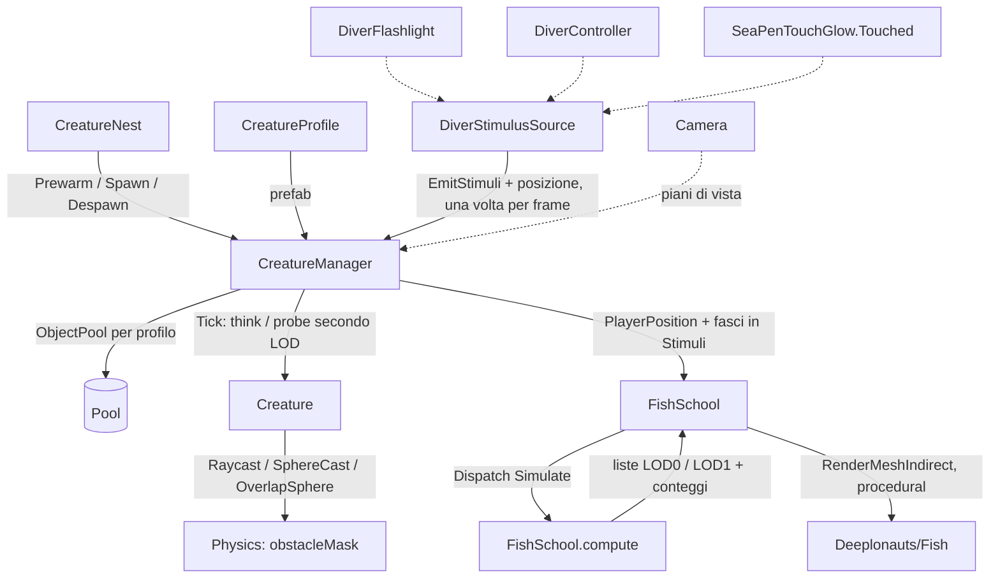

# Creatures
Ultima verifica: 2026-10-16

## Scopo e confini
Fa vivere la fauna della slice: le creature escono dai nidi, vagano attorno a casa evitando rocce e fondale e reagiscono agli stimoli del sub: la luce della torcia, il rumore dei passi e la scia luminosa del prato di penne. Il sistema è progettato per molte creature a basso costo: un solo componente per creatura, un solo ciclo di aggiornamento per tutta la scena, livelli di dettaglio dell'intelligenza (LOD) e pool senza allocazioni a regime.

Sostituisce il vecchio Entity System (`Assets/_Project/Code/EntitySystem/`, 22 script, circa 4500 righe), rimosso il 2026-10-13 nella task 1 di M2 e recuperabile dalla storia di Git. Rispetto al vecchio sistema non c'è più la catena alimentare simulata (salute, fame, stamina, danni tra pesci, `PlayerStatus`/`PlayerProfile`): la "vita propria" delle creature arriverà dallo stesso sistema di stimoli che serve per il sub (vedi *Estensione del sistema*).

Stato:
- **Implementato e verificato (2026-10-13):** profilo di specie, creatura con stati `Wander` e `Flee`, moto cinematico con evitamento ostacoli, quota sopra il fondale e soffitto per nido, manager con pool per profilo e LOD, nido base, sonda di benchmark (task 1 di M2). Stimoli del sub (task 2, che assorbe la task 3 della torcia rossa): luce del fascio in Full e Low, nessuna luce in Red, rumore dalla velocità e dall'atterraggio, scia del prato di penne; percezione con portata, sensibilità di specie, fascio, alone e linea di vista. Reazioni per specie (task 4): quattro categorie di stimolo (luce debole, luce forte, flash, rumore), ognuna con la sua reazione nel profilo (ignora, avvicinati, scappa); nuovo stato `Inspect`.
- **Implementato e verificato (2026-10-14, task 7a):** lanternfish con il modello definitivo di Manu e nuoto nello shader `Deeplonauts/Fish` (onda laterale dalla testa alla coda, piega in virata), fase e ampiezza per istanza da `Creature`.
- **Implementato e verificato (2026-10-14, task 7b):** banco e spavento. Banco: le creature della stessa specie entro `schoolRadius` si tengono a distanza (separazione), restano insieme (coesione) e nuotano nella stessa direzione (allineamento), con una griglia spaziale nel manager. Spavento: All'ingresso in fuga la creatura scatta (virata e accelerazione ×6 per `startleDuration`, corpo piegato a C), i fotofori lampeggiano e il lampo diventa uno stimolo `Flash` per le altre creature: l'allarme si propaga nel banco.
- **Implementato e verificato (2026-10-14, task 5):** catena di joint procedurale `SwimChain` (follow the leader con limite di piega e onda di nuoto), provata su una capsula a segmenti.
- **Implementato e verificato (2026-10-14, task 8, prima parte):** viperfish predatore. Nuovo stato `Stalk`: gira attorno al sub anche al buio e stringe l'orbita con l'aggressività, che sale con la luce e il rumore del sub e scende al buio; il flash della torcia lo fa scappare e gli dimezza l'aggressività. Mascella procedurale `CreatureJaw`, che si apre con l'aggressività.
- **Implementato e verificato (2026-10-15, task 8 completa):** morso e caccia. Stato `Strike`: ad aggressività piena il viperfish si lancia sul casco del sub e lo morde; `DiverBiteReceiver` sul sub applica picco di stress, perdita di ossigeno, vignetta rosso scuro e battito cardiaco (audio provvisorio generato in codice). Stato `Hunt`: caccia i lanternfish vicini quando il sub non lo ha provocato troppo, la preda presa torna nel pool con il suo lampo d'allarme e il viperfish resta sazio.
- **Implementato e verificato (2026-10-15):** espressività del viperfish. `CreatureGlow` porta i fotofori dall'arancione al rosso con l'aggressività, con la pulsazione che accelera, e li fa lampeggiare rosso acceso nello slancio; `CreatureLure` alza la pinna dorsale e piega l'esca in avanti sopra la testa con l'aggressività e del tutto in caccia e nello slancio; `CreatureEyes` muove gli occhi verso il casco del sub, la preda o la luce, con piccoli scatti.
- **Implementato e verificato (2026-10-16, task 6):** nidi completi. Il nido rimpiazza le creature che mancano (anche le prede mangiate) facendole uscire a nuoto dalla bocca quando non si vede, si riempie in blocco quando è oltre la nebbia, fa uscire una creatura in dissolvenza se resta in vista troppo a lungo (shader Fish, `_Fade`) e rimette nel pool le creature non viste quando il sub è lontano. Corretti anche il recupero da dentro la roccia (i pesci attraversavano gli sbalzi) e il colore del viperfish in caccia.
- **Implementato e verificato (2026-10-16, task 7c):** banco di lanternfish sulla GPU (`FishSchool` + `FishSchool.compute`), seconda forma del pesce ambientale accanto alla `Creature`: centinaia di pesci senza intelligenza in un volume ellissoidale, boids semplici, bolla vuota attorno al casco del sub, tunnel dove punta la torcia; disegnati con `Graphics.RenderMeshIndirect`, stessa mesh e stesso materiale del lanternfish entità (percorso di instancing procedurale dello shader `Deeplonauts/Fish`), LOD0/LOD1 in dissolvenza a retino e cull a 35 m fatti nel compute. Nessun pacchetto (niente VFX Graph né Particle System), decisione di Manu del 2026-10-16.
- **Pianificato (M2):** pesce ascia e tripode (task 7d), isopode, stimoli emessi dalle creature stesse (via `IStimulusSource` e `CreatureManager.AddSource`).

## File e componenti
Tutti in `Assets/_Project/Code/Creatures/`, namespace `Deeploration.Creatures`:
1. `CreatureProfile.cs`: ScriptableObject con i dati di una specie, prefab compreso.
2. `Creature.cs`: componente unico sul prefab della creatura; percezione, macchina a stati e moto.
3. `CreatureManager.cs`: uno per scena; pool, lista delle creature attive, LOD, ciclo di aggiornamento.
4. `CreatureNest.cs`: punto della mappa da cui escono le creature di una specie.
5. `CreatureEnums.cs`: enum `CreatureState`, `StimulusCategory`, `StimulusReaction` e `CreatureLod`.
6. `CreatureStimulus.cs`: struct `CreatureStimulus` (uno stimolo del frame) e interfaccia `IStimulusSource`.
7. `DiverStimulusSource.cs`: sul `PlayerCapsule`, traduce torcia, passi e prato di penne in stimoli.
8. `SwimChain.cs`: catena di joint procedurale per i corpi lunghi (viperfish, Pelican Eel).
9. `CreatureJaw.cs`: mascella procedurale guidata da stato e aggressività della creatura.
10. `DiverBiteReceiver.cs`: sul `PlayerCapsule`, trasforma i morsi in effetti sul sub (stress, ossigeno, vignetta, battito).
11. `CreatureGlow.cs`: colore e pulsazione dei fotofori secondo stato e aggressività.
12. `CreatureLure.cs`: esca sulla spina dorsale che si piega in avanti con l'aggressività.
13. `CreatureEyes.cs`: occhi che guardano il punto d'interesse della creatura, con saccadi.
14. `Debug/CreatureBenchmark.cs`: sonda che misura il costo per frame in Play.
15. `FishSchool.cs` (2026-10-16): banco di pesci simulato sulla GPU e disegnato con l'instancing indiretto.

Shader: `Assets/_Project/Rendering/Shaders/Fish.shader` (`Deeplonauts/Fish`), per i pesci ambientali senza ossa (vedi *Shader Deeplonauts/Fish*). Compute: `Assets/_Project/Rendering/Shaders/FishSchool.compute` (kernel `Simulate`), la simulazione del banco (vedi *FishSchool*).

Asset:
- `Assets/_Project/Entities/Profiles/Creature_TestCube.asset`: profilo di prova (valori di default del codice).
- `Assets/_Project/Entities/Prefabs/Creature_TestCube.prefab`: cubo 0.3 × 0.2 × 0.6 sul layer `Entity`, senza collider, con `Creature`. Resta per i benchmark.
- `Assets/_Project/Entities/Prefabs/Creature_ChainTest.prefab` (2026-10-14): capsula a segmenti per provare `SwimChain` finché non c'è il rig del viperfish. Radice con `Creature` e `SwimChain`; dieci ossa annidate (`Head`, `Seg_01` … `Seg_09`) a 0.1 m l'una dall'altra lungo -Z (catena lunga 0.9 m), ognuna con un figlio `Visual` (sfera, raggio da 0.13 alla testa a 0.04 in coda, materiale `M_ChainTest`, URP Lit grigio caldo). `visibilityRenderer` = la sfera della testa. Nessun collider, layer `Entity`.
- `Assets/_Project/Assets/Creatures/Viperfish/Viperfish.fbx` (2026-10-15, terza versione, texturizzata): il modello di Manu con corpo ossuto, denti ridotti, occhi nuovi e catena dell'esca. Esce dalla collection `EXP_ViperFish_unity` del file Blender, una copia unificata ricostruita da script a partire da `EXP_ViperFish_low`: armatura copiata come `ARM_Viperfish` con la posa azzerata, pezzi valutati in posizione di riposo con i modificatori ai livelli della viewport, pezzi imparentati a un osso trasformati in un gruppo di vertici al 100% su quell'osso, tutto unito nella mesh `SK_Viperfish` con un solo set di UV e un solo materiale. In Blender sono 3232 vertici e 6260 triangoli, tutti pesati; le ossa sono 18 (`Head`, `Spine_01` … `Spine_09`, `Tail`, `Jaw`, `Lure_01` … `Lure_04`, `Eye_L`, `Eye_R`). Exporter FBX della collection: *FBX Units Scale*, Forward -Z, Up Y, *Apply Transform*, armatura e mesh, solo ossa deform, niente leaf bones né animazione. In Unity: testa verso +Z, dorso verso +Y, scala 1, lungo 1.30 m senza pinne caudali, 3837 vertici dopo lo split delle UV. Il `.meta` è quello di prima, quindi il prefab ha ritrovato da solo ossa, `SwimChain` e `CreatureJaw`. Per riesportare dopo una modifica al low va ricostruita la copia (script di Claude) e poi lanciato l'exporter della collection.
- Texture (2026-10-15): `SM_ViperFish_low_UniV_Grid_2K_AlbedoTransparency.png`, `_MetallicSmoothness`, `_Normal`, `_Emission` nella cartella del viperfish, esportate da Manu con il preset di Painter per URP; copie di quelle in `C:\Users\manue\Desktop\Deeplonauts\Creatures\ViperFish\`. Import come quelle del lanternfish: normal come *Normal Map*, metallic e smoothness lineare, emissione senza alpha, 2048, compresse con mipmap.
- **File Blender del viperfish** (`Assets/_Project/Assets/Models/Blends/Creatures.blend`, riordinato il 2026-10-15 come il lanternfish). La collection `ViperFish` contiene:
  - `ViperFish_low`: modello di lavoro riggato. Armatura `ARM_Viperfish_low` (era `ARM_Viperfish.001`) con 18 ossa: `Head` alla nuca, `Spine_01` … `Spine_09` ogni 0.1 m, `Tail` alla base della coda, `Jaw` figlia di `Head` con il pivot dietro l'angolo della bocca, catena dell'esca `Lure_01` … `Lure_04`, occhi `Eye_L` ed `Eye_R`. Pezzi `MSH_Viperfish_<Parte>_low` (il prefisso di specie serve perché `MSH_Body_low` e `MSH_Eyes_low` esistono già nel lanternfish): `Body` (versione ossuta del 2026-10-15, gabbia da 180 vertici con solco della linea laterale, chiglia dorsale e ventrale, cranio a cresta, gradino dell'opercolo e creste di base su tutta la gabbia tranne la mandibola; subdivision 1 in viewport e 2 in render; pesato sulle ossa), `EyeL`, `EyeR`, `FangsUpper`, `FangsLower`, `TeethUpperFront`, `TeethUpperA`, `TeethUpperB`, `TeethLowerA`, `TeethLowerB`, `TeethLowerC` (denti a Skin modifier imparentati a `Head` o `Jaw`), `Lure` (la spina lunga della pinna dorsale), `DorsalFin`, `PectoralFins`, `PelvicFins`, `AdiposeFin`, `AnalFin`, `CaudalFin`. A livello 1 circa 7000 facce, di cui circa 4600 nei denti e 1400 nella spina.
  - Catena dell'esca (2026-10-15): `Lure_01`, figlia di `Spine_01`, va dalla base della spina alla punta della membrana della pinna dorsale (0.154 m, la parte attaccata); `Lure_02`, `Lure_03` e `Lure_04`, connesse, dividono in tre la parte libera fino alla punta (0.161 m). L'asse X locale di ogni osso è l'asse laterale del pesce: una rotazione positiva attorno a X piega la spina in avanti, verso la testa. Il 2026-10-15 Manu ha applicato lo Skin e ha fatto le UV (con un bulbo in punta). Claude ha poi rimesso la spina in `ViperFish_low` sotto l'armatura, con l'Armature in cima, e ha assegnato a `Lure_04` i 49 vertici del bulbo, che non avevano pesi. Come UV ha tenuto quelle usate da Painter (lo strato `Float2`, rinominato `UVMap`), togliendo una striscia inutilizzata. Prima la spina `MSH_Viperfish_Lure_low` era stata ricampionata in 13 vertici lungo la stessa linea (la prima subdivision è applicata), con i raggi dello Skin interpolati da 4.7 mm alla base a 0.5 mm in punta, e ha il modificatore Armature in cima allo stack, prima dello Skin: i vertici della parte attaccata sono al 100% su `Lure_01`, quelli della parte libera sfumati fra `Lure_02`, `Lure_03` e `Lure_04`. La membrana `MSH_Viperfish_DorsalFin_low` non è più figlia dell'osso `Spine_01` ma deformata dall'armatura: angolo in alto 100% `Lure_01`, metà del bordo posteriore 43%, il resto su `Spine_01`, così segue la spina quando si alza.
  - Occhi (2026-10-15): bulbi rifatti da Manu, una mezza sfera piena sul retro (raggio 23 mm) con la metà frontale scavata a coppa (fondo a 9.5 mm dal centro), Bevel e *Smooth by Angle*. `MSH_Viperfish_EyeL_low` è l'originale; `EyeR` è lo specchio in X, con la geometria specchiata e la rotazione coniugata, quindi senza scala negativa. Ognuno ha il pivot al centro del bulbo ed è figlio dell'osso del suo lato. `Eye_L` ed `Eye_R`, figlie di `Head`, hanno la testa nel centro del bulbo e l'asse Y lungo l'asse della coppa, cioè lo sguardo a riposo (verso l'esterno, un po' in avanti e in alto); l'asse Z è allineato all'alto del mondo. Yaw = rotazione attorno a Z, pitch = attorno a X. Provato a ±25° di yaw e ±20° di pitch: fino a ±20° la coppa resta nella parte visibile del bulbo, a yaw −25° e pitch +20° il bulbo comincia a schiacciarsi contro la pelle. Limiti consigliati per lo sguardo: yaw ±20°, pitch ±15°.
  - `ViperFish_high` (2026-10-15): versione per il bake delle mappe in Painter. Oggetti `MSH_Viperfish_<Parte>_high` con gli stessi nomi del low (bake con *Match: By Mesh Name*), trasformazioni applicate, posa di riposo, attributo colore `ID` per le maschere. Vedi *Versione high per il bake*.
  - Export per Painter (2026-10-15): collection `EXP_ViperFish_low` ed `EXP_ViperFish_high` dentro `ViperFish`, escluse dal view layer, con gli stessi oggetti di `ViperFish_low` e `ViperFish_high` (solo le mesh, l'armatura no) e un Collection Exporter FBX ciascuna verso `C:\Users\manue\Desktop\Deeplonauts\Creatures\ViperFish\SM_ViperFish_low.fbx` e `SM_ViperFish_high.fbx` (cartella di lavoro fuori dalla repo). Impostazioni: *FBX Units Scale*, Forward -Z, Up Y, modificatori applicati ai livelli della viewport, solo mesh, smoothing per faccia, colori sRGB, niente animazione, leaf bones o texture incorporate. Prima esportazione il 2026-10-15: low 18 mesh e 7442 facce (14 782 triangoli), high 18 mesh e 252 708 facce con l'attributo `ID` su tutte; reimportati, i due file hanno lo stesso ingombro. Un oggetto nuovo in `ViperFish_low` o `ViperFish_high` va collegato anche alla collection `EXP_` corrispondente.
  - Archivio in `DEP` (collection fuori da `ViperFish`, esclusa dal view layer): `ViperFish_Rig_v1` (prima versione del rig fatta da Claude, `SK_Viperfish_v1` / `ARM_Viperfish_v1`, bocca aperta di circa 43° a riposo), `ViperFish_Export_old` (la copia unificata da cui è uscito l'FBX attuale, rinominata `SK_Viperfish_old` / `ARM_Viperfish_old` così i nomi `SK_Viperfish` e `ARM_Viperfish` restano liberi per il prossimo export), `MSH_Viperfish_Body_smooth_old` (il corpo liscio prima della versione ossuta), `MSH_Viperfish_Lure_old` e `MSH_Viperfish_DorsalFin_old` (spina e membrana prima della catena).
- `Assets/_Project/Assets/Creatures/Viperfish/M_Viperfish.mat` (2026-10-15): URP Lit con le quattro mappe di Painter, colore base bianco, doppia faccia, *Alpha Clipping* a 0.4 (i raggi trasparenti delle pinne), coda AlphaTest. Metallic e smoothness dalla mappa, con *Smoothness* a 0.5: con 1 la torcia, che parte quasi dalla camera, rimbalza dritta indietro su tutto il fianco e il corpo diventa argento chiaro. *Environment Reflections* spente (il cubemap della scena dava un velo argento). Emissione dalla mappa per 8 (HDR) con *Global Illumination* in Realtime: con l'impostazione None URP toglie la parola chiave `_EMISSION` al salvataggio e fotofori ed esca restano spenti. Il colore dell'emissione è fisso: il passaggio dall'arancione al rosso con l'aggressività è da fare.
- **Versione high per il bake** (`ViperFish_high`, 2026-10-15), generata da script a partire dal low:
  - `MSH_Viperfish_Body_high`: la gabbia del corpo low con subdivision a livello 5, senza armatura, circa 225k facce. Dettagli scolpiti dallo script sulla superficie suddivisa:
    - miomeri: solchi a chevron sui fianchi, con la punta verso la testa sulla linea laterale, passo di circa 4 cm, larghi circa 5 mm e profondi circa 1 mm, da dietro l'opercolo alla coda;
    - placche ossee della testa: solchi di circa 2 mm, profondi circa 0.8 mm, lungo il preopercolo dietro l'occhio, l'arco suborbitale, il bordo del cranio sopra l'occhio, la mascella sopra la bocca e il dentale sulla mandibola;
    - fotofori: due file per lato sul ventre (fila bassa a 28° dalla linea ventrale, diametro 10 mm ogni 22 mm, dalla gola alla coda; fila alta a 52°, 8 mm ogni 26 mm, da dietro le pettorali alla pinna anale) e un fotoforo postorbitale per lato (13 mm). Ognuno è una lente a cupola con un anello di pigmento; 138 in tutto, nel gruppo di vertici `Photophores`.
  - `MSH_Viperfish_Lure_high`: la spina a livello di render con il bulbo dell'esca in punta (12 mm).
  - Gli altri pezzi sono il low con i modificatori a livello di render applicati: denti più densi, occhi e pinne uguali. Il contorno azzurro attorno all'occhio sul corpo high viene dal bulbo precedente (raggio 26 mm, appena più grande del nuovo) e fa da maschera dell'orbita.
  - Colori ID (attributo `ID`, colore per angolo di faccia, sRGB), da usare nel bake ID di Painter con *Color Source: Vertex Color*:

    | Regione | Colore | Dove |
    |---|---|---|
    | Pelle | (0, 0, 255) | Corpo dietro l'opercolo |
    | Cranio | (0, 255, 255) | Testa sopra e davanti alle placche, muso, contorno dell'occhio |
    | Placche | (0, 255, 0) | Guancia e opercolo: fra occhio, bordo del cranio, mascella e gradino dell'opercolo |
    | Mandibola | (255, 0, 255) | Vertici pesati su `Jaw` |
    | Branchie | (255, 0, 0) | Gola sotto le placche, dalla cerniera della mandibola all'opercolo |
    | Lente dei fotofori | (255, 255, 0) | Cupole, maschera dell'emissione |
    | Anello dei fotofori | (128, 0, 255) | Pigmento attorno alle lenti |
    | Esca | (255, 128, 0) | Bulbo in punta alla spina |
    | Spina | (128, 64, 0) | `Lure` |
    | Bulbo | (255, 255, 255) | `EyeL` / `EyeR`, oltre 70° dall'asse della coppa |
    | Iride | (255, 160, 160) | Pareti della coppa, fra 30° e 70° dall'asse |
    | Pupilla | (0, 0, 0) | Fondo della coppa, entro 30° dall'asse |
    | Denti | (128, 128, 128) | Zanne e denti |
    | Pinne | (0, 128, 0) | Tutte le pinne |

- `Assets/_Project/Entities/Prefabs/Creature_Viperfish.prefab`: radice con `Creature` e `SwimChain` (`bones` = `Head`, `Spine_01` … `Spine_09`, `Tail`; `visibilityRenderer` = `SK_Viperfish`; altri campi ai default); figlio `Viperfish` (l'FBX) spostato di (0, -0.011, -0.45) perché `Head` cada sull'origine della radice. `Jaw` nella posa dell'FBX: con la seconda versione la bocca è già chiusa a riposo, quindi l'override di -43° della prima versione è stato tolto. Dal 2026-10-14 (task 8) la radice ha anche `CreatureJaw` (`jaw` = `Jaw`, `visibilityRenderer` = `SK_Viperfish`, altri campi ai default: asse X locale dell'osso, 40° a mascella spalancata, verso positivo = la punta della mandibola scende). Dal 2026-10-15 anche `CreatureGlow` (`renderers` = `SK_Viperfish`, altri campi ai default), `CreatureLure` (`bones` = `Lure_01` … `Lure_04`, `forwardAngles` 60/45/40/30, `visibilityRenderer` = `SK_Viperfish`) e `CreatureEyes` (`eyes` = `Eye_L`, `Eye_R`, `visibilityRenderer` = `SK_Viperfish`, limiti 20° di yaw e 15° di pitch come provati in Blender). Nell'FBX di Unity l'asse Y locale di ogni osso è la sua direzione: lungo la spina per `Lure_0X`, lo sguardo a riposo per `Eye_L`/`Eye_R`. `SkinnedMeshRenderer` senza ombre, `localBounds` allargati a 1.2 × 1.6 × 0.8 m per le pieghe del corpo. Tutto sul layer `Entity`.
- `Assets/_Project/Entities/Profiles/Creature_Viperfish.asset`: profilo del viperfish (default del codice tranne `cruiseSpeed` 0.8, `fleeSpeed` 3, `heightAboveFloor` 1.8, `heightTolerance` 0.75, `bodyRadius` 0.2, `inspectDistance` 3, `diverClearance` 1.5). Reazioni (task 8): luce debole, luce forte e rumore → Approach (in `Stalk` fanno salire l'aggressività), flash → Flee. Predatore: `stalkRange` 30, `stalkRadius` 8, `strikeRadius` 2.5, `aggressionRate` 0.15, `aggressionDecay` 0.1, cioè circa 7 s di torcia piena per arrivare all'aggressività piena e 10 s di buio per tornare a zero. Morso e caccia (2026-10-15): `prey` = `Creature_Lanternfish`, il resto ai default del codice (`strikeSpeed` 5, `biteReach` 0.5, `strikeCooldown` 20, `huntRange` 5, `huntMaxAggression` 0.6, `lungeDistance` 1.5, `preyAlertRadius` 1.2, `satiation` 30). Nido in scena: `Nest_Lanternfish (1)` in `SCN_Gameplay` (vedi *Configurazione verificata*).
- `Assets/_Project/Entities/Profiles/Creature_ChainTest.asset`: profilo della capsula (default del codice tranne `cruiseSpeed` 1, `fleeSpeed` 3, `heightAboveFloor` 1.5, `heightTolerance` 0.75, `bodyRadius` 0.15, `strongLightReaction` Approach, `inspectDistance` 3). Nessun nido in scena: per provarla si fa uscire dal pool con `CreatureManager.Spawn`.
- `Assets/_Project/Entities/Profiles/Creature_Lanternfish.asset`: profilo del lanternfish (default del codice tranne `heightAboveFloor` 1.5, `heightTolerance` 0.75, `bodyRadius` 0.125, `strongLightReaction` Approach). Reazioni: luce debole e forte → si avvicina (i mictofidi vanno verso la luce, per questo si pescano con le lampade), flash e rumore → scappa. Banco e spavento (dal 2026-10-14): `schoolRadius` 2.5, `separationDistance` 0.6 (circa due lunghezze del corpo), `cohesionWeight` 0.5, `alignmentWeight` 0.5, `startleGlow` 4, `alarmRadius` 4, il resto ai default (i lanternfish veri lampeggiano con i fotofori quando si spaventano).
- `Assets/_Project/Entities/Prefabs/Creature_Lanternfish.prefab` (dal 2026-10-14): alla radice `Creature` (`swimRenderers` = `Body` e `Body_LOD1`, `swimFrequency` 2.5, `fullBendTurnRate` 120) e `LODGroup` (Cross Fade animato, `size` 0.31, LOD0 `Body` fino a 0.13 dell'altezza dello schermo, LOD1 `Body_LOD1` fino a 0.03, poi niente). Con la camera del sub (FOV 32.9°) e `lodBias` 2 il passaggio è a circa 8 m e la scomparsa a circa 35 m, dove la nebbia esponenziale (densità 0.065) ha già coperto quasi tutto. Figli `Body` (`MSH_LanternFish`) e `Body_LOD1` (`MSH_LanternFish_LOD1`), entrambi con `MeshFilter` + `MeshRenderer`, `M_LanternFish`, ombre e probe spenti; tutto sul layer `Entity`. Ha sostituito `Creature_Lanternfish_Placeholder` (Fish-1 del pacchetto Backrock con Animator), rimosso lo stesso giorno e recuperabile dalla storia di Git.
- `Assets/_Project/Assets/Creatures/LanternFish/`: modello di Manu.
  - `LanternFishlowfbx.fbx`: export da Blender, 10 oggetti separati (corpo, occhi, pinne a raggi e membrane), 2577 triangoli in tutto, lungo 14.3 cm, testa verso -X, scala 100 e rotazione 270° sugli oggetti. Non è usato direttamente dal prefab.
  - `LanternFishLOD1.fbx`: LOD di Manu (2026-10-14), stessi 10 oggetti con la stessa disposizione, 207 triangoli in tutto. Non è usato direttamente dal prefab.
  - `MSH_LanternFish_LOD1.asset`: i 10 oggetti del LOD uniti con **la stessa trasformazione** del LOD0 (calcolata dai bounds dell'FBX del LOD0, non da quelli del LOD), così i due livelli si sovrappongono esattamente e lo shader usa gli stessi `_HeadZ` e `_BodyLength`. Bounds allargati di 0.3 m su X.
  - `MSH_LanternFish.asset`: i 10 oggetti uniti in una mesh sola (un draw call per pesce), ruotata con la testa verso +Z, centrata sul pivot e scalata a 31 cm (fattore 2.16, la taglia del placeholder: 25 cm più la licenza del 25%). Bounds allargati di 0.3 m su X per l'ondulazione. Generata una volta dall'Editor con `Mesh.CombineMeshes`: **se l'FBX cambia va rigenerata** (vedi *Limiti*).
  - `M_LanternFish.mat`: shader `Deeplonauts/Fish`, GPU instancing acceso, le quattro mappe di Painter (`_UniV_Grid_2K_AlbedoTransparency`, `_Normal`, `_MetallicSmoothness`, `_Emission`), proprietà ai default dello shader. Import delle texture corretti il 2026-10-14: normal come *Normal Map*, metallic/smoothness lineare (sRGB spento), emission senza alpha.

Placeholder scelti il 2026-10-13 tra i pesci del pacchetto, per sagoma: lanternfish = Fish-1, pesce ascia = Fish-3 o Fish-5, tripode = Fish-6, viperfish = Shark; per l'isopode non c'è niente. Sono da barriera corallina e low-poly, con scale incoerenti (Fish-1 e Fish-2 lunghi circa 6.5 m, gli altri 4-16 cm). Fish-4 e Fish-6 hanno circa 10k triangoli. La testa punta a +Z. Fish-3 non ha Animator. Il lanternfish ha già il modello definitivo; gli altri entrano con le task delle loro specie.

Licenza di stile (decisa da Manu il 2026-10-13): ogni pesce può essere fino al 25% più grande della sua taglia reale, per leggersi meglio nel buio. Vale per i placeholder e per i modelli definitivi. Eccezione decisa da Manu il 2026-10-14: il viperfish è un esemplare **mutato** e resta lungo 1.34 m, circa tre volte un *Chauliodus* reale (35 cm).

## Dipendenze e flusso dati
- `CreatureNest` chiede al manager `Prewarm` e `Spawn` all'avvio e per il ricambio, `IsHidden` e `IsBeyondFog` per decidere quando far uscire o rientrare le creature, `Despawn` con il sub lontano e quando si disabilita. Per il paracadute chiama `Creature.FadeIn`.
- `CreatureManager.Update` raccoglie gli stimoli del frame chiedendoli una volta a ogni sorgente registrata (`IStimulusSource.EmitStimuli`), legge la posizione del sub (riferimento serializzato, mai cercato), calcola i piani della camera e, per ogni creatura attiva, sceglie il LOD e chiama `Creature.Tick(deltaTime, think, probe)`.
- `DiverStimulusSource` legge `DiverFlashlight` (modalità, `SpotLight`), `DiverController` (`CurrentSpeed`, `IsGrounded`) e l'evento `SeaPenTouchGlow.Touched`.
- `Creature.Tick`: se `think`, aggiorna percezione e stato; se `probe`, lancia i raggi verso il fondale e in avanti e ne conserva i risultati; poi muove sempre, usando l'ultimo stato e gli ultimi raggi.
- `FishSchool.LateUpdate` legge dal manager `HasPlayer`, `PlayerPosition` e `Stimuli` (i fasci di luce, cioè gli stimoli con `ConeCos` > 0) dopo che il manager li ha raccolti nel suo `Update`, li passa al compute insieme ai piani della camera, poi disegna le liste che la GPU ha riempito. Non tocca il pool, la griglia dei vicini né le `Creature`: le entità non vedono il banco e il banco non vede le entità.
- Dipendenze verso altri sistemi: solo `DiverStimulusSource`, che legge `Deeploration.Player` (`DiverFlashlight`, `DiverController`) e `Deeploration.Environment` (`SeaPenTouchGlow`). Nessuno di quei sistemi dipende dalle creature.

## Componenti

### CreatureProfile
- Responsabilità e ciclo di vita: dati immutabili di una specie, condivisi da tutte le istanze. Il manager indicizza i pool per profilo. Menu: *Create → Deeploration → Creature Profile*.
- Campi Inspector (tutti pubblici):

| Campo | Tipo | Default | Significato |
|---|---|---|---|
| `prefab` | `Creature` | null | Prefab istanziato dal pool, con `Creature` alla radice |
| `cruiseSpeed` | float [0.1, 10] | 1.2 | Velocità mentre vaga (m/s) |
| `fleeSpeed` | float [0.5, 20] | 4 | Velocità di fuga (m/s) |
| `acceleration` | float [0.1, 20] | 3 | Variazione di velocità (m/s²) |
| `turnRate` | float [10, 720] | 90 | Virata massima (°/s) |
| `heightAboveFloor` | float [0, 30] | 2.5 | Altezza preferita sopra il fondale (m) |
| `heightTolerance` | float [0, 10] | 1 | Scarto di quota tollerato prima di correggere (m) |
| `wanderTurn` | float [0, 360] | 45 | Virata massima del vagare (°/s) |
| `wanderFrequency` | float [0.01, 2] | 0.15 | Frequenza dei cambi di direzione (Hz) |
| `lightSensitivity` | float [0, 3] | 1 | Moltiplica la portata delle luci percepite; 0 = cieca alla luce |
| `hearingSensitivity` | float [0, 3] | 1 | Moltiplica la portata dei rumori percepiti; 0 = sorda |
| `weakLightReaction` | `StimulusReaction` | Approach | Reazione alla luce debole (torcia bassa, prato di penne, creature luminose) |
| `strongLightReaction` | `StimulusReaction` | Flee | Reazione alla luce forte e stabile (torcia piena) |
| `flashReaction` | `StimulusReaction` | Flee | Reazione al flash (l'istante in cui si accende la piena) |
| `noiseReaction` | `StimulusReaction` | Flee | Reazione al rumore |
| `inspectDistance` | float [0.5, 15] | 2.5 | Distanza preferita (m) da una luce debole in `Inspect`; ogni creatura sceglie il suo posto fra il 75% e il 130% |
| `strongLightDistanceScale` | float [1, 5] | 2.2 | Moltiplica la distanza preferita per luce forte e flash (con i default circa 5.5 m) |
| `inspectRepositionInterval` | float [0.5, 30] | 5 | Ogni quanti secondi, in media (±50%), cambia posto mentre osserva |
| `schoolRadius` | float [0, 10] | 0 | Raggio (m) entro cui vede i compagni della stessa specie. 0 = solitaria. Arriva al massimo a 3 celle della griglia del manager (3 m con `neighbourCellSize` 1) |
| `separationDistance` | float [0.05, 5] | 0.6 | Sotto questa distanza (m) da un compagno se ne allontana, in ogni stato. Non deve superare `neighbourCellSize`, altrimenti alcuni compagni troppo vicini sfuggono |
| `cohesionWeight` | float [0, 3] | 0.5 | Quanto piega verso il baricentro dei compagni mentre vaga |
| `alignmentWeight` | float [0, 3] | 0.5 | Quanto allinea la rotta a quella dei compagni mentre vaga o scappa |
| `diverClearance` | float [0, 5] | 1 | Spazio personale del sub (m) attorno al corpo, dai piedi alla testa: la creatura non ci entra. 0 = nessuno (per un predatore che deve arrivare a contatto) |
| `stalkRange` | float [0, 60] | 0 | Entro questa distanza (m) dal sub gli gira attorno (stato `Stalk`), anche al buio: lo sente senza vederlo. 0 = non è un predatore del sub |
| `stalkRadius` | float [1, 30] | 8 | Raggio dell'orbita (m) ad aggressività 0 |
| `strikeRadius` | float [0.5, 10] | 2.5 | Raggio dell'orbita (m) ad aggressività piena: la distanza da cui colpirà |
| `aggressionRate` | float [0, 2] | 0.15 | Aggressività guadagnata al secondo sotto la luce forte o il flash del sub; luce debole e rumore valgono metà |
| `aggressionDecay` | float [0, 2] | 0.1 | Aggressività persa al secondo quando non percepisce stimoli del sub |
| `strikeSpeed` | float [0.5, 20] | 5 | Velocità dello slancio (m/s): verso il sub nel morso, verso la preda nell'ultimo tratto della caccia |
| `biteReach` | float [0.1, 3] | 0.5 | Distanza (m) fra la testa e il bersaglio a cui il morso va a segno; per le prede l'80% |
| `strikeCooldown` | float [0, 120] | 20 | Secondi dopo un morso prima che possa lanciarsi di nuovo sul sub |
| `prey` | `CreatureProfile` | null | Specie che caccia; vuoto = non caccia |
| `huntRange` | float [0, 30] | 5 | Distanza (m) entro cui nota una preda e la insegue |
| `huntMaxAggression` | float [0, 1] | 0.6 | Caccia solo se l'aggressività verso il sub non supera questo valore |
| `lungeDistance` | float [0.2, 10] | 1.5 | Sotto questa distanza (m) dalla preda passa dall'inseguimento allo slancio |
| `preyAlertRadius` | float [0, 10] | 1.2 | Portata (m) del rumore con cui le prede lo sentono arrivare |
| `satiation` | float [0, 300] | 30 | Secondi di sazietà dopo una preda presa, in cui non caccia |
| `startleDuration` | float [0, 2] | 0.35 | Secondi di scatto all'inizio della fuga: virata e accelerazione ×6, piega a C fino a 1.6 |
| `startleGlow` | float [0, 10] | 0 | Lampo dei fotofori all'inizio della fuga: emissione fino a (1 + valore) volte la normale. 0 = nessun lampo |
| `startleGlowDuration` | float [0.05, 5] | 1.2 | Secondi in cui il lampo si spegne |
| `alarmRadius` | float [0, 20] | 0 | Portata (m) del lampo come stimolo `Flash` per le altre creature. 0 = il lampo non è uno stimolo |
| `calmDelay` | float [0, 30] | 3 | Secondi senza stimoli prima di calmarsi: da `Flee` a `Inspect` (se c'è ancora qualcosa che la attira) o `Wander`, da `Inspect` a `Wander` |

I campi `sightRange`, `fovAngle`, `hearingRange` e `fleeDistance` della task 1 sono stati tolti il 2026-10-13 con la task 2: al buio il corpo del sub non si vede, quindi le creature percepiscono solo la sua luce e il suo rumore.
| `bodyRadius` | float [0.05, 5] | 0.3 | Raggio d'ingombro per ostacoli e spawn (m) |
| `lookAhead` | float [0.2, 5] | 1.5 | Secondi di strada controllati in avanti |

- API pubbliche: i campi e `StimulusReaction ReactionTo(StimulusCategory category)` (Ignore per `None`).
- Riferimenti obbligatori: `prefab`. Senza, `CreatureManager.Spawn` registra un errore e ritorna null.

### Creature
- Responsabilità e ciclo di vita: non ha `Update`. Esce dal pool attivata dal manager, che chiama `OnSpawn` (reset di rotta, velocità a metà crociera, stato `Wander`, quota sconosciuta, seme del rumore casuale) e poi `Tick` a ogni frame. Non ha Rigidbody né collider: si muove scrivendo il transform (`SetPositionAndRotation`), quindi non spinge il sub e non viene spinta.
- Stati (`CreatureState`):
  - `Wander`: la rotta ruota attorno all'asse verticale secondo un rumore di Perlin (`wanderTurn`, `wanderFrequency`). Oltre il guinzaglio (`leashRadius` del nido) piega verso casa, tanto più quanto più è lontana.
  - `Flee`: scappa dalla sorgente dello stimolo che la spaventa a `fleeSpeed`, anche oltre il guinzaglio. Dopo `calmDelay` secondi senza stimoli che la spaventano passa a `Inspect` se qualcosa la attira ancora (percepito negli ultimi `calmDelay` secondi), altrimenti a `Wander`.
  - `Stalk` (solo con `stalkRange` > 0): il predatore gira attorno al sub. Ci entra, da qualsiasi stato tranne `Flee`, quando il sub è entro `stalkRange`, e torna a `Wander` oltre il 120% di quella distanza. Ha la precedenza su `Inspect`: uno stimolo che attira non lo porta a osservare, gli fa salire l'aggressività. L'orbita è un cerchio orizzontale attorno al busto del sub (1 m sopra i piedi): la rotta è la tangente più una correzione verso il raggio (`(raggio - distanza) × 0.5`, limitata a ±1.5). Il raggio va da `stalkRadius` ad aggressività 0 a `strikeRadius` ad aggressività piena e respira del ±20% con un rumore lento. Il verso si inverte ogni 8-20 s e quando la creatura sta per sbattere contro un ostacolo (`avoidWeight` > 0.5, al massimo una volta ogni 2 s): in un corridoio fa avanti e indietro sul lato libero invece di scivolare lungo la parete verso il sub. La quota oscilla di ±1 m attorno al busto, mai sotto due raggi del corpo dal fondale. La velocità scende dalla crociera al 60% con l'aggressività: più è aggressivo, più si avvicina strisciando. Ignora il guinzaglio.
  - `Strike` (morso): parte da `Stalk` quando l'aggressività è piena, `strikeCooldown` è passato e il busto del sub è entro 1.3 × `strikeRadius` in orizzontale. Punta dritto al casco (1.3 m sopra i piedi), anche in quota, a `strikeSpeed`, con virata e accelerazione ×6 come nello scatto della fuga e senza spazio personale. Quando la testa arriva entro `biteReach`, morde: il manager passa il morso al `DiverBiteReceiver` del sub, poi la creatura scappa dal sub con lo scatto della fuga, l'aggressività torna a 0 e per `strikeCooldown` secondi non può rilanciarsi. Se in 1.5 s non arriva (il sub si è spostato) torna a `Stalk` con l'aggressività a 0.7. La percezione resta attiva: il flash della torcia lo manda in fuga anche a metà slancio.
  - `Hunt` (caccia, solo con `prey`): parte da `Wander` o `Stalk` se non è sazio, l'aggressività non supera `huntMaxAggression` e una creatura della specie `prey` è entro `huntRange` (la più vicina, cercata con `CreatureManager.FindNearest`). Insegue la preda a 1.5 × la velocità di crociera e, sotto `lungeDistance`, si lancia a `strikeSpeed` come nel morso. Ogni 0.15 s emette un rumore di portata `preyAlertRadius` (con `Emitter` = sé stesso), così le prede lo sentono solo quando è vicino e scappano: qualcuna si salva. Sotto l'80% di `biteReach` la preda è presa (`CreatureManager.Eat`): torna nel pool alla fine del frame, il suo lampo d'allarme fa scappare i compagni e il predatore resta sazio per `satiation` secondi. La caccia finisce senza preda se questa torna nel pool, si allontana oltre 1.5 × `huntRange`, l'inseguimento dura più di 8 s o l'aggressività sale sopra `huntMaxAggression` (il sub che lo illumina mentre caccia lo distoglie dalla preda); allora 4 s di pausa prima di riprovare.
  - Un predatore ignora gli stimoli emessi dalle creature della specie `prey` (il loro lampo d'allarme), così non scappa da quello che sta cacciando.
  - Aggressività (`Aggression`, 0..1, solo per i predatori, a ogni frame): in `Stalk` e in `Hunt` (dal 2026-10-15 sera: prima solo in `Stalk`, e con tante prede attorno il viperfish passava molto tempo a cacciare senza mai arrabbiarsi), se uno stimolo che attira e che viene dal sub (`FromPlayer`) è stato percepito negli ultimi 0.5 s, sale di `aggressionRate` al secondo per la luce forte e il flash, di metà per la luce debole e il rumore; altrimenti scende di `aggressionDecay`. Lo spavento (`Startle`, per esempio il flash della torcia con `flashReaction` Flee) la dimezza. Torna a 0 all'uscita dal pool.
  - `Inspect`: si comporta come un pesce attirato dalla luce. Sceglie un **posto personale** relativo alla sorgente: per un fascio dentro il cono (yaw e pitch casuali fino all'80% del semi-angolo), per una luce omnidirezionale su un guscio sopra la sorgente; la distanza è quella preferita (`inspectDistance`, per luce forte e flash moltiplicata per `strongLightDistanceScale`) per un fattore casuale fra 0.75 e 1.3, perché una luce più intensa si osserva da più lontano, dove la luminosità è quella giusta. Il posto si ricalcola a ogni frame rispetto alla sorgente, quindi segue il sub; cambia ogni `inspectRepositionInterval` secondi (±50%). La creatura ci nuota rallentando (velocità `cruiseSpeed × clamp(distanza dal posto / 1.5, 0.2, 1)`); entro 1 m dal posto la rotta passa gradualmente a puntare il muso verso la luce, così scivola verso la sorgente, si allontana dal posto e ci torna: un andirivieni invece di un'orbita. La quota segue il posto (sempre sotto il soffitto e almeno `2 × bodyRadius` sopra il fondale). Torna a `Wander` dopo `calmDelay` secondi senza stimoli che la attirano. Non rispetta il guinzaglio finché osserva. Fino al 2026-10-13 sera girava in cerchio alla stessa distanza e alla quota della lampada: tutti i pesci finivano sullo stesso anello, anche dietro il sub, e si compenetravano.
- Banco (in `think`, se `schoolRadius` > 0): `CreatureManager.Flock` restituisce i compagni della stessa specie entro `schoolRadius`, con la spinta di separazione (somma su tutti quelli più vicini di `separationDistance` di `direzione opposta × (1 - distanza / separationDistance)`), il baricentro e la rotta media dei primi 8. Ne escono tre spinte: separazione, coesione (verso il baricentro, lunga al massimo 1) e allineamento (rotta media normalizzata). In `Move` si sommano alla rotta dello stato:
  - `Wander`: separazione × 2 + coesione × `cohesionWeight` + allineamento × `alignmentWeight`; la coesione sposta anche la quota preferita (`cohesion.y × schoolRadius × cohesionWeight × 0.5`);
  - `Inspect`: solo separazione × 2, così ognuno resta al suo posto ma si scosta da chi gli finisce addosso;
  - `Flee`: separazione × 2 + allineamento, il banco scappa compatto.
  Oltre alla rotta, la separazione sposta direttamente la posizione di `spinta × 0.6 m/s`, anche in quota: con virate da 90°/s la sola rotta non stacca due pesci paralleli. Fra un ragionamento e l'altro le spinte restano quelle dell'ultimo.
- Spazio personale del sub (in `Move`, a ogni frame, in ogni stato): il corpo del sub è un segmento verticale dalla posizione del `PlayerCapsule` (i piedi) a 1.5 m sopra. Se la creatura è più vicina di `diverClearance` al punto più vicino del segmento, riceve una spinta lontano dal corpo, da 0 al bordo a 1 sul corpo: si somma alla rotta × 4, alza o abbassa la quota preferita di `spinta.y × diverClearance` e sposta direttamente la posizione di `spinta × 1.5 m/s`. Aggiunto il 2026-10-14: prima i pesci attirati dalla torcia scivolavano fino alla lampada sul casco e attraversavano la camera, sparendo sul piano vicino (il "pop" visto da Manu).
- Spavento: quando `Think` porta la creatura in `Flee` da un altro stato chiama `Startle`, che segna l'istante dello scatto e, se la specie ha `startleGlow` e `alarmRadius` maggiori di 0, aggiunge al manager con `AddPulse` un punto luce `Flash` di portata `alarmRadius` nella posizione della creatura, per 0.4 s, con `Emitter` = la creatura stessa. Per `startleDuration` secondi `Move` moltiplica virata e accelerazione per 6: la rotta gira di colpo lontano dalla minaccia e la piega del corpo (che segue la virata) arriva alla C. Ogni pesce lampeggia una volta sola quando entra in fuga, quindi l'allarme si propaga di vicino in vicino e si spegne da solo.
- Percezione (in `think`): fra gli stimoli del frame (`CreatureManager.Stimuli`) sceglie il più forte, cioè quello con il rapporto distanza / portata più basso, dove la portata è `Radius` × sensibilità della specie (`lightSensitivity` per le luci, `hearingSensitivity` per i rumori). Un rumore conta se la creatura è entro la portata, attraverso gli ostacoli. Una luce conta se la creatura è entro la portata **e** dentro il fascio (`ConeCos`) o entro l'alone (`HaloRadius` × sensibilità), **e** se il raggio dalla sorgente alla creatura (lungo distanza meno `bodyRadius`) non tocca `obstacleMask`. Il raggio parte solo quando i controlli economici sono passati e lo stimolo batterebbe il migliore trovato. Gli stimoli emessi dalla creatura stessa (`Emitter`) sono ignorati. Per ogni stimolo la reazione è `profile.ReactionTo(categoria)`: gli stimoli ignorati non vengono nemmeno valutati, uno che spaventa vince sempre su uno che attira, a parità di reazione vince il più forte. La paura vince anche nel tempo: chi è in `Flee` non passa a `Inspect` finché non si è calmato.
- Raggi (in `probe`):
  - raggio verso il basso (100 m) per la quota del fondale. Se non trova niente ma dall'alto c'è una superficie, la creatura è finita sotto il terreno e viene riportata all'altezza preferita (paracadute);
  - `OverlapSphereNonAlloc` sul corpo: se tocca un ostacolo torna all'ultima posizione libera (salvata a ogni raggio senza contatti) e punta da lì, cioè esce dalla parte da cui è entrata. Solo se non ha ancora una posizione libera (appena uscita dal pool dentro un ostacolo) esce allontanandosi dal centro del collider e verso l'alto. Fino al 2026-10-16 usava sempre l'uscita verso l'alto: un pesce entrato da sotto uno sbalzo saliva attraverso tutta la roccia, sparendo e riapparendo sopra (misurato: 54 attraversamenti in 50 s con 100 lanternfish, 0 dopo la correzione);
  - altrimenti `SphereCast` in avanti lungo `bodyRadius + max(1, speed × lookAhead)`: se colpisce, scivola lungo la superficie staccandosene, solo sul piano orizzontale e con peso crescente man mano che si avvicina. La quota resta decisa dalla correzione di quota: così un pendio che sale oltre il soffitto diventa una parete da aggirare, non una rampa.
- Moto (ogni frame): la rotta orizzontale viene dallo stato, la componente verticale dalla correzione di quota (limitata a ±0.5). La correzione punta a `fondale + heightAboveFloor`, ma mai sopra il soffitto ricevuto dal nido; sopra il soffitto la creatura scende sempre, anche dentro `heightTolerance`. Vicino a un ostacolo la velocità scende fino al 40% e la virata sale fino al triplo. La rotta ruota verso quella desiderata a `turnRate`, la velocità tende al bersaglio con `acceleration`, la posizione non scende mai sotto `fondale + bodyRadius`.
- Campi Inspector (solo per il modello provvisorio; tutto il resto arriva da profilo e nido):

| Campo | Tipo | Default | Significato |
|---|---|---|---|
| `swimAnimator` | `Animator` | null | Animator con la clip di nuoto del modello provvisorio. Vuoto = nessuna animazione |
| `swimAnimationSpeed` | float ≥ 0 | 1 | Velocità della clip alla velocità di crociera. Scala con `speed / cruiseSpeed`, minimo 0.3 |
| `swimRenderers` | `Renderer[]` | vuoto | Renderer con lo shader `Deeplonauts/Fish`, uno per livello di LOD. Vuoto = nessun nuoto nello shader. Era `swimRenderer` (un solo renderer) fino all'arrivo del LOD |
| `swimFrequency` | float ≥ 0 | 2.5 | Colpi di coda al secondo alla velocità di crociera (Hz) |
| `fullBendTurnRate` | float ≥ 1 | 120 | Velocità di virata (°/s) a cui il corpo è piegato del tutto |

  `swimAnimator` e `swimAnimationSpeed` servono ai placeholder animati e vanno tolti con la catena di joint (task 5 di M2). `swimRenderers` resta per i pesci senza ossa (lanternfish, pesce ascia).
- Nuoto nello shader (a ogni frame, se `swimRenderers` non è vuoto): la fase avanza di `swimFrequency × clamp(speed / cruiseSpeed, 0.35, 3) × 2π × dt` e parte da un valore casuale a ogni spawn, così i pesci non battono la coda all'unisono. La piega segue la velocità di virata orizzontale (`yawRate / fullBendTurnRate`, limitata a ±1, inseguita a 4 unità al secondo): il corpo fa una C con la coda verso l'interno della curva. L'ampiezza è `clamp(0.6 + 0.4 × speed / cruiseSpeed, 0.5, 1.4)`. Durante lo scatto la piega può arrivare a ±1.6 e cambia a 20 unità al secondo invece di 4. Il lampo (`_GlowBoost`) vale `startleGlow × fade² × tremolio`: sale in 0.05 s, cala con `fade = 1 - t / startleGlowDuration`, tremola a circa 6 Hz. I valori vanno al renderer con un `MaterialPropertyBlock` condiviso (`_SwimPhase`, `_SwimAmount`, `_SwimBend`, `_GlowBoost`, `_Fade`) a tutti i renderer della lista, solo se almeno uno è visibile oppure è in corso la dissolvenza d'entrata (appena uscita dal pool `isVisible` è ancora falso e il primo frame userebbe il blocco della vita precedente); la fase avanza comunque. `_Fade` va da 0 a 1 in `fadeDuration` secondi dopo `FadeIn`, altrimenti vale 1. Così i due livelli di LOD restano nella stessa posa anche durante il cross-fade.
- API pubbliche:
  - `CreatureProfile Profile { get; }`
  - `CreatureState State { get; }`
  - `CreatureLod Lod { get; }`: livello assegnato dal manager nell'ultimo frame.
  - `Vector3 Heading { get; }`: rotta attuale, normalizzata.
  - `int NeighbourCount { get; }`: compagni visti nell'ultimo ragionamento (0 per le specie solitarie).
  - `StimulusCategory Perceived { get; }`: categoria dello stimolo che ha deciso la reazione nell'ultimo ragionamento (`None` se nessuno).
  - `float Speed { get; }`: velocità attuale (m/s).
  - `float Aggression { get; }`: aggressività verso il sub, da 0 a 1; sempre 0 per chi non è un predatore.
  - `float LastBiteTime { get; }`: istante dell'ultimo morso (al sub o a una preda); -infinito se non ha mai morso.
  - `Creature Prey { get; }`: preda inseguita in `Hunt`, null negli altri stati.
  - `bool TryGetFocus(out Vector3 point)`: punto che la creatura sta guardando, per gli occhi: il casco del sub (1.3 m sopra i piedi) in `Stalk` e `Strike`, la preda in `Hunt`, la sorgente in `Inspect`; false negli altri stati.
  - `bool CanFadeIn { get; }`: true se `swimRenderers` non è vuoto (shader Deeplonauts/Fish, che legge `_Fade`). Il nido lo legge sul prefab per decidere il paracadute.
  - `void FadeIn(float duration)`: fa comparire la creatura con una dissolvenza a retino lunga `duration` secondi (dal 2026-10-16). Senza `CanFadeIn` non ha effetto visibile. Si azzera a ogni spawn.
  - Interne (`internal`, usate dal manager): `OnSpawn(CreatureManager, CreatureProfile, Vector3 home, float leash, float ceiling)`, `Tick(float deltaTime, bool think, bool probe)`, `ActiveIndex`, `Slot`.
- Gizmo (selezionata): rotta (ciano in `Wander`, rossa in `Flee`, verde in `Inspect`, rosa in `Stalk`, rosso acceso in `Strike` con una linea verso il casco, arancione in `Hunt` con una linea verso la preda), in `Stalk` il cerchio dell'orbita attuale attorno al busto del sub (dal rosa al rosso con l'aggressività), in `Flee` una linea verso la sorgente (gialla per la luce, arancione per il rumore), in `Inspect` una linea verde verso il posto personale, una sfera sul posto e una linea tenue dal posto alla sorgente, guinzaglio attorno a casa, direzione di evitamento (magenta).
- Riferimenti obbligatori: va presa dal pool con `CreatureManager.Spawn`. Una `Creature` messa a mano in scena resta ferma, perché nessuno chiama `Tick`.

### CreatureManager
- Responsabilità e ciclo di vita: uno per scena. In `Awake` crea il figlio `CreaturePool` che contiene tutte le istanze; in `Start` prende `Camera.main` se `viewCamera` è vuota; in `OnDestroy` libera i pool. In `Update` fa avanzare tutte le creature attive (dall'ultima alla prima).
- LOD (calcolato a ogni frame per ogni creatura, dalla posizione del sub o, se manca, della camera):
  - `Near`: entro `nearDistance` e dentro l'inquadratura (più `visibilityMargin`). Ragiona e lancia raggi a ogni frame.
  - `Mid`: entro `farDistance`, oppure vicina ma fuori inquadratura. Ragiona e lancia raggi un frame ogni `midInterval`.
  - `Far`: oltre `farDistance`. Ragiona un frame ogni `farInterval` e non lancia raggi.
  - I ragionamenti sono sfasati con `(Time.frameCount + Slot) % intervallo`, così il costo si distribuisce sui frame invece di concentrarsi in picchi.
- Griglia dei vicini: all'inizio di `Update`, prima di far avanzare le creature, il manager mette ogni creatura attiva in una tabella hash di celle di lato `neighbourCellSize` (testa per secchio e successivo per creatura in array, posizioni di inizio frame). Costo O(n), nessuna allocazione finché il numero di creature non cresce oltre la capacità (poi gli array raddoppiano). `Flock` cerca ad anelli di celle dal centro verso l'esterno: il primo anello è il cubo di 27 celle attorno alla creatura e contiene tutti i compagni più vicini di `separationDistance` (che la separazione conta tutti); gli anelli successivi, fino a `ceil(schoolRadius / neighbourCellSize)` e al massimo 3, servono solo se baricentro e rotte non hanno ancora 8 compagni. In un banco fitto la ricerca si ferma quindi al primo anello. Le voci di altre celle finite nello stesso secchio vengono scartate.
- Pool: un `UnityEngine.Pool.ObjectPool<Creature>` per profilo, creato al primo uso, `collectionCheck` spento, capacità iniziale 16, massimo 1024 istanze inattive. `Despawn` toglie la creatura dalla lista attiva in O(1), scambiandola con l'ultima.
- Campi Inspector:

| Campo | Tipo | Default | Significato |
|---|---|---|---|
| `player` | `DiverStimulusSource` | null | Sorgente degli stimoli del sub, sul `PlayerCapsule`; registrata come prima sorgente in `Awake`. Senza, nessuno stimolo del sub e LOD calcolato dalla camera (warning in `Awake`) |
| `viewCamera` | `Camera` | null | Camera per la visibilità; vuota = `Camera.main` in `Start` |
| `obstacleMask` | `LayerMask` | Default, Obstacle, Seafloor (1153) | Layer che bloccano vista e moto. Non includere Player ed Entity |
| `nearDistance` | float ≥ 1 | 25 | Raggio del livello `Near` (m) |
| `farDistance` | float ≥ 1 | 60 | Oltre questa distanza, livello `Far` (m) |
| `midInterval` | int [1, 30] | 4 | Livello `Mid`: un frame ogni N |
| `farInterval` | int [1, 120] | 16 | Livello `Far`: un frame ogni N |
| `visibilityMargin` | float ≥ 0 | 1 | Margine attorno all'inquadratura (m) |
| `hiddenDistance` | float ≥ 1 | 35 | Oltre questa distanza dalla camera un punto conta come nascosto dalla nebbia, per spawn e despawn dei nidi (m). 35 = distanza a cui il LOD dei lanternfish li fa sparire (dal 2026-10-16) |
| `neighbourCellSize` | float ≥ 0.25 | 1 | Lato delle celle della griglia dei vicini (m). Almeno quanto la `separationDistance` delle specie; il `schoolRadius` arriva al massimo a 3 celle. Era 3 fino al 2026-10-14 (vedi *Verifica*) |

- API pubbliche:
  - `bool HasPlayer { get; }`
  - `Vector3 PlayerPosition { get; }`: posizione del sub letta all'inizio del frame.
  - `IReadOnlyList<CreatureStimulus> Stimuli { get; }`: stimoli raccolti all'inizio del frame.
  - `void AddSource(IStimulusSource source)` / `void RemoveSource(IStimulusSource source)`: registra o toglie altre sorgenti di stimoli (per le creature luminose); i duplicati sono ignorati.
  - Interna: `int Flock(Creature self, Vector3 position, float radius, float separationDistance, int maxNeighbours, out Vector3 separation, out Vector3 centre, out Vector3 alignment)`: vicini della stessa specie (vedi *Creature*, Banco, e la griglia sopra); ritorna quanti ne ha usati per baricentro e rotte.
  - Interne per i predatori: `ReportBite(Creature biter)` passa il morso al `DiverBiteReceiver` trovato in `Awake` sullo stesso GameObject del `player` (senza, il morso non ha effetti); `Eat(Creature prey)` aggiunge il lampo d'allarme della preda (se la specie ha `alarmRadius`) e la rimette nel pool alla fine di `Update`, così la lista delle attive non cambia mentre il manager la scorre; `FindNearest(CreatureProfile species, Vector3 position, float radius)` scorre le creature attive (costo lineare, va bene per pochi predatori).
  - `void AddPulse(CreatureStimulus stimulus, float duration)`: stimolo breve senza sorgente registrata (il lampo di un pesce spaventato), attivo per `duration` secondi a partire dal frame dopo. Gli impulsi scaduti escono dalla lista con uno scambio dall'ultimo posto, senza allocazioni a regime.
  - `LayerMask ObstacleMask { get; }`
  - `bool IsHidden(Vector3 point, float radius)`: true se la sfera non si vede dalla camera: oltre `hiddenDistance`, fuori dall'inquadratura (con `visibilityMargin`) o coperta da un ostacolo di `obstacleMask` sulla linea di vista (un raggio). Senza camera true. Calcola i piani della camera a ogni chiamata, senza allocazioni.
  - `bool IsBeyondFog(Vector3 point, float radius)`: true se tutta la sfera sta oltre `hiddenDistance` dalla camera. Senza camera true.
  - `int ActiveCount { get; }`
  - `int CountAtLod(CreatureLod lod)`: creature nel livello durante l'ultimo frame.
  - `void Prewarm(CreatureProfile profile, int count)`: porta a `count` le istanze inattive della specie.
  - `Creature Spawn(CreatureProfile profile, Vector3 position, Quaternion rotation, Vector3 home, float leashRadius, float ceilingY = float.PositiveInfinity)`: `ceilingY` è la quota assoluta che la creatura non supera. Ritorna null (con errore in console) se il profilo è nullo o senza prefab.
  - `void Despawn(Creature creature)`: ignora creature nulle o già nel pool.
- Gizmo (selezionato): sfere di `nearDistance` e `farDistance` attorno al sub.

### CreatureNest
- Responsabilità e ciclo di vita (nido completo dal 2026-10-16, task 6 di M2): una specie per nido, fino a `count` creature fuori dal pool.
  - **Riempimento iniziale:** con `fillOnStart`, in `Start` fa uscire subito le creature che mancano (dopo `Prewarm`), in punti a caso nella sfera `spawnRadius`, abbassati sotto il soffitto e scartati se sepolti (guardando dall'alto la prima superficie sta sopra il punto meno `bodyRadius`) o se il corpo tocca un ostacolo; dopo 8 tentativi falliti usa il centro del nido. Se il nido viene riabilitato si riempie di nuovo; in `OnDisable` rimette tutto nel pool.
  - **Elenco delle sue creature:** il nido tiene ogni creatura con lo `Slot` ricevuto allo spawn (unico per spawn). Una creatura tornata nel pool (mangiata, rimessa da altri) ha `ActiveIndex` -1 o, se ripresa da un altro nido, uno `Slot` diverso: il nido la toglie dall'elenco e il posto si libera.
  - **Ricambio** (in `Update`, un controllo ogni 0.25 s): con il sub entro `activeDistance` e posti liberi, se il nido è nascosto (`CreatureManager.IsHidden` sul centro del nido) fa uscire una creatura dalla bocca: nel centro del nido (o in un punto libero della sfera se il centro tocca un ostacolo), orientata lungo l'asse Z del nido con una deviazione casuale fino a `exitSpread` gradi in beccheggio e imbardata, in `Wander` a metà della velocità di crociera. Poi aspetta `respawnInterval` (±50%). Se il nido è anche oltre la nebbia per tutta la zona (`IsBeyondFog` con raggio `spawnRadius + leashRadius`) lo riempie subito come all'avvio: chi torna da lontano non trova il nido vuoto.
  - **Paracadute:** se il nido è in vista da `fadeInAfter` secondi dall'ultima uscita (o da quando si è liberato un posto) fa uscire comunque una creatura con `Creature.FadeIn(fadeDuration)`. Solo per le specie con `CanFadeIn` (shader Fish); le altre aspettano che il nido sia nascosto.
  - **Despawn inverso:** con il sub oltre il 120% di `activeDistance` rimette nel pool, a ogni controllo, le creature del nido che `IsHidden` dà per nascoste. Fra `activeDistance` e il 120% il nido non fa niente, così non svuota e riempie di continuo sul bordo.
- Campi Inspector:

| Campo | Tipo | Default | Significato |
|---|---|---|---|
| `manager` | `CreatureManager` | null | Manager della scena |
| `profile` | `CreatureProfile` | null | Specie del nido |
| `count` | int ≥ 0 | 5 | Massimo di creature del nido fuori dal pool |
| `fillOnStart` | bool | true | All'avvio si riempie subito; spento, parte vuoto e le creature escono una alla volta |
| `spawnRadius` | float ≥ 0 | 3 | Sfera dei riempimenti in blocco attorno al nido (m) |
| `leashRadius` | float ≥ 1 | 20 | Oltre questa distanza dal nido le creature tornano indietro (m) |
| `maxHeightAboveNest` | float ≥ 0 | 4 | Soffitto: quota massima delle creature sopra il nido (m). Dove il fondale sale oltre, lo aggirano |
| `respawnInterval` | float ≥ 0.1 | 3 | Secondi medi fra due uscite dalla bocca (±50%) |
| `exitSpread` | float [0, 90] | 30 | Semi-angolo del cono di uscita attorno all'asse Z del nido (°) |
| `activeDistance` | float ≥ 1 | 60 | Il nido rimpiazza solo con il sub entro questa distanza; oltre il 120% le creature non viste tornano nel pool (m) |
| `fadeInAfter` | float ≥ 0 | 6 | Secondi in vista dopo cui una creatura esce comunque in dissolvenza; 0 = mai |
| `fadeDuration` | float ≥ 0.05 | 1.5 | Durata della dissolvenza d'entrata (s) |

- API pubbliche:
  - `int SpawnedCount { get; }`: creature del nido fuori dal pool (ripulisce prima l'elenco).
  - `void Respawn(int newCount)`: cambia il numero e rifà uscire il nido da capo, riempito subito (usato per i benchmark).
- Gizmo: sfera di spawn e linea della bocca lungo l'asse Z (sempre); guinzaglio e piano del soffitto (selezionato).
- Riferimenti obbligatori: `manager` e `profile`. Se mancano, errore in console e nessuno spawn. Senza camera nel manager tutto conta come nascosto: il ricambio avviene sempre in blocco.

### CreatureEnums
- `CreatureState`: `Wander`, `Flee`, `Inspect`, `Stalk` (dal 2026-10-14), `Strike` e `Hunt` (dal 2026-10-15). Cresce con le task di M2.
- `StimulusCategory`: `None`, `WeakLight`, `StrongLight`, `Flash`, `Noise`. Le tre luci richiedono la linea di vista, il rumore no. Ha sostituito `StimulusKind` (luce o rumore) con la task 4.
- `StimulusReaction`: `Ignore`, `Approach` (stato `Inspect`), `Flee` (stato `Flee`, vince su `Approach`).
- `CreatureLod`: `Near`, `Mid`, `Far` (vedi `CreatureManager`).

### CreatureStimulus e IStimulusSource
- `CreatureStimulus` (struct): `Category` (`StimulusCategory`), `Position`, `Radius` (portata a sensibilità 1), `Direction` e `ConeCos` (fascio; `Omnidirectional` = -2 per un punto), `HaloRadius`, `FromPlayer`, `Emitter` (`Creature` che l'ha emesso, null per sub e ambiente: la creatura non percepisce i propri stimoli); proprietà `bool IsLight` (tutto tranne `Noise`). Costruttori statici: `Noise(position, radius, fromPlayer)`, `PointLight(position, radius, category, fromPlayer)` (alone = portata), `Beam(position, direction, radius, halfAngle°, haloRadius, category, fromPlayer)`.
- `IStimulusSource`: `void EmitStimuli(List<CreatureStimulus> output)`, chiamato dal manager una volta per frame; aggiunge zero o più stimoli.

### DiverStimulusSource
- Responsabilità e ciclo di vita: sul `PlayerCapsule` del prefab `Player`. In `Awake` risolve i riferimenti vuoti con `GetComponent` sullo stesso GameObject. In `Start` costruisce una griglia di celle (lato `seaPenCellSize`) sopra tutti i renderer con un materiale che ha `_CORAL_TOUCH_GLOW` attivo, allargati di `seaPenTouchRadius`: sono le zone dove un tocco accende davvero il prato. In `OnEnable`/`OnDisable` si iscrive a `SeaPenTouchGlow.Touched` e a `DiverFlashlight.OnModeChanged` (per il flash). In `Update` registra l'istante in cui il diver atterra (`IsGrounded` da falso a vero). Emette in `EmitStimuli`:
  - **luce:** se la torcia è in `Full` (`StrongLight`) o `Low` (`WeakLight`), un fascio dalla posizione di `SpotLight` lungo il suo asse, semi-angolo `spotAngle / 2`, portata `fullLightReach` o `lowLightReach`, alone `portata × haloFraction`. In `Red` niente;
  - **flash:** per `flashDuration` secondi dopo ogni passaggio a `Full` da un'altra modalità, un secondo fascio `Flash` con portata `fullLightReach` e alone più largo (`fullLightReach × flashHaloFraction`);
  - **rumore:** portata `CurrentSpeed × noisePerSpeed` (0 se il `DiverController` è disabilitato, per esempio da seduto nella capsula), oppure il picco dell'atterraggio `landingNoise`, che cala a zero in `landingNoiseDuration`; vale il maggiore. Sotto 0.05 m non emette;
  - **scia del prato:** ogni tocco che cade in una cella delle penne diventa un punto luce `WeakLight` (alzato di 0.3 m dal fondale) con portata `seaPenGlowReach`, che cala a zero in `seaPenGlowDuration`. Ne ricorda al massimo 12, come lo shader.
- Campi Inspector:

| Campo | Tipo | Default | Significato |
|---|---|---|---|
| `flashlight` | `DiverFlashlight` | null | Vuoto = `GetComponent` |
| `diver` | `DiverController` | null | Vuoto = `GetComponent` |
| `seaPenTouch` | `SeaPenTouchGlow` | null | Vuoto = `GetComponent` |
| `fullLightReach` | float ≥ 0 | 25 | Portata del fascio Full per le creature (m); più lunga della portata visiva della luce (15) |
| `lowLightReach` | float ≥ 0 | 8 | Portata del fascio Low (m) |
| `haloFraction` | float [0, 1] | 0.4 | Frazione della portata entro cui la lampada si vede da fuori del fascio (Low 3.2 m, Full 10 m). Era 0.3: con la bassa l'alone (2.4 m) era più stretto della distanza a cui le creature orbitano in `Inspect` (2.5), che uscivano dalla luce a ogni giro |
| `flashDuration` | float ≥ 0.05 | 0.4 | Secondi per cui il passaggio a `Full` conta come flash |
| `flashHaloFraction` | float [0, 1] | 0.6 | Frazione di `fullLightReach` entro cui il flash si vede da fuori del fascio |
| `noisePerSpeed` | float ≥ 0 | 2.5 | Metri di portata per ogni m/s del diver |
| `landingNoise` | float ≥ 0 | 8 | Portata del rumore all'atterraggio (m) |
| `landingNoiseDuration` | float ≥ 0.01 | 1 | Secondi in cui il rumore dell'atterraggio si spegne |
| `seaPenGlowReach` | float ≥ 0 | 6 | Portata della luce di un tocco appena acceso (m) |
| `seaPenGlowDuration` | float ≥ 0.01 | 2.5 | Durata della luce di un tocco (s), allineata a `_TouchLifetime` |
| `seaPenTouchRadius` | float ≥ 0 | 1.6 | Distanza massima tocco-penna perché il tocco accenda il prato (m), allineata a `_TouchRadius` dei materiali delle penne |
| `seaPenCellSize` | float ≥ 0.25 | 1 | Lato delle celle della griglia (m) |

- API pubbliche: `void EmitStimuli(List<CreatureStimulus> output)` (da `IStimulusSource`), `int SeaPenCellCount { get; }`.
- Gizmo (selezionato, in Play): i punti luce del prato ancora accesi.
- Riferimenti obbligatori: nessuno. Senza torcia, controller o `SeaPenTouchGlow` lo stimolo corrispondente non viene emesso. Va assegnato al campo `player` del `CreatureManager` della scena.

### SwimChain
- Responsabilità e ciclo di vita: anima i corpi lunghi senza clip né Animator. Sta sulla radice della creatura, accanto a `Creature`. In `Awake` legge dalla posa di riposo le lunghezze dei segmenti fra ossa consecutive e, per ogni osso, la rotazione rispetto alla direzione verso l'osso davanti: così l'asse delle ossa del rig può essere qualsiasi. `OnEnable` (anche all'uscita dal pool) chiede di ridistendere la catena. In `LateUpdate`, quindi dopo che il `CreatureManager` ha mosso la creatura:
  1. se serve ridistenderla, o se la testa si è spostata più della lunghezza della catena (teletrasporto), mette i punti in fila dietro la testa;
  2. **follow the leader**: il primo punto è la posizione del primo osso (che segue la creatura per gerarchia e non viene mai scritto); ogni punto successivo resta sulla retta verso la sua posizione precedente, a distanza fissa dal punto davanti, e la sua direzione non si scosta più di `maxBend` da quella del segmento davanti (per il primo segmento, dalla direzione opposta al muso). Il corpo ripercorre quindi la traiettoria della testa;
  3. la fase dell'onda avanza di `waveFrequency × clamp(speed / cruiseSpeed, 0.3, 3) × 2π × dt`;
  4. se `visibilityRenderer` è assegnato e non visibile si ferma qui: la simulazione avanza ma le ossa non vengono scritte;
  5. scrive le ossa: posizione = punto simulato più l'onda laterale (perpendicolare al segmento e all'alto della creatura) `waveAmplitude × lunghezza catena × clamp(speed / cruiseSpeed, 0.3, 1.5) × lerp(headAmplitude, 1, u²) × sin(fase - u × waveCount × 2π)`, con u da 0 alla testa a 1 in coda; rotazione = guarda verso l'osso davanti già spostato, per la rotazione di riposo. L'onda non entra nei punti simulati, altrimenti si accumulerebbe.
- Campi Inspector:

| Campo | Tipo | Default | Significato |
|---|---|---|---|
| `bones` | `Transform[]` | vuoto | Ossa in ordine dalla testa alla coda. La prima segue la creatura e non viene toccata |
| `maxBend` | float [1, 90] | 30 | Piega massima fra due segmenti consecutivi (gradi) |
| `waveAmplitude` | float [0, 0.5] | 0.08 | Ampiezza laterale dell'onda in coda, alla velocità di crociera, in frazione della lunghezza della catena |
| `headAmplitude` | float [0, 1] | 0.1 | Ampiezza alla testa, in frazione di quella in coda |
| `waveCount` | float [0, 3] | 0.9 | Onde lungo il corpo (1 = un'onda intera, da anguilla) |
| `waveFrequency` | float ≥ 0 | 1.2 | Onde al secondo alla velocità di crociera (Hz) |
| `visibilityRenderer` | `Renderer` | null | Se assegnato, le ossa si scrivono solo quando è visibile. Per un rig vero: lo `SkinnedMeshRenderer` |

- API pubbliche: `float ChainLength { get; }` (lunghezza a riposo, m).
- Gizmo (selezionata, in Play): la catena simulata in ciano.
- Riferimenti obbligatori: `bones` con almeno 2 ossa, altrimenti non fa niente. Senza `Creature` sullo stesso GameObject l'onda va sempre al ritmo di crociera.
- Ordine con la gerarchia: le ossa possono essere annidate (come in un rig) perché vengono scritte in ordine dalla testa alla coda, in coordinate del mondo.

### CreatureJaw
- Responsabilità e ciclo di vita: mascella procedurale, sulla radice della creatura accanto a `Creature`. In `Awake` salva la rotazione locale di riposo dell'osso (che deve essere a bocca chiusa); `OnEnable` (anche all'uscita dal pool) riparte da bocca chiusa con un seme nuovo per il respiro. In `LateUpdate` calcola l'apertura voluta dallo stato della `Creature`:
  - `Flee`: 0, senza respiro;
  - `Stalk`: da `stalkOpen` ad aggressività 0 a `strikeOpen` ad aggressività piena: è l'avvertimento prima del morso;
  - `Strike`: 1, inseguita 4 volte più in fretta;
  - `Hunt`: `huntOpen`, 4 volte più in fretta;
  - per `snapDuration` secondi dopo un morso (`Creature.LastBiteTime`): 0 quasi istantaneo, la mascella che si chiude di colpo;
  - altri stati (o senza `Creature`): `idleOpen`.
  Fuori dalla fuga somma un respiro lento (`breathAmount` × rumore di Perlin a 0.3 Hz). L'apertura insegue il valore voluto con una curva esponenziale (`responsiveness`) e l'osso ruota di `apertura × openAngle` attorno a `openAxis` partendo dalla posa di riposo. Se `visibilityRenderer` non è visibile l'apertura avanza ma l'osso non viene scritto.
- Campi Inspector:

| Campo | Tipo | Default | Significato |
|---|---|---|---|
| `jaw` | `Transform` | null | Osso della mandibola, posa di riposo chiusa |
| `openAxis` | `Vector3` | (1, 0, 0) | Asse della cerniera nello spazio locale dell'osso |
| `openAngle` | float [-120, 120] | 40 | Angolo (°) a mascella spalancata; il segno sceglie il verso |
| `idleOpen` | float [0, 1] | 0.1 | Apertura mentre vaga o osserva |
| `stalkOpen` | float [0, 1] | 0.2 | Apertura in `Stalk` ad aggressività 0 |
| `strikeOpen` | float [0, 1] | 0.85 | Apertura in `Stalk` ad aggressività piena |
| `huntOpen` | float [0, 1] | 0.7 | Apertura mentre insegue una preda |
| `snapDuration` | float [0.05, 2] | 0.35 | Secondi in cui la mascella resta chiusa di scatto dopo un morso |
| `breathAmount` | float [0, 0.5] | 0.08 | Ampiezza del respiro lento attorno all'apertura |
| `responsiveness` | float ≥ 0.1 | 3 | Velocità con cui l'apertura insegue il valore voluto (1/s) |
| `visibilityRenderer` | `Renderer` | null | Se assegnato, l'osso si scrive solo quando è visibile |

- API pubbliche: `float Openness { get; }`: apertura attuale, da 0 (posa di riposo) a 1 (`openAngle`).
- Riferimenti obbligatori: `jaw`; senza, il componente non fa niente. Senza `Creature` resta su `idleOpen` col respiro.
- Ordine: la mandibola è figlia di `Head`, che `SwimChain` non scrive, quindi le due rotazioni non si pestano.

### CreatureGlow
- Responsabilità e ciclo di vita: sulla radice della creatura accanto a `Creature`. In `LateUpdate` scrive `_EmissionColor` sui `renderers` con un `MaterialPropertyBlock`: la mappa di emissione del materiale dà la forma dei fotofori, il colore la moltiplica. L'umore visibile insegue l'aggressività con `responsiveness`; colore, frequenza e profondità della pulsazione vanno da `calmColor`, `pulseFrequency.x`, `pulseDepth.x` a `angryColor`, `pulseFrequency.y`, `pulseDepth.y`. In `Strike` usa `strikeColor` e lampeggia a onda quadra a `strikeStrobe`; in `Hunt` l'umore insegue almeno `huntMood` e l'intensità si moltiplica per `huntBoost`, con almeno 1 pulsazione al secondo (l'aggressività sale solo con luce e rumore del sub, quindi fino al 2026-10-16 la caccia ai lanternfish lontano dal sub restava del colore della calma); in `Flee` per `fleeDim`. Colore e intensità cambiano insieme, così il segnale si legge anche dove il rosso si confonde (luce rossa, daltonismo). Scrive solo se almeno un renderer è visibile. I colori sono moltiplicatori lineari passati con `SetVector`, come l'`_EmissionColor` salvato nel materiale: (8, 8, 8) = mappa per 8. Fino al 2026-10-15 sera passavano con `SetColor`, che in spazio colore Linear tratta il colore come gamma e lo eleva a 2.2: con valori HDR l'emissione esplodeva (il bianco ×8 diventava ×97) e il colore si bruciava in un arancione chiaro.
- Campi Inspector:

| Campo | Tipo | Default | Significato |
|---|---|---|---|
| `renderers` | `Renderer[]` | vuoto | Renderer con il materiale emissivo (URP Lit con `_EMISSION`) |
| `calmColor` | `Color` HDR | (8, 8, 8) | Moltiplicatore a riposo: bianco = colore della mappa (arancione per il viperfish) |
| `angryColor` | `Color` HDR | (16, 2.5, 2) | Moltiplicatore ad aggressività piena: sposta l'arancione verso il rosso. Il rosso deve restare molto sopra verde e blu, altrimenti il risultato resta arancione |
| `strikeColor` | `Color` HDR | (28, 2.5, 2) | Moltiplicatore nello slancio |
| `pulseFrequency` | `Vector2` | (0.25, 2) | Pulsazioni al secondo a riposo e ad aggressività piena |
| `pulseDepth` | `Vector2` | (0.3, 0.5) | Profondità della pulsazione a riposo e ad aggressività piena |
| `strikeStrobe` | float ≥ 0 | 9 | Lampeggi al secondo nello slancio |
| `huntBoost` | float ≥ 0 | 1.4 | Intensità in caccia rispetto al riposo |
| `huntMood` | float [0, 1] | 0.8 | Umore minimo in caccia: colore e pulsazione vicini all'aggressività piena anche quando il sub non provoca |
| `fleeDim` | float [0, 1] | 0.4 | Intensità in fuga rispetto al riposo |
| `responsiveness` | float ≥ 0.1 | 2 | Velocità con cui l'umore visibile insegue l'aggressività (1/s) |

- API pubbliche: nessuna. Riferimenti obbligatori: `renderers`; vuoto, non fa niente.

### CreatureLure
- Responsabilità e ciclo di vita: sulla radice della creatura. In `Awake` salva le rotazioni locali di riposo delle `bones` e l'asse laterale nello spazio del genitore della prima osso (per il viperfish `Spine_01`, così la piega segue il corpo che ondeggia), con il verso che porta la prima osso verso il muso. In `LateUpdate` l'estensione insegue il valore voluto (`Strike` e `Hunt`: 1; `Flee`: 0; altri stati: l'aggressività) con `responsiveness`; ogni osso parte dalla posa di riposo e ruota attorno all'asse laterale di `forwardAngles[i] × estensione` più un ondeggiamento `swayAngle × sin(fase - i × 0.6)`, ampio il 30% a riposo e il 100% a esca distesa. Le ossa vengono scritte solo se `visibilityRenderer` è visibile.
- Campi Inspector:

| Campo | Tipo | Default | Significato |
|---|---|---|---|
| `bones` | `Transform[]` | vuoto | Ossa dell'esca dalla base alla punta; l'asse Y locale è la direzione dell'osso |
| `forwardAngles` | `float[]` | 60, 45, 40, 30 | Piega in avanti di ogni osso (gradi) a esca distesa |
| `responsiveness` | float ≥ 0.1 | 1.5 | Velocità con cui l'esca insegue la posa voluta (1/s) |
| `swayAngle` | float [0, 30] | 6 | Ondeggiamento per osso (gradi) a esca distesa |
| `swayFrequency` | float ≥ 0 | 0.5 | Ondeggiamenti al secondo |
| `visibilityRenderer` | `Renderer` | null | Se assegnato, le ossa si scrivono solo quando è visibile |

- API pubbliche: `float Extension { get; }`: da 0 (riposo, all'indietro) a 1 (distesa in avanti).
- Taratura (2026-10-15, posa misurata nello spazio della radice, testa nell'origine): con 15/50/50/40 la punta arriva sopra la nuca (z -0.04); con 60/45/40/30 la pinna dorsale si alza in avanti e la punta va sopra gli occhi, 10 cm davanti alla testa (z 0.10, y 0.20). Piegando di più la parte libera la spina si arriccia ma non avanza: la spina è lunga 31 cm, di cui solo 16 liberi, e la base sta 8 cm dietro la testa.

### CreatureEyes
- Responsabilità e ciclo di vita: sulla radice della creatura. In `LateUpdate` chiede a `Creature.TryGetFocus` il punto da guardare. Ogni `saccadeInterval` secondi sceglie un piccolo scarto casuale (`idleSaccade` gradi senza un punto, `focusSaccade` con un punto). Per ogni occhio parte dalla posa di riposo, calcola yaw e pitch del punto (più lo scarto) in un riferimento con l'avanti lungo lo sguardo a riposo (asse Y locale dell'osso) e l'alto della creatura, li limita a `maxYaw` e `maxPitch`, li insegue con `speed` (alta: i movimenti degli occhi sono scatti) e ruota l'osso di conseguenza. Gli occhi si muovono insieme. Ossa scritte solo se `visibilityRenderer` è visibile.
- Campi Inspector:

| Campo | Tipo | Default | Significato |
|---|---|---|---|
| `eyes` | `Transform[]` | vuoto | Ossa degli occhi; asse Y locale = sguardo a riposo, pivot al centro del bulbo |
| `maxYaw` | float [0, 60] | 20 | Rotazione massima a destra e sinistra (gradi) |
| `maxPitch` | float [0, 60] | 15 | Rotazione massima in alto e in basso (gradi) |
| `speed` | float ≥ 0.1 | 25 | Velocità con cui l'occhio raggiunge il punto voluto (1/s) |
| `saccadeInterval` | `Vector2` | (0.4, 1.6) | Pausa fra due scatti (s, minimo e massimo) |
| `idleSaccade` | float [0, 30] | 8 | Ampiezza degli scatti senza un punto da guardare (gradi) |
| `focusSaccade` | float [0, 10] | 2 | Ampiezza degli scatti mentre guarda qualcosa (gradi) |
| `visibilityRenderer` | `Renderer` | null | Se assegnato, gli occhi si scrivono solo quando è visibile |

- API pubbliche: nessuna. Riferimenti obbligatori: `eyes`; vuoto, non fa niente.

### DiverBiteReceiver
- Responsabilità e ciclo di vita: sul `PlayerCapsule` del prefab `Player`, accanto a `DiverStimulusSource`; il `CreatureManager` lo trova con `GetComponent` sul suo `player`. In `Awake` risolve `StressSystem` e `OxygenSystem` sullo stesso GameObject, crea il figlio `BiteVignetteVolume` (un `Volume` globale con priorità `volumePriority`, peso 0 e un profilo creato a runtime con una sola `Vignette`) e il figlio `BiteHeartbeat` (un `AudioSource` 2D). Se `heartbeatClip` è vuoto genera un battito sintetico (due colpi bassi a 55 e 72 Hz, a 0.16 s di distanza). `ReceiveBite` aggiunge `stressSpike` con `StressSystem.AddStress`, toglie `oxygenLoss` con `OxygenSystem.Consume`, fa ripartire vignetta e battito e lancia `OnBitten`. In `Update` il peso del Volume sale a 1 in `vignetteAttack`, resta per `vignetteHold` e torna a 0 in `vignetteRelease` (smoothstep); la vignetta del morso vince su quella dello stress di `SuitDebugOverlay` perché il suo Volume ha priorità più alta. Il battito suona `heartbeats` volte, con intervallo da `firstBeatInterval` a `lastBeatInterval` e volume che cala fino al 45%. Niente combattimento: il morso fa paura e costa ossigeno.
- Campi Inspector:

| Campo | Tipo | Default | Significato |
|---|---|---|---|
| `stress` | `StressSystem` | null | Vuoto = `GetComponent` |
| `oxygen` | `OxygenSystem` | null | Vuoto = `GetComponent` |
| `stressSpike` | float ≥ 0 | 45 | Stress aggiunto a ogni morso (su `maxStress` 100) |
| `oxygenLoss` | float ≥ 0 | 30 | Ossigeno perso a ogni morso (su `maxOxygen` 400) |
| `vignettePeak` | float [0, 1] | 0.65 | Intensità della vignetta al culmine |
| `vignetteColor` | `Color` | (0.22, 0, 0) | Colore della vignetta, rosso scuro |
| `vignetteSmoothness` | float [0.01, 1] | 0.45 | Morbidezza del bordo |
| `vignetteAttack` | float ≥ 0.01 | 0.08 | Secondi in cui si chiude |
| `vignetteHold` | float ≥ 0 | 0.4 | Secondi in cui resta chiusa |
| `vignetteRelease` | float ≥ 0.01 | 2.5 | Secondi in cui si riapre |
| `volumePriority` | float | 100 | Priorità del Volume del morso, più alta di quelle della scena |
| `volumeLayer` | int [0, 31] | 0 | Layer del Volume: deve stare nella *Volume Mask* della camera (oggi solo Default) |
| `heartbeatClip` | `AudioClip` | null | Clip di un battito; vuoto = battito sintetico |
| `heartbeatVolume` | float [0, 1] | 0.9 | Volume del primo battito |
| `heartbeats` | int [1, 20] | 7 | Battiti dopo un morso |
| `firstBeatInterval` | float ≥ 0.2 | 0.42 | Secondi fra i primi battiti |
| `lastBeatInterval` | float ≥ 0.2 | 0.8 | Secondi fra gli ultimi battiti |

- API pubbliche: `void ReceiveBite(Creature biter)`; `event Action<Creature> OnBitten`; `float LastBiteTime { get; }`; `int BiteCount { get; }`; `float VignetteWeight { get; }`.
- Riferimenti obbligatori: nessuno. Senza `StressSystem` o `OxygenSystem` l'effetto corrispondente non c'è.

### CreatureBenchmark
- Responsabilità e ciclo di vita: strumento di sviluppo. `Run(label)` avvia quattro `ProfilerRecorder` (`Main Thread`, `BehaviourUpdate`, `FixedBehaviourUpdate`, `GC Allocated In Frame`). Dopo `warmup` secondi campiona per `duration` secondi, poi scrive le medie in console e in `Logs/CreatureBenchmark.log` (fuori da Assets, ignorato da Git).
- Campi Inspector: `warmup` (float, 3 s), `duration` (float, 10 s), `label` (string, "creature"), `runOnEnable` (bool, false).
- API pubbliche: `void Run(string measureLabel)`, `bool IsRunning { get; }`, `string LastResult { get; }`; voce di menu contestuale *Run*.
- Limite: in Editor il tempo scorre solo con l'Editor in primo piano o con `Application.runInBackground = true`; una misura avviata con l'Editor fermo campiona un solo frame.

### FishSchool
- Responsabilità e ciclo di vita: un banco per componente, volume ellissoidale centrato sul GameObject (semiassi `volumeExtents` negli assi locali; rotazione usata, scala ignorata). In `OnEnable` controlla il supporto dei compute shader e i riferimenti, trova il kernel `Simulate` e alloca i buffer: due `Structured` di `count` pesci da 48 byte (lettura e scrittura, scambiati a ogni frame), due `Append` da 80 byte (lista di disegno di LOD0 e LOD1) e un `IndirectArguments` con due comandi `IndirectDrawIndexedArgs`; dispone i pesci a caso (seme `seed`) nell'80% interno dell'ellissoide, in orizzontale alla velocità di crociera. In `OnDisable` libera tutto. In `LateUpdate`: se `count` è cambiato rialloca, imposta i parametri, azzera i contatori delle liste, un dispatch da 256 thread per gruppo, `GraphicsBuffer.CopyCount` dei due contatori nel campo `instanceCount` dei comandi, scambio dei buffer, poi due `Graphics.RenderMeshIndirect` (LOD0 con `mesh`, LOD1 con `meshLod1`) con `RenderParams` sul layer del GameObject, ombre, ricezione delle ombre e probe spenti come sul prefab del lanternfish, e un `MaterialPropertyBlock` per LOD che lega la sua lista a `_SchoolDraws`. La CPU non legge mai i pesci (solo i metodi di debug). `Time.deltaTime` è limitato a 0.05 s.
- Simulazione (un thread per pesce, `FishSchool.compute`):
  - boids contro tutti gli altri pesci (O(n²), letti a blocchi di 256 nella memoria condivisa del gruppo): separazione sotto `separationDistance` (spinta lineare fino a zero al bordo), coesione verso il baricentro e allineamento alla rotta media dei vicini entro `neighbourRadius`;
  - rumore lento di rotta per pesce (`wanderWeight`) e spinta tangente attorno all'asse verticale del volume (`swirl`): il banco gira piano su sé stesso;
  - richiamo verso il centro nella fascia `volumeSoftness` sotto il bordo dell'ellissoide (`containWeight`, ridotto di `panicContainRelief` × panico) e limite duro a 1.2 volte i semiassi: oltre, il pesce viene riportato sul limite;
  - bolla del sub: entro `diverRadius` dal casco (`PlayerPosition + diverOffset`) spinta radiale `diverWeight × (1 − d / diverRadius)`;
  - fasci: per ogni fascio (al massimo 4) spinta perpendicolare all'asse dentro un cono di semi-angolo `semi-angolo del fascio × beamConeScale` più `beamMargin` (doppio per il flash), `peso × (1 − r / raggio del cono) × (1 − (t / portata)²)` con portata = portata dello stimolo × `beamReachScale`; un pesce sull'asse sceglie un lato fisso dal suo seme. Peso per categoria: `strongLightWeight` (Full), `weakLightWeight` (Low), `flashWeight` (flash);
  - panico = la spinta più forte fra bolla e fasci, che poi cala con costante `panicDecay`: alza velocità massima (fino a `panicSpeed`) e accelerazione (fino al triplo di `maxAcceleration`), allenta il richiamo e accende i fotofori (`_GlowBoost = panicGlow × panico² × tremolio`);
  - velocità tra `minSpeed` e `maxSpeed` (in panico `panicSpeed`), che torna verso `cruiseSpeed` quando niente spinge; velocità verticale smorzata (`verticalDamping`) perché i pesci restino quasi orizzontali;
  - nuoto come `Creature`: fase che avanza con `swimFrequency × clamp(velocità / crociera, 0.35, 3)`, ampiezza `clamp(0.6 + 0.4 × passo, 0.5, 1.4)`, piega dalla virata orizzontale (`fullBendTurnRate`, fino a 1.6 e più rapida in panico, stesso segno della `Creature`);
  - cull e LOD sulla camera: sfera di raggio `cullRadius × scala` contro i sei piani, niente oltre `cullDistance`. Sotto `lod1Distance − lodFadeWidth / 2` solo LOD0, sopra `lod1Distance + lodFadeWidth / 2` solo LOD1, in mezzo tutti e due a retino complementare (vedi `_Fade` nello shader); negli ultimi `cullFadeWidth` metri LOD1 si dissolve. Ogni voce della lista contiene la matrice oggetto→mondo (righe di una 3×4, rotazione dalla rotta con l'alto del mondo, scala per pesce da `sizeRange`), fase, ampiezza, piega, lampo e dissolvenza.
- Campi Inspector:

| Campo | Tipo | Default | Significato |
|---|---|---|---|
| `manager` | `CreatureManager` | null | Sorgente della posizione del sub e dei fasci. Vuoto = il banco nuota ma non reagisce (warning) |
| `simulation` | `ComputeShader` | null | `FishSchool.compute`. Obbligatorio |
| `mesh` | `Mesh` | null | Mesh del LOD0, lungo +Z come per lo shader Fish. Obbligatoria |
| `meshLod1` | `Mesh` | null | Mesh del LOD1, allineata al LOD0. Vuota = LOD0 fino al cull |
| `material` | `Material` | null | Materiale `Deeplonauts/Fish` (lo stesso delle entità). Obbligatorio |
| `viewCamera` | `Camera` | null | Camera del cull e del LOD. Vuota = `Camera.main` in `Start`; senza camera nessun cull sull'inquadratura |
| `count` | int [1, 8192] | 500 | Numero di pesci; cambiarlo in Play rialloca e ridispone il banco |
| `volumeExtents` | Vector3 | (6, 2, 6) | Semiassi dell'ellissoide (m) |
| `volumeSoftness` | float [0.05, 1] | 0.3 | Fascia sotto il bordo, in frazione del semiasse, in cui parte il richiamo |
| `containWeight` | float ≥ 0 | 4 | Richiamo al bordo (m/s²) |
| `panicContainRelief` | float [0, 1] | 0.7 | Quanto cala il richiamo con il panico pieno |
| `swirl` | float | 0.3 | Spinta tangente attorno all'asse verticale (m/s², il segno sceglie il verso) |
| `sizeRange` | Vector2 | (0.85, 1.1) | Scala casuale di ogni pesce |
| `seed` | int | 1 | Seme della disposizione iniziale |
| `neighbourRadius` | float ≥ 0.1 | 1.2 | Raggio dei vicini per coesione e allineamento (m) |
| `separationDistance` | float ≥ 0.05 | 0.45 | Distanza sotto cui due pesci si respingono (m) |
| `separationWeight` | float ≥ 0 | 6 | Peso della separazione |
| `cohesionWeight` | float ≥ 0 | 0.6 | Peso della coesione |
| `alignmentWeight` | float ≥ 0 | 1.5 | Peso dell'allineamento |
| `wanderWeight` | float ≥ 0 | 0.3 | Rumore di rotta (m/s²) |
| `cruiseSpeed` | float ≥ 0.05 | 0.8 | Velocità a riposo (m/s); il lanternfish entità va a 1.2 |
| `minSpeed` | float ≥ 0 | 0.4 | Velocità minima (m/s) |
| `maxSpeed` | float ≥ 0.05 | 1.3 | Velocità massima senza panico (m/s) |
| `panicSpeed` | float ≥ 0.05 | 3.5 | Velocità massima con il panico pieno (m/s) |
| `maxAcceleration` | float ≥ 0.1 | 3 | Accelerazione massima a riposo (m/s²) |
| `verticalDamping` | float ≥ 0 | 2 | Smorzamento della velocità verticale (1/s) |
| `diverRadius` | float ≥ 0 | 3.5 | Raggio della bolla attorno al casco (m); 0 = nessuna |
| `diverWeight` | float ≥ 0 | 12 | Spinta al centro della bolla (m/s²) |
| `diverOffset` | Vector3 | (0, 1.2, 0) | Centro della bolla rispetto al `PlayerCapsule` (la camera è a +1.38) |
| `strongLightWeight` | float ≥ 0 | 10 | Spinta fuori dal fascio Full (m/s²) |
| `weakLightWeight` | float ≥ 0 | 5 | Spinta fuori dal fascio Low (m/s²) |
| `flashWeight` | float ≥ 0 | 20 | Spinta fuori dal flash (m/s²) |
| `beamMargin` | float ≥ 0 | 0.6 | Margine attorno al cono (m), doppio per il flash |
| `beamConeScale` | float [0.1, 1] | 0.4 | Semi-angolo del cono che respinge, in frazione di quello del fascio |
| `beamReachScale` | float [0.05, 1] | 1 | Portata del fascio per il banco, in frazione di quella dello stimolo |
| `panicDecay` | float ≥ 0.05 | 1.5 | Costante di tempo del calo del panico (s) |
| `swimFrequency` | float ≥ 0 | 2.5 | Colpi di coda al secondo alla crociera, come `Creature` |
| `fullBendTurnRate` | float ≥ 1 | 120 | Virata (°/s) a piega piena, come `Creature` |
| `panicGlow` | float ≥ 0 | 1.5 | Lampo dei fotofori a panico pieno; 0 = nessuno |
| `lod1Distance` | float ≥ 0 | 8 | Distanza del passaggio a LOD1, al centro della dissolvenza (m) |
| `lodFadeWidth` | float ≥ 0.01 | 1.5 | Larghezza della dissolvenza fra i LOD (m) |
| `cullDistance` | float ≥ 1 | 35 | Distanza oltre cui i pesci non si disegnano (m), come la scomparsa del `LODGroup` dell'entità |
| `cullFadeWidth` | float ≥ 0.01 | 4 | Dissolvenza prima del cull (m) |
| `cullRadius` | float ≥ 0.05 | 0.35 | Raggio di un pesce per il cull sull'inquadratura (m) |

- API pubbliche: `int Count { get; }`, `int AllocatedCount { get; }` (0 se spento), `int BeamCount { get; }` (fasci passati al compute nell'ultimo frame); per debug e verifica, con lettura sincrona dalla GPU che blocca il frame: `int ReadPositions(List<Vector3> output)` e `Vector2Int ReadDrawCounts()` (pesci disegnati in LOD0 e LOD1 nell'ultimo frame; nella fascia di dissolvenza un pesce conta in tutti e due). Nessun evento.
- Gizmo (selezionato): l'ellissoide del volume e la sua fascia interna.
- Riferimenti obbligatori: `simulation`, `mesh`, `material`; se mancano, o se la piattaforma non supporta i compute shader, warning e componente disabilitato. `manager` consigliato. Il materiale deve avere lo shader `Deeplonauts/Fish` con il percorso procedurale (sotto).

### Shader Deeplonauts/Fish
- File: `Assets/_Project/Rendering/Shaders/Fish.shader`. URP lit scritto a mano sul modello di `Coral.shader`: passi `ForwardLit`, `ShadowCaster`, `DepthOnly`, `DepthNormals`, tutti con la stessa deformazione. `ForwardLit` e `DepthOnly` supportano il cross-fade a retino dei `LODGroup` (`LOD_FADE_CROSSFADE`), con il valore di dissolvenza per istanza (`#pragma instancing_options lodfade`). Senza quella riga, fino al 2026-10-14 sera, i pesci disegnati con l'instancing condividevano un solo valore di dissolvenza: quelli in transizione a circa 6 m potevano sparire di colpo, cosa che Manu ha visto avvicinandosi al banco. Coda `AlphaTest`, doppia faccia di default (le membrane delle pinne sono piani).
- Requisiti della mesh: distesa lungo +Z con la testa verso +Z, pivot al centro, una sola mesh con un solo materiale. Niente ossa.
- Nuoto (vertex): `u = saturate((_HeadZ - z) / _BodyLength)` va da 0 alla testa a 1 in coda; lo spostamento laterale su X è `_SwimAmplitude × _SwimAmount × lerp(_HeadAmplitude, 1, u²) × sin(_SwimPhase - u × _SwimWaves × 2π) + _BendAmount × _SwimBend × u²`. Le normali sono corrette con la derivata dello spostamento lungo Z.
- Superficie: mappe di Painter nel formato *Unity URP (Metallic)*; alpha dell'albedo per le pinne con taglio a `_Cutoff`, oppure (`_FISH_DITHER`, acceso di default) con una soglia Bayer 4×4 tra 0 e `2 × _Cutoff`, che rende le membrane sfumate a retino come il finish analogico. Emissione = mappa × `_EmissionColor` (fotofori).
- Proprietà per istanza (`UNITY_INSTANCING_BUFFER`): `_SwimPhase` (rad), `_SwimAmount`, `_SwimBend` (-1.6..1.6), `_GlowBoost` (lampo dello spavento: emissione × (1 + valore)), `_Fade` (dal 2026-10-16: dissolvenza d'entrata del nido, 1 = opaco; sotto 1 taglia tutto il pesce con la stessa soglia Bayer, in tutti i pass compresa l'ombra), scritte da `Creature`. Con il `MaterialPropertyBlock` i pesci escono dallo SRP Batcher e vengono disegnati con il GPU instancing del materiale.
- Percorso del banco (dal 2026-10-16, task 7c): tutti i pass hanno `#pragma instancing_options procedural:FishSchoolSetup`, che aggiunge la variante `PROCEDURAL_INSTANCING_ON` usata da Unity per `Graphics.RenderMeshIndirect`. In quella variante le proprietà per istanza qui sopra diventano variabili statiche e `FishSchoolSetup` (chiamata da `UNITY_SETUP_INSTANCE_ID` nel vertex e nel fragment) le riempie dalla voce `unity_InstanceID` di `StructuredBuffer<FishSchoolDraw> _SchoolDraws` (la lista del LOD, legata da `FishSchool` con un `MaterialPropertyBlock`), insieme a `unity_ObjectToWorld` e `unity_WorldToObject` (inversa calcolata come trasposta diviso il quadrato della scala). Il resto dello shader è lo stesso per entità e banco. La struttura `FishSchoolDraw` (3 righe della matrice, `swim` = fase, ampiezza, piega, lampo; `fade.x`) deve coincidere con `FishDraw` del compute. Le varianti `INSTANCING_ON` e `LOD_FADE_CROSSFADE` delle entità non cambiano.
- `_Fade` negativo (dal 2026-10-16, solo il banco): tiene le celle Bayer complementari, cioè quelle con soglia ≥ 1 + `_Fade`. Nella fascia fra i LOD il compute dà al LOD0 `1 − t` e al LOD1 `−t`, così ogni pixel è coperto da uno solo dei due. Per le entità `_Fade` è sempre fra 0 e 1 e il comportamento è quello di prima.

| Proprietà | Default | Significato |
|---|---|---|
| `_BaseMap`, `_BaseColor` | white, bianco | Albedo, alpha = pinne |
| `_BumpMap`, `_BumpScale` | bump, 1 | Normal map |
| `_MetallicGlossMap`, `_Metallic`, `_Smoothness` | white, 1, 1 | Metallic in R, smoothness in A, con i due moltiplicatori |
| `_EmissionMap`, `_EmissionColor` | black, bianco HDR | Fotofori |
| `_Cull` | Off (0) | Faccia da scartare |
| `_Cutoff` | 0.35 | Soglia dell'alpha |
| `_Dither` | acceso | Alpha a retino Bayer |
| `_HeadZ` | 0.155 | Z della testa in object space (m) |
| `_BodyLength` | 0.31 | Lunghezza del corpo (m) |
| `_SwimAmplitude` | 0.035 | Spostamento laterale massimo in coda (m) |
| `_HeadAmplitude` | 0.12 | Ampiezza alla testa, in frazione della coda |
| `_SwimWaves` | 0.8 | Onde lungo il corpo |
| `_BendAmount` | 0.08 | Spostamento della coda in virata piena (m) |

## Setup in Unity
1. Creare un profilo (*Create → Deeploration → Creature Profile*) e assegnargli un prefab con `Creature` alla radice, senza collider.
2. Sul `PlayerCapsule` del prefab `Player` c'è già `DiverStimulusSource`. In scena: un GameObject con `CreatureManager`, con `player` = il `DiverStimulusSource` dell'istanza del Player.
3. Uno o più `CreatureNest` con `manager` e `profile` assegnati, appoggiati in acqua libera.
4. Le rocce devono stare su un layer incluso in `obstacleMask` (oggi sono su Default).
5. Pesce senza ossa con nuoto nello shader: mesh unica lungo +Z, materiale `Deeplonauts/Fish` con GPU instancing acceso, `_HeadZ` e `_BodyLength` sulle misure della mesh, renderer (uno per livello di LOD) in `swimRenderers` della `Creature`. Con un LOD: `LODGroup` sulla radice in Cross Fade, mesh dei livelli allineate fra loro, soglie calcolate per la camera del sub (FOV stretto e `lodBias` 2 spostano molto le distanze).
6. Banco sulla GPU (task 7c): GameObject vuoto in acqua libera con `FishSchool`; `manager` = il `CreatureManager` della scena, `simulation` = `FishSchool.compute`, `mesh` / `meshLod1` = le mesh del pesce e del suo LOD, `material` = il materiale dell'entità (`Deeplonauts/Fish`). Scegliere `volumeExtents` in modo che l'ellissoide **allargato di 1.2** (il limite duro) non tocchi rocce né fondale: per esempio campionando la superficie con `Physics.CheckSphere` (raggio 0.2) sui layer di `obstacleMask`.
7. Corpo lungo con `SwimChain`: `SwimChain` sulla radice accanto a `Creature`, `bones` in ordine dalla testa alla coda con la prima figlia della radice nell'origine (è il punto che guida), corpo dritto lungo -Z nella posa di riposo, `visibilityRenderer` = lo `SkinnedMeshRenderer`. Requisiti del modello del viperfish concordati con Manu il 2026-10-14: corpo dritto lungo -Y in Blender con la testa in avanti, 24-30 loop regolari, ossa `Head`, `Spine_01` … `Spine_09`, `Tail` a distanza regolare, osso `Jaw` figlio di `Head` con il pivot sulla cerniera della mandibola, mesh e materiale unici, interno della bocca modellato.

## Configurazione verificata in prefab e scene
In `SCN_Gameplay.unity` (2026-10-13):
- Il vecchio GameObject `EntityPooler` (con `EntityPooler` ed `EntitySpawner`) è stato rimosso.
- Al suo posto `Creatures` con `CreatureManager` (`player` = `DiverStimulusSource` del `PlayerCapsule`, `neighbourCellSize` 1, altri campi ai default) e il figlio `Nest_Lanternfish` in (-5, 2.51, -14), nel corridoio del prato di penne a 11 m dalla capsula, 1.5 m sopra il fondale: profilo `Creature_Lanternfish`, `count` 100 (12 fino al 2026-10-14, quando Manu ha scelto 100 dopo gli stress test), `spawnRadius` 6.81, `leashRadius` 12, `maxHeightAboveNest` 2.87 (soffitto a Y 5.4; 6 e 3 fino alle modifiche di Manu del 2026-10-15/16), campi del ricambio ai default. Il primo giorno si chiamava `Nest_TestCubes`, stava in (0, 2.5, 0) tra le rocce accanto alla capsula e usava `Creature_TestCube`: lì metà del fondale entro 15 m sta sopra Y 6.4 e i pesci salivano lungo le pareti del canyon (mediana Y 8.9 contro il sub a 0.1).
- Secondo figlio `Nest_Lanternfish (1)` (nome da duplicato, aggiunto da Manu il 2026-10-15/16) in (-5, 2.51, -26.83), 12.8 m oltre il nido dei lanternfish lungo il corridoio: profilo `Creature_Viperfish`, `count` 4 (10 nella prova di Manu, ridotto il 2026-10-16 perché il nido dei lanternfish non teneva il passo con la caccia), `spawnRadius` 6.81, `leashRadius` 12, `maxHeightAboveNest` 2.87. Nuovi campi del ricambio ai default. Rotazione nulla per entrambi i nidi: le creature escono verso +Z.

- Terzo figlio `FishSchool_Lanternfish` (2026-10-16, task 7c) in (-7.5, 3.8, -19), nel corridoio fra i due nidi, layer `Entity`, rotazione nulla: `FishSchool` con `manager` = `CreatureManager` di `Creatures`, `simulation` = `FishSchool.compute`, `mesh` = `MSH_LanternFish`, `meshLod1` = `MSH_LanternFish_LOD1`, `material` = `M_LanternFish`, `count` 500, `volumeExtents` (2.5, 1.2, 5), `beamReachScale` 1, il resto ai default del codice. Il volume va da Y 2.6 a 5.0 (limite duro 2.4-5.2) sopra un fondale a Y 0.4-1.6: il sub, che cammina sul fondo con il casco a circa Y 1.9, passa sotto il banco e la bolla lo apre. Controllo dell'ellissoide con 2000 punti di superficie e sfere di 0.2 m: nessun contatto fino a 1.2 volte i semiassi (spostando il centro di 0.2 m verso -X compaiono 23 contatti con la parete del canyon a 1.2).

Nel prefab `Player` (2026-10-13): `DiverStimulusSource` sul `PlayerCapsule` con i default del codice; dal 2026-10-15 anche `DiverBiteReceiver`, con i default del codice; spia `PlayerCapsule/TorchPivot/EmergencyLight` assegnata a `DiverFlashlight` (vedi [Flashlight.md](file:///Z:/_PROJECTS/Unity/Project_Deep/documentation/Flashlight.md)).

## Estensione del sistema
- Nuova specie: nuovo `CreatureProfile` con il suo prefab, più un `CreatureNest` che la usa. Niente stringhe né enum da aggiornare.
- Nuovo stato: valore in `CreatureState`, caso in `Creature.Think` (transizioni) e in `Creature.Move` (rotta e velocità). Lo stato è un enum con switch, non una classe: le transizioni non allocano.
- Allarme fra specie (2026-10-14): il lampo di un pesce spaventato è uno stimolo `Flash` come quello della torcia. Una specie che deve esserne attirata (il viperfish che caccia i banchi) mette `flashReaction` ad `Approach`; una che non deve vederlo lo ignora.
- Vita propria delle creature (deciso il 2026-10-13, task 2 e 4): stimoli unificati. Torcia del sub, prato di penne e creature bioluminescenti sono tutti fonti di luce, quindi il viperfish attratto dalla luce insegue anche i lanternfish senza codice di caccia dedicato. Predazione finta: se il predatore raggiunge la preda, la preda torna nel pool con un lampo e il predatore entra in "sazietà" (un timer, non una fame che uccide). Più routine per specie (l'isopode che fruga, il tripode ritto controcorrente). Il manager raccoglierà gli emettitori di stimoli una volta per frame; le creature li leggeranno solo nei frame di `think`.

## Limiti e problemi noti
- **Bocca del viperfish aperta nella mesh:** il corpo low ha 15 spigoli di bordo dentro la bocca. Quello che si vede dentro la bocca è il retro della pelle esterna e ne condivide le UV: finché non c'è una cavità modellata con le sue UV, l'interno della bocca non può avere una texture sua (per esempio rossa).
- **Denti e spina senza UV:** sono generati dallo Skin modifier, che non crea UV. Prima del bake in Painter vanno applicati i modificatori e fatte le UV (Manu riduce anche la densità dei denti).
- **High generata da script:** fotofori, solchi e regioni ID sono piazzati con punti di riferimento della gabbia attuale (centro dell'occhio, cerniera della mandibola, anello dell'opercolo, quote degli anelli del corpo). Se il corpo low cambia forma, la high va rigenerata. I bordi delle regioni ID seguono le facce suddivise (gradini di 1-3 mm): in Painter conviene sfumarli un poco.
- **Esca e occhi non ancora in Unity:** le ossa `Lure_01` … `Lure_04`, `Eye_L` ed `Eye_R` esistono solo nel file Blender. I componenti che le muovono (esca con l'aggressività, sguardo verso il sub o la lampada) sono pianificati; lo sguardo è nel Parcheggio della Roadmap (espressività, M7).
- **Viperfish e torcia bassa:** la luce debole conta solo se la creatura è nel fascio o entro l'alone (3.2 m con la `Low`). A 8 m di orbita la torcia bassa lo provoca solo se lo si illumina; la piena (alone 10 m) lo provoca quasi sempre, salvo roccia in mezzo. È voluto: la bassa è la modalità prudente.
- **Ricambio più lento della caccia se i predatori sono tanti:** ogni viperfish mangia al massimo due prede al minuto (sazietà 30 s). Un nido in vista rimpiazza una creatura ogni `fadeInAfter` secondi (10 al minuto a 6 s), uno nascosto una ogni 1.5-4.5 s. Con 10 viperfish (prova di Manu del 2026-10-16, circa 14 lanternfish mangiati al minuto) il banco calava comunque; per questo il nido dei viperfish in scena è sceso a 4 (al massimo 8 prede al minuto).
- **Esca non davanti alla bocca:** con la spina attuale l'esca arriva sopra gli occhi, non davanti al muso (vedi *CreatureLure*, Taratura). Per portarla davanti alla bocca la spina va allungata nel modello.
- **Colore unico per tutta l'emissione:** `CreatureGlow` tinge insieme fotofori, fotoforo postorbitale ed esca, perché la mappa di emissione è una sola. Il bulbo dell'esca, più luminoso, ad aggressività piena esce quasi bianco. Un'esca con colore e ritmo suoi richiede una maschera separata (per esempio il canale G, come previsto per il bake) e uno shader che la legga.
- Il `MaterialPropertyBlock` di `CreatureGlow` toglie il viperfish dallo SRP Batcher: un draw call non raggruppato, irrilevante per una creatura sola.
- Un occhio dalla parte opposta al sub non lo può guardare (resta al limite di yaw verso di lui): è voluto, gli occhi sono ai lati della testa.
- **Dentro la capsula le creature non vedono la torcia:** il raggio dalla lampada verso le creature colpisce il portello e lo scafo (`MSH_Hatch_Door`, `MSH_PV_Shell`), quindi da seduto non le provochi e i viperfish restano calmi e arancioni. È fisicamente corretto.
- **Battito provvisorio:** il battito sintetico è un segnaposto; quello definitivo si assegna a `heartbeatClip`.
- Il morso ignora lo spazio personale del sub: nell'ultimo istante la testa del viperfish arriva a mezzo metro dal casco e può entrare nel piano vicino della camera.
- In `Stalk` il predatore sa sempre dov'è il sub entro `stalkRange`, attraverso la roccia: lo sente, senza linea di vista.
- **Mesh del lanternfish da rigenerare a mano:** `MSH_LanternFish.asset` e `MSH_LanternFish_LOD1.asset` sono state prodotte una volta dagli FBX. Se Manu riesporta, la mesh in gioco non cambia finché non viene rifatta. Per evitarlo il prossimo export può uscire già pronto (un solo oggetto unito, trasformazioni applicate, testa lungo l'asse che in Unity diventa +Z, 31 cm): allora il prefab può puntare direttamente alla mesh dell'FBX.
- Lo scatto a C è visibile solo se la fuga richiede una virata: con la minaccia esattamente alle spalle il pesce parte dritto, senza piega.
- Sotto la torcia piena il lampo dei fotofori si nota poco, perché la luce del fascio domina; si vede bene al buio o in luce rossa, quando l'allarme parte da un altro pesce.
- Nel LOD1 da vicino il corpo è sfaccettato, l'occhio esce più piccolo e i fotofori più a macchie (stesse texture su meno geometria). Oltre gli 8 m, dove compare, non si nota.
- La soglia del LOD era a 6 m fino al 2026-10-14 sera: con la torcia piena i pesci stazionano a 4.1-7.2 m dalla lampada e alcuni restavano sulla soglia, cambiando livello più volte mentre il giocatore li guardava (misurato: LOD0 → dissolvenza → LOD1 → dissolvenza in 3 frame a 6.00 m). A 8 m i pesci che osservano la torcia restano al LOD0.
- Con migliaia di pesci in un solo banco la coesione comprime il banco: con 2000 lanternfish circa il 5% dei pesci ha un compagno a meno di 0.25 m (con 30 nessuno).
- Le soglie del LOD sono calcolate per la camera del sub e per `lodBias` 2: se cambia il livello di qualità, cambiano le distanze.
- `SwimChain` muove solo le ossa: la testa e la sua evitamento degli ostacoli sono quelli della `Creature`, quindi la coda può strisciare dentro una roccia in una curva stretta.
- Con `visibilityRenderer` sulla sola testa (capsula di prova), se la testa esce dall'inquadratura il corpo smette di ondeggiare e resta rigido finché la testa non torna visibile; con uno `SkinnedMeshRenderer` unico il problema non c'è.
- Il nuoto nello shader sposta solo su X (laterale): niente beccheggio, e le pinne pettorali non battono per conto loro.
- **Collider convesso enorme:** `SM_LargeRock_low (2)` in `SCN_Gameplay` ha un `MeshCollider` convesso con bounds di circa 52 × 42 × 32 m, molto più grande della roccia visibile. Per la fisica (creature e sub) quello spazio è roccia piena. Le creature lo aggirano ed escono se ci finiscono dentro, ma il buco nell'acqua resta. Da valutare un collider concavo o più convessi quando si sistemano i collider dell'ambiente.
- **Rocce sul layer Default:** nessun oggetto usa il layer `Obstacle`. Per questo `obstacleMask` include Default. Ogni collider su Default (anche non roccia) blocca le creature.
- Le creature `Far` non lanciano raggi: se una creatura nasce lontana, la quota del fondale resta sconosciuta finché non passa a `Mid`.
- Il riempimento in blocco scarta i punti sotto qualsiasi superficie vista dall'alto, quindi anche quelli sotto uno sbalzo di roccia: un nido in un crepaccio coperto ripiega sul proprio centro e le creature compaiono tutte lì. L'uscita dalla bocca invece usa il centro del nido così com'è, quindi un nido in un crepaccio funziona se il suo centro è in acqua libera e l'asse Z punta fuori. Per un nido coperto conviene spegnere `fillOnStart` o tenere piccolo `count`.
- I nidi in scena hanno l'asse Z di default (rotazione nulla): le creature escono verso +Z del mondo. Quando i nidi verranno messi nei crepacci va girato l'asse verso l'apertura.
- Il nido controlla la visibilità solo sul proprio centro: una creatura che esce da un nido nascosto può comunque nuotare subito nell'inquadratura. È voluto: si vede uscire da dietro la roccia, non comparire.
- Il recupero da dentro un ostacolo usa il centro dei bounds del collider solo per una creatura appena uscita dal pool, che non ha ancora una posizione libera: con collider molto grandi o concavi quella direzione di uscita è approssimativa.
- **Prede mangiate:** una preda presa dal predatore torna nel pool all'istante: a vista il pesce sparisce di colpo vicino alla bocca del predatore. Il nido poi la rimpiazza (vedi `CreatureNest`).
- Il flash dura 0.4 s: le creature `Far` (un ragionamento ogni 16 frame) possono perderlo; quelle `Mid` lo vedono.
- In `Inspect` la creatura ignora guinzaglio e casa: con la torcia accesa a lungo un banco può seguire il sub lontano dal nido (resta il soffitto). Al ritorno in `Wander` il richiamo verso casa la riporta indietro.
- Le creature si evitano solo fra compagni della stessa specie (separazione del banco). Non evitano le altre specie né gli organismi senza collider (coralli bambù, penne), che attraversano.
- In un banco compatto la distanza fra vicini si stabilizza poco sotto `separationDistance` (0.5-0.6 m con il lanternfish) e l'allineamento arriva a 0.99: il banco è molto ordinato. Se a vista sembra rigido, abbassare `alignmentWeight` o alzare `wanderTurn`.
- Il rumore non si attenua attraverso la roccia e non ha direzione: chi è entro la portata lo sente comunque.
- La luce è percepita solo se la creatura sta nel fascio o nell'alone: una creatura lontana, fuori dal fascio, non vede la lampada anche se la guarda. Va bene per il fascio stretto della torcia; per le creature luminose (punti luce) non cambia niente.
- Il picco dell'atterraggio dura 1 s: le creature `Mid` lo campionano ogni 4 frame, quindi quelle al bordo della portata a volte non lo sentono.
- La griglia del prato si costruisce una volta in `Start`: penne aggiunte o spostate in Play non vengono viste.
- Il soffitto è una quota assoluta per nido: in una mappa a canyon funziona se il nido sta nel fondo piano. Un nido sul fianco di una parete ha bisogno di un soffitto più alto.
- Lo stato `Flee` non ha ancora un costo (stamina rimossa): una creatura scappa finché percepisce il sub.
- **Banco senza collisioni:** `FishSchool` non conosce rocce e fondale; il limite duro a 1.2 volte i semiassi è l'unica garanzia. Il volume va messo in acqua libera con quel margine (vedi *Setup*).
- **Banco O(n²):** ogni pesce guarda tutti gli altri. Misurato fino a 2000 (0.18 ms di compute); per molti più pesci per banco serve una griglia sulla GPU. Meglio più banchi piccoli che uno enorme.
- **Banco e lanternfish entità reagiscono al contrario alla luce:** le entità si avvicinano (`Approach`, come i mictofidi veri), il banco scansa il fascio, come chiesto dalla task 7c. Le due forme non si vedono tra loro: il banco non è nella griglia dei vicini né negli stimoli, e il viperfish non lo caccia.
- **Fascio lungo il volume:** il cono che respinge si allarga con la distanza; se la torcia punta lungo l'asse lungo di un volume stretto, il banco si apre a tunnel attorno all'asse ma i pesci restano in parte nella luce perché non hanno dove andare (misure in *Verifica*). Vicino alla lampada (entro circa 2.5 m) il cono è largo appena 1 m e qualche pesce resta a 0.6-1 m dall'asse, al bordo della bolla del sub.
- **Cull e LOD sulla sola `viewCamera`:** la Scene view e le altre camere vedono i pesci scelti per la camera del sub. Niente ombre (come le entità).
- **Densità:** il volume della scena (63 m³) è pensato per 500 pesci (distanza media fra vicini 0.38 m). Con 2000 nello stesso volume il banco è un ammasso compatto e il disegno costa 9 volte di più per la sovrapposizione: per più pesci va allargato il volume.
- **Scrittura di `unity_ObjectToWorld` nella variante procedurale:** verificata con Direct3D12, come negli esempi di instancing procedurale di URP; non provata con Vulkan, Metal o console.

## Verifica
Verifica del 2026-10-13 in Editor, Play Mode in `SCN_Gameplay`, durante il prologo (sub nella capsula):
- Compilazione senza errori né warning dagli script del sistema; zero script mancanti in scena dopo la rimozione del vecchio sistema.
- 12 cubi vagano attorno al nido seguendo il fondale. Sui pendii e sulle rocce la quota sale con il terreno.
- Fuga: un cubo messo a 2.5 m dal sub passa a `Flee` e accelera; dopo `calmDelay` torna a `Wander`.
- Compenetrazione, con 300 cubi dopo 30 s: 0 dentro la geometria, 1 a contatto (in uscita), 1 sotto uno sbalzo (legittimo). Prima delle correzioni di spawn e recupero erano 52 sepolti su 300.

Verifica del 2026-10-16 in Editor, Play Mode in `SCN_Gameplay` (100 lanternfish, 10 viperfish), con un monitor temporaneo che ogni frame controllava ogni lanternfish:
- Centro del pesce dentro la roccia: 54 episodi in 50 s prima della correzione del recupero (quasi tutti su `SM_Slope_low (6)`, in `Wander` a LOD `Mid`), 0 in 57 s dopo. Restano 7 pesci "sotto una superficie" vista dall'alto: nuotano sotto sbalzi, fuori dalla roccia.
- Salti di posizione oltre la velocità del pesce: 0. Pesci che spariscono restando nell'inquadratura: 1 in 57 s, a 44 m (scomparsa del LOD).
- `CreatureGlow` del viperfish in `Hunt`: dopo la rampa di circa 1 s il colore passa al rosso anche lontano dal sub (2345 campioni rossi contro 1127 arancioni, questi ultimi nella rampa).

Verifica dei nidi del 2026-10-16, stessa scena (nido dei lanternfish a 10.8 m dalla camera e in vista, nido dei viperfish nascosto), sub nella capsula:
- Ricambio in vista: in 60 s 7 lanternfish rimpiazzati (4 in dissolvenza) contro circa 14 mangiati. Con il timer della dissolvenza legato alla vista continua erano 8 in 63 s, perché il nido risultava nascosto per brevi istanti e il timer ripartiva.
- Despawn inverso: sub spostato a 90 m, dopo 3 s 0 creature attive su 110.
- Ritorno: sub a 55.8 m dal nido dei lanternfish (oltre la nebbia), dopo 2 s il nido è di nuovo a 100. Sub di nuovo alla capsula: il nido dei viperfish (nascosto) ne fa uscire 6 su 10 in circa 18 s, tutti con la rotta lungo +Z del nido.
- Dissolvenza vista da una camera temporanea davanti al banco: a circa un quarto i lanternfish sono quasi invisibili a retino e i viperfish (senza dissolvenza) restano pieni; a fine dissolvenza i lanternfish sono tutti visibili.
- Compilazione e shader senza errori.

Costo misurato con `CreatureBenchmark` (Editor, Mono, 10 s dopo 3 s di riscaldamento). "Update" e "FixedUpdate" sono il tempo totale degli script di quel ciclo, quindi includono anche gli altri sistemi della scena. Il riferimento a vuoto è Update circa 0.5 ms e GC circa 19-29 KB/frame.

| Misura | Main thread | Update | FixedUpdate | GC per frame |
|---|---|---|---|---|
| Vecchio sistema, 0 creature | 19.6 ms | 0.52 ms | 0.00 ms | 28.9 KB |
| Vecchio sistema, 12 pesci | 76.8 ms | 0.48 ms | 58.0 ms | 754 KB |
| Vecchio sistema, 50 pesci | 337.4 ms | 1.55 ms | 317.7 ms | 13 346 KB |
| Vecchio sistema, 50 pesci, log spenti | 28.3 ms | 0.95 ms | 5.64 ms | 94.5 KB |
| Nuovo sistema, 12 cubi | 17.5 ms | 0.66 ms | 0.00 ms | 18.8 KB |
| Nuovo sistema, 50 cubi | 21.0 ms | 1.43 ms | 0.00 ms | 18.8 KB |
| Nuovo sistema, 100 cubi | 20.7 ms | 1.84 ms | 0.00 ms | 18.8 KB |
| Nuovo sistema, 300 cubi | 22.1 ms | 4.16 ms | 0.00 ms | 18.8 KB |
| Nuovo sistema, 300 cubi, LOD spento | 24.5 ms | 6.81 ms | 0.00 ms | 19.0 KB |
| Placeholder lanternfish animato, 50 pesci | 25.2 ms | 1.88 ms | 0.00 ms | 18.9 KB |

Le misure con 50 e 300 cubi sono quelle del codice definitivo; 100 cubi e "LOD spento" sono state prese prima delle correzioni anti-compenetrazione, che a 300 cubi aggiungono circa 0.6 ms.

Letture:
- Il collo di bottiglia del vecchio sistema erano i `Debug.Log` nei cicli di fisica: circa 6 log formattati per creatura a ogni step (circa 300 al secondo per creatura). Spegnendo i log, 50 pesci passano da 318 a 5.6 ms di FixedUpdate. La ricerca del player con la sfera da 10 km, sospettata in Roadmap, avveniva solo in `Awake` e non pesava.
- Nel nuovo sistema il costo cresce in modo lineare, circa 10-12 µs per creatura in Editor, e non alloca memoria per frame.
- Il LOD dimezza il costo a 300 creature (6.8 → 3.5 ms prima delle correzioni anti-compenetrazione), con 272 creature su 300 fuori inquadratura.
- Provato e scartato: togliere il padre comune (`CreaturePool`) alle istanze non cambia il costo, quindi la gerarchia resta ordinata.

Le misure sono prese con la Scene view puntata nel vuoto: se inquadra la scena, il suo rendering entra nel main thread (con 50 pesci animati e la Scene view sulla scena: 44.4 ms). Con il placeholder animato, durante il prologo, quasi tutti i pesci sono fuori inquadratura e il loro Animator è fermo (`CullCompletely`): il costo dell'animazione con molti pesci inquadrati non è ancora misurato.

Quota (100 lanternfish dopo 30 s, nido nel corridoio, soffitto e quote del profilo attuali): altezza sopra il fondale mediana 1.3 m (0.3-3.4), Y mediana 2.9 m (massimo 6.1, in discesa verso il soffitto), 0 sepolti e 0 a contatto. Alcuni pesci superano il guinzaglio (massimo 21.7 m dal nido contro 12): il richiamo verso casa è morbido.

Stimoli (2026-10-13, Play in `SCN_Gameplay`, sub spostato a mano nel corridoio a 10 m dal nido e rivolto verso i pesci, 12 lanternfish):
- torcia `Full`: i pesci nel fascio scappano in fondo al corridoio, oltre la portata e dietro il terreno; uno a 5 m di lato al sub scappa per l'alone. Passando a `Red`: zero stimoli, in 20 s tutti di nuovo in `Wander` e tornati al nido, alcuni a 3-4 m dal sub senza reagire;
- atterraggio simulato (istante scritto per reflection): i pesci a 3-4 m scappano;
- tocco su una penna di mare a 1.5 m dal nido: un punto luce di 6 m che si spegne in 2.5 s, i 4 pesci entro 6 m scappano. Un tocco lontano dalle penne (20, 0, 25) non produce stimoli. La griglia del prato conta 454 celle.

Costo con 300 lanternfish animati, sub nel corridoio: Update 6.8 ms con torcia `Full`, 6.3 ms con `Red` (la percezione costa circa 0.5 ms). Più dei 4.2 ms dei cubi perché con il sub nel corridoio molti più pesci sono vicini e inquadrati (livello `Near`).

Reazioni (2026-10-13, task 4, stesso metodo: sub spostato a mano a 7 m dal nido, 12 lanternfish con il loro profilo):
- torcia `Low`: dopo 12 s 5 in `Inspect`, 4 già in orbita a 2.5-3.1 m dalla lampada, 7 fuori portata o dietro il terreno;
- passaggio a `Full`: il flash fa scappare 10 pesci su 12; finito il flash percepiscono la luce forte ma restano in `Flee` finché non si calmano; dopo 10 s tutti e 12 in `Inspect` attorno alla lampada (11 su 12 tra 2.5 e 3.6 m);
- passaggio a `Red`: dopo 6 s tutti e 12 in `Wander`;
- atterraggio simulato in `Red`: scappa l'unico pesce rimasto entro la portata (3.1 m).

Posti personali (2026-10-13 sera, 30 lanternfish, sub fermo a 8 m dal nido):
- `Low` dopo 15 s: 19 in `Inspect` a 1.7-5.9 m dalla lampada (mediana 2.5), mediana a 20° dall'asse del fascio (semi-angolo 28.6°), quote 1.6-3.6 m; distanza minima fra due pesci 0.21 m, una sola coppia sotto 0.25 m;
- `Full` dopo altri 15 s: tutti e 30 in `Inspect` a 2.6-19.8 m (mediana 5.2, i più lontani ancora in arrivo), mediana a 11° dall'asse, quote 1.0-3.4 m; una coppia sotto 0.25 m. In 2 s 9 pesci si sono avvicinati alla lampada e 21 allontanati, nessuno fermo (velocità 0.24-1.2 m/s, mediana 0.74);
- vista dal sub con la torcia piena: banco sparso nel fascio a distanze e altezze diverse, nessun anello.

Costo con 300 lanternfish in `Inspect` attorno alla torcia `Full` (284 in `Inspect`, 115 `Near`): Update 8.2 ms. È il caso limite di centinaia di pesci addosso alla lampada, tutti vicini e inquadrati.

Modello definitivo del lanternfish (2026-10-14, Play in `SCN_Gameplay`, sub spostato a 8.5 m dal nido, torcia `Low`, 12 pesci): shader compilato senza messaggi, dopo 12 s 10 pesci in `Inspect` a 1.9-3.9 m dalla camera, testa nel verso del moto. Da vicino (camera di prova a 0.7 m, luce di prova): fotofori emissivi leggibili, membrane delle pinne a retino, coda che ondeggia e corpo piegato in virata; dall'alto l'onda corre dalla testa alla coda. Costo non misurato: il benchmark lanciato con l'Editor non in primo piano ha campionato un solo frame.

Spavento (2026-10-14, task 7b, stesso metodo, 12 lanternfish):
- da torcia `Low` (10 in `Inspect`) a `Full`: dopo 0.1 s tutti e 12 in `Flee`, 10 che lampeggiano (picco `_GlowBoost` 3.3 su 4), 12 allarmi attivi, piega massima 1.35 e poi 1.51, velocità 4 m/s (quella di fuga, raggiunta subito invece che in circa 1 s); lampo finito dopo 2 s; dopo 4 s tutti di nuovo in `Inspect`;
- allarme da solo, torcia `Red` (nessuno stimolo del sub), un pesce spaventato a mano con 8 vicini entro 4 m: dopo 0.2 s 9 pesci su 12 in fuga, cioè lui più tutti gli 8 vicini; i 3 pesci a 16-20 m restano in `Wander`. Il numero resta 9 anche dopo 2 s: la propagazione si ferma;
- frame dalla camera del sub 0.12 s dopo il passaggio a `Full`: corpi piegati e pesci che girano via, lampo poco visibile sotto il fascio pieno.

Banco (2026-10-14, task 7b, 30 lanternfish, sub fermo a 8.5 m dal nido; allineamento = media del prodotto scalare fra la rotta di ogni pesce e quella media dei vicini entro 2.5 m):
- prima versione, con il limite di 8 vicini applicato anche alla separazione: in torcia `Red` dopo 20 s allineamento 0.93 ma 10 coppie sotto 0.25 m, e 32 dopo aver aggiunto la scivolata. La ricerca si fermava all'ottavo vicino trovato, prima di arrivare a quelli a 13 cm. Corretto: la separazione conta tutti i vicini troppo vicini;
- versione finale, torcia `Red` dopo 20 s: tutti in `Wander`, distanza dal vicino più vicino 0.51-0.64 m (mediana 0.56), nessuna coppia sotto 0.4 m, in media 6.9 compagni visti, allineamento 0.99, tre banchi di 19, 7 e 4;
- poi torcia `Low` per 15 s: 11 pesci in `Inspect` a 1.4-3.2 m dalla lampada (mediana 2.3), gli altri ancora in banco fuori dal fascio; vicino più vicino minimo 0.38 m, nessuna coppia sotto 0.25 m;
- poi torcia `Full`: tutti e 30 in fuga (l'allarme attraversa i banchi), allineamento dei pesci in fuga 0.97 dopo 0.3 s e 0.99 dopo 1 e 2 s, distanza minima 0.41-0.52 m, nessuna coppia sotto 0.25 m;
- console senza errori.

Stress test di Manu (2026-10-14, prima del banco, 2000 lanternfish nella Game view): circa 60 FPS con main thread 16.5 ms, 371 batch e 1152 risparmiati dal batching (l'instancing funziona), 3.4 M triangoli. Il valore a 60 FPS potrebbe essere il tetto del VSync; il peso principale ora è la geometria (circa 2600 triangoli per pesce, senza LOD).

LOD (2026-10-14, Play, sub a 8.5 m dal nido, torcia `Full`, 40 lanternfish): renderer del LOD0 visibili fino a 6.3 m, del LOD1 da 6.0 m (la fascia comune è il cross-fade). Da vicino, con il livello forzato: LOD1 sovrapposto al LOD0 nella stessa posa e con la stessa piega del nuoto. Shader e script compilati senza messaggi, console senza errori.

Costo del banco con 2000 pesci (2026-10-14). Lo stress test di Manu dopo l'arrivo del banco dava circa 10 FPS (main thread 96 ms) contro i circa 60 di prima. Misura del solo `CreatureManager.Update` (media di 10 chiamate dirette, 2000 lanternfish in un unico grande banco, circa 1200-1350 `Near` e il resto `Mid`):
- prima versione (celle da 3 m, sempre le 27 celle attorno, separazione su tutti i vicini trovati): 43.5 ms con il banco, 10.2 ms con `schoolRadius` a 0. In un banco fitto le 27 celle da 3 m (729 m³) contenevano quasi tutti i 2000 pesci, quindi ogni pesce esaminava l'intero banco: costo che cresce con il quadrato dei pesci;
- versione attuale (celle da 1 m, ricerca ad anelli con arresto a 8 compagni, confronti del profilo per riferimento): 15.4 ms con il banco, 9.5 ms senza. Il banco costa circa 6 ms invece di 33;
- frame intero nella stessa prova, Editor non in primo piano: 34.5 FPS (29 ms), VSync spento;
- sovrapposizioni, su 300 pesci a caso: 14 con un compagno a meno di 0.25 m.

`SCN_Gameplay` aveva `neighbourCellSize` salvato a 3 da una versione precedente: portato a 1.

Costo con 40 lanternfish (2026-10-14 sera, Play, sub davanti al nido con torcia `Low`, `ProfilerRecorder` mediati su 120 frame per configurazione, Editor non in primo piano). Manu aveva visto scendere i FPS da circa 300 a circa 150 rispetto ai giorni prima:

| Configurazione | Main thread | Script (BehaviourUpdate) |
|---|---|---|
| Normale | 6.05 ms (5.52 alla ripetizione) | 0.55 / 0.45 ms |
| Banco spento (`schoolRadius` 0) | 5.35 ms | 0.42 ms |
| `CreatureManager` spento | 5.05 ms | 0.17 ms |
| Pesci non disegnati | 5.23 ms | 0.45 ms |
| LOD senza cross-fade | 5.44 ms | 0.45 ms |

Con 40 pesci il banco costa meno di 0.1 ms, l'intero sistema delle creature circa 0.3 ms e il disegno dei pesci circa 0.3 ms: il calo di FPS osservato non viene da loro. Il tempo della GPU non è misurato (con l'Editor non in primo piano la Game view non disegna e `FrameTimingManager` riporta 0.15 ms).

Pop dei pesci vicini (2026-10-14 sera, Editor in primo piano, 100 lanternfish, sub a 4 m dal nido con torcia `Low`). Manu vedeva alcuni pesci sparire di colpo mentre passavano davanti:
- sonda per frame su 1500 frame: nessun salto di posizione; con un test severo (centro del pesce fra il 15% e l'85% dello schermo, oltre il piano vicino) nessun pesce smette di essere disegnato, solo passaggi di LOD alla soglia;
- distanza dalla camera (piano vicino a 0.14 m): in 20 s due pesci in `Inspect` sotto 0.4 m per 89 frame complessivi, cioè dentro la camera. Causa: l'andirivieni verso la lampada sul casco;
- con lo spazio personale (`diverClearance` 1): in 20 s, con tutti e 100 in `Inspect`, nessun pesce sotto 0.6 m dalla camera; minimo 0.65 m dalla camera e 0.57 m dal corpo.

Corretta anche la dissolvenza per istanza del LOD (`instancing_options lodfade`, vedi *Shader*), trovata cercando lo stesso problema.

Catena di joint (2026-10-14, task 5, Play in `SCN_Gameplay` accanto ai 100 lanternfish, 5 capsule `Creature_ChainTest` fatte uscire dal pool vicino al nido):
- in `Wander` a 1 m/s: segmenti lunghi 0.1 m con scarto massimo 0.018 m (dovuto all'onda), piega massima fra segmenti 9-17° (limite 30), coda che oscilla di ±0.04-0.07 m attorno all'asse;
- virata di 180° in fuga (minaccia messa davanti al muso, scatto compreso), vista dall'alto a 0, 0.1, 0.25 e 0.45 s: il corpo passa da dritto a U ripercorrendo la curva della testa e poi si distende nella nuova direzione, senza spigoli né segmenti allungati;
- 20 capsule: `LateBehaviourUpdate` medio 0.22 ms su 120 frame (comprende gli altri script in `LateUpdate` della scena); console senza errori.

Viperfish su `SwimChain` (2026-10-14, Play in `SCN_Gameplay`, un viperfish fatto uscire dal pool a 4.5 m dal sub con torcia `Low`): passa a `Inspect` e nuota verso la torcia a 0.8 m/s; vista ravvicinata a bocca chiusa: le zanne inferiori salgono davanti al muso e le superiori scendono fuori, senza compenetrare le labbra; vista dall'alto in quattro istanti a 0.5 s di distanza: la coda oscilla da un lato all'altro con l'onda della catena. In Blender, prima dell'export: catena piegata a S senza spigoli né pinne staccate, mandibola chiusa a -35/-43° senza strappi all'angolo della bocca. Console senza errori.

Seconda versione del viperfish (2026-10-14 sera, stesso metodo): FBX reimportato con 5420 triangoli e 12 ossa, catena con 11 ossa valide senza ricollegare niente (stessi nomi), `Head` sull'origine della radice; vista ravvicinata: bocca chiusa a riposo, linea della bocca quasi orizzontale, zanna inferiore davanti al muso; vista dall'alto in quattro istanti a 0.5 s: coda che oscilla da un lato all'altro, pinne attaccate al corpo. Console senza errori.

Viperfish predatore (2026-10-14, task 8, Play in `SCN_Gameplay`; sub spostato a mano sul fondo del corridoio in (-5, 0.37, -5.5), diver seduto con il controller spento; un viperfish fatto uscire dal pool a 12 m; campioni ogni secondo di stato, aggressività, distanza orizzontale dal busto, angolo attorno al sub e apertura della mascella):
- torcia `Red`, prima versione senza inversione sugli ostacoli: in `Stalk` a 7.5-8 m, ma nel corridoio sbatteva contro le pareti e scivolava verso il sub fino a 3.4 m con aggressività 0. Corretto con l'inversione del verso quando sta per urtare;
- torcia `Red`, versione finale, 45 s: sempre in `Stalk` ad aggressività 0, avanti e indietro sul lato libero fra -19° e 87° attorno al sub a 6.3-8.5 m, mascella 0.15-0.25;
- torcia `Full`: per i primi 6 s una roccia copriva la lampada e non succedeva niente; poi luce forte percepita, aggressività da 0 a 1 in 7 s, orbita da 8 a 3.6 m in 15 s, velocità da 0.8 a 0.35-0.48 m/s, mascella da 0.2 a 0.85. Dietro la roccia (1 s senza luce) l'aggressività scende a 0.75 e risale appena torna in vista;
- flash (`Red` → `Full` con il viperfish in vista a 4.6 m): passa a `Flee`, aggressività da 0.85 a 0.42, mascella chiusa, scappa a 2.2 m/s fino a 8.9 m; dopo 3 s torna in `Stalk` e in 6 s riarriva ad aggressività piena;
- vista ravvicinata con mascella a 0.86 (34°): la mandibola scende dalla cerniera, zanne visibili, nessuno strappo all'angolo della bocca;
- compilazione senza errori né warning, console senza errori con 100 lanternfish e il viperfish attivi.

File Blender del viperfish (2026-10-15, in Blender 5.2 via MCP, render Workbench di controllo):
- riordino: `ViperFish_low` con 17 pezzi e l'armatura, `ViperFish_high` con 17 pezzi, `DEP` escluso; i nomi del lanternfish non sono cambiati;
- catena dell'esca: con `Lure_01` a +12° e le altre a +40-45° la spina si piega in avanti sopra la testa senza strappi e la membrana segue la base; posa riportata a riposo;
- high: 138 fotofori (13248 facce di lente e 11592 di anello, cioè 138 cupole e 138 anelli completi); viste di lato, di tre quarti e da sotto: due file per lato come nella reference, miomeri leggibili sui fianchi, solchi della testa visibili, anello del postorbitale intero dopo averlo spostato dietro il rilievo dell'occhio; colori ID senza rumore attorno all'occhio dopo aver calcolato le regioni sulle normali prima dei solchi.

Occhi del viperfish (2026-10-15, stesso metodo): specchio e imparentamento alle ossa senza spostamenti (errore 0 mm sulla posizione e 0° sull'asse, determinante positivo); render ravvicinati a riposo, yaw ±25° e pitch ±20° (vedi i limiti nella descrizione degli occhi); high rifatta con 24 facce di pupilla e 96 di iride per occhio.

Viperfish texturizzato (2026-10-15, Play in `SCN_Gameplay`, camera temporanea con lo stesso post-processing della camera del sub accanto alla torcia, pesce messo nel fascio di lato): torcia `Full` a 2.6 m con smoothness 1 il corpo esce argento chiaro, con 0.5 torna scuro con i toni rosso-bruni e la fila di fotofori visibile; torcia `Low` a 3 m sagoma scura leggibile; luce `Red` a 2.2 m corpo nero, doppia fila di fotofori, esca e fotoforo postorbitale accesi (dopo aver rimesso `_EMISSION`). Console senza errori.

Morso e caccia (2026-10-15, Play in `SCN_Gameplay`, sub spostato a mano nel corridoio, viperfish fatto uscire dal pool a 7 m, registro dei cambi di stato):
- torcia `Low`: dopo 0.1 s `Hunt` verso un lanternfish a 4 m; il primo inseguimento finisce senza preda dopo 5.3 s; il secondo prende un lanternfish a 2.2 m dal sub (100 → 99), poi 30 s di sazietà e di nuovo `Hunt` a 46.8 s; nel frattempo i lanternfish sono passati a 98;
- torcia `Full`: il flash dell'accensione lo fa scappare; l'aggressività arriva a 1 in circa 6 s e l'orbita si stringe; a 3.4 m dal busto parte `Strike` e dopo 0.7 s, a 5 m/s, morde: stress da 0 a 45, ossigeno −30, poi `Flee` e di nuovo `Stalk` ad aggressività 0;
- effetti (morso simulato con `ReceiveBite`): peso della vignetta 1 a 0.3 s, 0.63 a 1.5 s, 0 a 4 s; 5 battiti nei primi 4 s; nella camera del sub bordi rosso scuro che stringono il campo visivo;
- compilazione senza errori, console senza errori.

Espressività del viperfish (2026-10-15, Play, luce `Red`, camera temporanea con il post-processing del sub accanto al pesce, aggressività forzata a 1 per riflessione per la seconda foto): calmo puntini giallo-arancio ed esca all'indietro; ad aggressività piena puntini rossi, occhio postorbitale rosso, bocca spalancata, pinna dorsale alzata ed esca sopra gli occhi con il bulbo quasi bianco; `_EmissionColor` (9.1, 1.8, 1.5) nella pulsazione; occhio dal lato del sub a 9° dalla direzione del casco; slancio con lampeggio rosso e morso a segno. Compilazione e console senza errori.

Colore dei fotofori in gioco (2026-10-15 sera). Manu vedeva i viperfish sempre arancione chiaro. Cause trovate: (1) seduto nella capsula la lampada è coperta, aggressività 0 per tutti i 10 viperfish del nido aggiunto da Manu; (2) fuori dalla capsula, con 100 lanternfish vicini, i viperfish cacciavano e in caccia l'aggressività non saliva; (3) `SetColor` gonfiava l'emissione (vedi *CreatureGlow*) e il `angryColor` del prefab, (944, 234, 49), è arancione e circa 100 volte il default. Dopo le correzioni (1 resta voluto), con la torcia `Full` fuori dalla capsula l'aggressività media dei 10 viperfish sale a 0.6-0.8 in 20 s e uno morde; in luce rossa con i default calmo arancio-giallo, aggressivo rosso; con (944, 234, 49) giallo-crema bruciato.

Banco GPU (2026-10-16, task 7c, Play in `SCN_Gameplay`, Editor con `Application.runInBackground = true`, NVIDIA GeForce RTX 4070 Laptop, Direct3D12, Game view 496 × 279). Sub spostato a mano nel corridoio, misure lette con `ReadPositions` e `ReadDrawCounts`:
- Compilazione, shader e compute senza errori; console senza errori. Il banco si vede dalla camera del sub con lo stesso materiale dell'entità; i lanternfish entità restano disegnati come prima (nello stesso screenshot).
- Fascio Full dal fondo a 11 m davanti al banco, puntato verso il centro: pesci entro 1 m dall'asse del fascio 240 con la luce `Red`, 0 dopo 4 s di `Full`; nel cono che respinge da 431 a 282. Prima della correzione (cono pieno da 57° e portata 15 m) il banco restava tutto nella luce: da 386 a 266 nel cono interno, perché il fascio copriva l'intero volume e il richiamo lo teneva dentro. Nello screenshot il banco si apre a mezzaluna attorno all'asse.
- Bolla: sub sotto il centro del banco, luce `Red`. Pesci entro 2.5 m dal casco da 198 (stessa zona prima che arrivasse il sub) a 2, distanza minima da 0.53 m a 2.47 m; entro 3.5 m da 475 a 422, perché sopra il limite duro i pesci non hanno spazio: la bolla utile è di circa 2.5 m. Dal casco si vede un soffitto di pesci aperto sopra la testa.
- Fascio puntato in alto da sotto: entro 1 m dall'asse da 51 a 28, tutti a 1.5-2.7 m dalla lampada (al bordo del cono, vedi *Limiti*).
- Rocce: 0 pesci con il centro nella roccia e 0 entro 25 cm da una superficie, con 500 e con 2000 pesci, anche sotto la spinta della bolla; distanza massima dal centro 1.20 volte i semiassi (il limite duro); Y minima 2.68 contro un fondale a 0.4-1.6.
- Costo CPU: `LateUpdate` 0.010 ms con 500 e 0.009 ms con 2000 (media di 20 chiamate per riflessione).
- Costo GPU del compute, 50 dispatch seguiti da una lettura sincrona, meno la lettura a vuoto: 0.072 ms con 500 pesci, 0.185 ms con 2000.
- Costo GPU del disegno, ricavato ripetendo 20 volte le due draw indirette in un `CommandBuffer` su una RT 1920 × 1080 con le matrici della camera del sub, meno l'esecuzione a vuoto (solo il pass `ForwardLit`, senza prepass di profondità):

| Vista | Pesci | Disegnati LOD0 / LOD1 | Disegno |
|---|---|---|---|
| Davanti al banco, a 9-14 m | 500 | 36 / 500 | 0.10 ms |
| Davanti al banco, a 9-14 m | 2000 | 169 / 1995 | 0.90 ms |
| Sotto il banco, guardando in su | 500 | 145 / 0 | 0.20 ms |
| Sotto il banco, guardando in su | 2000 | 477 / 0 | 0.40 ms |

- Tempo GPU del frame (FrameTimingManager): oscilla fra circa 0.5 e 1.45 ms anche con il banco spento (stati di clock del portatile), quindi non separa il banco dal resto. Per questo il disegno è misurato a parte come sopra.

Non verificato per il banco: build standalone, Vulkan, aspetto con la torcia `Low` da vicino (portata 8 m), più banchi in scena, banco visto mentre il sub cammina davvero (il sub è stato spostato a mano), costo del prepass di profondità.

Non verificato: costo del lanternfish con lo shader (draw call e instancing) degli impulsi d'allarme e della griglia dei vicini con centinaia di pesci (benchmark con l'Editor in primo piano), tocco lungo su F con la tastiera vera, rumore con il diver che cammina davvero, build standalone (i tempi in build saranno più bassi che in Editor), creature con il sub fuori dalla capsula e in movimento, comportamento a livello `Far`.

## Sistemi collegati
- [PlayerMovement.md](file:///Z:/_PROJECTS/Unity/Project_Deep/documentation/PlayerMovement.md): `PlayerCapsule`, riferimento del manager; dalla task 2 sorgente del rumore.
- [Flashlight.md](file:///Z:/_PROJECTS/Unity/Project_Deep/documentation/Flashlight.md): dalla task 2 sorgente dello stimolo di luce.
- [Coral.md](file:///Z:/_PROJECTS/Unity/Project_Deep/documentation/Coral.md): `SeaPenTouchGlow`, dalla task 2 scia luminosa del prato di penne.
- [EditorTools.md](file:///Z:/_PROJECTS/Unity/Project_Deep/documentation/EditorTools.md)
