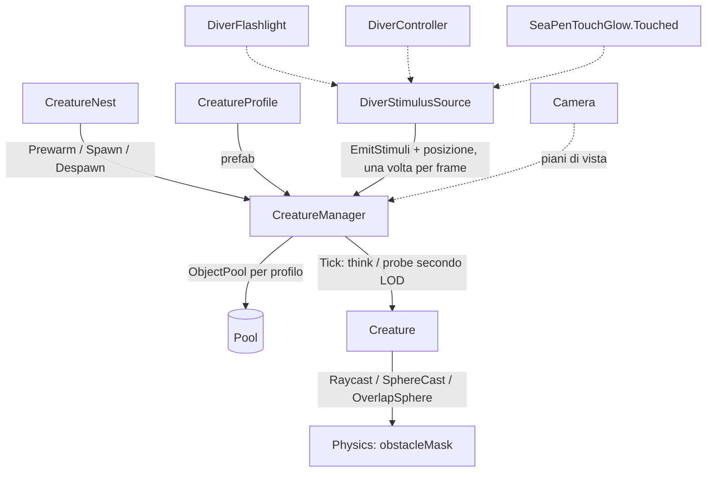

# Creatures
Ultima verifica: 2026-10-14

## Scopo e confini
Fa vivere la fauna della slice: le creature escono dai nidi, vagano attorno a casa evitando rocce e fondale e reagiscono agli stimoli del sub: la luce della torcia, il rumore dei passi e la scia luminosa del prato di penne. Il sistema è progettato per molte creature a basso costo: un solo componente per creatura, un solo ciclo di aggiornamento per tutta la scena, livelli di dettaglio dell'intelligenza (LOD) e pool senza allocazioni a regime.

Sostituisce il vecchio Entity System (`Assets/_Project/Code/EntitySystem/`, 22 script, circa 4500 righe), rimosso il 2026-10-13 nella task 1 di M2 e recuperabile dalla storia di Git. Rispetto al vecchio sistema non c'è più la catena alimentare simulata (salute, fame, stamina, danni tra pesci, `PlayerStatus`/`PlayerProfile`): la "vita propria" delle creature arriverà dallo stesso sistema di stimoli che serve per il sub (vedi *Estensione del sistema*).

Stato:
- **Implementato e verificato (2026-10-13):** profilo di specie, creatura con stati `Wander` e `Flee`, moto cinematico con evitamento ostacoli, quota sopra il fondale e soffitto per nido, manager con pool per profilo e LOD, nido base, sonda di benchmark (task 1 di M2). Stimoli del sub (task 2, che assorbe la task 3 della torcia rossa): luce del fascio in Full e Low, nessuna luce in Red, rumore dalla velocità e dall'atterraggio, scia del prato di penne; percezione con portata, sensibilità di specie, fascio, alone e linea di vista. Reazioni per specie (task 4): quattro categorie di stimolo (luce debole, luce forte, flash, rumore), ognuna con la sua reazione nel profilo (ignora, avvicinati, scappa); nuovo stato `Inspect`.
- **Implementato e verificato (2026-10-14, task 7a):** lanternfish con il modello definitivo di Manu e nuoto nello shader `Deeplonauts/Fish` (onda laterale dalla testa alla coda, piega in virata), fase e ampiezza per istanza da `Creature`.
- **Implementato e verificato (2026-10-14, task 7b):** banco e spavento. Banco: le creature della stessa specie entro `schoolRadius` si tengono a distanza (separazione), restano insieme (coesione) e nuotano nella stessa direzione (allineamento), con una griglia spaziale nel manager. Spavento: All'ingresso in fuga la creatura scatta (virata e accelerazione ×6 per `startleDuration`, corpo piegato a C), i fotofori lampeggiano e il lampo diventa uno stimolo `Flash` per le altre creature: l'allarme si propaga nel banco.
- **Pianificato (M2):** catena di joint procedurale, nidi completi (spawn fuori vista, uscita a nuoto, despawn), pesci ambientali, viperfish, isopode, stimoli emessi dalle creature stesse (via `IStimulusSource` e `CreatureManager.AddSource`).

## File e componenti
Tutti in `Assets/_Project/Code/Creatures/`, namespace `Deeploration.Creatures`:
1. `CreatureProfile.cs`: ScriptableObject con i dati di una specie, prefab compreso.
2. `Creature.cs`: componente unico sul prefab della creatura; percezione, macchina a stati e moto.
3. `CreatureManager.cs`: uno per scena; pool, lista delle creature attive, LOD, ciclo di aggiornamento.
4. `CreatureNest.cs`: punto della mappa da cui escono le creature di una specie.
5. `CreatureEnums.cs`: enum `CreatureState`, `StimulusCategory`, `StimulusReaction` e `CreatureLod`.
6. `CreatureStimulus.cs`: struct `CreatureStimulus` (uno stimolo del frame) e interfaccia `IStimulusSource`.
7. `DiverStimulusSource.cs`: sul `PlayerCapsule`, traduce torcia, passi e prato di penne in stimoli.
8. `Debug/CreatureBenchmark.cs`: sonda che misura il costo per frame in Play.

Shader: `Assets/_Project/Rendering/Shaders/Fish.shader` (`Deeplonauts/Fish`), per i pesci ambientali senza ossa (vedi *Shader Deeplonauts/Fish*).

Asset:
- `Assets/_Project/Entities/Profiles/Creature_TestCube.asset`: profilo di prova (valori di default del codice).
- `Assets/_Project/Entities/Prefabs/Creature_TestCube.prefab`: cubo 0.3 × 0.2 × 0.6 sul layer `Entity`, senza collider, con `Creature`. Resta per i benchmark.
- `Assets/_Project/Entities/Profiles/Creature_Lanternfish.asset`: profilo del lanternfish (default del codice tranne `heightAboveFloor` 1.5, `heightTolerance` 0.75, `bodyRadius` 0.125, `strongLightReaction` Approach). Reazioni: luce debole e forte → si avvicina (i mictofidi vanno verso la luce, per questo si pescano con le lampade), flash e rumore → scappa. Banco e spavento (dal 2026-10-14): `schoolRadius` 2.5, `separationDistance` 0.6 (circa due lunghezze del corpo), `cohesionWeight` 0.5, `alignmentWeight` 0.5, `startleGlow` 4, `alarmRadius` 4, il resto ai default (i lanternfish veri lampeggiano con i fotofori quando si spaventano).
- `Assets/_Project/Entities/Prefabs/Creature_Lanternfish.prefab` (dal 2026-10-14): alla radice `Creature` (`swimRenderers` = `Body` e `Body_LOD1`, `swimFrequency` 2.5, `fullBendTurnRate` 120) e `LODGroup` (Cross Fade animato, `size` 0.31, LOD0 `Body` fino a 0.13 dell'altezza dello schermo, LOD1 `Body_LOD1` fino a 0.03, poi niente). Con la camera del sub (FOV 32.9°) e `lodBias` 2 il passaggio è a circa 8 m e la scomparsa a circa 35 m, dove la nebbia esponenziale (densità 0.065) ha già coperto quasi tutto. Figli `Body` (`MSH_LanternFish`) e `Body_LOD1` (`MSH_LanternFish_LOD1`), entrambi con `MeshFilter` + `MeshRenderer`, `M_LanternFish`, ombre e probe spenti; tutto sul layer `Entity`. Ha sostituito `Creature_Lanternfish_Placeholder` (Fish-1 del pacchetto Backrock con Animator), rimosso lo stesso giorno e recuperabile dalla storia di Git.
- `Assets/_Project/Assets/Creatures/LanternFish/`: modello di Manu.
  - `LanternFishlowfbx.fbx`: export da Blender, 10 oggetti separati (corpo, occhi, pinne a raggi e membrane), 2577 triangoli in tutto, lungo 14.3 cm, testa verso -X, scala 100 e rotazione 270° sugli oggetti. Non è usato direttamente dal prefab.
  - `LanternFishLOD1.fbx`: LOD di Manu (2026-10-14), stessi 10 oggetti con la stessa disposizione, 207 triangoli in tutto. Non è usato direttamente dal prefab.
  - `MSH_LanternFish_LOD1.asset`: i 10 oggetti del LOD uniti con **la stessa trasformazione** del LOD0 (calcolata dai bounds dell'FBX del LOD0, non da quelli del LOD), così i due livelli si sovrappongono esattamente e lo shader usa gli stessi `_HeadZ` e `_BodyLength`. Bounds allargati di 0.3 m su X.
  - `MSH_LanternFish.asset`: i 10 oggetti uniti in una mesh sola (un draw call per pesce), ruotata con la testa verso +Z, centrata sul pivot e scalata a 31 cm (fattore 2.16, la taglia del placeholder: 25 cm più la licenza del 25%). Bounds allargati di 0.3 m su X per l'ondulazione. Generata una volta dall'Editor con `Mesh.CombineMeshes`: **se l'FBX cambia va rigenerata** (vedi *Limiti*).
  - `M_LanternFish.mat`: shader `Deeplonauts/Fish`, GPU instancing acceso, le quattro mappe di Painter (`_UniV_Grid_2K_AlbedoTransparency`, `_Normal`, `_MetallicSmoothness`, `_Emission`), proprietà ai default dello shader. Import delle texture corretti il 2026-10-14: normal come *Normal Map*, metallic/smoothness lineare (sRGB spento), emission senza alpha.

Placeholder scelti il 2026-10-13 tra i pesci del pacchetto, per sagoma: lanternfish = Fish-1, pesce ascia = Fish-3 o Fish-5, tripode = Fish-6, viperfish = Shark; per l'isopode non c'è niente. Sono da barriera corallina e low-poly, con scale incoerenti (Fish-1 e Fish-2 lunghi circa 6.5 m, gli altri 4-16 cm). Fish-4 e Fish-6 hanno circa 10k triangoli. La testa punta a +Z. Fish-3 non ha Animator. Il lanternfish ha già il modello definitivo; gli altri entrano con le task delle loro specie.

Licenza di stile (decisa da Manu il 2026-10-13): ogni pesce può essere fino al 25% più grande della sua taglia reale, per leggersi meglio nel buio. Vale per i placeholder e per i modelli definitivi.

## Dipendenze e flusso dati
- `CreatureNest` chiede al manager `Prewarm` e `Spawn` all'avvio, `Despawn` quando si disabilita.
- `CreatureManager.Update` raccoglie gli stimoli del frame chiedendoli una volta a ogni sorgente registrata (`IStimulusSource.EmitStimuli`), legge la posizione del sub (riferimento serializzato, mai cercato), calcola i piani della camera e, per ogni creatura attiva, sceglie il LOD e chiama `Creature.Tick(deltaTime, think, probe)`.
- `DiverStimulusSource` legge `DiverFlashlight` (modalità, `SpotLight`), `DiverController` (`CurrentSpeed`, `IsGrounded`) e l'evento `SeaPenTouchGlow.Touched`.
- `Creature.Tick`: se `think`, aggiorna percezione e stato; se `probe`, lancia i raggi verso il fondale e in avanti e ne conserva i risultati; poi muove sempre, usando l'ultimo stato e gli ultimi raggi.
- Dipendenze verso altri sistemi: solo `DiverStimulusSource`, che legge `Deeploration.Player` (`DiverFlashlight`, `DiverController`) e `Deeploration.Environment` (`SeaPenTouchGlow`). Nessuno di quei sistemi dipende dalle creature.

## Componenti

### CreatureProfile
- Responsabilità e ciclo di vita: dati immutabili di una specie, condivisi da tutte le istanze. Il manager indicizza i pool per profilo. Menu: *Create → Deeploration → Creature Profile*.
- Campi Inspector (tutti pubblici):

| Campo | Tipo | Default | Significato |
|---|---|---|---|
| `prefab` | `Creature` | null | Prefab istanziato dal pool, con `Creature` alla radice |
| `cruiseSpeed` | float [0.1, 10] | 1.2 | Velocità mentre vaga (m/s) |
| `fleeSpeed` | float [0.5, 20] | 4 | Velocità di fuga (m/s) |
| `acceleration` | float [0.1, 20] | 3 | Variazione di velocità (m/s²) |
| `turnRate` | float [10, 720] | 90 | Virata massima (°/s) |
| `heightAboveFloor` | float [0, 30] | 2.5 | Altezza preferita sopra il fondale (m) |
| `heightTolerance` | float [0, 10] | 1 | Scarto di quota tollerato prima di correggere (m) |
| `wanderTurn` | float [0, 360] | 45 | Virata massima del vagare (°/s) |
| `wanderFrequency` | float [0.01, 2] | 0.15 | Frequenza dei cambi di direzione (Hz) |
| `lightSensitivity` | float [0, 3] | 1 | Moltiplica la portata delle luci percepite; 0 = cieca alla luce |
| `hearingSensitivity` | float [0, 3] | 1 | Moltiplica la portata dei rumori percepiti; 0 = sorda |
| `weakLightReaction` | `StimulusReaction` | Approach | Reazione alla luce debole (torcia bassa, prato di penne, creature luminose) |
| `strongLightReaction` | `StimulusReaction` | Flee | Reazione alla luce forte e stabile (torcia piena) |
| `flashReaction` | `StimulusReaction` | Flee | Reazione al flash (l'istante in cui si accende la piena) |
| `noiseReaction` | `StimulusReaction` | Flee | Reazione al rumore |
| `inspectDistance` | float [0.5, 15] | 2.5 | Distanza preferita (m) da una luce debole in `Inspect`; ogni creatura sceglie il suo posto fra il 75% e il 130% |
| `strongLightDistanceScale` | float [1, 5] | 2.2 | Moltiplica la distanza preferita per luce forte e flash (con i default circa 5.5 m) |
| `inspectRepositionInterval` | float [0.5, 30] | 5 | Ogni quanti secondi, in media (±50%), cambia posto mentre osserva |
| `schoolRadius` | float [0, 10] | 0 | Raggio (m) entro cui vede i compagni della stessa specie. 0 = solitaria. Arriva al massimo a 3 celle della griglia del manager (3 m con `neighbourCellSize` 1) |
| `separationDistance` | float [0.05, 5] | 0.6 | Sotto questa distanza (m) da un compagno se ne allontana, in ogni stato. Non deve superare `neighbourCellSize`, altrimenti alcuni compagni troppo vicini sfuggono |
| `cohesionWeight` | float [0, 3] | 0.5 | Quanto piega verso il baricentro dei compagni mentre vaga |
| `alignmentWeight` | float [0, 3] | 0.5 | Quanto allinea la rotta a quella dei compagni mentre vaga o scappa |
| `diverClearance` | float [0, 5] | 1 | Spazio personale del sub (m) attorno al corpo, dai piedi alla testa: la creatura non ci entra. 0 = nessuno (per un predatore che deve arrivare a contatto) |
| `startleDuration` | float [0, 2] | 0.35 | Secondi di scatto all'inizio della fuga: virata e accelerazione ×6, piega a C fino a 1.6 |
| `startleGlow` | float [0, 10] | 0 | Lampo dei fotofori all'inizio della fuga: emissione fino a (1 + valore) volte la normale. 0 = nessun lampo |
| `startleGlowDuration` | float [0.05, 5] | 1.2 | Secondi in cui il lampo si spegne |
| `alarmRadius` | float [0, 20] | 0 | Portata (m) del lampo come stimolo `Flash` per le altre creature. 0 = il lampo non è uno stimolo |
| `calmDelay` | float [0, 30] | 3 | Secondi senza stimoli prima di calmarsi: da `Flee` a `Inspect` (se c'è ancora qualcosa che la attira) o `Wander`, da `Inspect` a `Wander` |

I campi `sightRange`, `fovAngle`, `hearingRange` e `fleeDistance` della task 1 sono stati tolti il 2026-10-13 con la task 2: al buio il corpo del sub non si vede, quindi le creature percepiscono solo la sua luce e il suo rumore.
| `bodyRadius` | float [0.05, 5] | 0.3 | Raggio d'ingombro per ostacoli e spawn (m) |
| `lookAhead` | float [0.2, 5] | 1.5 | Secondi di strada controllati in avanti |

- API pubbliche: i campi e `StimulusReaction ReactionTo(StimulusCategory category)` (Ignore per `None`).
- Riferimenti obbligatori: `prefab`. Senza, `CreatureManager.Spawn` registra un errore e ritorna null.

### Creature
- Responsabilità e ciclo di vita: non ha `Update`. Esce dal pool attivata dal manager, che chiama `OnSpawn` (reset di rotta, velocità a metà crociera, stato `Wander`, quota sconosciuta, seme del rumore casuale) e poi `Tick` a ogni frame. Non ha Rigidbody né collider: si muove scrivendo il transform (`SetPositionAndRotation`), quindi non spinge il sub e non viene spinta.
- Stati (`CreatureState`):
  - `Wander`: la rotta ruota attorno all'asse verticale secondo un rumore di Perlin (`wanderTurn`, `wanderFrequency`). Oltre il guinzaglio (`leashRadius` del nido) piega verso casa, tanto più quanto più è lontana.
  - `Flee`: scappa dalla sorgente dello stimolo che la spaventa a `fleeSpeed`, anche oltre il guinzaglio. Dopo `calmDelay` secondi senza stimoli che la spaventano passa a `Inspect` se qualcosa la attira ancora (percepito negli ultimi `calmDelay` secondi), altrimenti a `Wander`.
  - `Inspect`: si comporta come un pesce attirato dalla luce. Sceglie un **posto personale** relativo alla sorgente: per un fascio dentro il cono (yaw e pitch casuali fino all'80% del semi-angolo), per una luce omnidirezionale su un guscio sopra la sorgente; la distanza è quella preferita (`inspectDistance`, per luce forte e flash moltiplicata per `strongLightDistanceScale`) per un fattore casuale fra 0.75 e 1.3, perché una luce più intensa si osserva da più lontano, dove la luminosità è quella giusta. Il posto si ricalcola a ogni frame rispetto alla sorgente, quindi segue il sub; cambia ogni `inspectRepositionInterval` secondi (±50%). La creatura ci nuota rallentando (velocità `cruiseSpeed × clamp(distanza dal posto / 1.5, 0.2, 1)`); entro 1 m dal posto la rotta passa gradualmente a puntare il muso verso la luce, così scivola verso la sorgente, si allontana dal posto e ci torna: un andirivieni invece di un'orbita. La quota segue il posto (sempre sotto il soffitto e almeno `2 × bodyRadius` sopra il fondale). Torna a `Wander` dopo `calmDelay` secondi senza stimoli che la attirano. Non rispetta il guinzaglio finché osserva. Fino al 2026-10-13 sera girava in cerchio alla stessa distanza e alla quota della lampada: tutti i pesci finivano sullo stesso anello, anche dietro il sub, e si compenetravano.
- Banco (in `think`, se `schoolRadius` > 0): `CreatureManager.Flock` restituisce i compagni della stessa specie entro `schoolRadius`, con la spinta di separazione (somma su tutti quelli più vicini di `separationDistance` di `direzione opposta × (1 - distanza / separationDistance)`), il baricentro e la rotta media dei primi 8. Ne escono tre spinte: separazione, coesione (verso il baricentro, lunga al massimo 1) e allineamento (rotta media normalizzata). In `Move` si sommano alla rotta dello stato:
  - `Wander`: separazione × 2 + coesione × `cohesionWeight` + allineamento × `alignmentWeight`; la coesione sposta anche la quota preferita (`cohesion.y × schoolRadius × cohesionWeight × 0.5`);
  - `Inspect`: solo separazione × 2, così ognuno resta al suo posto ma si scosta da chi gli finisce addosso;
  - `Flee`: separazione × 2 + allineamento, il banco scappa compatto.
  Oltre alla rotta, la separazione sposta direttamente la posizione di `spinta × 0.6 m/s`, anche in quota: con virate da 90°/s la sola rotta non stacca due pesci paralleli. Fra un ragionamento e l'altro le spinte restano quelle dell'ultimo.
- Spazio personale del sub (in `Move`, a ogni frame, in ogni stato): il corpo del sub è un segmento verticale dalla posizione del `PlayerCapsule` (i piedi) a 1.5 m sopra. Se la creatura è più vicina di `diverClearance` al punto più vicino del segmento, riceve una spinta lontano dal corpo, da 0 al bordo a 1 sul corpo: si somma alla rotta × 4, alza o abbassa la quota preferita di `spinta.y × diverClearance` e sposta direttamente la posizione di `spinta × 1.5 m/s`. Aggiunto il 2026-10-14: prima i pesci attirati dalla torcia scivolavano fino alla lampada sul casco e attraversavano la camera, sparendo sul piano vicino (il "pop" visto da Manu).
- Spavento: quando `Think` porta la creatura in `Flee` da un altro stato chiama `Startle`, che segna l'istante dello scatto e, se la specie ha `startleGlow` e `alarmRadius` maggiori di 0, aggiunge al manager con `AddPulse` un punto luce `Flash` di portata `alarmRadius` nella posizione della creatura, per 0.4 s, con `Emitter` = la creatura stessa. Per `startleDuration` secondi `Move` moltiplica virata e accelerazione per 6: la rotta gira di colpo lontano dalla minaccia e la piega del corpo (che segue la virata) arriva alla C. Ogni pesce lampeggia una volta sola quando entra in fuga, quindi l'allarme si propaga di vicino in vicino e si spegne da solo.
- Percezione (in `think`): fra gli stimoli del frame (`CreatureManager.Stimuli`) sceglie il più forte, cioè quello con il rapporto distanza / portata più basso, dove la portata è `Radius` × sensibilità della specie (`lightSensitivity` per le luci, `hearingSensitivity` per i rumori). Un rumore conta se la creatura è entro la portata, attraverso gli ostacoli. Una luce conta se la creatura è entro la portata **e** dentro il fascio (`ConeCos`) o entro l'alone (`HaloRadius` × sensibilità), **e** se il raggio dalla sorgente alla creatura (lungo distanza meno `bodyRadius`) non tocca `obstacleMask`. Il raggio parte solo quando i controlli economici sono passati e lo stimolo batterebbe il migliore trovato. Gli stimoli emessi dalla creatura stessa (`Emitter`) sono ignorati. Per ogni stimolo la reazione è `profile.ReactionTo(categoria)`: gli stimoli ignorati non vengono nemmeno valutati, uno che spaventa vince sempre su uno che attira, a parità di reazione vince il più forte. La paura vince anche nel tempo: chi è in `Flee` non passa a `Inspect` finché non si è calmato.
- Raggi (in `probe`):
  - raggio verso il basso (100 m) per la quota del fondale. Se non trova niente ma dall'alto c'è una superficie, la creatura è finita sotto il terreno e viene riportata all'altezza preferita (paracadute);
  - `OverlapSphereNonAlloc` sul corpo: se è dentro un ostacolo (per esempio nell'involucro di un collider convesso) esce allontanandosi dal centro del collider e verso l'alto;
  - altrimenti `SphereCast` in avanti lungo `bodyRadius + max(1, speed × lookAhead)`: se colpisce, scivola lungo la superficie staccandosene, solo sul piano orizzontale e con peso crescente man mano che si avvicina. La quota resta decisa dalla correzione di quota: così un pendio che sale oltre il soffitto diventa una parete da aggirare, non una rampa.
- Moto (ogni frame): la rotta orizzontale viene dallo stato, la componente verticale dalla correzione di quota (limitata a ±0.5). La correzione punta a `fondale + heightAboveFloor`, ma mai sopra il soffitto ricevuto dal nido; sopra il soffitto la creatura scende sempre, anche dentro `heightTolerance`. Vicino a un ostacolo la velocità scende fino al 40% e la virata sale fino al triplo. La rotta ruota verso quella desiderata a `turnRate`, la velocità tende al bersaglio con `acceleration`, la posizione non scende mai sotto `fondale + bodyRadius`.
- Campi Inspector (solo per il modello provvisorio; tutto il resto arriva da profilo e nido):

| Campo | Tipo | Default | Significato |
|---|---|---|---|
| `swimAnimator` | `Animator` | null | Animator con la clip di nuoto del modello provvisorio. Vuoto = nessuna animazione |
| `swimAnimationSpeed` | float ≥ 0 | 1 | Velocità della clip alla velocità di crociera. Scala con `speed / cruiseSpeed`, minimo 0.3 |
| `swimRenderers` | `Renderer[]` | vuoto | Renderer con lo shader `Deeplonauts/Fish`, uno per livello di LOD. Vuoto = nessun nuoto nello shader. Era `swimRenderer` (un solo renderer) fino all'arrivo del LOD |
| `swimFrequency` | float ≥ 0 | 2.5 | Colpi di coda al secondo alla velocità di crociera (Hz) |
| `fullBendTurnRate` | float ≥ 1 | 120 | Velocità di virata (°/s) a cui il corpo è piegato del tutto |

  `swimAnimator` e `swimAnimationSpeed` servono ai placeholder animati e vanno tolti con la catena di joint (task 5 di M2). `swimRenderers` resta per i pesci senza ossa (lanternfish, pesce ascia).
- Nuoto nello shader (a ogni frame, se `swimRenderers` non è vuoto): la fase avanza di `swimFrequency × clamp(speed / cruiseSpeed, 0.35, 3) × 2π × dt` e parte da un valore casuale a ogni spawn, così i pesci non battono la coda all'unisono. La piega segue la velocità di virata orizzontale (`yawRate / fullBendTurnRate`, limitata a ±1, inseguita a 4 unità al secondo): il corpo fa una C con la coda verso l'interno della curva. L'ampiezza è `clamp(0.6 + 0.4 × speed / cruiseSpeed, 0.5, 1.4)`. Durante lo scatto la piega può arrivare a ±1.6 e cambia a 20 unità al secondo invece di 4. Il lampo (`_GlowBoost`) vale `startleGlow × fade² × tremolio`: sale in 0.05 s, cala con `fade = 1 - t / startleGlowDuration`, tremola a circa 6 Hz. I quattro valori vanno al renderer con un `MaterialPropertyBlock` condiviso (`_SwimPhase`, `_SwimAmount`, `_SwimBend`, `_GlowBoost`) a tutti i renderer della lista, solo se almeno uno è visibile; la fase avanza comunque. Così i due livelli di LOD restano nella stessa posa anche durante il cross-fade.
- API pubbliche:
  - `CreatureProfile Profile { get; }`
  - `CreatureState State { get; }`
  - `CreatureLod Lod { get; }`: livello assegnato dal manager nell'ultimo frame.
  - `Vector3 Heading { get; }`: rotta attuale, normalizzata.
  - `int NeighbourCount { get; }`: compagni visti nell'ultimo ragionamento (0 per le specie solitarie).
  - `StimulusCategory Perceived { get; }`: categoria dello stimolo che ha deciso la reazione nell'ultimo ragionamento (`None` se nessuno).
  - `float Speed { get; }`: velocità attuale (m/s).
  - Interne (`internal`, usate dal manager): `OnSpawn(CreatureManager, CreatureProfile, Vector3 home, float leash, float ceiling)`, `Tick(float deltaTime, bool think, bool probe)`, `ActiveIndex`, `Slot`.
- Gizmo (selezionata): rotta (ciano in `Wander`, rossa in `Flee`, verde in `Inspect`), in `Flee` una linea verso la sorgente (gialla per la luce, arancione per il rumore), in `Inspect` una linea verde verso il posto personale, una sfera sul posto e una linea tenue dal posto alla sorgente, guinzaglio attorno a casa, direzione di evitamento (magenta).
- Riferimenti obbligatori: va presa dal pool con `CreatureManager.Spawn`. Una `Creature` messa a mano in scena resta ferma, perché nessuno chiama `Tick`.

### CreatureManager
- Responsabilità e ciclo di vita: uno per scena. In `Awake` crea il figlio `CreaturePool` che contiene tutte le istanze; in `Start` prende `Camera.main` se `viewCamera` è vuota; in `OnDestroy` libera i pool. In `Update` fa avanzare tutte le creature attive (dall'ultima alla prima).
- LOD (calcolato a ogni frame per ogni creatura, dalla posizione del sub o, se manca, della camera):
  - `Near`: entro `nearDistance` e dentro l'inquadratura (più `visibilityMargin`). Ragiona e lancia raggi a ogni frame.
  - `Mid`: entro `farDistance`, oppure vicina ma fuori inquadratura. Ragiona e lancia raggi un frame ogni `midInterval`.
  - `Far`: oltre `farDistance`. Ragiona un frame ogni `farInterval` e non lancia raggi.
  - I ragionamenti sono sfasati con `(Time.frameCount + Slot) % intervallo`, così il costo si distribuisce sui frame invece di concentrarsi in picchi.
- Griglia dei vicini: all'inizio di `Update`, prima di far avanzare le creature, il manager mette ogni creatura attiva in una tabella hash di celle di lato `neighbourCellSize` (testa per secchio e successivo per creatura in array, posizioni di inizio frame). Costo O(n), nessuna allocazione finché il numero di creature non cresce oltre la capacità (poi gli array raddoppiano). `Flock` cerca ad anelli di celle dal centro verso l'esterno: il primo anello è il cubo di 27 celle attorno alla creatura e contiene tutti i compagni più vicini di `separationDistance` (che la separazione conta tutti); gli anelli successivi, fino a `ceil(schoolRadius / neighbourCellSize)` e al massimo 3, servono solo se baricentro e rotte non hanno ancora 8 compagni. In un banco fitto la ricerca si ferma quindi al primo anello. Le voci di altre celle finite nello stesso secchio vengono scartate.
- Pool: un `UnityEngine.Pool.ObjectPool<Creature>` per profilo, creato al primo uso, `collectionCheck` spento, capacità iniziale 16, massimo 1024 istanze inattive. `Despawn` toglie la creatura dalla lista attiva in O(1), scambiandola con l'ultima.
- Campi Inspector:

| Campo | Tipo | Default | Significato |
|---|---|---|---|
| `player` | `DiverStimulusSource` | null | Sorgente degli stimoli del sub, sul `PlayerCapsule`; registrata come prima sorgente in `Awake`. Senza, nessuno stimolo del sub e LOD calcolato dalla camera (warning in `Awake`) |
| `viewCamera` | `Camera` | null | Camera per la visibilità; vuota = `Camera.main` in `Start` |
| `obstacleMask` | `LayerMask` | Default, Obstacle, Seafloor (1153) | Layer che bloccano vista e moto. Non includere Player ed Entity |
| `nearDistance` | float ≥ 1 | 25 | Raggio del livello `Near` (m) |
| `farDistance` | float ≥ 1 | 60 | Oltre questa distanza, livello `Far` (m) |
| `midInterval` | int [1, 30] | 4 | Livello `Mid`: un frame ogni N |
| `farInterval` | int [1, 120] | 16 | Livello `Far`: un frame ogni N |
| `visibilityMargin` | float ≥ 0 | 1 | Margine attorno all'inquadratura (m) |
| `neighbourCellSize` | float ≥ 0.25 | 1 | Lato delle celle della griglia dei vicini (m). Almeno quanto la `separationDistance` delle specie; il `schoolRadius` arriva al massimo a 3 celle. Era 3 fino al 2026-10-14 (vedi *Verifica*) |

- API pubbliche:
  - `bool HasPlayer { get; }`
  - `Vector3 PlayerPosition { get; }`: posizione del sub letta all'inizio del frame.
  - `IReadOnlyList<CreatureStimulus> Stimuli { get; }`: stimoli raccolti all'inizio del frame.
  - `void AddSource(IStimulusSource source)` / `void RemoveSource(IStimulusSource source)`: registra o toglie altre sorgenti di stimoli (per le creature luminose); i duplicati sono ignorati.
  - Interna: `int Flock(Creature self, Vector3 position, float radius, float separationDistance, int maxNeighbours, out Vector3 separation, out Vector3 centre, out Vector3 alignment)`: vicini della stessa specie (vedi *Creature*, Banco, e la griglia sopra); ritorna quanti ne ha usati per baricentro e rotte.
  - `void AddPulse(CreatureStimulus stimulus, float duration)`: stimolo breve senza sorgente registrata (il lampo di un pesce spaventato), attivo per `duration` secondi a partire dal frame dopo. Gli impulsi scaduti escono dalla lista con uno scambio dall'ultimo posto, senza allocazioni a regime.
  - `LayerMask ObstacleMask { get; }`
  - `int ActiveCount { get; }`
  - `int CountAtLod(CreatureLod lod)`: creature nel livello durante l'ultimo frame.
  - `void Prewarm(CreatureProfile profile, int count)`: porta a `count` le istanze inattive della specie.
  - `Creature Spawn(CreatureProfile profile, Vector3 position, Quaternion rotation, Vector3 home, float leashRadius, float ceilingY = float.PositiveInfinity)`: `ceilingY` è la quota assoluta che la creatura non supera. Ritorna null (con errore in console) se il profilo è nullo o senza prefab.
  - `void Despawn(Creature creature)`: ignora creature nulle o già nel pool.
- Gizmo (selezionato): sfere di `nearDistance` e `farDistance` attorno al sub.

### CreatureNest
- Responsabilità e ciclo di vita: in `Start` fa uscire `count` creature (dopo `Prewarm`); se viene riabilitato le rifà uscire; in `OnDisable` le rimette nel pool. Ogni punto di spawn è scelto a caso nella sfera `spawnRadius`, abbassato sotto il soffitto e scartato se è sepolto (guardando dall'alto la prima superficie sta sopra il punto meno `bodyRadius`) o se il corpo tocca un ostacolo. Dopo 8 tentativi falliti usa il centro del nido. Versione base: spawn fuori vista, uscita a nuoto e despawn per distanza arrivano con la task dei nidi.
- Campi Inspector:

| Campo | Tipo | Default | Significato |
|---|---|---|---|
| `manager` | `CreatureManager` | null | Manager della scena |
| `profile` | `CreatureProfile` | null | Specie del nido |
| `count` | int ≥ 0 | 5 | Creature fatte uscire all'avvio |
| `spawnRadius` | float ≥ 0 | 3 | Sfera di spawn attorno al nido (m) |
| `leashRadius` | float ≥ 1 | 20 | Oltre questa distanza dal nido le creature tornano indietro (m) |
| `maxHeightAboveNest` | float ≥ 0 | 4 | Soffitto: quota massima delle creature sopra il nido (m). Dove il fondale sale oltre, lo aggirano |

- API pubbliche:
  - `int SpawnedCount { get; }`
  - `void Respawn(int newCount)`: cambia il numero e rifà uscire il nido da capo (usato per i benchmark).
- Gizmo: sfera di spawn (sempre); guinzaglio e piano del soffitto (selezionato).
- Riferimenti obbligatori: `manager` e `profile`. Se mancano, errore in console e nessuno spawn.

### CreatureEnums
- `CreatureState`: `Wander`, `Flee`, `Inspect`. Cresce con le task di M2.
- `StimulusCategory`: `None`, `WeakLight`, `StrongLight`, `Flash`, `Noise`. Le tre luci richiedono la linea di vista, il rumore no. Ha sostituito `StimulusKind` (luce o rumore) con la task 4.
- `StimulusReaction`: `Ignore`, `Approach` (stato `Inspect`), `Flee` (stato `Flee`, vince su `Approach`).
- `CreatureLod`: `Near`, `Mid`, `Far` (vedi `CreatureManager`).

### CreatureStimulus e IStimulusSource
- `CreatureStimulus` (struct): `Category` (`StimulusCategory`), `Position`, `Radius` (portata a sensibilità 1), `Direction` e `ConeCos` (fascio; `Omnidirectional` = -2 per un punto), `HaloRadius`, `FromPlayer`, `Emitter` (`Creature` che l'ha emesso, null per sub e ambiente: la creatura non percepisce i propri stimoli); proprietà `bool IsLight` (tutto tranne `Noise`). Costruttori statici: `Noise(position, radius, fromPlayer)`, `PointLight(position, radius, category, fromPlayer)` (alone = portata), `Beam(position, direction, radius, halfAngle°, haloRadius, category, fromPlayer)`.
- `IStimulusSource`: `void EmitStimuli(List<CreatureStimulus> output)`, chiamato dal manager una volta per frame; aggiunge zero o più stimoli.

### DiverStimulusSource
- Responsabilità e ciclo di vita: sul `PlayerCapsule` del prefab `Player`. In `Awake` risolve i riferimenti vuoti con `GetComponent` sullo stesso GameObject. In `Start` costruisce una griglia di celle (lato `seaPenCellSize`) sopra tutti i renderer con un materiale che ha `_CORAL_TOUCH_GLOW` attivo, allargati di `seaPenTouchRadius`: sono le zone dove un tocco accende davvero il prato. In `OnEnable`/`OnDisable` si iscrive a `SeaPenTouchGlow.Touched` e a `DiverFlashlight.OnModeChanged` (per il flash). In `Update` registra l'istante in cui il diver atterra (`IsGrounded` da falso a vero). Emette in `EmitStimuli`:
  - **luce:** se la torcia è in `Full` (`StrongLight`) o `Low` (`WeakLight`), un fascio dalla posizione di `SpotLight` lungo il suo asse, semi-angolo `spotAngle / 2`, portata `fullLightReach` o `lowLightReach`, alone `portata × haloFraction`. In `Red` niente;
  - **flash:** per `flashDuration` secondi dopo ogni passaggio a `Full` da un'altra modalità, un secondo fascio `Flash` con portata `fullLightReach` e alone più largo (`fullLightReach × flashHaloFraction`);
  - **rumore:** portata `CurrentSpeed × noisePerSpeed` (0 se il `DiverController` è disabilitato, per esempio da seduto nella capsula), oppure il picco dell'atterraggio `landingNoise`, che cala a zero in `landingNoiseDuration`; vale il maggiore. Sotto 0.05 m non emette;
  - **scia del prato:** ogni tocco che cade in una cella delle penne diventa un punto luce `WeakLight` (alzato di 0.3 m dal fondale) con portata `seaPenGlowReach`, che cala a zero in `seaPenGlowDuration`. Ne ricorda al massimo 12, come lo shader.
- Campi Inspector:

| Campo | Tipo | Default | Significato |
|---|---|---|---|
| `flashlight` | `DiverFlashlight` | null | Vuoto = `GetComponent` |
| `diver` | `DiverController` | null | Vuoto = `GetComponent` |
| `seaPenTouch` | `SeaPenTouchGlow` | null | Vuoto = `GetComponent` |
| `fullLightReach` | float ≥ 0 | 25 | Portata del fascio Full per le creature (m); più lunga della portata visiva della luce (15) |
| `lowLightReach` | float ≥ 0 | 8 | Portata del fascio Low (m) |
| `haloFraction` | float [0, 1] | 0.4 | Frazione della portata entro cui la lampada si vede da fuori del fascio (Low 3.2 m, Full 10 m). Era 0.3: con la bassa l'alone (2.4 m) era più stretto della distanza a cui le creature orbitano in `Inspect` (2.5), che uscivano dalla luce a ogni giro |
| `flashDuration` | float ≥ 0.05 | 0.4 | Secondi per cui il passaggio a `Full` conta come flash |
| `flashHaloFraction` | float [0, 1] | 0.6 | Frazione di `fullLightReach` entro cui il flash si vede da fuori del fascio |
| `noisePerSpeed` | float ≥ 0 | 2.5 | Metri di portata per ogni m/s del diver |
| `landingNoise` | float ≥ 0 | 8 | Portata del rumore all'atterraggio (m) |
| `landingNoiseDuration` | float ≥ 0.01 | 1 | Secondi in cui il rumore dell'atterraggio si spegne |
| `seaPenGlowReach` | float ≥ 0 | 6 | Portata della luce di un tocco appena acceso (m) |
| `seaPenGlowDuration` | float ≥ 0.01 | 2.5 | Durata della luce di un tocco (s), allineata a `_TouchLifetime` |
| `seaPenTouchRadius` | float ≥ 0 | 1.6 | Distanza massima tocco-penna perché il tocco accenda il prato (m), allineata a `_TouchRadius` dei materiali delle penne |
| `seaPenCellSize` | float ≥ 0.25 | 1 | Lato delle celle della griglia (m) |

- API pubbliche: `void EmitStimuli(List<CreatureStimulus> output)` (da `IStimulusSource`), `int SeaPenCellCount { get; }`.
- Gizmo (selezionato, in Play): i punti luce del prato ancora accesi.
- Riferimenti obbligatori: nessuno. Senza torcia, controller o `SeaPenTouchGlow` lo stimolo corrispondente non viene emesso. Va assegnato al campo `player` del `CreatureManager` della scena.

### CreatureBenchmark
- Responsabilità e ciclo di vita: strumento di sviluppo. `Run(label)` avvia quattro `ProfilerRecorder` (`Main Thread`, `BehaviourUpdate`, `FixedBehaviourUpdate`, `GC Allocated In Frame`). Dopo `warmup` secondi campiona per `duration` secondi, poi scrive le medie in console e in `Logs/CreatureBenchmark.log` (fuori da Assets, ignorato da Git).
- Campi Inspector: `warmup` (float, 3 s), `duration` (float, 10 s), `label` (string, "creature"), `runOnEnable` (bool, false).
- API pubbliche: `void Run(string measureLabel)`, `bool IsRunning { get; }`, `string LastResult { get; }`; voce di menu contestuale *Run*.
- Limite: in Editor il tempo scorre solo con l'Editor in primo piano o con `Application.runInBackground = true`; una misura avviata con l'Editor fermo campiona un solo frame.

### Shader Deeplonauts/Fish
- File: `Assets/_Project/Rendering/Shaders/Fish.shader`. URP lit scritto a mano sul modello di `Coral.shader`: passi `ForwardLit`, `ShadowCaster`, `DepthOnly`, `DepthNormals`, tutti con la stessa deformazione. `ForwardLit` e `DepthOnly` supportano il cross-fade a retino dei `LODGroup` (`LOD_FADE_CROSSFADE`), con il valore di dissolvenza per istanza (`#pragma instancing_options lodfade`). Senza quella riga, fino al 2026-10-14 sera, i pesci disegnati con l'instancing condividevano un solo valore di dissolvenza: quelli in transizione a circa 6 m potevano sparire di colpo, cosa che Manu ha visto avvicinandosi al banco. Coda `AlphaTest`, doppia faccia di default (le membrane delle pinne sono piani).
- Requisiti della mesh: distesa lungo +Z con la testa verso +Z, pivot al centro, una sola mesh con un solo materiale. Niente ossa.
- Nuoto (vertex): `u = saturate((_HeadZ - z) / _BodyLength)` va da 0 alla testa a 1 in coda; lo spostamento laterale su X è `_SwimAmplitude × _SwimAmount × lerp(_HeadAmplitude, 1, u²) × sin(_SwimPhase - u × _SwimWaves × 2π) + _BendAmount × _SwimBend × u²`. Le normali sono corrette con la derivata dello spostamento lungo Z.
- Superficie: mappe di Painter nel formato *Unity URP (Metallic)*; alpha dell'albedo per le pinne con taglio a `_Cutoff`, oppure (`_FISH_DITHER`, acceso di default) con una soglia Bayer 4×4 tra 0 e `2 × _Cutoff`, che rende le membrane sfumate a retino come il finish analogico. Emissione = mappa × `_EmissionColor` (fotofori).
- Proprietà per istanza (`UNITY_INSTANCING_BUFFER`): `_SwimPhase` (rad), `_SwimAmount`, `_SwimBend` (-1.6..1.6), `_GlowBoost` (lampo dello spavento: emissione × (1 + valore)), scritte da `Creature`. Con il `MaterialPropertyBlock` i pesci escono dallo SRP Batcher e vengono disegnati con il GPU instancing del materiale.

| Proprietà | Default | Significato |
|---|---|---|
| `_BaseMap`, `_BaseColor` | white, bianco | Albedo, alpha = pinne |
| `_BumpMap`, `_BumpScale` | bump, 1 | Normal map |
| `_MetallicGlossMap`, `_Metallic`, `_Smoothness` | white, 1, 1 | Metallic in R, smoothness in A, con i due moltiplicatori |
| `_EmissionMap`, `_EmissionColor` | black, bianco HDR | Fotofori |
| `_Cull` | Off (0) | Faccia da scartare |
| `_Cutoff` | 0.35 | Soglia dell'alpha |
| `_Dither` | acceso | Alpha a retino Bayer |
| `_HeadZ` | 0.155 | Z della testa in object space (m) |
| `_BodyLength` | 0.31 | Lunghezza del corpo (m) |
| `_SwimAmplitude` | 0.035 | Spostamento laterale massimo in coda (m) |
| `_HeadAmplitude` | 0.12 | Ampiezza alla testa, in frazione della coda |
| `_SwimWaves` | 0.8 | Onde lungo il corpo |
| `_BendAmount` | 0.08 | Spostamento della coda in virata piena (m) |

## Setup in Unity
1. Creare un profilo (*Create → Deeploration → Creature Profile*) e assegnargli un prefab con `Creature` alla radice, senza collider.
2. Sul `PlayerCapsule` del prefab `Player` c'è già `DiverStimulusSource`. In scena: un GameObject con `CreatureManager`, con `player` = il `DiverStimulusSource` dell'istanza del Player.
3. Uno o più `CreatureNest` con `manager` e `profile` assegnati, appoggiati in acqua libera.
4. Le rocce devono stare su un layer incluso in `obstacleMask` (oggi sono su Default).
5. Pesce senza ossa con nuoto nello shader: mesh unica lungo +Z, materiale `Deeplonauts/Fish` con GPU instancing acceso, `_HeadZ` e `_BodyLength` sulle misure della mesh, renderer (uno per livello di LOD) in `swimRenderers` della `Creature`. Con un LOD: `LODGroup` sulla radice in Cross Fade, mesh dei livelli allineate fra loro, soglie calcolate per la camera del sub (FOV stretto e `lodBias` 2 spostano molto le distanze).

## Configurazione verificata in prefab e scene
In `SCN_Gameplay.unity` (2026-10-13):
- Il vecchio GameObject `EntityPooler` (con `EntityPooler` ed `EntitySpawner`) è stato rimosso.
- Al suo posto `Creatures` con `CreatureManager` (`player` = `DiverStimulusSource` del `PlayerCapsule`, altri campi ai default) e il figlio `Nest_Lanternfish` in (-5, 2.51, -14), nel corridoio del prato di penne a 11 m dalla capsula, 1.5 m sopra il fondale: profilo `Creature_Lanternfish`, `count` 12, `spawnRadius` 6, `leashRadius` 12, `maxHeightAboveNest` 3 (soffitto a Y 5.5). Il primo giorno si chiamava `Nest_TestCubes`, stava in (0, 2.5, 0) tra le rocce accanto alla capsula e usava `Creature_TestCube`: lì metà del fondale entro 15 m sta sopra Y 6.4 e i pesci salivano lungo le pareti del canyon (mediana Y 8.9 contro il sub a 0.1).

Nel prefab `Player` (2026-10-13): `DiverStimulusSource` sul `PlayerCapsule` con i default del codice; spia `PlayerCapsule/TorchPivot/EmergencyLight` assegnata a `DiverFlashlight` (vedi [Flashlight.md](file:///Z:/_PROJECTS/Unity/Project_Deep/documentation/Flashlight.md)).

## Estensione del sistema
- Nuova specie: nuovo `CreatureProfile` con il suo prefab, più un `CreatureNest` che la usa. Niente stringhe né enum da aggiornare.
- Nuovo stato: valore in `CreatureState`, caso in `Creature.Think` (transizioni) e in `Creature.Move` (rotta e velocità). Lo stato è un enum con switch, non una classe: le transizioni non allocano.
- Allarme fra specie (2026-10-14): il lampo di un pesce spaventato è uno stimolo `Flash` come quello della torcia. Una specie che deve esserne attirata (il viperfish che caccia i banchi) mette `flashReaction` ad `Approach`; una che non deve vederlo lo ignora.
- Vita propria delle creature (deciso il 2026-10-13, task 2 e 4): stimoli unificati. Torcia del sub, prato di penne e creature bioluminescenti sono tutti fonti di luce, quindi il viperfish attratto dalla luce insegue anche i lanternfish senza codice di caccia dedicato. Predazione finta: se il predatore raggiunge la preda, la preda torna nel pool con un lampo e il predatore entra in "sazietà" (un timer, non una fame che uccide). Più routine per specie (l'isopode che fruga, il tripode ritto controcorrente). Il manager raccoglierà gli emettitori di stimoli una volta per frame; le creature li leggeranno solo nei frame di `think`.

## Limiti e problemi noti
- **Mesh del lanternfish da rigenerare a mano:** `MSH_LanternFish.asset` e `MSH_LanternFish_LOD1.asset` sono state prodotte una volta dagli FBX. Se Manu riesporta, la mesh in gioco non cambia finché non viene rifatta. Per evitarlo il prossimo export può uscire già pronto (un solo oggetto unito, trasformazioni applicate, testa lungo l'asse che in Unity diventa +Z, 31 cm): allora il prefab può puntare direttamente alla mesh dell'FBX.
- Lo scatto a C è visibile solo se la fuga richiede una virata: con la minaccia esattamente alle spalle il pesce parte dritto, senza piega.
- Sotto la torcia piena il lampo dei fotofori si nota poco, perché la luce del fascio domina; si vede bene al buio o in luce rossa, quando l'allarme parte da un altro pesce.
- Nel LOD1 da vicino il corpo è sfaccettato, l'occhio esce più piccolo e i fotofori più a macchie (stesse texture su meno geometria). Oltre gli 8 m, dove compare, non si nota.
- La soglia del LOD era a 6 m fino al 2026-10-14 sera: con la torcia piena i pesci stazionano a 4.1-7.2 m dalla lampada e alcuni restavano sulla soglia, cambiando livello più volte mentre il giocatore li guardava (misurato: LOD0 → dissolvenza → LOD1 → dissolvenza in 3 frame a 6.00 m). A 8 m i pesci che osservano la torcia restano al LOD0.
- Con migliaia di pesci in un solo banco la coesione comprime il banco: con 2000 lanternfish circa il 5% dei pesci ha un compagno a meno di 0.25 m (con 30 nessuno).
- Le soglie del LOD sono calcolate per la camera del sub e per `lodBias` 2: se cambia il livello di qualità, cambiano le distanze.
- Il nuoto nello shader sposta solo su X (laterale): niente beccheggio, e le pinne pettorali non battono per conto loro.
- **Collider convesso enorme:** `SM_LargeRock_low (2)` in `SCN_Gameplay` ha un `MeshCollider` convesso con bounds di circa 52 × 42 × 32 m, molto più grande della roccia visibile. Per la fisica (creature e sub) quello spazio è roccia piena. Le creature lo aggirano ed escono se ci finiscono dentro, ma il buco nell'acqua resta. Da valutare un collider concavo o più convessi quando si sistemano i collider dell'ambiente.
- **Rocce sul layer Default:** nessun oggetto usa il layer `Obstacle`. Per questo `obstacleMask` include Default. Ogni collider su Default (anche non roccia) blocca le creature.
- Le creature `Far` non lanciano raggi: se una creatura nasce lontana, la quota del fondale resta sconosciuta finché non passa a `Mid`.
- Lo spawn scarta i punti sotto qualsiasi superficie vista dall'alto, quindi anche quelli sotto uno sbalzo di roccia. Un nido in un crepaccio coperto (previsto nella task dei nidi) ripiegherà sul proprio centro: da rivedere in quella task.
- Il recupero da dentro un ostacolo usa il centro dei bounds del collider: con collider molto grandi o concavi la direzione di uscita è approssimativa.
- Il flash dura 0.4 s: le creature `Far` (un ragionamento ogni 16 frame) possono perderlo; quelle `Mid` lo vedono.
- In `Inspect` la creatura ignora guinzaglio e casa: con la torcia accesa a lungo un banco può seguire il sub lontano dal nido (resta il soffitto). Al ritorno in `Wander` il richiamo verso casa la riporta indietro.
- Le creature si evitano solo fra compagni della stessa specie (separazione del banco). Non evitano le altre specie né gli organismi senza collider (coralli bambù, penne), che attraversano.
- In un banco compatto la distanza fra vicini si stabilizza poco sotto `separationDistance` (0.5-0.6 m con il lanternfish) e l'allineamento arriva a 0.99: il banco è molto ordinato. Se a vista sembra rigido, abbassare `alignmentWeight` o alzare `wanderTurn`.
- Il rumore non si attenua attraverso la roccia e non ha direzione: chi è entro la portata lo sente comunque.
- La luce è percepita solo se la creatura sta nel fascio o nell'alone: una creatura lontana, fuori dal fascio, non vede la lampada anche se la guarda. Va bene per il fascio stretto della torcia; per le creature luminose (punti luce) non cambia niente.
- Il picco dell'atterraggio dura 1 s: le creature `Mid` lo campionano ogni 4 frame, quindi quelle al bordo della portata a volte non lo sentono.
- La griglia del prato si costruisce una volta in `Start`: penne aggiunte o spostate in Play non vengono viste.
- Il soffitto è una quota assoluta per nido: in una mappa a canyon funziona se il nido sta nel fondo piano. Un nido sul fianco di una parete ha bisogno di un soffitto più alto.
- Lo stato `Flee` non ha ancora un costo (stamina rimossa): una creatura scappa finché percepisce il sub.

## Verifica
Verifica del 2026-10-13 in Editor, Play Mode in `SCN_Gameplay`, durante il prologo (sub nella capsula):
- Compilazione senza errori né warning dagli script del sistema; zero script mancanti in scena dopo la rimozione del vecchio sistema.
- 12 cubi vagano attorno al nido seguendo il fondale. Sui pendii e sulle rocce la quota sale con il terreno.
- Fuga: un cubo messo a 2.5 m dal sub passa a `Flee` e accelera; dopo `calmDelay` torna a `Wander`.
- Compenetrazione, con 300 cubi dopo 30 s: 0 dentro la geometria, 1 a contatto (in uscita), 1 sotto uno sbalzo (legittimo). Prima delle correzioni di spawn e recupero erano 52 sepolti su 300.

Costo misurato con `CreatureBenchmark` (Editor, Mono, 10 s dopo 3 s di riscaldamento). "Update" e "FixedUpdate" sono il tempo totale degli script di quel ciclo, quindi includono anche gli altri sistemi della scena. Il riferimento a vuoto è Update circa 0.5 ms e GC circa 19-29 KB/frame.

| Misura | Main thread | Update | FixedUpdate | GC per frame |
|---|---|---|---|---|
| Vecchio sistema, 0 creature | 19.6 ms | 0.52 ms | 0.00 ms | 28.9 KB |
| Vecchio sistema, 12 pesci | 76.8 ms | 0.48 ms | 58.0 ms | 754 KB |
| Vecchio sistema, 50 pesci | 337.4 ms | 1.55 ms | 317.7 ms | 13 346 KB |
| Vecchio sistema, 50 pesci, log spenti | 28.3 ms | 0.95 ms | 5.64 ms | 94.5 KB |
| Nuovo sistema, 12 cubi | 17.5 ms | 0.66 ms | 0.00 ms | 18.8 KB |
| Nuovo sistema, 50 cubi | 21.0 ms | 1.43 ms | 0.00 ms | 18.8 KB |
| Nuovo sistema, 100 cubi | 20.7 ms | 1.84 ms | 0.00 ms | 18.8 KB |
| Nuovo sistema, 300 cubi | 22.1 ms | 4.16 ms | 0.00 ms | 18.8 KB |
| Nuovo sistema, 300 cubi, LOD spento | 24.5 ms | 6.81 ms | 0.00 ms | 19.0 KB |
| Placeholder lanternfish animato, 50 pesci | 25.2 ms | 1.88 ms | 0.00 ms | 18.9 KB |

Le misure con 50 e 300 cubi sono quelle del codice definitivo; 100 cubi e "LOD spento" sono state prese prima delle correzioni anti-compenetrazione, che a 300 cubi aggiungono circa 0.6 ms.

Letture:
- Il collo di bottiglia del vecchio sistema erano i `Debug.Log` nei cicli di fisica: circa 6 log formattati per creatura a ogni step (circa 300 al secondo per creatura). Spegnendo i log, 50 pesci passano da 318 a 5.6 ms di FixedUpdate. La ricerca del player con la sfera da 10 km, sospettata in Roadmap, avveniva solo in `Awake` e non pesava.
- Nel nuovo sistema il costo cresce in modo lineare, circa 10-12 µs per creatura in Editor, e non alloca memoria per frame.
- Il LOD dimezza il costo a 300 creature (6.8 → 3.5 ms prima delle correzioni anti-compenetrazione), con 272 creature su 300 fuori inquadratura.
- Provato e scartato: togliere il padre comune (`CreaturePool`) alle istanze non cambia il costo, quindi la gerarchia resta ordinata.

Le misure sono prese con la Scene view puntata nel vuoto: se inquadra la scena, il suo rendering entra nel main thread (con 50 pesci animati e la Scene view sulla scena: 44.4 ms). Con il placeholder animato, durante il prologo, quasi tutti i pesci sono fuori inquadratura e il loro Animator è fermo (`CullCompletely`): il costo dell'animazione con molti pesci inquadrati non è ancora misurato.

Quota (100 lanternfish dopo 30 s, nido nel corridoio, soffitto e quote del profilo attuali): altezza sopra il fondale mediana 1.3 m (0.3-3.4), Y mediana 2.9 m (massimo 6.1, in discesa verso il soffitto), 0 sepolti e 0 a contatto. Alcuni pesci superano il guinzaglio (massimo 21.7 m dal nido contro 12): il richiamo verso casa è morbido.

Stimoli (2026-10-13, Play in `SCN_Gameplay`, sub spostato a mano nel corridoio a 10 m dal nido e rivolto verso i pesci, 12 lanternfish):
- torcia `Full`: i pesci nel fascio scappano in fondo al corridoio, oltre la portata e dietro il terreno; uno a 5 m di lato al sub scappa per l'alone. Passando a `Red`: zero stimoli, in 20 s tutti di nuovo in `Wander` e tornati al nido, alcuni a 3-4 m dal sub senza reagire;
- atterraggio simulato (istante scritto per reflection): i pesci a 3-4 m scappano;
- tocco su una penna di mare a 1.5 m dal nido: un punto luce di 6 m che si spegne in 2.5 s, i 4 pesci entro 6 m scappano. Un tocco lontano dalle penne (20, 0, 25) non produce stimoli. La griglia del prato conta 454 celle.

Costo con 300 lanternfish animati, sub nel corridoio: Update 6.8 ms con torcia `Full`, 6.3 ms con `Red` (la percezione costa circa 0.5 ms). Più dei 4.2 ms dei cubi perché con il sub nel corridoio molti più pesci sono vicini e inquadrati (livello `Near`).

Reazioni (2026-10-13, task 4, stesso metodo: sub spostato a mano a 7 m dal nido, 12 lanternfish con il loro profilo):
- torcia `Low`: dopo 12 s 5 in `Inspect`, 4 già in orbita a 2.5-3.1 m dalla lampada, 7 fuori portata o dietro il terreno;
- passaggio a `Full`: il flash fa scappare 10 pesci su 12; finito il flash percepiscono la luce forte ma restano in `Flee` finché non si calmano; dopo 10 s tutti e 12 in `Inspect` attorno alla lampada (11 su 12 tra 2.5 e 3.6 m);
- passaggio a `Red`: dopo 6 s tutti e 12 in `Wander`;
- atterraggio simulato in `Red`: scappa l'unico pesce rimasto entro la portata (3.1 m).

Posti personali (2026-10-13 sera, 30 lanternfish, sub fermo a 8 m dal nido):
- `Low` dopo 15 s: 19 in `Inspect` a 1.7-5.9 m dalla lampada (mediana 2.5), mediana a 20° dall'asse del fascio (semi-angolo 28.6°), quote 1.6-3.6 m; distanza minima fra due pesci 0.21 m, una sola coppia sotto 0.25 m;
- `Full` dopo altri 15 s: tutti e 30 in `Inspect` a 2.6-19.8 m (mediana 5.2, i più lontani ancora in arrivo), mediana a 11° dall'asse, quote 1.0-3.4 m; una coppia sotto 0.25 m. In 2 s 9 pesci si sono avvicinati alla lampada e 21 allontanati, nessuno fermo (velocità 0.24-1.2 m/s, mediana 0.74);
- vista dal sub con la torcia piena: banco sparso nel fascio a distanze e altezze diverse, nessun anello.

Costo con 300 lanternfish in `Inspect` attorno alla torcia `Full` (284 in `Inspect`, 115 `Near`): Update 8.2 ms. È il caso limite di centinaia di pesci addosso alla lampada, tutti vicini e inquadrati.

Modello definitivo del lanternfish (2026-10-14, Play in `SCN_Gameplay`, sub spostato a 8.5 m dal nido, torcia `Low`, 12 pesci): shader compilato senza messaggi, dopo 12 s 10 pesci in `Inspect` a 1.9-3.9 m dalla camera, testa nel verso del moto. Da vicino (camera di prova a 0.7 m, luce di prova): fotofori emissivi leggibili, membrane delle pinne a retino, coda che ondeggia e corpo piegato in virata; dall'alto l'onda corre dalla testa alla coda. Costo non misurato: il benchmark lanciato con l'Editor non in primo piano ha campionato un solo frame.

Spavento (2026-10-14, task 7b, stesso metodo, 12 lanternfish):
- da torcia `Low` (10 in `Inspect`) a `Full`: dopo 0.1 s tutti e 12 in `Flee`, 10 che lampeggiano (picco `_GlowBoost` 3.3 su 4), 12 allarmi attivi, piega massima 1.35 e poi 1.51, velocità 4 m/s (quella di fuga, raggiunta subito invece che in circa 1 s); lampo finito dopo 2 s; dopo 4 s tutti di nuovo in `Inspect`;
- allarme da solo, torcia `Red` (nessuno stimolo del sub), un pesce spaventato a mano con 8 vicini entro 4 m: dopo 0.2 s 9 pesci su 12 in fuga, cioè lui più tutti gli 8 vicini; i 3 pesci a 16-20 m restano in `Wander`. Il numero resta 9 anche dopo 2 s: la propagazione si ferma;
- frame dalla camera del sub 0.12 s dopo il passaggio a `Full`: corpi piegati e pesci che girano via, lampo poco visibile sotto il fascio pieno.

Banco (2026-10-14, task 7b, 30 lanternfish, sub fermo a 8.5 m dal nido; allineamento = media del prodotto scalare fra la rotta di ogni pesce e quella media dei vicini entro 2.5 m):
- prima versione, con il limite di 8 vicini applicato anche alla separazione: in torcia `Red` dopo 20 s allineamento 0.93 ma 10 coppie sotto 0.25 m, e 32 dopo aver aggiunto la scivolata. La ricerca si fermava all'ottavo vicino trovato, prima di arrivare a quelli a 13 cm. Corretto: la separazione conta tutti i vicini troppo vicini;
- versione finale, torcia `Red` dopo 20 s: tutti in `Wander`, distanza dal vicino più vicino 0.51-0.64 m (mediana 0.56), nessuna coppia sotto 0.4 m, in media 6.9 compagni visti, allineamento 0.99, tre banchi di 19, 7 e 4;
- poi torcia `Low` per 15 s: 11 pesci in `Inspect` a 1.4-3.2 m dalla lampada (mediana 2.3), gli altri ancora in banco fuori dal fascio; vicino più vicino minimo 0.38 m, nessuna coppia sotto 0.25 m;
- poi torcia `Full`: tutti e 30 in fuga (l'allarme attraversa i banchi), allineamento dei pesci in fuga 0.97 dopo 0.3 s e 0.99 dopo 1 e 2 s, distanza minima 0.41-0.52 m, nessuna coppia sotto 0.25 m;
- console senza errori.

Stress test di Manu (2026-10-14, prima del banco, 2000 lanternfish nella Game view): circa 60 FPS con main thread 16.5 ms, 371 batch e 1152 risparmiati dal batching (l'instancing funziona), 3.4 M triangoli. Il valore a 60 FPS potrebbe essere il tetto del VSync; il peso principale ora è la geometria (circa 2600 triangoli per pesce, senza LOD).

LOD (2026-10-14, Play, sub a 8.5 m dal nido, torcia `Full`, 40 lanternfish): renderer del LOD0 visibili fino a 6.3 m, del LOD1 da 6.0 m (la fascia comune è il cross-fade). Da vicino, con il livello forzato: LOD1 sovrapposto al LOD0 nella stessa posa e con la stessa piega del nuoto. Shader e script compilati senza messaggi, console senza errori.

Costo del banco con 2000 pesci (2026-10-14). Lo stress test di Manu dopo l'arrivo del banco dava circa 10 FPS (main thread 96 ms) contro i circa 60 di prima. Misura del solo `CreatureManager.Update` (media di 10 chiamate dirette, 2000 lanternfish in un unico grande banco, circa 1200-1350 `Near` e il resto `Mid`):
- prima versione (celle da 3 m, sempre le 27 celle attorno, separazione su tutti i vicini trovati): 43.5 ms con il banco, 10.2 ms con `schoolRadius` a 0. In un banco fitto le 27 celle da 3 m (729 m³) contenevano quasi tutti i 2000 pesci, quindi ogni pesce esaminava l'intero banco: costo che cresce con il quadrato dei pesci;
- versione attuale (celle da 1 m, ricerca ad anelli con arresto a 8 compagni, confronti del profilo per riferimento): 15.4 ms con il banco, 9.5 ms senza. Il banco costa circa 6 ms invece di 33;
- frame intero nella stessa prova, Editor non in primo piano: 34.5 FPS (29 ms), VSync spento;
- sovrapposizioni, su 300 pesci a caso: 14 con un compagno a meno di 0.25 m.

`SCN_Gameplay` aveva `neighbourCellSize` salvato a 3 da una versione precedente: portato a 1.

Costo con 40 lanternfish (2026-10-14 sera, Play, sub davanti al nido con torcia `Low`, `ProfilerRecorder` mediati su 120 frame per configurazione, Editor non in primo piano). Manu aveva visto scendere i FPS da circa 300 a circa 150 rispetto ai giorni prima:

| Configurazione | Main thread | Script (BehaviourUpdate) |
|---|---|---|
| Normale | 6.05 ms (5.52 alla ripetizione) | 0.55 / 0.45 ms |
| Banco spento (`schoolRadius` 0) | 5.35 ms | 0.42 ms |
| `CreatureManager` spento | 5.05 ms | 0.17 ms |
| Pesci non disegnati | 5.23 ms | 0.45 ms |
| LOD senza cross-fade | 5.44 ms | 0.45 ms |

Con 40 pesci il banco costa meno di 0.1 ms, l'intero sistema delle creature circa 0.3 ms e il disegno dei pesci circa 0.3 ms: il calo di FPS osservato non viene da loro. Il tempo della GPU non è misurato (con l'Editor non in primo piano la Game view non disegna e `FrameTimingManager` riporta 0.15 ms).

Pop dei pesci vicini (2026-10-14 sera, Editor in primo piano, 100 lanternfish, sub a 4 m dal nido con torcia `Low`). Manu vedeva alcuni pesci sparire di colpo mentre passavano davanti:
- sonda per frame su 1500 frame: nessun salto di posizione; con un test severo (centro del pesce fra il 15% e l'85% dello schermo, oltre il piano vicino) nessun pesce smette di essere disegnato, solo passaggi di LOD alla soglia;
- distanza dalla camera (piano vicino a 0.14 m): in 20 s due pesci in `Inspect` sotto 0.4 m per 89 frame complessivi, cioè dentro la camera. Causa: l'andirivieni verso la lampada sul casco;
- con lo spazio personale (`diverClearance` 1): in 20 s, con tutti e 100 in `Inspect`, nessun pesce sotto 0.6 m dalla camera; minimo 0.65 m dalla camera e 0.57 m dal corpo.

Corretta anche la dissolvenza per istanza del LOD (`instancing_options lodfade`, vedi *Shader*), trovata cercando lo stesso problema.

Non verificato: costo del lanternfish con lo shader (draw call e instancing) degli impulsi d'allarme e della griglia dei vicini con centinaia di pesci (benchmark con l'Editor in primo piano), tocco lungo su F con la tastiera vera, rumore con il diver che cammina davvero, build standalone (i tempi in build saranno più bassi che in Editor), creature con il sub fuori dalla capsula e in movimento, comportamento a livello `Far`.

## Sistemi collegati
- [PlayerMovement.md](file:///Z:/_PROJECTS/Unity/Project_Deep/documentation/PlayerMovement.md): `PlayerCapsule`, riferimento del manager; dalla task 2 sorgente del rumore.
- [Flashlight.md](file:///Z:/_PROJECTS/Unity/Project_Deep/documentation/Flashlight.md): dalla task 2 sorgente dello stimolo di luce.
- [Coral.md](file:///Z:/_PROJECTS/Unity/Project_Deep/documentation/Coral.md): `SeaPenTouchGlow`, dalla task 2 scia luminosa del prato di penne.
- [EditorTools.md](file:///Z:/_PROJECTS/Unity/Project_Deep/documentation/EditorTools.md)
