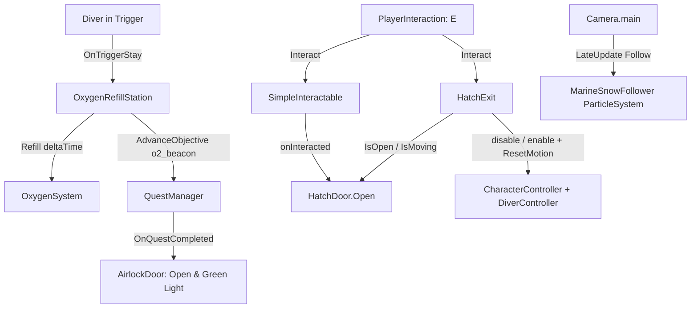

# Environment Systems
Ultima verifica: 2026-11-24

## Scopo e confini
Raggruppa gli elementi interattivi e atmosferici dell'ambiente di gioco non appartenenti alla fauna autonoma:
- Il portale stagno della base (`AirlockDoor`), che funge da passaggio di fine sezione legato agli obiettivi di missione.
- Il portello della capsula di discesa (`HatchDoor`), prima interazione del gioco: ruota sulla cerniera quando il diver preme [E].
- L'uscita guidata dalla capsula (`HatchExit`): a portello aperto, [E] porta il diver attraverso l'apertura fino al fondale a controlli bloccati.
- La stazione di rifornimento ossigeno (`OxygenRefillStation`), che ripristina la bombola del diver e avanza gli obiettivi di sopravvivenza.
- L'effetto atmosferico particellare della neve marina (`MarineSnowFollower`), ottimizzato per seguire il punto di vista del giocatore.
- Il cavo scoperto della chiusa (`ShortedCable`, puzzle Z2 della slice): fa luce debole che attira gli isopodi; con isopodi sopra il circuito è in corto e la leva non ridà corrente.
- La mina navale ancorata del perimetro (`NavalMine`): oscilla con la corrente, la scia del diver la scosta, il contatto con la testa o con la catena la fa scoppiare e uccide il diver.
- L'appoggio automatico al terreno dei prefab di scena in Editor (`GroundSnap`): stazione O₂, power station e simili si adagiano sul fondale mentre li sposti.
- La lampada da cantiere della discarica Z2 (`LightLure`, dal 2026-11-23): luce ferma che conta come accesa dal sub e si accende e spegne a ciclo; i lanternfish la preferiscono a ogni altra luce.
- La segnaletica CRT (dal 2026-11-23, solo prefab blockout, nessuno script): cartelli stradali con icona della zona, nome in inglese e freccia, su un palo.
- Lo schermo CRT ambra di un gruppo di prese (`SocketGroupScreen`, dal 2026-11-23): icone delle celle inserite e del bersaglio, senza testo.
- Le isole di luce protetta (`StressLightZone`), documentate in dettaglio in [DarknessStress-docs.md](file:///Z:/_PROJECTS/Unity/Project_Deep/documentation/DarknessStress-docs.md).

## File e componenti
- `Assets/_Project/Code/Environment/AirlockDoor.cs`: Controller dell'apertura meccanica e dei segnali visivi del portale stagno della base DR-04.
- `Assets/_Project/Code/Environment/HatchDoor.cs`: Apertura a rotazione su un asse di un portello incernierato, con curva di easing ed eventi di inizio/fine.
- `Assets/_Project/Code/Environment/HatchExit.cs`: `IInteractable` che, a portello aperto, sposta il diver lungo una curva interno → apertura → fondale e poi restituisce i controlli.
- `Assets/_Project/Code/Environment/OxygenRefillStation.cs`: Ricaricatore continuo di O₂ per il diver in sosta sul trigger.
- `Assets/_Project/Code/Environment/ShortedCable.cs`: `IStimulusSource` che emette luce debole per le creature, conta gli esemplari di una specie entro un raggio (corto) e ridà corrente a circuito libero.
- `Assets/_Project/Code/Environment/MarineSnowFollower.cs`: Script ad esecuzione immediata (`ExecuteAlways`) che ancora il sistema particellare della neve marina davanti alla camera.
- `Assets/_Project/Code/Environment/Photocell.cs`: fotocellula delle porte, scatta col fascio rosso tenuto addosso (o con una luce di scena sopra soglia) e misura la luce ricevuta.
- `Assets/_Project/Code/Environment/PhotocellEye.cs`: occhio della fotocellula, ruota verso la luce più forte e accende lo schermo ambra (solo estetica).
- `Assets/_Project/Code/Environment/PhotocellScreen.cs`: schermo CRT ambra accanto al gate, acceso dalla stazione: occhio, icona della luce richiesta o di quella sbagliata barrata, anello di carica, lucchetto.
- Texture dello schermo e icone delle modalità torcia in `Assets/_Project/Assets/Models/Photocell/Screen/`: `T_TorchMode_Full`, `_Low`, `_Red`, `_Full_Barred`, `_Low_Barred`, `T_PhotocellScreen_Ring_00..11` (bianco su trasparente, 128 px, generate con PIL; dal 2026-11-22 le `T_TorchMode_*` sono gli esagoni disegnati da Manu in Figma (`Frame 1.svg`: esagono con raggi lunghi, raggi corti, raggi corti con barra orizzontale e tre raggi alternati attaccati al corpo, in alto a sinistra, in alto a destra e in basso; barrate con una diagonale), rigenerate da uno script PIL fuori repo; il 2026-11-23 `T_TorchMode_Red` è rigenerata con i raggi giusti, prima aveva tutti i raggi staccati come la Low; le `T_TorchMode_*` servono anche al CRT del casco, vedi `SuitFeedback.md`).
- `Assets/_Project/Code/Environment/NavalMine.cs`: mina navale ancorata, catena generata da un segmento, oscillazione, spinta della scia, scoppio e riarmo.
- `Assets/_Project/Code/Environment/GroundSnap.cs`: utility solo Editor (`ExecuteAlways`): a ogni spostamento appoggia l'oggetto sul fondale campionando i 4 angoli dell'impronta.
- `Assets/_Project/Code/Environment/LightLure.cs`: `IStimulusSource` che emette ogni frame uno stimolo `WeakLight` puntiforme, di default come luce del giocatore, finché è attivo.
- `Assets/_Project/Code/Environment/ScreenFlipbook.cs` (2026-11-24): icona animata a fotogrammi di uno schermo CRT, per i cartelli animati.
- `Assets/_Project/Code/Editor/Screens/gen_sign_frames.py` (2026-11-24): genera con PIL i fotogrammi placeholder dei cartelli animati in `Assets/_Project/Assets/Models/Screens/Animated/` (`T_Sign_LightAttracts_00..05`, `T_Sign_RedLight_00..05` e, con `fauna_protocol()`, i 26 fotogrammi di FAUNA PROTOCOL `T_Fauna_A_00..09` e `T_Fauna_B_00..15`, bianco su trasparente, 256×128, stile delle icone `T_Screen_*`). Ha un self-check a fine esecuzione. Da sostituire con i disegni di Manu tenendo gli stessi nomi.
- `Assets/_Project/Code/Environment/SocketGroupScreen.cs`: schermo CRT ambra di un `SocketGroup`: un'icona per presa (piena o tratteggiata che pulsa) e l'icona del bersaglio, fioca finché il gruppo non è completo.
- Icone degli schermi in `Assets/_Project/Assets/Models/Screens/` (dal 2026-11-23, placeholder generati con PIL da uno script fuori repo nello stile degli esagoni di Manu, bianco su trasparente, 128 px, import copiato da `T_TorchMode_Full`): `T_Screen_Cell_Full` (profilo conico della cella con le barre), `T_Screen_Cell_Empty` (profilo tratteggiato), `T_Screen_Cell_Dead` (profilo barrato), `T_Screen_Tower` (traliccio con tre anelli ed esagono in cima); materiale `M_Screen_LockClosed` (copia di `M_PhotocellScreen_Icon` con il lucchetto chiuso).
- Prefab `Assets/_Project/Prefabs/Puzzle/CRTScreen.prefab` (schermo generico con testo: `Housing`, `Glass`, `Content` con `Logo` «TD», `CellId`, `Label` TMP Jersey25 al centro, `ScreenGlow`; nessuno script, per cartelli e scritte), `GeneratorScreen.prefab` (variante di `CRTScreen` con `SocketGroupScreen`, `SlotIcon_0`, `SlotIcon_1`, `TargetIcon`, `Label` spento, `CellId` «GEN-02»), `PowerCell_Dead.prefab` (variante di `PowerCell`: `itemId = power_cell_dead`, nessuna luce né stimolo; dal 2026-11-23 `MSH_CellGlow` spento, `glowRenderer` vuoto e tutti i renderer col materiale `M_NuclearCell_Dead` scuro e opaco, base `(0.33, 0.27, 0.21)`, smoothness 0.12, perché nel playtest blind i riflessi delle scariche sembravano bagliore). `GeneratorScreen`: `emptyIcon` = `T_Screen_Cell_Charge` (sagoma tratteggiata col fulmine: il generatore vuole celle cariche), `rejectedIcon` = `T_Screen_Cell_Dead` (cella barrata); icone placeholder in `Assets/_Project/Assets/Models/Screens/`.
- Segnaletica (2026-11-23, blockout da sostituire con la mesh di Manu): `Assets/_Project/Prefabs/Puzzle/CRTSign.prefab`, variante di `CRTScreen` larga (`Housing` 1.1 × 0.54, `Glass` 1.0 × 0.44) con `Content/Icon` a sinistra, `Label` al centro (TMP con auto size 0.4…1.2, area 0.5 × 0.24) e `Content/Arrow` a destra; `Assets/_Project/Prefabs/Puzzle/CRTSignPost.prefab`, palo con `Blockout` (`BLK_Palo` cilindro alto 4 m, `BLK_Base`) e un figlio vuoto `Signs` dove si mettono le istanze di `CRTSign`. Icone `T_Screen_Arrow` (freccia verso destra), `T_Screen_Mining` (cristalli), `T_Screen_Oil` (goccia), `T_Screen_Generator` (fulmine), con i materiali `M_Screen_Arrow`, `M_Screen_Mining`, `M_Screen_Oil`, `M_Screen_Generator`, `M_Screen_Tower`, `M_Screen_Cell_Dead` (copie di `M_Screen_LockClosed` con un'altra `_BaseMap`). Direzione della freccia: rotazione Z locale di `Arrow`, 0° destra, 90° dritto, 180° sinistra. Icona: si cambia il materiale di `Icon`.
- `Assets/_Project/Code/Environment/StressLightZone.cs`: Trigger volumetrico di sollievo dallo stress (vedere [DarknessStress-docs.md](file:///Z:/_PROJECTS/Unity/Project_Deep/documentation/DarknessStress-docs.md)).

## Dipendenze e flusso dati
- **Progressione**: `AirlockDoor` si iscrive a `QuestManager.Instance.OnQuestCompleted` in `Start()`. All'apertura del portale si sposta verso `targetPosition`.
- **Portello capsula**: `HatchDoor` non legge input. Lo attiva un `SimpleInteractable` sullo stesso oggetto, il cui `onInteracted` chiama `HatchDoor.Open()` (vedi [Interaction.md](file:///Z:/_PROJECTS/Unity/Project_Deep/documentation/Interaction.md)).
- **Uscita capsula**: `HatchExit` è un `IInteractable` raggiunto da `PlayerInteraction`. Legge `HatchDoor.IsOpen`/`IsMoving`; durante l'uscita disabilita `CharacterController` e `DiverController` del giocatore, scrive direttamente posizione e yaw del diver e posa di `DiverController.CameraTarget`, poi li riabilita, azzera `ViewRoll`, sblocca `LockMovement` e chiama `SetViewPitch(0)` e `ResetMotion()`.
- **Ricarica O₂**: `OxygenRefillStation` rileva l'`OxygenSystem` sul diver e, se è accesa, chiama `Refill(Time.deltaTime)` durante la permanenza nel trigger e registra il checkpoint su `DiverRespawn`. Spenta (`startsPowered` falso) non ricarica finché `PowerOn()` (in scena da `GrabSocket.onSocketed`).
- **Chiusa 1 (dal 2026-11-10)**: cella trascinata nello slot → stazione accesa; modulo luce rossa (dal 2026-11-21, prima flash) → `DiverFlashlight.UnlockRed`; fascio rosso sulla `Photocell` → `AirlockDoor.HandleQuestCompleted`. `PhotocellEye` legge ogni frame `Photocell.BrightestLight`/`BrightestScore` e non scrive nulla sulla cella. `PhotocellScreen` legge `OxygenRefillStation.IsPowered` (acceso) e `Photocell.BrightestScore`/`Triggered`.
- **Chiusa (puzzle Z2)**: `ShortedCable` si registra con `CreatureManager.AddSource` in `OnEnable` e ogni frame aggiunge uno stimolo `WeakLight` puntiforme. In `Update` scorre `CreatureManager.ActiveCreatures` e conta le creature con `Profile == shortingSpecies` entro `shortRadius`. La leva (`SimpleInteractable` riusabile) chiama `ShortedCable.TryRestorePower` da `onInteracted`; a circuito libero `onPowerRestored` apre il gate (`AirlockDoor.HandleQuestCompleted`).
- **Mina navale**: `NavalMine` trova in `OnEnable` (solo Play) il `DiverController` con `FindAnyObjectByType` e ne legge `CharacterController` e `OxygenSystem`. Ogni frame misura la velocità del diver dalle posizioni (scarta salti oltre 3 m, cioè i respawn). Al contatto chiama `OxygenSystem.SetNormalized(0)`: la morte passa per `OnOxygenDepleted` → `DiverRespawn` come l'asfissia. Non usa trigger né fisica.
- **Rendering & Atmosfera**: `MarineSnowFollower` calcola in `LateUpdate()` la posizione delle particelle oceaniche in base alla posizione e rotazione della `Camera.main`.

## Componenti

### AirlockDoor
- **Responsabilità e ciclo di vita**:
  - `Awake()`: Salva `closedPosition = doorPanel.localPosition` e imposta la luce `doorStatusLight` su `lockedColor`.
  - `Start()` / `OnDestroy()`: Sottoscrive `QuestManager.Instance.OnQuestCompleted` e lo disdice tramite `QuestManager.TryGetInstance`, così alla chiusura della scena non ricrea un `QuestManager` (prima lasciava l'errore "Some objects were not cleaned up when closing the scene"). Se la quest è già completata all'avvio, apre immediatamente la porta.
  - `Update()`: Quando `isOpen` è vero, interpola `doorPanel.localPosition` verso `targetPosition` a velocità `openSpeed`, e allo stesso modo `secondPanel` (se c'è) verso la sua posizione chiusa + `secondOpenOffset`.
- **Campi Inspector**:
  - `Light doorStatusLight`: Faretto di segnalazione sopra la porta.
  - `Transform doorPanel`: Paratia mobile della porta.
  - `Vector3 openOffset` (default: `(0f, 3.5f, 0f)`): Spostamento relativo del pannello all'apertura.
  - `Transform secondPanel` (opzionale, dal 2026-11-11): seconda anta delle porte a due battenti; `Vector3 secondOpenOffset` (default `(0f, 3.5f, 0f)`), nello spazio del suo genitore.
  - `float openSpeed` (default: `2f` m/s).
  - `Color lockedColor` (default: Rosso), `Color unlockedColor` (default: Verde).
  - `bool isOpen` (debug sola lettura).
- **API pubbliche**:
  - `void HandleQuestCompleted()`: Avvia l'apertura della paratia e colora la luce di verde.

### ShortedCable
- **Responsabilità e ciclo di vita**:
  - `OnEnable()` / `OnDisable()`: registra e toglie il componente come sorgente di stimoli nel `CreatureManager`. Senza manager logga un errore e il cavo non attira nessuno.
  - `EmitStimuli(List<CreatureStimulus>)`: aggiunge `CreatureStimulus.PointLight(posizione, lightRadius, WeakLight, false)` con `OnlySpecies = shortingSpecies` a ogni frame, anche dopo che la corrente è tornata: la luce del cavo attira solo gli isopodi (prima richiamava anche 48 lanternfish, che si ammassavano contro il muro della chiusa).
  - `Update()`: aggiorna `IsShorted` (almeno una creatura di `shortingSpecies` entro `shortRadius`); finché non c'è corrente aggiorna il prompt della leva e fa sfarfallare `cableLight` (rumore di Perlin sull'intensità iniziale) quando è in corto.
- **Campi Inspector**:
  - `CreatureManager manager`: obbligatorio.
  - `CreatureProfile shortingSpecies`: specie che manda in corto il cavo (`Creature_Isopod`). Vuoto = mai in corto.
  - `SimpleInteractable lever` (opzionale): riceve `SetPromptText` con lo stato del circuito e `SetInteractable(false)` quando torna la corrente.
  - `Light cableLight` (opzionale): sfarfalla durante il corto.
  - `float lightRadius` (default `10`): portata della luce debole per sensibilità 1 (m).
  - `float shortRadius` (default `3.5`): raggio del corto (m). Va tenuto sopra l'`inspectDistance` della specie (2,5 per l'isopode), dove le creature si fermano a guardare la luce.
  - `string shortedPrompt` (default `"Leva: circuito in corto"`), `string readyPrompt` (default `"Riattiva la chiusa"`).
  - `UnityEvent onPowerRestored`: lanciato una volta sola, quando la leva viene tirata a circuito libero.
  - `UnityEvent onShortedAttempt`: lanciato quando la leva viene tirata durante il corto (feedback, dialoghi).
- **API pubbliche**:
  - `bool IsShorted { get; }`, `bool IsPowered { get; }`.
  - `void TryRestorePower()`: da collegare a `SimpleInteractable.onInteracted` (leva con `isReusable = true`).
  - `void EmitStimuli(List<CreatureStimulus> output)` (`IStimulusSource`).

### HatchDoor
- **Responsabilità e ciclo di vita**:
  - `Awake()`: Se `doorPivot` è nullo usa il proprio `transform`; salva `closedRotation = doorPivot.localRotation`.
  - `Update()`: Solo durante l'apertura. Avanza il tempo, valuta `openCurve` e imposta `doorPivot.localRotation = closedRotation * AngleAxis(curve(t) * openAngle, hingeAxis)`. A fine corsa invoca `onOpened`.
  - Apertura one-shot: non esiste chiusura.
- **Campi Inspector**:
  - `Transform doorPivot` (default: `null` → se stesso): Transform ruotato. Il pivot deve stare sull'asse della cerniera.
  - `Vector3 hingeAxis` (default: `Vector3.right`): Asse di rotazione nello spazio locale del pivot.
  - `float openAngle` (default: `110f` gradi): Angolo di apertura. Il segno decide il verso.
  - `float openDuration` (default: `1.6f` secondi).
  - `AnimationCurve openCurve` (default: `EaseInOut(0,0,1,1)`).
  - `UnityEvent onOpenStarted`, `UnityEvent onOpened`: Agganci per audio, VFX e Timeline.
  - `bool isOpen` (debug sola lettura).
- **API pubbliche**:
  - `bool IsOpen { get; }`
  - `bool IsMoving { get; }`
  - `void Open()`: Avvia l'apertura e invoca `onOpenStarted`. Ignorata se il portello è già aperto.
- **Riferimenti obbligatori**: nessuno. Senza un `SimpleInteractable` (o altro chiamante di `Open()`) il portello resta chiuso.

### HatchExit
- **Responsabilità e ciclo di vita**:
  - Implementa `IInteractable`. Richiede un `Collider` (in scena un `BoxCollider` trigger sull'apertura). L'uscita è un salto scriptato in tre fasi, non un verbo del giocatore (il salto libero resta all'Hydropack, vedi [PlayerMovement.md](file:///Z:/_PROJECTS/Unity/Project_Deep/documentation/PlayerMovement.md)).
  - `CanInteract(user)`: vero solo una volta, se `hatch.IsOpen && !hatch.IsMoving` e `passPoint`/`exitPoint` sono assegnati.
  - `Interact(user)`: memorizza il transform dell'utente, legge `DiverController.CameraTarget`, disabilita `DiverController` e `CharacterController`. Calcola il punto di atterraggio: con `snapExitToGround` un raycast da 1 m sopra `exitPoint` verso il basso (5 m, `groundMask`, trigger ignorati) trova il suolo, e la quota viene alzata di `height / 2 - center.y + skinWidth` del `CharacterController`, cioè dove il controller lascerebbe il pivot; senza colpo resta `exitPoint`. Salva yaw, pitch, `DiverController.ViewRoll` e posizione della camera di partenza, poi invoca `onExitStarted`.
  - `Update()`, in tre fasi:
    1. **Raccolta** (`crouchDuration`): il diver resta fermo, ruota metà dello yaw verso l'uscita, la testa scende di `crouchDepth` e lo sguardo va verso `passPoint` più `crouchPitch`.
    2. **Salto** (`jumpDuration`): i piedi seguono una Bézier quadratica da partenza ad atterraggio, con controllo calcolato perché a metà curva passino per `passPoint - up * eyeHeight`. Oltre metà si aggiunge una parabola `arcHeight * sin(π·u)`, dopo il portello per non toccarne il bordo. L'avanzamento nel tempo segue `jumpCurve` (veloce alla spinta, frenato verso la fine come dall'acqua). Lo sguardo insegue l'inclinazione della traiettoria (`pathLookWeight`, limitata a −30°…35°), lo yaw arriva alla direzione d'uscita, il roll oscilla fino a `flightRoll` a metà volo e la testa torna in quota nel primo quarto.
    3. **Atterraggio** (`landDuration`): piedi fermi sul punto di atterraggio, la testa scende di `landDepth` e risale (discesa rapida, risalita lenta), lo sguardo ha uno scatto di `landPitchKick` e si assesta a 0.
  - Raddrizzamento dal sedile: roll di partenza (`ViewRoll`) e posizione laterale della camera tornano a 0 e all'altezza occhi standard entro la raccolta più il 40% del salto, cioè quando il diver ha passato il portello.
  - Fine (dal 2026-11-14): `DiverController.PlaceStanding(land, exitYaw, eyeHeight)`, che spegne e riaccende il `CharacterController` attorno al posizionamento e fa `ViewRoll = 0`, `CameraBasePosition = (0, eyeHeight, 0)`, camera dritta, `enabled = true`, `SetViewPitch(0)`, `ResetMotion()`, `LockMovement = false`; senza `DiverController` posa e camera a mano. Poi `onExited`. Stessa routine del menu cheat (vedi [DevTools.md](file:///Z:/_PROJECTS/Unity/Project_Deep/documentation/DevTools.md)).
- **Campi Inspector**:
  - `HatchDoor hatch` (default: `null`): Portello da cui dipende la disponibilità.
  - `Transform passPoint` (default: `null`): Punto attraversato dalla camera, al centro dell'apertura.
  - `Transform exitPoint` (default: `null`): Punto di uscita sul fondale (vedi `snapExitToGround`).
  - `float eyeHeight` (default: `1.5f`, dal 2026-11-23; prima `1.375f`): Altezza occhi rispetto ai piedi; deve corrispondere a `PlayerCameraRoot` (1.5 nel `Player.prefab`). Alzata dopo il playtest blind: la camera era troppo bassa. La posa da seduto del risveglio resta a `PlayerWakeUpSequence.eyeHeight` 1.375.
  - `string promptText` (default: `"Esci"`).
  - `bool snapExitToGround` (default: `true`), `LayerMask groundMask` (default: `~0`): Atterraggio sul suolo sotto `exitPoint`.
  - Raccolta: `float crouchDuration` (`0.45`), `float crouchDepth` (`0.15` m), `float crouchPitch` (`10`°).
  - Salto: `float jumpDuration` (`1.4`), `AnimationCurve jumpCurve` (default: da (0,0) con tangente 2.4 a (1,1) con tangente 0.2 in ingresso e 0 in uscita), `float arcHeight` (`0.35` m), `float pathLookWeight` (`0.6`, 0–1), `float flightRoll` (`3`°).
  - Atterraggio: `float landDuration` (`0.6`), `float landDepth` (`0.2` m), `float landPitchKick` (`6`°).
  - `UnityEvent onExitStarted`, `UnityEvent onExited`.
  - `float EyeHeight { get; }` (dal 2026-11-14): altezza degli occhi in piedi, letta da `CheatMenu`.
- **API pubbliche**: `string PromptText { get; }`, `bool CanInteract(GameObject user)`, `void Interact(GameObject user)`.
- **Riferimenti obbligatori**: `hatch`, `passPoint`, `exitPoint`. Se uno manca, `CanInteract` restituisce `false` e l'uscita non parte. L'utente deve avere `CharacterController` e `DiverController` (se mancano, vengono ignorati; senza `DiverController` la camera non viene animata).

### OxygenRefillStation
- **Responsabilità e ciclo di vita**:
  - Richiede un `Collider` con `isTrigger = true`.
  - `Awake()`: stato acceso da `startsPowered`; `respawnPoint` vuoto = se stesso; luce del beacon in `standbyColor`, spenta se la stazione è spenta.
  - `OnTriggerEnter(Collider other)`: Cerca `OxygenSystem`; se la stazione è accesa "aggancia" il diver: notifica `questObjectiveId` a `QuestManager.Instance` una volta (saltato se l'id è vuoto, dal 2026-11-10), registra `respawnPoint` su `DiverRespawn`, ripara il vetro del casco (`HelmetDamage.ResetDamage()` sull'unico `HelmetDamage` in scena, dal 2026-11-23) e porta la luce ad `activeColor`.
  - `PowerOn()`: accende stazione e beacon, invoca `onPowered`; se il diver è già dentro lo aggancia subito.
  - `OnTriggerStay(Collider other)`: se accesa chiama `playerOxygen.Refill(Time.deltaTime)`.
  - `OnTriggerExit(Collider other)`: Ripristina la luce in `standbyColor` e azzera il riferimento al player.
- **Campi Inspector**:
  - `float refillRatePerSecond` (default: `10f`): Parametro locale non usato (la velocità effettiva è `OxygenProfile.refillRate`).
  - `string questObjectiveId` (default: `"o2_beacon"`; vuoto = nessuna notifica).
  - `bool startsPowered` (default: `true`), `UnityEvent onPowered`.
  - `Transform respawnPoint` (default: vuoto = se stesso): checkpoint registrato su `DiverRespawn`.
- **API pubbliche**: `bool IsPowered { get; }`, `void PowerOn()`, `void PowerOff()` (dal 2026-11-23: stazione spenta, beacon in `standbyColor` e spento; non ricarica più, il checkpoint già registrato resta; in scena da `GrabSocket.onUnsocketed`).
  - `Light stationBeaconLight`: Faro di segnalazione della colonnina. Deve restare **senza ombre**. Il 2026-11-11 `SafeBeaconLight` in `O2Station.prefab` aveva ombre Soft ed era l'unica luce aggiuntiva della scena con ombre. Si accende con `PowerOn`, cioè quando la cella si aggancia. In quel momento URP attivava le ombre delle luci aggiuntive: compilava le varianti shader dei materiali in vista e renderizzava 6 facce di shadow map. È la causa più probabile dello scatto all'inserimento della cella. Ora le ombre sono `None`. Lo scatto non è stato rimisurato in gioco: in editor, con la finestra non a fuoco, il player loop non gira.
  - `Color standbyColor` (default: ambra/giallo), `Color activeColor` (default: ciano/verde).

### Photocell *(2026-11-10)*
- **Responsabilità e ciclo di vita**: fotocellula delle porte di Tidal Dynamics. In `Awake` cerca il `DiverFlashlight` della scena e colora `indicatorLight` in `lockedColor`. In `Update`, finché non è scattata e la stazione `powerSource` è accesa (dal 2026-11-21; vuoto = sempre alimentata, `bool Powered`), controlla il fascio della torcia e le `extraLights`. Dal 2026-11-21 la torcia la fa scattare solo in `FlashlightMode.Red`, a qualunque intensità (`IsLitByRedBeam`), e solo dopo `redHoldSeconds` di fascio addosso: `RedCharge` sale verso 1 col fascio rosso sulla cella e scende alla stessa velocità quando esce; a 1 scatta. Senza corrente `RedCharge` resta a 0; una `extraLight` serve `intensity ≥ minSourceIntensity` (`IsLitBy`). In entrambi i casi la luce dev'essere accesa, la cella è entro `range` e, per gli spot, dentro metà di `spotAngle`, e un `RaycastAll` dalla cella verso la luce (trigger ignorati) non incontra collider tranne quelli che contengono la luce (la capsula del diver) e la cella stessa. Scatta una volta: `RedCharge` = 1, luce in `triggeredColor`, `onTriggered`. Pensata per la chiusa 1 (fascio rosso) e per fari di sicurezza in `extraLights`. API: `bool IsLitByRedBeam()`, `bool IsLitBy(Light)` (solo per le `extraLights`), `float ReceivedLight(Light)`, `void Trigger()`.
- **Luce ricevuta (2026-11-11)**: ogni frame, prima del controllo di scatto e anche dopo lo scatto, calcola `ReceivedLight` per la torcia e le `extraLights` e tiene la più forte in `BrightestLight`/`BrightestScore`. Il punteggio non ha soglia: intensità × `(1 − d/range)²` × posizione nel cono (1 al centro, 0 al bordo) per gli spot, 0 se spenta, fuori portata, fuori cono o coperta. Misurato il 2026-11-11: torcia Full a 5.6 m al bordo del cono circa 3, lampo circa 112. Serve all'occhio. Nello stesso passo salva `BeamModeOnCell`: la modalità della torcia se il suo fascio arriva alla cella (punteggio > 0), altrimenti null; `IsLitByRedBeam` la legge senza rifare il raycast.
- **Linea di vista**: un solo metodo privato condiviso da `IsLitBy` e `ReceivedLight`; dal 2026-11-11 ignora la cella **e tutti i suoi figli** (guscio e occhio con collider non la coprono più) oltre ai collider che contengono la luce e ai trigger.
- **Campi Inspector**: `OxygenRefillStation powerSource` (vuoto; in `SCN_Gameplay` la stessa stazione dello schermo, `O2Station_1` della chiusa 1), `float minSourceIntensity` (`200`, solo per le `extraLights`; la torcia del diver scatta solo in rosso), `float redHoldSeconds` (`1.5` s, dal 2026-11-21), `Light[] extraLights` (vuoto), `LayerMask occluders` (tutti), `Light indicatorLight` (opzionale), `Color lockedColor` (rosso), `Color triggeredColor` (verde), `UnityEvent onTriggered`, `bool triggered` (debug).
- **API pubbliche**: `bool Triggered { get; }`, `bool Powered { get; }`, `float RedCharge { get; }` (0-1), `FlashlightMode? BeamModeOnCell { get; }`, `Light BrightestLight { get; }`, `float BrightestScore { get; }`, `void Trigger()`, `bool IsLitByRedBeam()`, `bool IsLitBy(Light light)`, `float ReceivedLight(Light light)`.
- **Limiti**: la soglia di scatto è sull'intensità della sorgente, non sulla luce ricevuta: la distanza conta solo come `range` della luce. La cella va staccata di qualche cm dalla parete, perché il raggio di linea di vista parte dal suo centro. Fino a una `RaycastAll` per luce candidata a frame. I lanternfish non contano: emettono `CreatureStimulus.PointLight`, non una `Light` di Unity.

### PhotocellEye *(2026-11-11)*
- **Responsabilità e ciclo di vita**: occhio della fotocellula, solo estetica. In `Awake` trova la `Photocell` sui genitori se manca, salva la `localRotation` di riposo di `eyePivot` e una fase casuale di scansione. In `Update`: se `Photocell.BrightestLight` esiste, ruota `eyePivot` verso la luce con `Quaternion.RotateTowards` a `turnSpeed`, limitando la direzione a `maxAngle` dal +Z di riposo (un bersaglio alle spalle porta l'occhio al bordo del cono, senza ribaltarlo); senza luce scansiona con due seni (yaw `scanAmplitude`, pitch 40% di quello) a `scanTurnSpeed`. L'emissione dello schermo va verso `max(idleGlow, BrightestScore / fullGlowScore)` a `glowResponse` al secondo e si scrive con un `MaterialPropertyBlock` (`_EmissionColor` = `screenColor` × glow × `maxEmission`). Disattivarlo non tocca lo scatto della cella.
- **Campi Inspector**: `Photocell photocell` (vuoto: cercata sui genitori), `Transform eyePivot` (vuoto: il proprio transform), `float maxAngle` (`60`), `float turnSpeed` (`90` °/s), `float scanAmplitude` (`25`°), `float scanSpeed` (`0.35`), `float scanTurnSpeed` (`30` °/s), `Renderer screenRenderer` (opzionale, materiale con emissione attiva), `Color screenColor` (ambra HDR `(1, 0.55, 0.1)`), `float idleGlow` (`0.15`), `float fullGlowScore` (`30`), `float maxEmission` (`4`), `float glowResponse` (`6`).
- **API pubbliche**: nessuna.
- **Riferimenti obbligatori**: senza `Photocell` l'occhio scansiona sempre e lo schermo resta al minimo. `eyePivot` deve essere un vuoto centrato nella sfera con +Z verso lo sguardo: il modello va sotto come figlio, con la correzione d'asse dell'FBX su quel figlio, mai sul pivot.
- **Deviazione dal vault**: Flusso-Slice diceva «rotazione in Photocell»; è un componente a parte per poterlo spegnere senza rischi sulla chiusa.

### PhotocellScreen *(2026-11-11, stati rifatti il 2026-11-21)*
- **Responsabilità e ciclo di vita**: schermo CRT ambra della fotocellula, solo lettura. In `Awake` trova la `Photocell` se manca. In `Update`: a ogni cambio di `IsPowered` (`powerSource.IsPowered`, sempre vero senza stazione) accende o spegne `content` e l'emissione di `background` (`backgroundGlow` o nero, via `MaterialPropertyBlock`). Acceso, legge `Photocell.Triggered`, `RedCharge` e `BeamModeOnCell` e mostra quattro stati senza testo (deciso con Manu il 2026-11-21, la barra di luminosità è tolta):
  - **In attesa** (nessun fascio sulla cella, o rosso senza modulo): occhio chiuso, `modeIcon` = `redIcon` che pulsa in alfa tra `pulseMinAlpha` e 1 a `pulseRate` al secondo.
  - **Luce sbagliata** (fascio Full o Low sulla cella): `modeIcon` = `fullBarredIcon` o `lowBarredIcon`, alfa 1; occhio chiuso.
  - **Rosso in carica**: occhio verso aperto, `chargeRing` visibile col fotogramma `ceil(RedCharge × n) − 1` di `ringFrames`. L'anello si vede solo con `RedCharge > 0`, niente anello vuoto; se il fascio esce l'anello si svuota con la carica.
  - **Scattata**: `modeIcon` nascosta, occhio aperto, anello pieno; il lucchetto lampeggia (alfa 0.15 a metà di ogni ciclo, `blinkRate` al secondo) per `blinkDuration` secondi, poi passa a `lockOpen`.
  - L'occhio segue un valore 0-1 che va a 1 col fascio rosso sulla cella o dopo lo scatto, a 0 altrimenti, a `eyeResponse` al secondo; fotogramma `round(valore × (n − 1))` di `eyeFrames`.
  - Icone colorate con `_BaseColor` = `amber` × alfa e `_BaseMap`, nel `MaterialPropertyBlock`; `chargeRing` e `modeIcon` si nascondono con `Renderer.enabled`.
- **Campi Inspector**: `Photocell photocell` (vuoto: la prima in scena), `OxygenRefillStation powerSource` (vuoto: sempre acceso), `GameObject content`, `Renderer background` (opzionale, materiale con emissione attiva), `Color backgroundGlow` (HDR `(0.12, 0.06, 0.01)`), `Color amber` (`(1, 0.6, 0.15, 1)`), `Renderer eyeIcon`, `Texture2D[] eyeFrames` (da chiuso ad aperto), `float eyeResponse` (`6`), `Renderer modeIcon`, `Texture2D redIcon`, `Texture2D fullBarredIcon`, `Texture2D lowBarredIcon`, `float pulseRate` (`1.2`), `float pulseMinAlpha` (`0.25`), `Color redTint` (`(0.85, 0.13, 0.14, 1)`, dal 2026-11-22: l'icona `redIcon` è rossa, unica non ambra), `Renderer chargeRing`, `Texture2D[] ringFrames` (dal primo spicchio al cerchio pieno, 12 in prefab), `Renderer lockIcon`, `Texture2D lockClosed`, `Texture2D lockOpen`, `float blinkDuration` (`1.5` s), `float blinkRate` (`6`).
- **API pubbliche**: `bool IsPowered { get; }` (`Fill` tolto il 2026-11-21 con la barra).
- **Prefab `PhotocellUnit`** (2026-11-21): sotto `Content` i `Bar_0..9` e `ThresholdNotch` sono disattivati (non cancellati); `EyeIcon` a `(0, 0.05)` scala 0.17, `ChargeRing` (copia del quad dell'occhio) a `(0, 0.05, −0.001)` scala 0.25, `ModeIcon` a `(−0.08, −0.135)` scala 0.12 (dal 2026-11-22 a `(−0.17, −0.11)` scala 0.18: illeggibile su portatile; a 0.20 toccava il bordo del vetro), `LockIcon` spostato a `(0.17, −0.135)` scala 0.10. Tutti col materiale `M_PhotocellScreen_Icon`.
- **Limiti**: un'`extraLight` sopra soglia fa scattare la cella subito, senza carica né anello. Niente effetto CRT (scanline, curvatura); il logo `TD` e l'id `PC-01` sono provvisori, in attesa della brand identity.

### NavalMine *(2026-11-13)*
- **Responsabilità e ciclo di vita**:
  - `[ExecuteAlways]`. `OnEnable` rigenera la catena (anche in editor); in Play calcola la fase dell'oscillazione e trova il diver. `OnDisable` distrugge la mesh della catena. `OnValidate` (editor) rimanda `RebuildChain` a `EditorApplication.delayCall`.
  - Catena: `chainSegment` (un anello intero più due mezzi anelli, passo = altezza dei bounds) ripetuto in verticale con `Mesh.CombineMeshes` in una mesh `HideFlags.DontSave`, mai salvata in scena o nel prefab. La testa va a y locale `chainLength` del pivot. Il numero di segmenti è `ceil((chainLength + headOverlap) / passo)`: l'ultimo sporge dentro la testa fino a un passo, i segmenti non vengono mai scalati.
  - `Update` (solo Play): rumore Perlin su due assi (`swayAngle`, `swayPeriod`, fase da `seed` o dalla posizione) più una molla smorzata spinta dalla scia del diver; la somma inclina `swayPivot` attorno all'asse orizzontale del mondo.
  - Scia: con il diver entro `wakeRadius` oltre il contatto, la velocità orizzontale del diver spinge la molla con peso `(1 - distanza/wakeRadius)²`. Velocità limitata a 8 m/s.
  - Contatto (analitico, senza fisica): il diver è la capsula verticale del `CharacterController` (asse lungo `height/2 - radius` sopra e sotto il centro, raggio `radius`). Testa: distanza fra il punto dell'asse del diver più vicino al centro dei bounds della testa e quel centro, meno il raggio della testa (estensione massima dei bounds) e `radius`. Catena (2026-11-13, mine «vecchie e instabili»): segmento da `swayPivot` a `head`, con raggio = estensione orizzontale massima del segmento di catena (0.102 m); distanza fra i punti più vicini dell'asse del diver e del segmento (approssimata in due passi, esatta per assi quasi paralleli), meno i due raggi. Se una delle due è `contactPadding` o meno: ossigeno a 0 e `Detonate(true)`. Non si usa `Physics.OverlapCapsule`: il `CharacterController` di PhysX risulta più stretto del suo `radius` (colpito a 0.50 m dall'asse, non a 0.53), quindi la soglia non coincideva con quella della testa.
- **Campi Inspector**:
  - Parti: `Transform swayPivot`, `Transform head` (pivot sull'aggancio della catena), `Renderer headRenderer`, `MeshFilter chainFilter`, `Mesh chainSegment`.
  - Catena: `float chainLength` (`6`, min 0.5, metri dal pivot all'aggancio della testa), `float headOverlap` (`0.12`).
  - Piazzamento: `float sinkDepth` (`0.35`, usato da «Appoggia al fondale»), `int seed` (`0` = fase dalla posizione).
  - Corrente: `float swayAngle` (`10`°, 0–30; era 3 fino al 2026-11-13), `float swayPeriod` (`8` s).
  - Scia del diver: `float wakeRadius` (`2` m), `float wakeStrength` (`20`, gradi/s² per m/s a distanza minima), `float maxWakeAngle` (`10`°), `float springStiffness` (`3`), `float springDamping` (`1.6`).
  - Scoppio: `float contactPadding` (`0`), `float rearmDelay` (`4` s, più lungo dei 2 s del respawn), `UnityEvent onDetonated`.
- **API pubbliche**: `void Detonate(bool rearm)` (nasconde testa e catena, lancia `onDetonated`; con `rearm` richiama `Rearm` dopo `rearmDelay`, senza resta scoppiata, es. la lucertola alla chiusa 3); `void Rearm()` (mina intatta e ferma); `void RebuildChain()`; `bool IsDetonated { get; }`; `float ChainLength { get; }`. Context menu (editor): «Appoggia al fondale» (raycast dall'alto escludendo i propri figli, affonda di `sinkDepth`, con Undo), «Ruota a caso» (yaw casuale, con Undo). Gizmo da selezionata: sfera di contatto e sfera della scia.
- **Riferimenti mancanti**: senza `swayPivot` niente movimento; senza `chainFilter` o `chainSegment` niente catena (la testa viene comunque posizionata); senza `headRenderer` raggio 1 m centrato su `head`; senza diver in scena niente scia né contatto; senza `OxygenSystem` sul diver lo scoppio avviene ma il diver non muore.

### GroundSnap *(2026-11-20)*
- **Responsabilità e ciclo di vita**:
  - `[ExecuteAlways]`, tutto il codice è dentro `#if UNITY_EDITOR`: in build e in Play non fa nulla.
  - `Reset` (aggiunta del componente in Editor): `groundMask` = layer `Seafloor` se esiste.
  - `OnEnable`: azzera `transform.hasChanged`, così caricare la scena o aggiungere il componente a un prefab non sposta le istanze già posate.
  - `Update` (solo in edit mode, fuori dalle scene di anteprima come il Prefab Mode): se `transform.hasChanged`, chiama `Snap` e azzera il flag. Scatta quindi a ogni trascinamento, anche quando si muove un genitore.
  - `Snap`: tiene lo yaw dato a mano, lancia un raggio verso il basso (da 10 m sopra, lungo 200 m, solo `groundMask`, trigger e collider propri esclusi, colpo più vicino) ai 4 angoli dell'impronta `footprintSize` centrata in `footprintCenter`. Se un angolo non trova suolo non fa nulla. Normale del terreno dal prodotto vettoriale delle due diagonali; alto dell'oggetto = `Slerp(up mondo, normale, slopeAlign)`. Quota: il pivot più basso fra quelli che appoggerebbero ciascun angolo, meno `sink`, quindi nessun angolo resta sospeso (sui pendii forti un lato affonda). Lo spostamento orizzontale degli angoli dovuto all'inclinazione è ignorato.
- **Campi Inspector**: `LayerMask groundMask` (`~0` nel codice, `Seafloor` da `Reset`); `Vector2 footprintSize` (`(2, 2)` m, X e Z locali); `Vector2 footprintCenter` (`(0, 0)`, offset X/Z dal pivot); `float slopeAlign` (`0.5`, 0 = dritto, 1 = inclinato come il terreno); `float sink` (`0.05` m).
- **API pubbliche**: nessuna. Context menu «Appoggia al terreno» per appoggiare senza spostare. Gizmo da selezionato: rettangolo giallo dell'impronta alla base.
- **Riferimenti mancanti**: il pivot deve stare alla base del modello (vero per i prefab di `Prefabs/Puzzle/`). Senza collider del terreno sotto tutti e 4 gli angoli l'oggetto resta dov'è.

### LightLure *(2026-11-23)*
- **Responsabilità e ciclo di vita**: `MonoBehaviour` sealed, `IStimulusSource`. `Awake` prende `lamp` (o la `Light` sullo stesso oggetto) e ne salva l'intensità. `OnEnable` azzera il ciclo, cerca il `CreatureManager` con `FindAnyObjectByType` e si registra (`AddSource`); `OnDisable` si toglie (`RemoveSource`). In `Update`, con `onDuration` > 0: accesa per `onDuration` secondi e spenta per `offDuration`, sfarfallio (Perlin, intensità piena o 10%) nei primi e negli ultimi `flickerDuration` secondi dell'accensione; da spenta disabilita la `Light`. Con `onDuration` = 0 resta accesa. `EmitStimuli` aggiunge `CreatureStimulus.PointLight(transform.position, reach, StimulusCategory.WeakLight, fromPlayer)` solo quando `IsLit`.
- **Perché `fromPlayer`**: in `Creature.Perceive` fra le luci che attirano vince quella più vicina in proporzione alla portata, e una luce del giocatore ha 1 di vantaggio sul punteggio. Una cella a terra non batte la cella buona sul mucchio (provato il 2026-11-23: cella a 9 m, sciame sul mucchio da 7 a 15, nessuno all'esca); una `LightLure` con `fromPlayer` sì. La luce conta solo in linea di vista: i collider sui layer di `CreatureManager.ObstacleMask` (`Default`, `Obstacle`, `Seafloor`) la bloccano.
- **Campi Inspector**: `float reach` (`10` m): portata dello stimolo; `bool fromPlayer` (`true`); `Light lamp` (vuoto = `Light` sullo stesso oggetto); `float onDuration` (`0` s = sempre accesa); `float offDuration` (`8` s); `float flickerDuration` (`1.5` s); `float flickerRate` (`12`).
- **API pubbliche**: `bool IsLit { get; }` (vero da accesa, anche mentre sfarfalla), `void EmitStimuli(List<CreatureStimulus> output)`.
- **Riferimenti**: senza `CreatureManager` in scena non emette nulla, senza errori. I lanternfish (`weakLightReaction = Approach`) si avvicinano; il viperfish ignora le luci ma caccia i lanternfish se sono entro guinzaglio più `huntRange`.

### SocketGroupScreen *(2026-11-23)*
- **Responsabilità e ciclo di vita**: `MonoBehaviour` sealed, solo lettura. In `Update` legge `SocketGroup.Total`, `GetSocket(i).IsOccupied` e `Completed`. Icona `i`: `filledIcon` ad alfa 1 se la presa è occupata, `emptyIcon` con alfa che pulsa fra `pulseMinAlpha` e 1 a `pulseRate` se vuota; per `rejectedShowTime` secondi dopo un `GrabSocket.onRejected` della presa (dal 2026-11-23, iscrizione in `OnEnable`, rimozione in `OnDisable`) `rejectedIcon` che lampeggia a `blinkRate`; nascosta (`Renderer.enabled`) se il gruppo ha meno prese. Icona del bersaglio: `targetIdleAlpha` finché il gruppo non è completo, poi lampeggia per `blinkDuration` a `blinkRate` e resta ad alfa 1. Colore `amber` × alfa e texture via `MaterialPropertyBlock` (`_BaseColor`, `_BaseMap`), come `PhotocellScreen`. Sempre acceso: non dipende da una stazione.
- **Campi Inspector**: `SocketGroup group`, `Color amber` (`(1, 0.6, 0.15, 1)`), `Renderer[] slotIcons` (vuoto), `Texture2D filledIcon`, `Texture2D emptyIcon`, `Texture2D rejectedIcon` (dal 2026-11-23), `float rejectedShowTime` (`2.5` s), `float pulseRate` (`1.2`), `float pulseMinAlpha` (`0.25`), `Renderer targetIcon`, `Texture2D targetTexture`, `float targetIdleAlpha` (`0.2`), `float blinkDuration` (`1.5` s), `float blinkRate` (`6`).
- **API pubbliche**: nessuna.
- **Riferimenti**: senza `group` non fa nulla. Icone nulle saltate.

### ScreenFlipbook *(2026-11-24)*
- **Responsabilità e ciclo di vita**: `MonoBehaviour` sealed, `RequireComponent(Renderer)`. In `Update`, a tempo non scalato, sceglie il fotogramma `(unscaledTime mod durata del ciclo) / (1 / framesPerSecond)`, con l'ultimo tenuto `holdLastSeconds` in più, e lo scrive come `_BaseMap` in un `MaterialPropertyBlock` solo quando cambia. Il materiale condiviso non viene toccato: il colore ambra resta quello del materiale. Tutti i cartelli con lo stesso ritmo sono in fase.
- **Campi Inspector**: `Texture2D[] frames` (vuoto), `float framesPerSecond` (`2`, min 0.1), `float holdLastSeconds` (`1`).
- **API pubbliche**: nessuna.
- **Riferimenti**: senza fotogrammi `Debug.LogError` in `Awake` e non fa nulla; fotogrammi nulli saltati.

### MarineSnowFollower
- **Responsabilità e ciclo di vita**:
  - `[ExecuteAlways]` per visualizzare il pulviscolo marino sia in Play Mode che nell'Editor.
  - `LateUpdate()`: Posiziona il Transform del sistema particellare a `target.position + target.rotation * offset`.
- **Campi Inspector**:
  - `Transform target`: Camera da seguire (se nullo, individua `Camera.main`).
  - `Vector3 offset` (default: `(0f, 1f, 3f)`): Offset locale davanti agli occhi del diver.
- **Aspetto delle particelle (verificato 2026-10-07 in `SCN_EnvDemo`, oggetto `MarineSnowParticles`)**:
  - Materiale `Assets/_Project/Materials/Environment/VFX/M_MarineSnow.mat`: shader `Universal Render Pipeline/Particles/Unlit`, superficie trasparente con blend additivo, tinta `(0.85, 0.92, 1, 0.8)`.
  - Texture `T_MarineSnow_Atlas.png` (512×512, atlas 4×4, bianco con la forma nell'alpha): riga 1 fiocchi soffici, riga 2 aggregati a grappolo, riga 3 filamenti, riga 4 granelli con alone. Generata proceduralmente.
  - Particle System: `Texture Sheet Animation` in modalità Grid 4×4, `WholeSheet`, frame iniziale casuale; rotazione iniziale casuale 0–360° e `Rotation over Lifetime` tra −0.3 e 0.3 rad/s.
  - Valori ritoccati da Manu in `SCN_EnvDemo` e copiati il 2026-10-09 in `SCN_Gameplay` (`08_UnderwaterAtmosphere/MarineSnowParticles`, Copy/Paste Component Values del solo `ParticleSystem`; renderer e `MarineSnowFollower` erano già uguali): `prewarm` attivo, `startLifetime` 24 s, `startSize` 0.015 m, alpha massimo di `startColor` 0.235, `startRotationX`/`Y` in modalità `minMaxState` 3, `maxParticles` 800. Prima in `SCN_Gameplay`: senza prewarm, 12 s, 0.02–0.09 m, alpha 0.35, 600 particelle.

## Setup in Unity
1. **Airlock**:
   - Creare un GameObject con la paratia mobile `doorPanel` e una luce `doorStatusLight`.
   - Aggiungere `AirlockDoor` e verificare che sia presente `QuestManager` in scena.
2. **Stazione O₂**:
   - Creare la mesh della colonnina, aggiungere un `Collider` impostato come trigger e il componente `OxygenRefillStation`.
3. **Portello capsula**:
   - Sulla mesh del portello (pivot sulla cerniera) aggiungere `HatchDoor` e `SimpleInteractable`; collegare `onInteracted` a `HatchDoor.Open`.
   - Il diver interagisce dall'interno: i `MeshCollider` non convessi non vengono colpiti dal lato posteriore, quindi aggiungere un figlio con `BoxCollider` trigger sottile davanti alla faccia interna. `PlayerInteraction` usa `QueryTriggerInteraction.Collide` e `GetComponentInParent`, quindi il trigger figlio basta.
   - Uscita: figlio della radice della capsula (non del portello, che ruota) con `BoxCollider` trigger appena oltre la faccia esterna del portello chiuso e `HatchExit`. Da portello chiuso il raggio colpisce prima il volume del portello; aperto, colpisce il volume d'uscita. Figli `HatchPassPoint` (centro apertura) e `HatchExitPoint` (fondale, con spazio libero per la capsula del player).
4. **Marine Snow**:
   - Creare un Particle System con particelle fluttuanti a bassa velocità e assegnare `MarineSnowFollower`.
   - Per l'aspetto a fiocchi: materiale `M_MarineSnow` sul `ParticleSystemRenderer` e `Texture Sheet Animation` 4×4 (vedi sopra).
5. **Chiusa (cavo in corto)**:
   - Oggetto cavo sul fondale con `ShortedCable`: `manager` = `CreatureManager` di scena, `shortingSpecies` = `Creature_Isopod`, opzionale `cableLight`.
   - Un `CreatureNest` di isopodi con il cavo dentro la portata della luce (`lightRadius` × `lightSensitivity` 0,8 dell'isopode), altrimenti gli isopodi del nido non lo vedono.
   - Leva con `Collider` e `SimpleInteractable` (`isReusable = true`), `onInteracted → ShortedCable.TryRestorePower`; assegnare la leva al campo `lever` del cavo.
   - Gate con `AirlockDoor` senza dipendere dalla quest: `onPowerRestored → AirlockDoor.HandleQuestCompleted`.

6. **Appoggio al terreno (`GroundSnap`)**:
   - Sulla radice di un prefab con pivot alla base: aggiungere `GroundSnap`, regolare `footprintSize` e `footprintCenter` finché il rettangolo giallo copre la base del modello. Poi basta trascinare l'oggetto: segue il terreno. Lo spostamento sull'asse Y viene sovrascritto.
   - Per tenere un'istanza in una posa fatta a mano, spegnere il componente su quell'istanza.

7. **Mina navale**:
   - Trascinare `Assets/_Project/Prefabs/Environment/NavalMine.prefab` in scena, impostare `chainLength` per istanza (lunghezze diverse invece di varianti del modello), poi context menu «Appoggia al fondale» e «Ruota a caso».
   - Prefab: radice `NavalMine` → `Chest` (mesh `SM_NavalMine_Chest_low`, `BoxCollider` center (0, 0.5, 0), size (1.58, 1.0, 2.66)) → `Sway` (y locale 0.85, nella feritoia della cassa) → `Chain` (`MeshFilter` vuoto + `MeshRenderer`) e `Head` (`SM_NavalMine_Head_low`).

## Configurazione verificata in prefab e scene
- Nella scena `Prototype.unity` (rimossa il 2026-10-07 nel commit `f0fb87b`, recuperabile dalla storia di Git; configurazione non riverificata dopo la rimozione):
  - `AirlockDoor` sigilla l'ingresso della stazione DR-04 fino al completamento dei tre compiti (generatore, O₂, comunicazioni).
  - La stazione di ricarica è collocata a metà percorso tra la capsula schiantata e la base.
- Nella scena `Assets/_Project/Scenes/SCN_Gameplay.unity` (verificato 2026-10-04):
  - `UnderwaterLander_Crashed` è l'istanza diretta di `Assets/_Project/Models/Blends/UnderwaterLander_Crashed.blend`.
  - `UnderwaterLander_Crashed/MSH_Hatch_Door` ha `MeshCollider`, `HatchDoor` (valori di default: asse locale X, `+110°`, `1.6 s`) e `SimpleInteractable` con `promptText = "Apri portello"`, listener persistente `onInteracted → HatchDoor.Open`.
  - Figlio `HatchInteractVolume`: `BoxCollider` trigger, center `(0, 0.08, -0.79)`, size `(1.53, 0.04, 1.29)` nello spazio locale del portello.
  - `UnderwaterLander_Crashed/HatchExitVolume`: `BoxCollider` trigger (stessa posa del portello chiuso, center `(0, 0.41, -0.79)` circa, spessore `0.08`), `HatchExit` con valori di default collegato a `HatchDoor`; figli `HatchPassPoint` ≈ `(-4.09, 1.57, -4.61)` e `HatchExitPoint` ≈ `(-4.18, 0.46, -6.41)` su `Cliff`.
  - Verificato in Play Mode (2026-10-04, chiamando `Interact()` da codice, non con tastiera): portello chiuso → prompt "Apri portello"; aperto → prompt "Esci"; uscita completa con piedi a `HatchExitPoint`, `CharacterController` e `DiverController` riabilitati, camminata libera di 1 m in avanti e di lato. Lungo il percorso nessun collider entro 20 cm dalla testa.
  - Verificato in editor: dalla posizione iniziale del player il raggio dal centro camera colpisce `HatchInteractVolume` con prompt "Apri portello". In Play Mode `Interact()` apre il portello; la posa finale (`+110°` su X) va verso l'esterno e l'alto senza sovrapposizioni con altri collider.
  - Verificato da Manu in Play Mode con input reale (2026-10-04): [E] apre il portello e [E] su "Esci" porta il diver fuori dalla capsula.
  - Al 2026-10-09 il player parte seduto sul sedile (vedi `PlayerWakeUpSequence` in [Prologue.md](file:///Z:/_PROJECTS/Unity/Project_Deep/documentation/Prologue.md)), piedi a `(-4.08, 0.26, -2.75)`. `HatchExitPoint` è a `(-4.62, 0.93, -6.06)`, circa 0.5 m sopra il `Cliff`: il raycast di `snapExitToGround` porta l'atterraggio a y 0.464.
  - Verificato in Play Mode il 2026-10-09 (Unity 6000.3.19f1, `Interact()` chiamato da codice, non con tastiera): da seduto il raggio di `PlayerInteraction` colpisce `SimpleInteractable` del portello e poi, ad apertura finita, `HatchExit`. Uscita completa in 2.45 s: raccolta, spinta attraverso l'apertura, parabola (picco piedi y 0.61), atterraggio a y 0.464. Il roll del sedile scende da 16.8° a 0 prima del passaggio dal portello. Fine con `LockMovement` falso, `grounded` vero, `ViewRoll` 0, posizione invariata un secondo dopo (nessun assestamento del `CharacterController`).
- Chiusa del settore, blocking del puzzle Z2 (2026-10-28, `SCN_Gameplay`, radice `Z2_Chiusa_Blocking` a `(-10, -2.24, -40)`, graybox di primitive da sostituire): pareti `Wall_L`/`Wall_R` 8×7×0.6 m, `Lintel`, `Gate` con `AirlockDoor` (`doorPanel` = `GatePanel` 4×5×0.4 m, `openOffset` `(0, 5.2, 0)`, `doorStatusLight` = `GateStatusLight`). `ExposedCable` (cilindro senza collider, spostato da Manu a `(-7.41, -0.70, -39.02)` lungo `Wall_R`) con `ShortedCable` (manager di scena, `Creature_Isopod`, leva `Lever`, `CableLight` arancione range 4, `shortRadius` 1.8 impostato da Manu in Inspector al posto del default 3.5). `Lever` (cubo con `BoxCollider` trigger allargato a size `(7, 2.4, 7)`, center `(0, -0.4, 0)` in spazio locale, circa 0.8 × 1.7 × 1.4 m attorno a leva e palo: il cubo da 12 cm era quasi impossibile da puntare e il palo, senza `SimpleInteractable`, fermava il raggio; `SimpleInteractable` riusabile, prompt `"Riattiva la chiusa"`) su `LeverPost` nel corridoio piano davanti al gate, a `(-10.8, -0.79, -38.45)` (suolo -2.19), con `LeverLight` (punto luce azzurro, range 3.5) sopra; la prima posizione `(-13, 0.88, -38.5)` stava 3 m sopra il corridoio su un pendio non percorribile e Manu non la trovava; listener persistenti (`RuntimeOnly`: in modalità edit non scattano) `onInteracted → ShortedCable.TryRestorePower` e `onPowerRestored → AirlockDoor.HandleQuestCompleted`. `Nest_Isopod_Chiusa`: copia di `Nest_Isopod` sul cavo, `count` 4, `spawnRadius` 1.5, `leashRadius` 12.
  - Verificato in Play il 2026-10-28 (stimoli simulati da codice, non con input reale): all'avvio 4 isopodi entro 1.7 m dal cavo, `IsShorted` vero e `TryRestorePower` senza effetto; un `Flash` simulato 3 m a lato del cavo li porta a 5-14 m, `IsShorted` falso, la leva ridà corrente, il pannello sale da y 2.5 a 7.7 e la luce diventa verde. Build Windows di `SCN_Gameplay` riuscita (`Builds/Gameplay_Z2`). Non verificato: il puzzle giocato con mouse e tastiera, la leggibilità del graybox, il ritorno degli isopodi sul cavo dopo la fuga.
  - Riverificato in Play il 2026-10-28 dopo la prova di Manu (sub spostato da codice a `(-9, -0.69, -31)`, stimoli simulati): un fascio `WeakLight` del sub a 6 m dal cavo porta i 4 isopodi a 2.5-3 m dal cavo verso la lampada e il circuito si libera; in 60 s nessuna creatura resta a contatto con il muro in due campioni consecutivi (prima 17 lanternfish incastrate); un `Flash` ad altezza casco (2 m sopra il cavo) li fa scappare e la leva ridà corrente. Un flash simulato a 1 m dal suolo non raggiungeva due isopodi coperti dal pendio. Build `Builds/Gameplay_Z2` rifatta. Non verificato con input reale.
  - Leva spostata e riverificata in Play il 2026-10-28: dal corridoio, a 1.8-2.4 m, il raggio di `PlayerInteraction` (`interactionLayers` tutti, 2.6 m) colpisce il trigger di `Lever` con prompt `"Riattiva la chiusa"`; a circuito libero `SimpleInteractable.Interact` ridà corrente e il pannello sale a y 7.7 con luce verde. Build rifatta.

- `SCN_Gameplay`, `Ambience_Abyss` (2026-11-08): GameObject alla radice con un solo `AudioSource` 2D (`spatialBlend` 0), `loop` acceso, `playOnAwake` acceso, `volume` 0.2, clip `Assets/_Project/Assets/Audio/Ambience/AMB_Abyss.mp3` (297.8 s, import *Streaming*). Sottofondo abissale fornito da Manu (Pixabay, autore dragon-studio, file `dragon-studio-abyss-ambience-467492.mp3`). Nessuno script: niente dissolvenze né cambi per zona. Non ancora ascoltato in Play.

- Chiusa 1, puzzle con cella, modulo flash e fotocellula (2026-11-10, `SCN_Gameplay`). Sostituisce il puzzle degli isopodi sul cavo: `ExposedCable`, `ShortedCable` e la leva non sono più in scena (rimossi da Manu), `LeverLight` cancellata; la sezione sopra sulla chiusa del settore è storica.
  - **Prefab (dal 2026-11-11)**, in `Assets/_Project/Prefabs/Puzzle/`, uno per oggetto, con la radice alla base del modello: sposti o ruoti la radice e la parte interattiva segue il modello. Si possono riprendere e riusare per le chiusure successive. Negli asset la radice ha posizione 0 e rotazione identità (il primo salvataggio aveva lasciato posa e yaw di scena, per cui in Prefab Mode i modelli apparivano ruotati). La posa in scena sta solo negli override delle istanze. Fronte dei modelli verso +Z del prefab, controllato sui bounds: `O2Station` maschera a +Z e serbatoio a −Z; `PowerStation` condensatore e antenne a −Z, piastra del connettore verso +Z; `PhotocellUnit` occhio a +Z; `Gate` lampada a +Z. Le impostazioni di import degli FBX non sono state toccate: la rotazione (270, 0, 0) dei modelli esportati da Blender resta sul figlio del modello.
    - `Gate.prefab` (`Chiusa1_Gate/Gate`): `AirlockDoor` sulla radice, figli `SM_Gate` (telaio con `Light Emissive` e `LightFrame`), `GateDoors/GateSideL|R`, `GateStatusLight`. `GateStatusLight` portata all'altezza della lampada `LightFrame` (y da −6.02 a −7.12; prima stava 1.1 m sopra), z invariata (0.48 m davanti alla lampada).
    - `PhotocellUnit.prefab` (`Chiusa1_Gate/PhotocellUnit`): radice alla base di `Body`, figli `Photocell` (invariato: il transform resta al centro dell'occhio, da cui parte la linea di vista) e `PhotocellScreen`.
    - `PowerStation.prefab` (`Chiusa1_Puzzle/PowerStation`): figli `SM_PowerStation` e `PowerSocket`. `PowerSocket` portato a scala 1 (era 0.7 × 0.7 × 0.3): `SocketStatusLight` alla stessa posizione nel mondo. Il trigger `BoxCollider` era centrato sul connettore (lo `snapPoint`, cioè il transform del socket) e sporgeva da un lato della stazione: ora è centrato sul modello e copre l'ingombro di `SM_PowerStation` più 0.2 m per lato e 0.3 m sopra (valori sotto). Lo `snapPoint` resta sul connettore.
    - `O2Station.prefab` (`Chiusa1_Puzzle/O2Station`): figli `SM_O2Station`, `SafeOxygenStressZone`, `SafeBeaconLight`, `RespawnPoint`.
    - Allineamento al terreno (2026-11-11, dopo che Manu ha inclinato i modelli sul pendio): in `O2Station` e `PowerStation` la radice ha la posa del pivot dell'FBX, inclinazione compresa (`O2Station` (4.5, 276.6, 6.2), 7.6° dalla verticale; `PowerStation` (359.9, 274.8, 5.0), 5°), e il modello figlio ha la rotazione d'import dell'FBX (identità per `SM_O2Station`, (270, 0, 0) per `SM_PowerStation`). Per riposizionarli si muove e si ruota solo la radice. Zona, luce di segnalazione e `RespawnPoint` hanno mantenuto la posa nel mondo (il respawn resta dritto). `PowerSocket` ora ha l'asse su perpendicolare alla piastra: è stato ruotato attorno al connettore, 0.45 m sotto lo `snapPoint`, quindi la cella agganciata è inclinata di 5° come la stazione. Il trigger è stato ricalcolato nello spazio del socket: `center` (0.136, 0.292, −0.227), `size` (1.194, 1.696, 1.345). Cancello e fotocellula erano già coerenti: radice e modello hanno la stessa posa, roll di 0.6° compreso. Verificato in Play da codice: cella lasciata cadere dritta sopra il socket → agganciata, scarto 0, stessa inclinazione del socket. Dopo l'applicazione del prefab `PowerSocket` e `SafeOxygenStressZone` erano finiti a posizione locale 0 (socket sul pavimento della stazione, zona alla base), per una causa non individuata. Rimessi direttamente nell'asset. Socket prima a (0.022, 0.456, −0.018) con yaw locale 21.2°, poi (stesso giorno, segnalato da Manu) sul connettore misurato nella mesh: anello di raggio 0.1 m centrato sull'origine del prefab, cima a y 0.005, quindi socket a (0, 0.455, 0) con rotazione identità e trigger `center` (0, 0.292, −0.201), `size` (1.124, 1.696, 1.275). `SocketStatusLight` a (0, 0.35, 0.03), zona a (0.231, 2.216, −0.514), cioè di nuovo al centro (−11.55, −7.65, −78.67) nel mondo. Catena completa riprovata in Play da codice: cella agganciata, stazione accesa, modulo raccolto, fotocellula scattata, ante aperte. Con il socket sul connettore, in Play da codice: cella lasciata cadere centrata → agganciata; girata di 180° e spostata di 3 cm → agganciata; con le maniglie verso il condensatore e spostata di 3 cm → si appoggia sulle fasce (`Bands`) inclinata di 13° e non si aggancia. Il connettore è a 28.6 cm dalle fasce e le maniglie sporgono 25.2 cm dal centro della cella sul retro, 13.5 sul davanti: restano 3.4 cm di gioco. Da risolvere nel modello (connettore più avanti o svaso), vedi la proposta dell'anello.
    - `PowerCell.prefab` e `FlashModule.prefab`: gli oggetti com'erano.
    - Il vecchio contenitore `O2Station_1` è diventato `_Graybox_O2Station_1`, spento, con i soli graybox già spenti (`RefillPad`, `Gantry_Pillar`, `Gantry_Arm`, `DispenserHead`, `BeaconMesh`): da cancellare quando Manu conferma.
    - Riferimenti tra prefab diversi, tenuti come override di scena: `PowerSocket.onSocketed → O2Station/SafeOxygenStressZone.PowerOn`, `PhotocellScreen.powerSource` → la stessa stazione, `Photocell.onTriggered → Gate.HandleQuestCompleted`, `RedLightModule.onInteracted → DiverFlashlight.UnlockRed` del Player (fino al 2026-11-21 `UnlockFlash`). Rimontando un prefab in un'altra scena vanno ricollegati. Dump dei riferimenti prima e dopo: identici. Pose nel mondo di modelli, trigger e luci invariate, tranne `GateStatusLight`. Ante e occhio erano già allineati alle pose dell'FBX (scarto 0). La radice `Chiusa1_Gate` ha un roll di 359.4°, ereditato dalle radici `Gate` e `PhotocellUnit`: non è stato azzerato.
    - Verificato in Play il 2026-11-11, da codice con `EditorApplication.Step`: cella lasciata cadere sul socket → agganciata, stazione accesa; `Interact` sul modulo → modulo spento; diver a 5.5 m dall'occhio, `FireFlash` → `Photocell.Triggered`, `GateSideR` scorre di 2.29 m. Non verificati: la sequenza giocata con mouse e tastiera, l'aspetto in Game view.
  - `Chiusa1_Gate` (ex `Z2_Chiusa_Blocking`, radice ancora a `(-10, -2.24, -40)`): pareti, architrave e `GatePanel` spostati da Manu a z −91.8, x −10, dove il canyon è largo circa 16 m; `GateStatusLight` portata a `(-10, -4.8, -91.0)`. Figlio nuovo `Photocell` a `(-10, -6.43, -91.25)` davanti all'architrave (sfera `Visual` 0.35 m senza collider, `IndicatorLight` punto range 2.5), `Photocell` con i default e `onTriggered → AirlockDoor.HandleQuestCompleted` del `Gate`. Dal gate a circa 1.6 m dal suolo la cima della torre (sopra y −10) è in vista libera a circa 430 m; il resto è coperto dalla curva del canyon.
  - `Chiusa1_Puzzle` a `(-10, ~-10.6, -82)`: `O2Station_1` (ex `05_Node_OxygenRefill` del blockout, graybox invariato) a `(-14.5, -10.52, -82)`, con `SafeOxygenStressZone` (`OxygenRefillStation` `startsPowered` falso, `questObjectiveId` vuoto, `respawnPoint` = figlio `RespawnPoint` a `(-12, -10.98, -82)`), `PowerSocket` e `PowerCell` (vedi [Interaction.md](file:///Z:/_PROJECTS/Unity/Project_Deep/documentation/Interaction.md)) a `(-7, ~-6.9, -72)`. `FlashModule` a `(-7.5, -10.72, -84)`: `BoxCollider` trigger 0.8 × 0.6 × 0.8, cubo `Visual`, `ModuleLight` azzurra, `SimpleInteractable` (`"Monta il modulo flash"`) con `onInteracted → DiverFlashlight.UnlockFlash` e `GameObject.SetActive(false)`.
  - Blockout deprecato spento: `_BLOCKOUT_OBJECTIVE_1` disattivato (dentro restano generatori e comms); `08_UnderwaterAtmosphere` (neve marina) spostato alla radice e attivo; `_OBJECTIVE_1_INTERACTIONS/01_Generators` disattivato. I due `QuestManager` restano.
  - Occhio della fotocellula, blocking (2026-11-11): sotto `Photocell` un vuoto `EyePivot` (posa identità, +Z verso il corridoio da cui arriva il diver) con figlio `EyeVisual`, che contiene `Screen` (sfera 0.22 × 0.22 × 0.08 a z 0.15, `M_PhotocellEye_Screen`) e `Pupil` (sfera 0.07 × 0.07 × 0.02 a z 0.19, `M_PhotocellEye_Pupil`), primitive senza collider; `Visual` resta come guscio. `PhotocellEye` sull'oggetto `Photocell` con i default, `eyePivot` = `EyePivot`, `screenRenderer` = `Screen`. Materiali URP Lit in `Assets/_Project/Materials/Environment/Props/`: schermo base `(0.12, 0.06, 0.02)`, emissione attiva ambra; pupilla quasi nera. Il modello di Manu sostituisce `EyeVisual` (e `Visual` per il guscio) senza toccare codice.
  - Verificato in Play il 2026-11-11, da codice (diver teletrasportato a circa 5.6 m, frame avanzati con `EditorApplication.Step`): torcia Full nel cono → `BrightestLight` = torcia, occhio puntato sulla luce con scarto 0° (26° dalla posa di riposo); `FireFlash` → punteggio massimo 112, cella scattata; senza luce l'occhio scansiona (yaw tra 13° e 26° nei campioni) e lo schermo resta a `idleGlow`. Non verificati: l'aspetto in Game view, la scena giocata con mouse e tastiera.
  - **Modelli di blocking di Manu montati (2026-11-11)**, FBX in `Assets/_Project/Assets/Models/<Asset>/SM_<Asset>_low.fbx` (normali importate, tangenti Mikk), esportati dai Collection Exporters di `C:\Users\manue\Desktop\Props.blend` (collection `O2Station`, `Gate`, `Wall` → `GateWall`, `Photocell`; FBX Units Scale, Forward −Z, Up Y, Apply Modifiers, smoothing `OFF`, verso `Desktop\Deeplonauts\Export\<Asset>\`). **Le quattro collection sono escluse dal view layer**: così Blender non le valuta e l'exporter scrive i mesh senza modificatori (bevel e normali indurite persi). Per riesportare vanno incluse, esportate e riescluse. Materiali (2026-11-11): texture di Painter di Manu nella cartella di ogni modello (`SM_<Asset>_low_DefaultMaterial_AlbedoTransparency|MetallicSmoothness|Normal.png`, 2048, normal come *Normal Map*, metallic lineare; **nessuna mappa di emissione**). Un materiale URP Lit per asset in `Models/<Asset>/Materials/M_<Asset>.mat` (base, metallic con smoothness dall'alpha, normal, `_Smoothness` e `_Metallic` 1), assegnato a mano sui renderer in scena, non con il remap dell'importer: una nuova istanza dell'FBX esce con il materiale di default. `M_Photocell_Eye` è una copia di `M_Photocell` con emissione attiva e `_EmissionMap` = albedo, così `PhotocellEye` illumina in ambra le parti chiare dell'occhio. `Light Emissive` di gate e muri usa il materiale normale e non si illumina.
    - `SM_Gate` (spacchettato) sotto `Chiusa1_Gate`, a terra a y −13.60 centrato in x −10, z −91.78, con `MeshCollider` su telaio e luce. Le ante `GateSideL`/`GateSideR` stanno in un vuoto nuovo `Gate/GateDoors` insieme al vecchio `GatePanel` (renderer spento, resta il `BoxCollider` 5.24 × 6.55): `AirlockDoor.doorPanel` = `GateDoors`, che sale di `openOffset` `(0, 5.2, 0)`.
    - `GateWalls` con due istanze di `SM_GateWall_low` (`SM_GateWall_-15`, `SM_GateWall_-5`), stessa quota e rotazione del gate, `MeshCollider`. `Wall_L`, `Wall_R` e `Lintel` graybox restano accesi dietro come riempitivo.
    - Fotocellula: `Photocell` spostata sul centro dell'occhio a `(-6.60, -11.50, -89.30)`, modello a terra (suolo −12.69) accanto al gate. Figli: `Body` (guscio, `MeshCollider`), `EyePivot` → `Eye` (mesh dell'occhio, origine a 5 cm dal centro dei bounds), `IndicatorLight` a z locale 0.5. Le primitive `Visual` ed `EyeVisual` sono cancellate (i materiali `M_PhotocellEye_*` restano nel progetto). `PhotocellEye.screenRenderer` = `Eye`: con la texture di Painter l'emissione segue la mappa di emissione. Dall'occhio sono in vista libera tutte le 18 posizioni di prova della testa del diver sul percorso (x −12…−8, z −86…−76).
    - `O2Station_1`: graybox `RefillPad`, `Gantry_Pillar`, `Gantry_Arm`, `DispenserHead` e `BeaconMesh` disattivati; `SM_O2Station` (istanza) a terra a y −10.52, rotazione y 42 come il graybox, `MeshCollider` sui figli. `PowerSocket`, `SafeBeaconLight`, `SafeOxygenStressZone` e `RespawnPoint` invariati: il socket a y −8.82 non è ancora allineato a un punto del modello.
    - Verificato in Play il 2026-11-11, da codice: spot di prova all'altezza della testa a `(-10, -9.22, -82)`, 8.4 m: con intensità 55 l'occhio lo punta (scarto 0°, punteggio 10.8); a 800 la cella scatta e `GateDoors` sale a y locale 5.2. Non verificati: aspetto in Game view, collisioni del diver con i nuovi mesh, socket della stazione raggiungibile.
  - **Pulizia e schermo (2026-11-11, sessione headless)**: cancellati `Wall_L`, `Wall_R`, `Lintel` e `GatePanel` graybox. Le ante sono separate: `GateSideR` (a x −10.81, lato −x) è il `doorPanel` con `openOffset` `(-2.29, 0, 0)`, `GateSideL` (x −9.18) il `secondPanel` con `secondOpenOffset` `(2.29, 0, 0)`, `openSpeed` 1.2; ognuna ha un `BoxCollider` sui bounds della mesh. Aperte lasciano un varco di circa 4 m (x −12…−8). `PowerSocket` spostato sul fronte della stazione, a `SM_O2Station` locale `(0, 1.0, 0.55)` (mondo `(-13.91, -9.52, -81.33)`), con la rotazione della stazione: solo lo snap, l'alloggiamento fisico nel modello manca.
  - **Power station (2026-11-11)**: modello di Manu dalla collection `PowerStation` di `Props.blend` (piastra a terra `PowerStaton`, `Capacitator`, `Bands`, `Antennas`; esportata inclusa nel view layer, bevel applicato), FBX `Models/PowerStation/SM_PowerStation_low.fbx`. Istanza `O2Station_1/SM_PowerStation` a `(-12.95, ~-11.0, -82.66)`, rotazione y 42 composta con il −90° X dell'import, a terra a y −11.03, `MeshCollider` sui pezzi. `PowerSocket` spostato sulla zona libera della piastra davanti al condensatore, a `(-12.74, -10.47, -82.43)`: la cella inserita poggia sulla piastra (fondo a 1 cm dal piano) e, dopo averla allontanata di 8 cm dalle fasce, `Physics.ComputePenetration` non trova compenetrazioni. Verificato in Play da codice: cella nel socket → stazione accesa. Ancora snap, non incastro fisico. Texture di Painter (`SM_PowerStation_low_DefaultMaterial_*`, senza emissione) e materiale `Models/PowerStation/Materials/M_PowerStation.mat` (URP Lit come gli altri blocking) assegnato ai 4 renderer.
  - `PhotocellScreen` sotto `Chiusa1_Gate`, a `(-4.0, -10.4, -91.46)`, rotazione y 180 (il +Z locale entra nel muro), appoggiato alla faccia di `SM_GateWall_-5` (z −91.54), sotto la lampada del modulo. Figli: `Housing` (cubo 0.68 × 0.54 × 0.1, `BoxCollider`, `M_PhotocellScreen_Housing`), `Glass` (quad 0.58 × 0.44, `M_PhotocellScreen_Glass`, Lit nero con emissione), `Content` con `EyeIcon` (0.17) e `LockIcon` (0.13), `Bar_0`…`Bar_9` (0.04 × 0.045, passo 0.05), `ThresholdNotch` all'80%, testi TMP `Logo` («TD») e `CellId` («PC-01») in Jersey 25 ambra, `ScreenGlow` (punto ambra, range 2, intensità 0.6). `powerSource` = `SafeOxygenStressZone` della `O2Station_1`. Texture generate in Python (bianco su alfa, 128 px) e materiali in `Assets/_Project/Assets/Models/Photocell/Screen/`: `T_PhotocellScreen_Eye_0`…`_3`, `_LockClosed`, `_LockOpen`, `_Segment`; `M_PhotocellScreen_Icon` (URP Unlit trasparente).
  - Verificato in Play il 2026-11-11, da codice, sessione headless (Manu assente): prima del socket stazione spenta e `Content` spento; cella spostata nel socket → `IsOccupied`, stazione accesa, schermo acceso con barra 0, occhio chiuso, lucchetto chiuso; spot di prova (intensità 55) a 8 m → punteggio 10.8, barra 0.18, occhio fotogramma 1; a 3.5 m → 31.6, barra 0.53, fotogramma 2; lampo (800) → cella scattata, lucchetto lampeggia poi aperto, barra 1, occhio aperto, ante spostate di −2.29 e +2.28 m. Cattura in Game view da 3.7 m a schermo acceso: testi `TD` e `PC-01`, occhio, lucchetto, barra e tacca leggibili e orientati giusti; il vetro lucido riflette la torcia vicino al lucchetto. Non verificata la sequenza giocata con mouse e tastiera.
  - **Riposizionamento di Manu (2026-11-11 pomeriggio)**: le posizioni sopra sono superate. `Gate` (con `GateDoors` e ante) e `GateWalls` spostati di circa −8.4 m in x e +2.2 m in y, telaio centrato a `(-18.49, -8.85, -91.78)`, fondo a y −11.39, ante sempre lungo x (stessi offset ±2.29); `GateWalls` con 4 moduli (`SM_GateWall_-15`, `SM_GateWall_-15 (1)`, `SM_GateWall_-5`, `SM_GateWall_-5 (1)`, centri x −28.4, −23.5, −13.5, −8.5). `Photocell` a `(-15.97, -10.30, -90.50)` alla destra del gate, `PhotocellScreen` subito sopra il corpo della fotocellula a `(-15.95, -9.40, -90.85)`. `SM_O2Station` (FBX riesportato da Manu con le UV corrette) centrata a `(-11.55, -8.61, -78.67)` e `SM_PowerStation` a `(-12.95, -9.12, -76.75)`. Dopo lo spostamento ho riallineato: `PowerSocket` sulla piastra della power station, centrato sul **connettore modellato da Manu** (incassato nella piastra, centro sull'origine dell'oggetto `PowerStaton`), a `(-13.13, -9.26, -76.66)`: in Play la cella agganciata ha scarto 0 dal connettore, fondo a 5 mm sopra la piastra, nessuna compenetrazione con fasce e condensatore (prima era 10.5 cm fuori centro); dal 2026-11-11 `requireSeating` acceso (poggiamento fisico, vedi Interaction.md), e dal 2026-11-11 senza `MeshRenderer` e `MeshFilter`: il cubo bianco era grafica del graybox `Socket_Gen_A`, resta solo il trigger da 1.2 m; `SafeOxygenStressZone` sul centro della stazione a 2.2 m da terra (raggio 3.32); `SafeBeaconLight` 0.6 m sopra la stazione; `RespawnPoint` a terra 2.6 m dalla stazione verso il percorso, a `(-12.79, -10.23, -80.95)`; `GateStatusLight` 0.3 m sopra il telaio, davanti, a `(-18.49, -6.02, -90.41)`; `FlashModule`, rimasto 6 m sotto la roccia del canyon dopo il cambio della mappa, a terra sul percorso a `(-15.50, -10.80, -84.00)`.
  - Riverificato in Play il 2026-11-11 dopo il riposizionamento, da codice: all'avvio stazione e schermo spenti; cella nel socket → stazione e schermo accesi, nessuna compenetrazione con la power station; diver nella zona → ossigeno da 206.8 a 265.8 in 60 frame; `FlashModule.Interact` → `FlashUnlocked` e modulo spento; spot con l'intensità della torcia a 6.6 m dal percorso → punteggio 17.2, barra 0.29, occhio puntato; lampo → cella scattata, barra piena, ante a +2.28 e −2.29 m; a ante aperte una sfera di raggio 0.45 passa il varco a 0.4, 1.0 e 1.8 m. Dall'occhio sono in vista 23 posizioni su 24 della testa del diver sul percorso (x −18…−12, z −88…−78; una coperta dalla maschera della stazione).
  - **Modulo flash, modello placeholder (2026-11-11 sera)**: il cubo `Chiusa1_Puzzle/FlashModule/Visual` è sostituito da un'istanza di `Prefabs/Puzzle/FlashModuleVisual.prefab`, chiamata sempre `Visual`, a y locale −0.132 e rotazione y 30. Il fondo poggia su `Cliff` a y −10.93. Il modello l'ha fatto Antigravity: corpo smussato con due condensatori a fasce, bordi arancio e niente verde, 756 triangoli, 0.34 × 0.45 × 0.21 m, origine al centro del fondo. File: `Models/FlashModule/SM_FlashModule_low.fbx`, le texture generate `SM_FlashModule_low_AlbedoTransparency.png` e `_MetallicSmoothness.png`, il materiale `Models/FlashModule/Materials/M_FlashModule.mat` (URP Lit). Il sorgente è `Desktop\Deeplonauts\Blend\FlashModule.blend`, l'export in `Export\FlashModule\`. `BoxCollider` (0.8 × 0.6 × 0.8), `SimpleInteractable` e `ModuleLight` sono invariati. Placeholder: niente Painter, le normali dei cilindri sono a sfaccettature visibili.
  - **Scatter riappoggiato al terreno (2026-11-11 sera)**: dopo le modifiche di Manu al terreno, controllati i 167 oggetti sparsi con Polybrush (`SM_SeaPen_*`, `SM_BambooFan_*` e `SM_SmallRock_low` sotto `MapBlocking/Cliff`, `ENV_M1/Scatter` e `ENV_M1/Rocks/SM_PillowSlope_low (1)`) contro i collider del suolo (`Cliff` sul layer Seafloor, `SM_Slope_low`, `SM_PillowSlope_low`, `SM_LargeRock_low`). Per ogni oggetto conta il vertice più basso della mesh, con raggio verso il basso dal vertice. 31 galleggiavano (fino a 40 cm) e 15 erano sepolti sotto il terreno rialzato (visibili meno del 10%), tra cui `SM_BambooFan_A(Polybrush Clone)` 3.3 m sotto `Cliff`. Ora ogni oggetto è spostato solo in verticale, con il vertice più basso affondato del minimo tra 3 cm (5 cm per i sassi) e il 15% della sua altezza. Rotazioni invariate. Alla fine nessun oggetto supera 1 cm di distacco. `SM_MediumRock_low` non toccati: sono incassati di proposito, e (4), (5) e (8) restano dentro capsula e portello del lander. `SM_SmallRock_low` e `SM_MediumRock_low` sotto `ENV_M1/Rocks` a x −67.6 sono fuori mappa e senza suolo. Non verificato a vista.
  - Verificato in Play il 2026-11-10, da codice e non con mouse e tastiera: slot e stazione (vedi Interaction.md); torcia Full puntata sulla cella da 7.2 m e da 1 m: non scatta; modulo raccolto con `Interact`, `FireFlash` da 7.2 m: la cella scatta, il pannello sale (y da −10.69 a −5.49 in corsa), la torcia torna a 55; respawn alla stazione (vedi Oxygen.md). Non verificati: la sequenza giocata, la leggibilità del graybox, la linea di H.E.L.M. (non implementata).

- **`GroundSnap` sui prefab (2026-11-20)**: aggiunto alla radice di `O2Station.prefab` (`footprintSize` (1.99, 2.26), `footprintCenter` (0, −0.34)) e `PowerStation.prefab` ((0.73, 0.96), (0, −0.16)), impronta misurata sui vertici entro 15 cm dal fondo dei modelli; `groundMask` = `Seafloor`, gli altri campi ai default. Le istanze di `Chiusa1_Puzzle` non si sono spostate (pose invariate dopo il salvataggio dei prefab).
  - Verificato in Editor il 2026-11-20, da codice (`Snap` chiamato via reflection su un'istanza temporanea di `O2Station`, yaw 37°, poi cancellata): a (−12, −60) pendio dolce, inclinazione 6°, angoli da −0.05 a −0.32 m rispetto al `Cliff`; a (−30, −75) terreno irregolare, inclinazione 15.8°, angoli da −0.08 a −0.90 m; a (10, −30) fuori dal `Cliff` nessun suolo, oggetto fermo. Nessun angolo sospeso. Non verificato: il trascinamento a mano col gizmo (il percorso via `Update` e `hasChanged`).

- **Mina navale (2026-11-13)**: FBX di Manu in `Assets/_Project/Assets/Models/NavalMine/` (`SM_NavalMine_Head_low` 2814 triangoli, pivot sull'aggancio in basso; `SM_NavalMine_Chest_low` 274; `SM_NavalMine_Chain_low` 384, un segmento con passo 0.4353 m), esportati da `C:\Users\manue\Desktop\Mine.blend` (collection pronte di Manu, copia unita temporanea per collection; FBX Units Scale, Forward −Z, Up Y, modificatori applicati), copia in `Desktop\Deeplonauts\Export\NavalMine\`. Import con rotazione identità e scala 1. Texture di Painter di Manu (2026-11-13, `Mine_MTL_Mine_*` dall'export di default di Painter) copiate come `Models/NavalMine/SM_NavalMine_low_MTL_Mine_AlbedoTransparency|MetallicSmoothness|Normal.png` (normal come *Normal Map*, metallic lineare, nessuna emissione); materiale `Models/NavalMine/Materials/M_NavalMine.mat`, copia di `M_PowerStation` (URP Lit) con le tre mappe, assegnato a `Chest`, `Chain` e `Head` nel prefab. Prefab `Prefabs/Environment/NavalMine.prefab` come nel Setup; la mesh della catena non è serializzata (verificato).
  - Suono dello scoppio (2026-11-13): `Assets/_Project/Assets/Audio/SFX/Environment/SFX_NavalMine_Explosion.mp3` (6.6 s), «Large Underwater Explosion» di DavidDumaisAudio su Pixabay (Pixabay Content License, uso commerciale senza attribuzione; pagina `pixabay.com/sound-effects/film-special-effects-large-underwater-explosion-190270/`). Nel prefab, figlio `Sway/Head/Explosion` al centro dei bounds della testa con `AudioSource` 3D (`playOnAwake` falso, `spatialBlend` 1, rolloff logaritmico, `minDistance` 8, `maxDistance` 120) e listener persistente `onDetonated → AudioSource.Play` (`RuntimeOnly`). Nessuno script: `Detonate` nasconde solo i renderer, quindi la sorgente resta attiva. Non ascoltato in Play.
  - VFX dello scoppio (2026-11-13): `Assets/_Project/Prefabs/VFX/VFX_NavalMine_Explosion.prefab`, copia spacchettata di `BigExplosion` dell'**Unity Particle Pack** (importato da Manu in `Assets/UnityTechnologies/ParticlePack/`, Unity Companion License, shader URP Particles; il pacchetto non è modificato e i materiali restano i suoi). Scala doppia (2026-11-13): radice a scala 2, `scalingMode` `Hierarchy` su tutti i 9 sistemi, `range` delle `Light` raddoppiato. Modifiche per l'acqua: tutti i sistemi `playOnAwake` e `loop` falsi; `Embers (1)` tolto; `Embers` gravità −0.15 (salgono); `Debris` gravità 0.35; `AdditonalSmoke` e `SmokeTrail` color fango `(0.32, 0.30, 0.24, 0.55)`, vita 3–5 s, gravità −0.03; drag (`Limit Velocity over Lifetime`, drag proporzionale alla velocità) su embers 0.6, detriti 1.2, fumo 0.8. Figli nuovi: `Bubbles` (burst 180 + 80 a 0.25 s, sfera raggio 1, velocità 1–5, vita 2.5–5 s, gravità −0.5, noise 0.6, spazio mondo, materiale `WaterDropSmall` del pacchetto) e `SedimentCloud` (sistema radice di `DustExplosion` senza figli, color fango, vita 4–7 s, gravità 0, spazio mondo). Ritocchi dopo il primo render: nucleo `BigExplosion` tinta `(1, 0.92, 0.78, 0.85)` e vita 0.3 s (prima 0.5, arancio pieno); `Shockwave` alpha 0.12 (a pieno si leggeva come un disco beige); `Light` vita 0.5 s e luci color ambra chiaro `(1, 0.8, 0.55)`; `Embers` vita 0.3–0.7 s. `Bubbles` usa `Assets/_Project/Materials/Environment/VFX/M_VFX_Bubble.mat` (copia di `ParticlesUnlit` del pacchetto, texture `Default-Particle`, additivo, `(0.55, 0.75, 0.85, 0.6)`): con il materiale Lit le bolle al buio erano invisibili. Nel prefab della mina è istanziato sotto `Sway/Head/Explosion` con il listener `onDetonated → ParticleSystem.Play` (`RuntimeOnly`), dopo quello dell'audio. Simulato in edit mode con `ParticleSystem.Simulate` su `NavalMine_1`: 311 particelle a 0.15 s, 469 a 2 s, 241 a 4 s. Render di verifica con una camera temporanea copiata da `Camera.main` (senza torcia del diver), letti da un subagente: a 0.15 s lampo ambra leggibile, non bruciato, alone dell'onda d'urto tenue; a 0.6 s fuoco spento, circa 150 bolle azzurre; a 2 s circa 200 bolle che salgono, tenui; a 4 s una ventina. Il sedimento e il fumo (Lit) al buio non si vedono: si leggeranno solo sotto la torcia. La nuvola di sedimento parte dalla testa, non dal fondale.
  - Contatto con la catena verificato in Play il 2026-11-13, da codice (`UpdateDiver` chiamato via reflection, `NavalMine_1`): centro del diver a 0.70 m dall'asse della catena → niente; a 0.58 m (sfiora: 0.5 + 0.102) → scoppio, ossigeno 0; piedi sulla catena con il centro 1.4 m sopra il pivot → scoppio. Oscillazione a 10° non vista con il tempo che scorre.
  - In `SCN_Gameplay` (2026-11-13, per il test): radice `NavalMines_Z1` con tre istanze ai lati del fondo del canyon fra il lander e la stazione O2, appoggiate con «Appoggia al fondale»: `NavalMine_1` `(-4, 1.63, -20)`, catena 4 m (poi 2.14 m, cambiata in Inspector), yaw 37; `NavalMine_2` `(-10, -2.03, -32)`, 6 m, yaw 152; `NavalMine_3` `(-16, -6.63, -56)`, 8 m, yaw 261. Pareti a 4.5 m o più dal centro della testa. `NavalMine_1` poggia su un pendio dolce: la cassa può staccarsi da un lato.
  - Verificato in Play il 2026-11-13, da codice (istanza temporanea, `Update` chiamato via reflection perché l'editor in background non faceva avanzare il player loop): passaggio laterale a 0.9 m dal contatto a 2 m/s → scostamento della scia 2.1°; diver dritto contro la testa → scoppio, ossigeno 0, testa e catena nascoste; `Rearm` → di nuovo visibili. Non verificati: il riarmo dopo `rearmDelay` (con `Invoke`, serve il tempo che scorre), l'oscillazione naturale a vista, le estremità della catena nascoste in cassa e testa, la scena giocata.

- **Z3, `Z3_Puzzle` (2026-11-21):** le due stazioni O2 (`Stazione_O2_A_bocca`, `Stazione_O2_B_gradone`) e `Centrale_Socket` hanno un figlio `Beacon_Unpowered`, una spia ambra lampeggiante visibile nella nebbia. Il loro `PowerSocket.onSocketed` ha una chiamata in più, `Beacon_Unpowered.SetActive(false)`, dopo `PowerOn` delle stazioni. Dal 2026-11-21 sera le `PowerSocket` delle due stazioni accettano `cable_plug` con `requireSeating` spento (si accendono col cavo, [Cable.md](Cable.md)); il beacon della centrale lo spegne il `SocketGroup` a 3 celle su 3 ([Interaction.md](Interaction.md)). **Dalla notte del 2026-11-21 (flusso ristrutturato, solo celle in Z3):** la `PowerSocket` di `Stazione_O2_A_bocca` accetta `power_cell` (`requireSeating` spento), si accende con la cella dell'ingresso; `Stazione_O2_B_gradone` ha `startsPowered = true` ed è un checkpoint acceso dall'inizio, con `PowerStation` e `Beacon_Unpowered` disattivati; i cavi `Cavo_A_bocca` e `Cavo_B_gradone` sono disattivati; la centrale ha 2 slot ([Interaction.md](Interaction.md)). Verificato in Play il 2026-11-21 con `GrabSocket.Insert` da codice: cella in A → A accesa; B accesa all'avvio; 1 cella in centrale → 1/2, 2 celle → completata e `CentraleOnlineLight` accesa. Le stazioni sono ancora copie scollegate dal prefab: rifacendole dal prefab vanno ricollegate le chiamate (`PowerOn` e `SetActive(false)`), rimessi `acceptedItemId = cable_plug` e `requireSeating = false` sulle due stazioni, e tenute le 3 `PowerStation` della centrale col loro `SocketGroup`. Dettagli in [Landmark.md](Landmark.md).

- **Gerarchia di `SCN_Gameplay` (2026-11-21)**: radice riordinata in gruppi vuoti a trasformazione identità, in un solo passo di Undo (posizioni mondo conservate, nessun oggetto spento, rinominato o cancellato tranne l'istanza del `.blend`):
  - `_Systems`: `Lighting`, `Ambience_Abyss`, `08_UnderwaterAtmosphere`.
  - `Player` (prefab), `_UI` (`Canvas`, `PrologueCanvas`), `_Prologue` (`Prologue_IntroDirector`, `Prologue_ExitDirector`, `Prologue_WakeUp_Manager`).
  - `World`: `MapBlocking` (istanza di `MapBlocking.blend`, prima chiamata `SM_LargeRock_low (1)`; dentro restano solo i figli nativi del `.blend`: `BLK_*`, `GD_*`, `Cliff`, `Scatter_Z2`), `UnderwaterLander_Crashed`, `ENV_M1`, `Towe_Beacons`, `Scatter` (solo `ScatterGenerated_Map`: il dressing Polybrush è stato rimosso il 2026-11-21, sostituito dallo scatter procedurale). `ENV_M1` contiene `Palette` (spento), `Rocks`, `CreviceWalls`, `CraterRocks`.
  - `Zones`: `Z0_Tutorial` (`Chiusa1_Gate`, `Chiusa1_Puzzle`), `Z3_Viperfish` (`Z3_Puzzle`, `Z3_LuciLavoro`).
  - `Creatures`: sottogruppi `Z0_Tutorial`, `Z1_Center`, `Z2_Lizardfish`, `Z3_Viperfish` (per nome, poi per z > −92 verso Z0); `VFX_CreatureBlood` resta diretto. Nidi e banchi non dipendono dal genitore.
  - `_DevTools`, `ProbeVolumePerSceneData` alla radice; `_Legacy` (`_BLOCKOUT_OBJECTIVE_1`, `_OBJECTIVE_1_INTERACTIONS`, nomi invariati perché `DeeplonautsLevelBuilder` li cerca con `GameObject.Find`).
  - I percorsi `Chiusa1_Gate/...` e `Chiusa1_Puzzle/...` citati sopra ora stanno sotto `Zones/Z0_Tutorial/`.

- **Z2 (cava dell'escavatore, in scena ancora sotto `Zones/Z3_Viperfish/Z3_Puzzle`), puzzle della discarica (2026-11-23, sera; sostituisce faro, esca sotto l'escavatore, gabbia col `Gate`, O2 B e cella 3 montati e tolti lo stesso giorno):** 2 celle per 3 prese più la lampada.
  - `Stazione_O2_A_bocca`: `PowerSocket` con `allowEject`; `onUnsocketed` → `SafeOxygenStressZone.PowerOff` e `Beacon_Unpowered.SetActive(true)`. La cella `PowerCell_1_ingresso` è quella «che hai già».
  - `Discarica` (figlio di `Z3_Puzzle`; spostata da Manu il 2026-11-23 sera nell'angolo nord-est del fondo): `Recinto` di cubi blockout alti 4 m, layer `TransparentFX` (fuori da `ObstacleMask`: la rete non blocca la vista né la luce per le creature; dentro `CreatureManager.fenceMask`: ferma il viperfish e lascia passare i lanternfish, `passesThroughFences`; il diver ci sbatte contro); cancello chiuso con `Cartello_Disposal` (istanza di `CRTScreen`, `Label` «DISPOSAL», `CellId` «D-07», `LockIcon` col materiale `M_Screen_LockClosed`); buco dalla parte opposta con `Rete_E_Strappata` piegata a terra. `Mucchio_Celle` a (93.6, −20.2, −120.5): 12 `PowerCell_Dead_*` e sotto `PowerCell_2_discarica` (ex `PowerCell_2_fondo`), l'unica accesa. `Creatures/Z3_Viperfish/Nest_Lanternfish_Z3_Discarica` 2 m sopra il mucchio (riportato lì dopo lo spostamento); il viperfish più vicino è `Nest_Viperfish_Z3_B_ruota` (99, −20.1, −127).
  - `Discarica/Lampada_Cantiere` (89.6, −20.1, −130.8, 10.5 m dal mucchio; dal 2026-11-23 sera senza cella, la presa `PowerStation_Lampada` è tolta): palo e testa blockout, `Luce` attiva (point ambra range 12, intensità 12) con `LightLure` reach 16, `fromPlayer`, ciclo 15 s accesa / 10 s spenta, sfarfallio 1.5 s. Con reach 10 i lanternfish sul mucchio non la vedevano.
  - `Centrale_Socket` = generatore: `PowerStation_1` e `_2` sulla faccia ovest di `BLK_Centrale`, cumuli `BLK_Cumulo_S_0` e `_N_0` disattivati; `GeneratorScreen` (scala 2.5, (80, −20.4, −155.8), yaw 90°) legato al `SocketGroup`; `Beacon_Unpowered` spostato sopra `BLK_Centrale` a (84.6, −17.6, −155). `onAllSocketed` → `Beacon_Unpowered.SetActive(false)`, `CentraleOnlineLight.SetActive(true)`, O2 A `PowerOn` e il suo `Beacon_Unpowered.SetActive(false)`, `World/Towe_Beacons/AnelloBasso_Z2.SetActive(true)` (4 point rossi range 20, intensità 40, sulle mesh del livello più basso della Torre, spento all'avvio).
  - Flusso: cella 1 nella O2 A (checkpoint); dal fondo si vedono lo schermo del generatore (2 sagome vuote, Torre spenta) e lo sciame di lanternfish sul mucchio. Il cancello è chiuso, il buco è dall'altra parte. La lampada da cantiere guasta si accende a intervalli: quando è accesa lo sciame la raggiunge e lascia il mucchio, e chi gioca scava nella finestra. Cella buona al generatore (1/2), poi si sfila la cella dalla O2 A (ossigeno spento) e la si porta al generatore (2/2): O2 A riaccesa dalla rete, anello basso della Torre acceso.
  - Binario delle celle (2026-11-23 notte, blockout in `MapBlocking.blend`, collezione `Z2_Binari`): racconta perché la cella 1 sta dietro la roccia e lega l'hub alla discarica. `Binari_Curve` (Bezier con maniglie auto, 44 punti ogni 2 m proiettati sul `Cliff` con `scene.ray_cast`) dall'hub (Unity 2, −13.5, −137) alla bocca, lungo il corridoio libero dai massi fra z −134 e −136, fino al cancello della discarica (85.5, −19.7, −124.4). `BLK_Binari`: segmento di 1 m (traversina 1.5 × 0.22, due rotaie a scartamento 1 m) con `Array` fit curve e `Curve` sull'asse Y, quindi si modifica spostando i punti della curva. `BLK_Carrello_Ribaltato` sul fianco a (31.3, −20.4, −143.3), fra il binario e `PowerCell_1_ingresso`; in scena ha un `BoxCollider` aggiunto come override (i `BLK_` del `.blend` non hanno collider, il binario resta senza). `Z3_Puzzle/Carrello`: `PowerCell_Dead_Carrello_0` e `_1` sparse accanto. Conversione delle coordinate: Unity (x, y, z) = Blender (−x, z, −y).
  - Il pendio verso il gradone nord resta: è largo circa 30 m sul lato ovest, non una rampa; lassù non c'è più nulla.

- **Cartello animato FAUNA PROTOCOL (2026-11-24):** `World/Signage/SignPost_Fauna/Signs/Sign_FAUNA_PROTOCOL`, palo `CRTSignPost` a (49.2, −21.0, −129.0), yaw 90° (fronte verso ovest, verso chi arriva dalla bocca della cava), a circa 2 m a nord-ovest della stazione O₂ A della bocca (50.9, −21.1, −131.5); il cartello sta a y locale 1.6 (occhi del diver), scala 1.6. Istanza di `CRTSign` con `Label` acceso «FAUNA PROTOCOL» (spostato nella riga alta fra logo e `CellId`, rect 0.5 × 0.07, auto size 0.2…0.5), `Arrow` spento, `CellId` «Z2-04», `Content/Icon` centrata (y −0.05, scala 0.64 × 0.32, proporzione 2:1 come i fotogrammi 256×128) con `M_Sign_FaunaProtocol` (copia di `M_Sign_LightAttracts`, ambra) e `ScreenFlipbook`: 28 fotogrammi `T_Fauna_A_00..09`, `T_Fauna_A_09` ancora due volte (pausa di 1 s a fine ciclo A, perché `holdLastSeconds` vale solo alla fine dell'array), poi `T_Fauna_B_00..15`; `framesPerSecond` 2, `holdLastSeconds` 1 (ciclo 15 s). Sicurezza sulla fauna: A = vignette del viperfish, B = seguito. Ha `Housing` con `BoxCollider` non trigger, bersaglio dello sguardo di `Comms_Fauna` (vedi [Comms.md](Comms.md)). Sostituisce `Sign_LIGHT_ATTRACTS`, tolto dalla scena (asset `T_Sign_*` e `M_Sign_LightAttracts` conservati, come i fotogrammi `T_Sign_RedLight_*`, non montati: oggi nessuna creatura vede il rosso). MINEFIELD rimandato alla Z3 (decisione di Manu). Nella gerarchia di scena la zona si chiama ancora `Z3_Viperfish` (nome precedente alla rinumerazione del 22/11).
- **Segnaletica (2026-11-23, blockout):** `World/Signage`. `SignPost_Hub` a (−14, −11.7, −112), yaw 180°, all'ingresso dell'hub per chi arriva dalla chiusa 1 guardando a sud: «MINING DISTRICT» (cristalli, freccia a sinistra = est, Z2), «RADIO TOWER» (Torre, dritto = sud, Z4), «OIL FIELD» (goccia, destra = ovest, Z3). `SignPost_Cava` a (44, −21, −131), yaw 90°, alla bocca della cava per chi entra guardando a est: «DISPOSAL» (cella barrata, dritto), «POWER GENERATOR» (fulmine, destra). Cartelli in scala 1.6, uno ogni 0.95 m da 3.4 m in giù.

## Limiti e problemi noti
- Puzzle Z2: le icone degli schermi sono placeholder. Recinto, cancello, lampada e cartello sono blockout. Il cancello non si apre mai. L'anello della Torre non è in sequenza e non è verificato se si vede dalla cava (circa 170 m). La cella buona sul mucchio è sotto 12 celle fisiche: non verificato come si assestano in Play né se scavare è comodo. Il viperfish non insegue lo sciame in modo netto: con lo sciame sul mucchio arriva a 7 m, con lo sciame alla lampada si allontana poco (9 m).
- Segnaletica: solo blockout, testo in inglese senza localizzazione, cartelli fissi (nessuno stato «facility attiva»). Le posizioni dei pali sono una prima ipotesi.
- `GroundSnap`: oggetto rigido, sui terreni irregolari alcuni angoli affondano (fino a 0.9 m nella prova a 15.8°). Durante il trascinamento sovrascrive la Y e la rotazione X/Z a ogni frame: per una posa a mano va spento sull'istanza. L'appoggio non registra un Undo proprio: non verificato se `Ctrl+Z` lo annulla insieme allo spostamento.
- `NavalMine`: suono e VFX dello scoppio non sono ancora stati visti né sentiti in Play con il tempo che scorre. Testa larga circa 2.3 m, più del doppio di una mina reale. Niente LOD. Il contatto usa una sfera sulla testa (estensione massima dei bounds), quindi è un po' più largo della sagoma fra i corni. Senza diver all'avvio della mina (diver istanziato dopo) la mina non lo trova mai.
- `ShortedCable`: il cavo è un punto solo, non una linea; per un cavo lungo il raggio del corto va coperto con più componenti (oggi non previsto). Gli isopodi attratti dal cavo lo raggiungono solo se il loro nido ha il cavo dentro il guinzaglio. La lampada di servizio come esca, il collegamento con la stazione O₂ e i dialoghi di H.E.L.M. non sono implementati.
- `HatchDoor`: nessuna chiusura né stato salvato. Gli override del componente vivono sull'istanza del `.blend` in scena: rinominare `MSH_Hatch_Door` in Blender li fa perdere.
- Il `CharacterController` del player (altezza 2 m, raggio 0,5) non può muoversi dentro la capsula: l'interno è una sfera di 2 m e il pavimento `MSH_PV_BaseRing` è una conca. Per questo il diver resta seduto con il controller spento (`PlayerWakeUpSequence`) e l'uscita è guidata (`HatchExit`), non a piedi.
- `HatchExit` disabilita `DiverController` per intero: durante l'uscita (2,45 s) il giocatore non controlla la visuale.
- Il moto dell'uscita non controlla le collisioni: il percorso è valido per la posa attuale di capsula, `HatchPassPoint` e `HatchExitPoint`. Spostandoli va ricontrollato che la testa non attraversi il bordo dell'apertura.
- Senza suolo entro 4 m sotto `exitPoint` l'atterraggio usa la quota del punto e il diver cade per gravità alla riattivazione del controller.

## Verifica
- 2026-11-24 sera, Play da codice (`EditorApplication.Step`, 300 frame): `Sign_LIGHT_ATTRACTS` (poi tolto, sostituito da FAUNA PROTOCOL) cambiava fotogramma ogni 0.5 s e ricominciava dopo la pausa: stesso `ScreenFlipbook`.
- 2026-11-24 notte, `Sign_FAUNA_PROTOCOL` montato e reso in edit mode da una camera temporanea a 3 m, altezza occhi (`.hx/images/fauna-protocol/in_scene.png`, 1280×720): titolo e vignetta A_00 leggibili, niente sovrapposizioni. Non provato in Play: ciclo dei 28 fotogrammi, leggibilità a distanza e nella nebbia, vignette B e A_09 a 256×128 sul CRT.
- 2026-11-23 sera, Play da codice (`EditorApplication.Step`, `GrabSocket.Insert`/`Eject`, non con mouse e tastiera), puzzle della discarica: schermo all'avvio con 2 sagome vuote che pulsano e Torre ad alfa 0.2; cella buona nello slot 1 → icona piena; O2 A sfilata e cella nello slot 2 → gruppo completo, O2 A riaccesa, anello della Torre acceso, Torre ad alfa 1 dopo il lampeggio. Lampada: prima dei layer del recinto non attirava nessuno (luce bloccata dai pannelli); con il recinto su `TransparentFX`, 12 s dopo la cella nella lampada 9 lanternfish entro 5 m dalla lampada, 1-2 sul mucchio; portando la cella buona (`IsHeld` vero) dal buco al generatore ne seguivano 1-4, alla lampada ne restavano 9. Il viperfish non è andato a cacciare alla lampada nei 24 s della prova. Non verificati: la sequenza giocata, la vista dello schermo e del cartello dal giocatore.
- 2026-11-23 notte, Play da codice col player a (66, −19.5, −150): ciclo della lampada giusto (accesa 0-15 s, spenta 15-25 s). Con reach 10 il mucchio non si svuotava (12-17 lanternfish restavano); con reach 16, 5-7 s dopo l'accensione sul mucchio ne restano 1-2 e alla lampada fino a 45; dopo lo spegnimento lo sciame torna in 5-10 s. Cartelli dell'hub controllati in Scene view: icone, nomi e frecce leggibili e nel verso giusto. Non giocato a mano.
- 2026-11-21, Play da codice (`SCN_Gameplay`, fascio della torcia puntato sulla cella da 3 m, stazione accesa con `PowerOn`): senza corrente schermo spento e `RedCharge` 0; Full → `T_TorchMode_Full_Barred`, Low → `T_TorchMode_Low_Barred`, occhio chiuso; Red senza modulo → fascio spento, icona rossa che pulsa (alfa 0.87 nel campione); Red col modulo → `RedCharge` 0.27, occhio al fotogramma 2, anello al fotogramma 3; poi scatto con anello pieno, occhio aperto, icona nascosta. Scarica: da 0.6 a 0.33 in 0.41 s col fascio fuori. Controllo visivo in Scene view (subagente): icone leggibili, nessuna sovrapposizione col logo né taglio sul vetro. Non verificati: la sequenza giocata con mouse e tastiera, l'apertura della porta dopo lo scatto con le nuove icone.

## Sistemi collegati
- [EnvironmentShading.md](file:///Z:/_PROJECTS/Unity/Project_Deep/documentation/EnvironmentShading.md): shader del fondale e delle rocce e fusione tra mesh.
- [Rendering.md](file:///Z:/_PROJECTS/Unity/Project_Deep/documentation/Rendering.md): post-processing e finish analogico.
- [Interaction.md](file:///Z:/_PROJECTS/Unity/Project_Deep/documentation/Interaction.md)
- [Oxygen.md](file:///Z:/_PROJECTS/Unity/Project_Deep/documentation/Oxygen.md)
- [Quests.md](file:///Z:/_PROJECTS/Unity/Project_Deep/documentation/Quests.md)
- [DarknessStress-docs.md](file:///Z:/_PROJECTS/Unity/Project_Deep/documentation/DarknessStress-docs.md)
