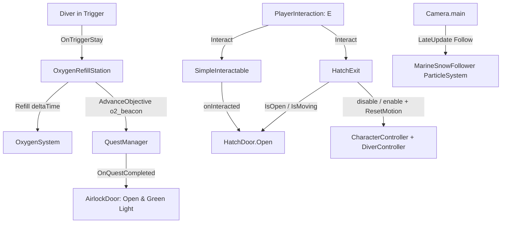

# Environment Systems
Ultima verifica: 2026-11-11

## Scopo e confini
Raggruppa gli elementi interattivi e atmosferici dell'ambiente di gioco non appartenenti alla fauna autonoma:
- Il portale stagno della base (`AirlockDoor`), che funge da passaggio di fine sezione legato agli obiettivi di missione.
- Il portello della capsula di discesa (`HatchDoor`), prima interazione del gioco: ruota sulla cerniera quando il diver preme [E].
- L'uscita guidata dalla capsula (`HatchExit`): a portello aperto, [E] porta il diver attraverso l'apertura fino al fondale a controlli bloccati.
- La stazione di rifornimento ossigeno (`OxygenRefillStation`), che ripristina la bombola del diver e avanza gli obiettivi di sopravvivenza.
- L'effetto atmosferico particellare della neve marina (`MarineSnowFollower`), ottimizzato per seguire il punto di vista del giocatore.
- Il cavo scoperto della chiusa (`ShortedCable`, puzzle Z2 della slice): fa luce debole che attira gli isopodi; con isopodi sopra il circuito è in corto e la leva non ridà corrente.
- Le isole di luce protetta (`StressLightZone`), documentate in dettaglio in [DarknessStress-docs.md](file:///Z:/_PROJECTS/Unity/Project_Deep/documentation/DarknessStress-docs.md).

## File e componenti
- `Assets/_Project/Code/Environment/AirlockDoor.cs`: Controller dell'apertura meccanica e dei segnali visivi del portale stagno della base DR-04.
- `Assets/_Project/Code/Environment/HatchDoor.cs`: Apertura a rotazione su un asse di un portello incernierato, con curva di easing ed eventi di inizio/fine.
- `Assets/_Project/Code/Environment/HatchExit.cs`: `IInteractable` che, a portello aperto, sposta il diver lungo una curva interno → apertura → fondale e poi restituisce i controlli.
- `Assets/_Project/Code/Environment/OxygenRefillStation.cs`: Ricaricatore continuo di O₂ per il diver in sosta sul trigger.
- `Assets/_Project/Code/Environment/ShortedCable.cs`: `IStimulusSource` che emette luce debole per le creature, conta gli esemplari di una specie entro un raggio (corto) e ridà corrente a circuito libero.
- `Assets/_Project/Code/Environment/MarineSnowFollower.cs`: Script ad esecuzione immediata (`ExecuteAlways`) che ancora il sistema particellare della neve marina davanti alla camera.
- `Assets/_Project/Code/Environment/Photocell.cs`: fotocellula delle porte, scatta con una luce sopra soglia e misura la luce ricevuta.
- `Assets/_Project/Code/Environment/PhotocellEye.cs`: occhio della fotocellula, ruota verso la luce più forte e accende lo schermo ambra (solo estetica).
- `Assets/_Project/Code/Environment/PhotocellScreen.cs`: schermo CRT ambra accanto al gate, acceso dalla stazione: barra della luce ricevuta, occhio, lucchetto.
- `Assets/_Project/Code/Environment/StressLightZone.cs`: Trigger volumetrico di sollievo dallo stress (vedere [DarknessStress-docs.md](file:///Z:/_PROJECTS/Unity/Project_Deep/documentation/DarknessStress-docs.md)).

## Dipendenze e flusso dati
- **Progressione**: `AirlockDoor` si iscrive a `QuestManager.Instance.OnQuestCompleted` in `Start()`. All'apertura del portale si sposta verso `targetPosition`.
- **Portello capsula**: `HatchDoor` non legge input. Lo attiva un `SimpleInteractable` sullo stesso oggetto, il cui `onInteracted` chiama `HatchDoor.Open()` (vedi [Interaction.md](file:///Z:/_PROJECTS/Unity/Project_Deep/documentation/Interaction.md)).
- **Uscita capsula**: `HatchExit` è un `IInteractable` raggiunto da `PlayerInteraction`. Legge `HatchDoor.IsOpen`/`IsMoving`; durante l'uscita disabilita `CharacterController` e `DiverController` del giocatore, scrive direttamente posizione e yaw del diver e posa di `DiverController.CameraTarget`, poi li riabilita, azzera `ViewRoll`, sblocca `LockMovement` e chiama `SetViewPitch(0)` e `ResetMotion()`.
- **Ricarica O₂**: `OxygenRefillStation` rileva l'`OxygenSystem` sul diver e, se è accesa, chiama `Refill(Time.deltaTime)` durante la permanenza nel trigger e registra il checkpoint su `DiverRespawn`. Spenta (`startsPowered` falso) non ricarica finché `PowerOn()` (in scena da `GrabSocket.onSocketed`).
- **Chiusa 1 (dal 2026-11-10)**: cella trascinata nello slot → stazione accesa; modulo flash → `DiverFlashlight.UnlockFlash`; lampo sulla `Photocell` → `AirlockDoor.HandleQuestCompleted`. `PhotocellEye` legge ogni frame `Photocell.BrightestLight`/`BrightestScore` e non scrive nulla sulla cella. `PhotocellScreen` legge `OxygenRefillStation.IsPowered` (acceso) e `Photocell.BrightestScore`/`Triggered`.
- **Chiusa (puzzle Z2)**: `ShortedCable` si registra con `CreatureManager.AddSource` in `OnEnable` e ogni frame aggiunge uno stimolo `WeakLight` puntiforme. In `Update` scorre `CreatureManager.ActiveCreatures` e conta le creature con `Profile == shortingSpecies` entro `shortRadius`. La leva (`SimpleInteractable` riusabile) chiama `ShortedCable.TryRestorePower` da `onInteracted`; a circuito libero `onPowerRestored` apre il gate (`AirlockDoor.HandleQuestCompleted`).
- **Rendering & Atmosfera**: `MarineSnowFollower` calcola in `LateUpdate()` la posizione delle particelle oceaniche in base alla posizione e rotazione della `Camera.main`.

## Componenti

### AirlockDoor
- **Responsabilità e ciclo di vita**:
  - `Awake()`: Salva `closedPosition = doorPanel.localPosition` e imposta la luce `doorStatusLight` su `lockedColor`.
  - `Start()` / `OnDestroy()`: Sottoscrive `QuestManager.Instance.OnQuestCompleted` e lo disdice tramite `QuestManager.TryGetInstance`, così alla chiusura della scena non ricrea un `QuestManager` (prima lasciava l'errore "Some objects were not cleaned up when closing the scene"). Se la quest è già completata all'avvio, apre immediatamente la porta.
  - `Update()`: Quando `isOpen` è vero, interpola `doorPanel.localPosition` verso `targetPosition` a velocità `openSpeed`, e allo stesso modo `secondPanel` (se c'è) verso la sua posizione chiusa + `secondOpenOffset`.
- **Campi Inspector**:
  - `Light doorStatusLight`: Faretto di segnalazione sopra la porta.
  - `Transform doorPanel`: Paratia mobile della porta.
  - `Vector3 openOffset` (default: `(0f, 3.5f, 0f)`): Spostamento relativo del pannello all'apertura.
  - `Transform secondPanel` (opzionale, dal 2026-11-11): seconda anta delle porte a due battenti; `Vector3 secondOpenOffset` (default `(0f, 3.5f, 0f)`), nello spazio del suo genitore.
  - `float openSpeed` (default: `2f` m/s).
  - `Color lockedColor` (default: Rosso), `Color unlockedColor` (default: Verde).
  - `bool isOpen` (debug sola lettura).
- **API pubbliche**:
  - `void HandleQuestCompleted()`: Avvia l'apertura della paratia e colora la luce di verde.

### ShortedCable
- **Responsabilità e ciclo di vita**:
  - `OnEnable()` / `OnDisable()`: registra e toglie il componente come sorgente di stimoli nel `CreatureManager`. Senza manager logga un errore e il cavo non attira nessuno.
  - `EmitStimuli(List<CreatureStimulus>)`: aggiunge `CreatureStimulus.PointLight(posizione, lightRadius, WeakLight, false)` con `OnlySpecies = shortingSpecies` a ogni frame, anche dopo che la corrente è tornata: la luce del cavo attira solo gli isopodi (prima richiamava anche 48 lanternfish, che si ammassavano contro il muro della chiusa).
  - `Update()`: aggiorna `IsShorted` (almeno una creatura di `shortingSpecies` entro `shortRadius`); finché non c'è corrente aggiorna il prompt della leva e fa sfarfallare `cableLight` (rumore di Perlin sull'intensità iniziale) quando è in corto.
- **Campi Inspector**:
  - `CreatureManager manager`: obbligatorio.
  - `CreatureProfile shortingSpecies`: specie che manda in corto il cavo (`Creature_Isopod`). Vuoto = mai in corto.
  - `SimpleInteractable lever` (opzionale): riceve `SetPromptText` con lo stato del circuito e `SetInteractable(false)` quando torna la corrente.
  - `Light cableLight` (opzionale): sfarfalla durante il corto.
  - `float lightRadius` (default `10`): portata della luce debole per sensibilità 1 (m).
  - `float shortRadius` (default `3.5`): raggio del corto (m). Va tenuto sopra l'`inspectDistance` della specie (2,5 per l'isopode), dove le creature si fermano a guardare la luce.
  - `string shortedPrompt` (default `"Leva: circuito in corto"`), `string readyPrompt` (default `"Riattiva la chiusa"`).
  - `UnityEvent onPowerRestored`: lanciato una volta sola, quando la leva viene tirata a circuito libero.
  - `UnityEvent onShortedAttempt`: lanciato quando la leva viene tirata durante il corto (feedback, dialoghi).
- **API pubbliche**:
  - `bool IsShorted { get; }`, `bool IsPowered { get; }`.
  - `void TryRestorePower()`: da collegare a `SimpleInteractable.onInteracted` (leva con `isReusable = true`).
  - `void EmitStimuli(List<CreatureStimulus> output)` (`IStimulusSource`).

### HatchDoor
- **Responsabilità e ciclo di vita**:
  - `Awake()`: Se `doorPivot` è nullo usa il proprio `transform`; salva `closedRotation = doorPivot.localRotation`.
  - `Update()`: Solo durante l'apertura. Avanza il tempo, valuta `openCurve` e imposta `doorPivot.localRotation = closedRotation * AngleAxis(curve(t) * openAngle, hingeAxis)`. A fine corsa invoca `onOpened`.
  - Apertura one-shot: non esiste chiusura.
- **Campi Inspector**:
  - `Transform doorPivot` (default: `null` → se stesso): Transform ruotato. Il pivot deve stare sull'asse della cerniera.
  - `Vector3 hingeAxis` (default: `Vector3.right`): Asse di rotazione nello spazio locale del pivot.
  - `float openAngle` (default: `110f` gradi): Angolo di apertura. Il segno decide il verso.
  - `float openDuration` (default: `1.6f` secondi).
  - `AnimationCurve openCurve` (default: `EaseInOut(0,0,1,1)`).
  - `UnityEvent onOpenStarted`, `UnityEvent onOpened`: Agganci per audio, VFX e Timeline.
  - `bool isOpen` (debug sola lettura).
- **API pubbliche**:
  - `bool IsOpen { get; }`
  - `bool IsMoving { get; }`
  - `void Open()`: Avvia l'apertura e invoca `onOpenStarted`. Ignorata se il portello è già aperto.
- **Riferimenti obbligatori**: nessuno. Senza un `SimpleInteractable` (o altro chiamante di `Open()`) il portello resta chiuso.

### HatchExit
- **Responsabilità e ciclo di vita**:
  - Implementa `IInteractable`. Richiede un `Collider` (in scena un `BoxCollider` trigger sull'apertura). L'uscita è un salto scriptato in tre fasi, non un verbo del giocatore (il salto libero resta all'Hydropack, vedi [PlayerMovement.md](file:///Z:/_PROJECTS/Unity/Project_Deep/documentation/PlayerMovement.md)).
  - `CanInteract(user)`: vero solo una volta, se `hatch.IsOpen && !hatch.IsMoving` e `passPoint`/`exitPoint` sono assegnati.
  - `Interact(user)`: memorizza il transform dell'utente, legge `DiverController.CameraTarget`, disabilita `DiverController` e `CharacterController`. Calcola il punto di atterraggio: con `snapExitToGround` un raycast da 1 m sopra `exitPoint` verso il basso (5 m, `groundMask`, trigger ignorati) trova il suolo, e la quota viene alzata di `height / 2 - center.y + skinWidth` del `CharacterController`, cioè dove il controller lascerebbe il pivot; senza colpo resta `exitPoint`. Salva yaw, pitch, `DiverController.ViewRoll` e posizione della camera di partenza, poi invoca `onExitStarted`.
  - `Update()`, in tre fasi:
    1. **Raccolta** (`crouchDuration`): il diver resta fermo, ruota metà dello yaw verso l'uscita, la testa scende di `crouchDepth` e lo sguardo va verso `passPoint` più `crouchPitch`.
    2. **Salto** (`jumpDuration`): i piedi seguono una Bézier quadratica da partenza ad atterraggio, con controllo calcolato perché a metà curva passino per `passPoint - up * eyeHeight`. Oltre metà si aggiunge una parabola `arcHeight * sin(π·u)`, dopo il portello per non toccarne il bordo. L'avanzamento nel tempo segue `jumpCurve` (veloce alla spinta, frenato verso la fine come dall'acqua). Lo sguardo insegue l'inclinazione della traiettoria (`pathLookWeight`, limitata a −30°…35°), lo yaw arriva alla direzione d'uscita, il roll oscilla fino a `flightRoll` a metà volo e la testa torna in quota nel primo quarto.
    3. **Atterraggio** (`landDuration`): piedi fermi sul punto di atterraggio, la testa scende di `landDepth` e risale (discesa rapida, risalita lenta), lo sguardo ha uno scatto di `landPitchKick` e si assesta a 0.
  - Raddrizzamento dal sedile: roll di partenza (`ViewRoll`) e posizione laterale della camera tornano a 0 e all'altezza occhi standard entro la raccolta più il 40% del salto, cioè quando il diver ha passato il portello.
  - Fine: posa finale, `CharacterController` riattivato, su `DiverController` `ViewRoll = 0`, `CameraBasePosition = (0, eyeHeight, 0)`, `enabled = true`, `SetViewPitch(0)`, `ResetMotion()`, `LockMovement = false`; poi `onExited`.
- **Campi Inspector**:
  - `HatchDoor hatch` (default: `null`): Portello da cui dipende la disponibilità.
  - `Transform passPoint` (default: `null`): Punto attraversato dalla camera, al centro dell'apertura.
  - `Transform exitPoint` (default: `null`): Punto di uscita sul fondale (vedi `snapExitToGround`).
  - `float eyeHeight` (default: `1.375f`): Altezza occhi rispetto ai piedi; deve corrispondere a `DiverController` / `PlayerCameraRoot`.
  - `string promptText` (default: `"Esci"`).
  - `bool snapExitToGround` (default: `true`), `LayerMask groundMask` (default: `~0`): Atterraggio sul suolo sotto `exitPoint`.
  - Raccolta: `float crouchDuration` (`0.45`), `float crouchDepth` (`0.15` m), `float crouchPitch` (`10`°).
  - Salto: `float jumpDuration` (`1.4`), `AnimationCurve jumpCurve` (default: da (0,0) con tangente 2.4 a (1,1) con tangente 0.2 in ingresso e 0 in uscita), `float arcHeight` (`0.35` m), `float pathLookWeight` (`0.6`, 0–1), `float flightRoll` (`3`°).
  - Atterraggio: `float landDuration` (`0.6`), `float landDepth` (`0.2` m), `float landPitchKick` (`6`°).
  - `UnityEvent onExitStarted`, `UnityEvent onExited`.
- **API pubbliche**: `string PromptText { get; }`, `bool CanInteract(GameObject user)`, `void Interact(GameObject user)`.
- **Riferimenti obbligatori**: `hatch`, `passPoint`, `exitPoint`. Se uno manca, `CanInteract` restituisce `false` e l'uscita non parte. L'utente deve avere `CharacterController` e `DiverController` (se mancano, vengono ignorati; senza `DiverController` la camera non viene animata).

### OxygenRefillStation
- **Responsabilità e ciclo di vita**:
  - Richiede un `Collider` con `isTrigger = true`.
  - `Awake()`: stato acceso da `startsPowered`; `respawnPoint` vuoto = se stesso; luce del beacon in `standbyColor`, spenta se la stazione è spenta.
  - `OnTriggerEnter(Collider other)`: Cerca `OxygenSystem`; se la stazione è accesa "aggancia" il diver: notifica `questObjectiveId` a `QuestManager.Instance` una volta (saltato se l'id è vuoto, dal 2026-11-10), registra `respawnPoint` su `DiverRespawn` e porta la luce ad `activeColor`.
  - `PowerOn()`: accende stazione e beacon, invoca `onPowered`; se il diver è già dentro lo aggancia subito.
  - `OnTriggerStay(Collider other)`: se accesa chiama `playerOxygen.Refill(Time.deltaTime)`.
  - `OnTriggerExit(Collider other)`: Ripristina la luce in `standbyColor` e azzera il riferimento al player.
- **Campi Inspector**:
  - `float refillRatePerSecond` (default: `10f`): Parametro locale non usato (la velocità effettiva è `OxygenProfile.refillRate`).
  - `string questObjectiveId` (default: `"o2_beacon"`; vuoto = nessuna notifica).
  - `bool startsPowered` (default: `true`), `UnityEvent onPowered`.
  - `Transform respawnPoint` (default: vuoto = se stesso): checkpoint registrato su `DiverRespawn`.
- **API pubbliche**: `bool IsPowered { get; }`, `void PowerOn()`.
  - `Light stationBeaconLight`: Faro di segnalazione della colonnina.
  - `Color standbyColor` (default: ambra/giallo), `Color activeColor` (default: ciano/verde).

### Photocell *(2026-11-10)*
- **Responsabilità e ciclo di vita**: fotocellula delle porte di Tidal Dynamics. In `Awake` cerca il `DiverFlashlight` della scena e colora `indicatorLight` in `lockedColor`. In `Update`, finché non è scattata, controlla il fascio della torcia (`SpotLight`) e le `extraLights`: una luce la fa scattare se è accesa, ha `intensity ≥ minSourceIntensity`, la cella è entro `range` e, per gli spot, dentro metà di `spotAngle`, e un `RaycastAll` dalla cella verso la luce (trigger ignorati) non incontra collider tranne quelli che contengono la luce (la capsula del diver) e la cella stessa. Scatta una volta: luce in `triggeredColor`, `onTriggered`. Pensata per le chiuse 1 (flash) e 3 (faro di sicurezza in `extraLights`).
- **Luce ricevuta (2026-11-11)**: ogni frame, prima del controllo di scatto e anche dopo lo scatto, calcola `ReceivedLight` per la torcia e le `extraLights` e tiene la più forte in `BrightestLight`/`BrightestScore`. Il punteggio non ha soglia: intensità × `(1 − d/range)²` × posizione nel cono (1 al centro, 0 al bordo) per gli spot, 0 se spenta, fuori portata, fuori cono o coperta. Misurato il 2026-11-11: torcia Full a 5.6 m al bordo del cono circa 3, lampo circa 112. Serve all'occhio e al futuro CRT a barra.
- **Linea di vista**: un solo metodo privato condiviso da `IsLitBy` e `ReceivedLight`; dal 2026-11-11 ignora la cella **e tutti i suoi figli** (guscio e occhio con collider non la coprono più) oltre ai collider che contengono la luce e ai trigger.
- **Campi Inspector**: `float minSourceIntensity` (`200`; torcia Full 55, lampo 800), `Light[] extraLights` (vuoto), `LayerMask occluders` (tutti), `Light indicatorLight` (opzionale), `Color lockedColor` (rosso), `Color triggeredColor` (verde), `UnityEvent onTriggered`, `bool triggered` (debug).
- **API pubbliche**: `bool Triggered { get; }`, `Light BrightestLight { get; }`, `float BrightestScore { get; }`, `void Trigger()`, `bool IsLitBy(Light light)`, `float ReceivedLight(Light light)`.
- **Limiti**: la soglia di scatto è sull'intensità della sorgente, non sulla luce ricevuta: la distanza conta solo come `range` della luce. La cella va staccata di qualche cm dalla parete, perché il raggio di linea di vista parte dal suo centro. Fino a una `RaycastAll` per luce candidata a frame. I lanternfish non contano: emettono `CreatureStimulus.PointLight`, non una `Light` di Unity.

### PhotocellEye *(2026-11-11)*
- **Responsabilità e ciclo di vita**: occhio della fotocellula, solo estetica. In `Awake` trova la `Photocell` sui genitori se manca, salva la `localRotation` di riposo di `eyePivot` e una fase casuale di scansione. In `Update`: se `Photocell.BrightestLight` esiste, ruota `eyePivot` verso la luce con `Quaternion.RotateTowards` a `turnSpeed`, limitando la direzione a `maxAngle` dal +Z di riposo (un bersaglio alle spalle porta l'occhio al bordo del cono, senza ribaltarlo); senza luce scansiona con due seni (yaw `scanAmplitude`, pitch 40% di quello) a `scanTurnSpeed`. L'emissione dello schermo va verso `max(idleGlow, BrightestScore / fullGlowScore)` a `glowResponse` al secondo e si scrive con un `MaterialPropertyBlock` (`_EmissionColor` = `screenColor` × glow × `maxEmission`). Disattivarlo non tocca lo scatto della cella.
- **Campi Inspector**: `Photocell photocell` (vuoto: cercata sui genitori), `Transform eyePivot` (vuoto: il proprio transform), `float maxAngle` (`60`), `float turnSpeed` (`90` °/s), `float scanAmplitude` (`25`°), `float scanSpeed` (`0.35`), `float scanTurnSpeed` (`30` °/s), `Renderer screenRenderer` (opzionale, materiale con emissione attiva), `Color screenColor` (ambra HDR `(1, 0.55, 0.1)`), `float idleGlow` (`0.15`), `float fullGlowScore` (`30`), `float maxEmission` (`4`), `float glowResponse` (`6`).
- **API pubbliche**: nessuna.
- **Riferimenti obbligatori**: senza `Photocell` l'occhio scansiona sempre e lo schermo resta al minimo. `eyePivot` deve essere un vuoto centrato nella sfera con +Z verso lo sguardo: il modello va sotto come figlio, con la correzione d'asse dell'FBX su quel figlio, mai sul pivot.
- **Deviazione dal vault**: Flusso-Slice diceva «rotazione in Photocell»; è un componente a parte per poterlo spegnere senza rischi sulla chiusa.

### PhotocellScreen *(2026-11-11)*
- **Responsabilità e ciclo di vita**: schermo CRT ambra della fotocellula, solo lettura. In `Awake` trova la `Photocell` se manca. In `Update`: a ogni cambio di `IsPowered` (`powerSource.IsPowered`, sempre vero senza stazione) accende o spegne `content` e l'emissione di `background` (`backgroundGlow` o nero, via `MaterialPropertyBlock`). Acceso: barra = `Clamp01(BrightestScore / fullScore)` (1 dopo lo scatto), seguita a `response` al secondo; i primi `round(fill × n)` segmenti ad alfa 1, gli altri a `unlitSegmentAlpha`. L'occhio mostra il fotogramma `round(fill × (n − 1))` di `eyeFrames`. Allo scatto il lucchetto lampeggia (alfa 0.15 a metà di ogni ciclo, `blinkRate` al secondo) per `blinkDuration` secondi, poi passa a `lockOpen`. Icone e segmenti si colorano con `_BaseColor` = `amber` × alfa e `_BaseMap` per le icone, nel `MaterialPropertyBlock`. Niente scritte sulla luce, come deciso con Manu.
- **Campi Inspector**: `Photocell photocell` (vuoto: la prima in scena), `OxygenRefillStation powerSource` (vuoto: sempre acceso), `GameObject content`, `Renderer background` (opzionale, materiale con emissione attiva), `Color backgroundGlow` (HDR `(0.12, 0.06, 0.01)`), `Color amber` (`(1, 0.6, 0.15, 1)`), `Renderer[] barSegments` (da sinistra), `float fullScore` (`60`), `float unlitSegmentAlpha` (`0.12`), `float response` (`4`), `Renderer eyeIcon`, `Texture2D[] eyeFrames` (da chiuso ad aperto), `Renderer lockIcon`, `Texture2D lockClosed`, `Texture2D lockOpen`, `float blinkDuration` (`1.5` s), `float blinkRate` (`6`).
- **API pubbliche**: `float Fill { get; }` (0-1), `bool IsPowered { get; }`.
- **Limiti**: la tacca di soglia è una geometria fissa all'80% della barra, ma lo scatto dipende dall'intensità della sorgente (`minSourceIntensity`), non dal punteggio: un lampo da lontano può far scattare la cella con la barra sotto la tacca (allo scatto la barra va comunque piena). Niente effetto CRT (scanline, curvatura); il logo `TD` e l'id `PC-01` sono provvisori, in attesa della brand identity.

### MarineSnowFollower
- **Responsabilità e ciclo di vita**:
  - `[ExecuteAlways]` per visualizzare il pulviscolo marino sia in Play Mode che nell'Editor.
  - `LateUpdate()`: Posiziona il Transform del sistema particellare a `target.position + target.rotation * offset`.
- **Campi Inspector**:
  - `Transform target`: Camera da seguire (se nullo, individua `Camera.main`).
  - `Vector3 offset` (default: `(0f, 1f, 3f)`): Offset locale davanti agli occhi del diver.
- **Aspetto delle particelle (verificato 2026-10-07 in `SCN_EnvDemo`, oggetto `MarineSnowParticles`)**:
  - Materiale `Assets/_Project/Materials/Environment/VFX/M_MarineSnow.mat`: shader `Universal Render Pipeline/Particles/Unlit`, superficie trasparente con blend additivo, tinta `(0.85, 0.92, 1, 0.8)`.
  - Texture `T_MarineSnow_Atlas.png` (512×512, atlas 4×4, bianco con la forma nell'alpha): riga 1 fiocchi soffici, riga 2 aggregati a grappolo, riga 3 filamenti, riga 4 granelli con alone. Generata proceduralmente.
  - Particle System: `Texture Sheet Animation` in modalità Grid 4×4, `WholeSheet`, frame iniziale casuale; rotazione iniziale casuale 0–360° e `Rotation over Lifetime` tra −0.3 e 0.3 rad/s.
  - Valori ritoccati da Manu in `SCN_EnvDemo` e copiati il 2026-10-09 in `SCN_Gameplay` (`08_UnderwaterAtmosphere/MarineSnowParticles`, Copy/Paste Component Values del solo `ParticleSystem`; renderer e `MarineSnowFollower` erano già uguali): `prewarm` attivo, `startLifetime` 24 s, `startSize` 0.015 m, alpha massimo di `startColor` 0.235, `startRotationX`/`Y` in modalità `minMaxState` 3, `maxParticles` 800. Prima in `SCN_Gameplay`: senza prewarm, 12 s, 0.02–0.09 m, alpha 0.35, 600 particelle.

## Setup in Unity
1. **Airlock**:
   - Creare un GameObject con la paratia mobile `doorPanel` e una luce `doorStatusLight`.
   - Aggiungere `AirlockDoor` e verificare che sia presente `QuestManager` in scena.
2. **Stazione O₂**:
   - Creare la mesh della colonnina, aggiungere un `Collider` impostato come trigger e il componente `OxygenRefillStation`.
3. **Portello capsula**:
   - Sulla mesh del portello (pivot sulla cerniera) aggiungere `HatchDoor` e `SimpleInteractable`; collegare `onInteracted` a `HatchDoor.Open`.
   - Il diver interagisce dall'interno: i `MeshCollider` non convessi non vengono colpiti dal lato posteriore, quindi aggiungere un figlio con `BoxCollider` trigger sottile davanti alla faccia interna. `PlayerInteraction` usa `QueryTriggerInteraction.Collide` e `GetComponentInParent`, quindi il trigger figlio basta.
   - Uscita: figlio della radice della capsula (non del portello, che ruota) con `BoxCollider` trigger appena oltre la faccia esterna del portello chiuso e `HatchExit`. Da portello chiuso il raggio colpisce prima il volume del portello; aperto, colpisce il volume d'uscita. Figli `HatchPassPoint` (centro apertura) e `HatchExitPoint` (fondale, con spazio libero per la capsula del player).
4. **Marine Snow**:
   - Creare un Particle System con particelle fluttuanti a bassa velocità e assegnare `MarineSnowFollower`.
   - Per l'aspetto a fiocchi: materiale `M_MarineSnow` sul `ParticleSystemRenderer` e `Texture Sheet Animation` 4×4 (vedi sopra).
5. **Chiusa (cavo in corto)**:
   - Oggetto cavo sul fondale con `ShortedCable`: `manager` = `CreatureManager` di scena, `shortingSpecies` = `Creature_Isopod`, opzionale `cableLight`.
   - Un `CreatureNest` di isopodi con il cavo dentro la portata della luce (`lightRadius` × `lightSensitivity` 0,8 dell'isopode), altrimenti gli isopodi del nido non lo vedono.
   - Leva con `Collider` e `SimpleInteractable` (`isReusable = true`), `onInteracted → ShortedCable.TryRestorePower`; assegnare la leva al campo `lever` del cavo.
   - Gate con `AirlockDoor` senza dipendere dalla quest: `onPowerRestored → AirlockDoor.HandleQuestCompleted`.

## Configurazione verificata in prefab e scene
- Nella scena `Prototype.unity` (rimossa il 2026-10-07 nel commit `f0fb87b`, recuperabile dalla storia di Git; configurazione non riverificata dopo la rimozione):
  - `AirlockDoor` sigilla l'ingresso della stazione DR-04 fino al completamento dei tre compiti (generatore, O₂, comunicazioni).
  - La stazione di ricarica è collocata a metà percorso tra la capsula schiantata e la base.
- Nella scena `Assets/_Project/Scenes/SCN_Gameplay.unity` (verificato 2026-10-04):
  - `UnderwaterLander_Crashed` è l'istanza diretta di `Assets/_Project/Models/Blends/UnderwaterLander_Crashed.blend`.
  - `UnderwaterLander_Crashed/MSH_Hatch_Door` ha `MeshCollider`, `HatchDoor` (valori di default: asse locale X, `+110°`, `1.6 s`) e `SimpleInteractable` con `promptText = "Apri portello"`, listener persistente `onInteracted → HatchDoor.Open`.
  - Figlio `HatchInteractVolume`: `BoxCollider` trigger, center `(0, 0.08, -0.79)`, size `(1.53, 0.04, 1.29)` nello spazio locale del portello.
  - `UnderwaterLander_Crashed/HatchExitVolume`: `BoxCollider` trigger (stessa posa del portello chiuso, center `(0, 0.41, -0.79)` circa, spessore `0.08`), `HatchExit` con valori di default collegato a `HatchDoor`; figli `HatchPassPoint` ≈ `(-4.09, 1.57, -4.61)` e `HatchExitPoint` ≈ `(-4.18, 0.46, -6.41)` su `Cliff`.
  - Verificato in Play Mode (2026-10-04, chiamando `Interact()` da codice, non con tastiera): portello chiuso → prompt "Apri portello"; aperto → prompt "Esci"; uscita completa con piedi a `HatchExitPoint`, `CharacterController` e `DiverController` riabilitati, camminata libera di 1 m in avanti e di lato. Lungo il percorso nessun collider entro 20 cm dalla testa.
  - Verificato in editor: dalla posizione iniziale del player il raggio dal centro camera colpisce `HatchInteractVolume` con prompt "Apri portello". In Play Mode `Interact()` apre il portello; la posa finale (`+110°` su X) va verso l'esterno e l'alto senza sovrapposizioni con altri collider.
  - Verificato da Manu in Play Mode con input reale (2026-10-04): [E] apre il portello e [E] su "Esci" porta il diver fuori dalla capsula.
  - Al 2026-10-09 il player parte seduto sul sedile (vedi `PlayerWakeUpSequence` in [Prologue.md](file:///Z:/_PROJECTS/Unity/Project_Deep/documentation/Prologue.md)), piedi a `(-4.08, 0.26, -2.75)`. `HatchExitPoint` è a `(-4.62, 0.93, -6.06)`, circa 0.5 m sopra il `Cliff`: il raycast di `snapExitToGround` porta l'atterraggio a y 0.464.
  - Verificato in Play Mode il 2026-10-09 (Unity 6000.3.19f1, `Interact()` chiamato da codice, non con tastiera): da seduto il raggio di `PlayerInteraction` colpisce `SimpleInteractable` del portello e poi, ad apertura finita, `HatchExit`. Uscita completa in 2.45 s: raccolta, spinta attraverso l'apertura, parabola (picco piedi y 0.61), atterraggio a y 0.464. Il roll del sedile scende da 16.8° a 0 prima del passaggio dal portello. Fine con `LockMovement` falso, `grounded` vero, `ViewRoll` 0, posizione invariata un secondo dopo (nessun assestamento del `CharacterController`).
- Chiusa del settore, blocking del puzzle Z2 (2026-10-28, `SCN_Gameplay`, radice `Z2_Chiusa_Blocking` a `(-10, -2.24, -40)`, graybox di primitive da sostituire): pareti `Wall_L`/`Wall_R` 8×7×0.6 m, `Lintel`, `Gate` con `AirlockDoor` (`doorPanel` = `GatePanel` 4×5×0.4 m, `openOffset` `(0, 5.2, 0)`, `doorStatusLight` = `GateStatusLight`). `ExposedCable` (cilindro senza collider, spostato da Manu a `(-7.41, -0.70, -39.02)` lungo `Wall_R`) con `ShortedCable` (manager di scena, `Creature_Isopod`, leva `Lever`, `CableLight` arancione range 4, `shortRadius` 1.8 impostato da Manu in Inspector al posto del default 3.5). `Lever` (cubo con `BoxCollider` trigger allargato a size `(7, 2.4, 7)`, center `(0, -0.4, 0)` in spazio locale, circa 0.8 × 1.7 × 1.4 m attorno a leva e palo: il cubo da 12 cm era quasi impossibile da puntare e il palo, senza `SimpleInteractable`, fermava il raggio; `SimpleInteractable` riusabile, prompt `"Riattiva la chiusa"`) su `LeverPost` nel corridoio piano davanti al gate, a `(-10.8, -0.79, -38.45)` (suolo -2.19), con `LeverLight` (punto luce azzurro, range 3.5) sopra; la prima posizione `(-13, 0.88, -38.5)` stava 3 m sopra il corridoio su un pendio non percorribile e Manu non la trovava; listener persistenti (`RuntimeOnly`: in modalità edit non scattano) `onInteracted → ShortedCable.TryRestorePower` e `onPowerRestored → AirlockDoor.HandleQuestCompleted`. `Nest_Isopod_Chiusa`: copia di `Nest_Isopod` sul cavo, `count` 4, `spawnRadius` 1.5, `leashRadius` 12.
  - Verificato in Play il 2026-10-28 (stimoli simulati da codice, non con input reale): all'avvio 4 isopodi entro 1.7 m dal cavo, `IsShorted` vero e `TryRestorePower` senza effetto; un `Flash` simulato 3 m a lato del cavo li porta a 5-14 m, `IsShorted` falso, la leva ridà corrente, il pannello sale da y 2.5 a 7.7 e la luce diventa verde. Build Windows di `SCN_Gameplay` riuscita (`Builds/Gameplay_Z2`). Non verificato: il puzzle giocato con mouse e tastiera, la leggibilità del graybox, il ritorno degli isopodi sul cavo dopo la fuga.
  - Riverificato in Play il 2026-10-28 dopo la prova di Manu (sub spostato da codice a `(-9, -0.69, -31)`, stimoli simulati): un fascio `WeakLight` del sub a 6 m dal cavo porta i 4 isopodi a 2.5-3 m dal cavo verso la lampada e il circuito si libera; in 60 s nessuna creatura resta a contatto con il muro in due campioni consecutivi (prima 17 lanternfish incastrate); un `Flash` ad altezza casco (2 m sopra il cavo) li fa scappare e la leva ridà corrente. Un flash simulato a 1 m dal suolo non raggiungeva due isopodi coperti dal pendio. Build `Builds/Gameplay_Z2` rifatta. Non verificato con input reale.
  - Leva spostata e riverificata in Play il 2026-10-28: dal corridoio, a 1.8-2.4 m, il raggio di `PlayerInteraction` (`interactionLayers` tutti, 2.6 m) colpisce il trigger di `Lever` con prompt `"Riattiva la chiusa"`; a circuito libero `SimpleInteractable.Interact` ridà corrente e il pannello sale a y 7.7 con luce verde. Build rifatta.

- `SCN_Gameplay`, `Ambience_Abyss` (2026-11-08): GameObject alla radice con un solo `AudioSource` 2D (`spatialBlend` 0), `loop` acceso, `playOnAwake` acceso, `volume` 0.2, clip `Assets/_Project/Assets/Audio/Ambience/AMB_Abyss.mp3` (297.8 s, import *Streaming*). Sottofondo abissale fornito da Manu (Pixabay, autore dragon-studio, file `dragon-studio-abyss-ambience-467492.mp3`). Nessuno script: niente dissolvenze né cambi per zona. Non ancora ascoltato in Play.

- Chiusa 1, puzzle con cella, modulo flash e fotocellula (2026-11-10, `SCN_Gameplay`). Sostituisce il puzzle degli isopodi sul cavo: `ExposedCable`, `ShortedCable` e la leva non sono più in scena (rimossi da Manu), `LeverLight` cancellata; la sezione sopra sulla chiusa del settore è storica.
  - `Chiusa1_Gate` (ex `Z2_Chiusa_Blocking`, radice ancora a `(-10, -2.24, -40)`): pareti, architrave e `GatePanel` spostati da Manu a z −91.8, x −10, dove il canyon è largo circa 16 m; `GateStatusLight` portata a `(-10, -4.8, -91.0)`. Figlio nuovo `Photocell` a `(-10, -6.43, -91.25)` davanti all'architrave (sfera `Visual` 0.35 m senza collider, `IndicatorLight` punto range 2.5), `Photocell` con i default e `onTriggered → AirlockDoor.HandleQuestCompleted` del `Gate`. Dal gate a circa 1.6 m dal suolo la cima della torre (sopra y −10) è in vista libera a circa 430 m; il resto è coperto dalla curva del canyon.
  - `Chiusa1_Puzzle` a `(-10, ~-10.6, -82)`: `O2Station_1` (ex `05_Node_OxygenRefill` del blockout, graybox invariato) a `(-14.5, -10.52, -82)`, con `SafeOxygenStressZone` (`OxygenRefillStation` `startsPowered` falso, `questObjectiveId` vuoto, `respawnPoint` = figlio `RespawnPoint` a `(-12, -10.98, -82)`), `PowerSocket` e `PowerCell` (vedi [Interaction.md](file:///Z:/_PROJECTS/Unity/Project_Deep/documentation/Interaction.md)) a `(-7, ~-6.9, -72)`. `FlashModule` a `(-7.5, -10.72, -84)`: `BoxCollider` trigger 0.8 × 0.6 × 0.8, cubo `Visual`, `ModuleLight` azzurra, `SimpleInteractable` (`"Monta il modulo flash"`) con `onInteracted → DiverFlashlight.UnlockFlash` e `GameObject.SetActive(false)`.
  - Blockout deprecato spento: `_BLOCKOUT_OBJECTIVE_1` disattivato (dentro restano generatori e comms); `08_UnderwaterAtmosphere` (neve marina) spostato alla radice e attivo; `_OBJECTIVE_1_INTERACTIONS/01_Generators` disattivato. I due `QuestManager` restano.
  - Occhio della fotocellula, blocking (2026-11-11): sotto `Photocell` un vuoto `EyePivot` (posa identità, +Z verso il corridoio da cui arriva il diver) con figlio `EyeVisual`, che contiene `Screen` (sfera 0.22 × 0.22 × 0.08 a z 0.15, `M_PhotocellEye_Screen`) e `Pupil` (sfera 0.07 × 0.07 × 0.02 a z 0.19, `M_PhotocellEye_Pupil`), primitive senza collider; `Visual` resta come guscio. `PhotocellEye` sull'oggetto `Photocell` con i default, `eyePivot` = `EyePivot`, `screenRenderer` = `Screen`. Materiali URP Lit in `Assets/_Project/Materials/Environment/Props/`: schermo base `(0.12, 0.06, 0.02)`, emissione attiva ambra; pupilla quasi nera. Il modello di Manu sostituisce `EyeVisual` (e `Visual` per il guscio) senza toccare codice.
  - Verificato in Play il 2026-11-11, da codice (diver teletrasportato a circa 5.6 m, frame avanzati con `EditorApplication.Step`): torcia Full nel cono → `BrightestLight` = torcia, occhio puntato sulla luce con scarto 0° (26° dalla posa di riposo); `FireFlash` → punteggio massimo 112, cella scattata; senza luce l'occhio scansiona (yaw tra 13° e 26° nei campioni) e lo schermo resta a `idleGlow`. Non verificati: l'aspetto in Game view, la scena giocata con mouse e tastiera.
  - **Modelli di blocking di Manu montati (2026-11-11)**, FBX in `Assets/_Project/Assets/Models/<Asset>/SM_<Asset>_low.fbx` (normali importate, tangenti Mikk), esportati dai Collection Exporters di `C:\Users\manue\Desktop\Props.blend` (collection `O2Station`, `Gate`, `Wall` → `GateWall`, `Photocell`; FBX Units Scale, Forward −Z, Up Y, Apply Modifiers, smoothing `OFF`, verso `Desktop\Deeplonauts\Export\<Asset>\`). **Le quattro collection sono escluse dal view layer**: così Blender non le valuta e l'exporter scrive i mesh senza modificatori (bevel e normali indurite persi). Per riesportare vanno incluse, esportate e riescluse. Materiali (2026-11-11): texture di Painter di Manu nella cartella di ogni modello (`SM_<Asset>_low_DefaultMaterial_AlbedoTransparency|MetallicSmoothness|Normal.png`, 2048, normal come *Normal Map*, metallic lineare; **nessuna mappa di emissione**). Un materiale URP Lit per asset in `Models/<Asset>/Materials/M_<Asset>.mat` (base, metallic con smoothness dall'alpha, normal, `_Smoothness` e `_Metallic` 1), assegnato a mano sui renderer in scena, non con il remap dell'importer: una nuova istanza dell'FBX esce con il materiale di default. `M_Photocell_Eye` è una copia di `M_Photocell` con emissione attiva e `_EmissionMap` = albedo, così `PhotocellEye` illumina in ambra le parti chiare dell'occhio. `Light Emissive` di gate e muri usa il materiale normale e non si illumina.
    - `SM_Gate` (spacchettato) sotto `Chiusa1_Gate`, a terra a y −13.60 centrato in x −10, z −91.78, con `MeshCollider` su telaio e luce. Le ante `GateSideL`/`GateSideR` stanno in un vuoto nuovo `Gate/GateDoors` insieme al vecchio `GatePanel` (renderer spento, resta il `BoxCollider` 5.24 × 6.55): `AirlockDoor.doorPanel` = `GateDoors`, che sale di `openOffset` `(0, 5.2, 0)`.
    - `GateWalls` con due istanze di `SM_GateWall_low` (`SM_GateWall_-15`, `SM_GateWall_-5`), stessa quota e rotazione del gate, `MeshCollider`. `Wall_L`, `Wall_R` e `Lintel` graybox restano accesi dietro come riempitivo.
    - Fotocellula: `Photocell` spostata sul centro dell'occhio a `(-6.60, -11.50, -89.30)`, modello a terra (suolo −12.69) accanto al gate. Figli: `Body` (guscio, `MeshCollider`), `EyePivot` → `Eye` (mesh dell'occhio, origine a 5 cm dal centro dei bounds), `IndicatorLight` a z locale 0.5. Le primitive `Visual` ed `EyeVisual` sono cancellate (i materiali `M_PhotocellEye_*` restano nel progetto). `PhotocellEye.screenRenderer` = `Eye`: con la texture di Painter l'emissione segue la mappa di emissione. Dall'occhio sono in vista libera tutte le 18 posizioni di prova della testa del diver sul percorso (x −12…−8, z −86…−76).
    - `O2Station_1`: graybox `RefillPad`, `Gantry_Pillar`, `Gantry_Arm`, `DispenserHead` e `BeaconMesh` disattivati; `SM_O2Station` (istanza) a terra a y −10.52, rotazione y 42 come il graybox, `MeshCollider` sui figli. `PowerSocket`, `SafeBeaconLight`, `SafeOxygenStressZone` e `RespawnPoint` invariati: il socket a y −8.82 non è ancora allineato a un punto del modello.
    - Verificato in Play il 2026-11-11, da codice: spot di prova all'altezza della testa a `(-10, -9.22, -82)`, 8.4 m: con intensità 55 l'occhio lo punta (scarto 0°, punteggio 10.8); a 800 la cella scatta e `GateDoors` sale a y locale 5.2. Non verificati: aspetto in Game view, collisioni del diver con i nuovi mesh, socket della stazione raggiungibile.
  - **Pulizia e schermo (2026-11-11, sessione headless)**: cancellati `Wall_L`, `Wall_R`, `Lintel` e `GatePanel` graybox. Le ante sono separate: `GateSideR` (a x −10.81, lato −x) è il `doorPanel` con `openOffset` `(-2.29, 0, 0)`, `GateSideL` (x −9.18) il `secondPanel` con `secondOpenOffset` `(2.29, 0, 0)`, `openSpeed` 1.2; ognuna ha un `BoxCollider` sui bounds della mesh. Aperte lasciano un varco di circa 4 m (x −12…−8). `PowerSocket` spostato sul fronte della stazione, a `SM_O2Station` locale `(0, 1.0, 0.55)` (mondo `(-13.91, -9.52, -81.33)`), con la rotazione della stazione: solo lo snap, l'alloggiamento fisico nel modello manca.
  - **Power station (2026-11-11)**: modello di Manu dalla collection `PowerStation` di `Props.blend` (piastra a terra `PowerStaton`, `Capacitator`, `Bands`, `Antennas`; esportata inclusa nel view layer, bevel applicato), FBX `Models/PowerStation/SM_PowerStation_low.fbx`. Istanza `O2Station_1/SM_PowerStation` a `(-12.95, ~-11.0, -82.66)`, rotazione y 42 composta con il −90° X dell'import, a terra a y −11.03, `MeshCollider` sui pezzi. `PowerSocket` spostato sulla zona libera della piastra davanti al condensatore, a `(-12.74, -10.47, -82.43)`: la cella inserita poggia sulla piastra (fondo a 1 cm dal piano) e, dopo averla allontanata di 8 cm dalle fasce, `Physics.ComputePenetration` non trova compenetrazioni. Verificato in Play da codice: cella nel socket → stazione accesa. Ancora snap, non incastro fisico.
  - `PhotocellScreen` sotto `Chiusa1_Gate`, a `(-4.0, -10.4, -91.46)`, rotazione y 180 (il +Z locale entra nel muro), appoggiato alla faccia di `SM_GateWall_-5` (z −91.54), sotto la lampada del modulo. Figli: `Housing` (cubo 0.68 × 0.54 × 0.1, `BoxCollider`, `M_PhotocellScreen_Housing`), `Glass` (quad 0.58 × 0.44, `M_PhotocellScreen_Glass`, Lit nero con emissione), `Content` con `EyeIcon` (0.17) e `LockIcon` (0.13), `Bar_0`…`Bar_9` (0.04 × 0.045, passo 0.05), `ThresholdNotch` all'80%, testi TMP `Logo` («TD») e `CellId` («PC-01») in Jersey 25 ambra, `ScreenGlow` (punto ambra, range 2, intensità 0.6). `powerSource` = `SafeOxygenStressZone` della `O2Station_1`. Texture generate in Python (bianco su alfa, 128 px) e materiali in `Assets/_Project/Assets/Models/Photocell/Screen/`: `T_PhotocellScreen_Eye_0`…`_3`, `_LockClosed`, `_LockOpen`, `_Segment`; `M_PhotocellScreen_Icon` (URP Unlit trasparente).
  - Verificato in Play il 2026-11-11, da codice, sessione headless (Manu assente): prima del socket stazione spenta e `Content` spento; cella spostata nel socket → `IsOccupied`, stazione accesa, schermo acceso con barra 0, occhio chiuso, lucchetto chiuso; spot di prova (intensità 55) a 8 m → punteggio 10.8, barra 0.18, occhio fotogramma 1; a 3.5 m → 31.6, barra 0.53, fotogramma 2; lampo (800) → cella scattata, lucchetto lampeggia poi aperto, barra 1, occhio aperto, ante spostate di −2.29 e +2.28 m. Cattura in Game view da 3.7 m a schermo acceso: testi `TD` e `PC-01`, occhio, lucchetto, barra e tacca leggibili e orientati giusti; il vetro lucido riflette la torcia vicino al lucchetto. Non verificata la sequenza giocata con mouse e tastiera.
  - Verificato in Play il 2026-11-10, da codice e non con mouse e tastiera: slot e stazione (vedi Interaction.md); torcia Full puntata sulla cella da 7.2 m e da 1 m: non scatta; modulo raccolto con `Interact`, `FireFlash` da 7.2 m: la cella scatta, il pannello sale (y da −10.69 a −5.49 in corsa), la torcia torna a 55; respawn alla stazione (vedi Oxygen.md). Non verificati: la sequenza giocata, la leggibilità del graybox, la linea di H.E.L.M. (non implementata).

## Limiti e problemi noti
- `ShortedCable`: il cavo è un punto solo, non una linea; per un cavo lungo il raggio del corto va coperto con più componenti (oggi non previsto). Gli isopodi attratti dal cavo lo raggiungono solo se il loro nido ha il cavo dentro il guinzaglio. La lampada di servizio come esca, il collegamento con la stazione O₂ e i dialoghi di H.E.L.M. non sono implementati.
- `HatchDoor`: nessuna chiusura né stato salvato. Gli override del componente vivono sull'istanza del `.blend` in scena: rinominare `MSH_Hatch_Door` in Blender li fa perdere.
- Il `CharacterController` del player (altezza 2 m, raggio 0,5) non può muoversi dentro la capsula: l'interno è una sfera di 2 m e il pavimento `MSH_PV_BaseRing` è una conca. Per questo il diver resta seduto con il controller spento (`PlayerWakeUpSequence`) e l'uscita è guidata (`HatchExit`), non a piedi.
- `HatchExit` disabilita `DiverController` per intero: durante l'uscita (2,45 s) il giocatore non controlla la visuale.
- Il moto dell'uscita non controlla le collisioni: il percorso è valido per la posa attuale di capsula, `HatchPassPoint` e `HatchExitPoint`. Spostandoli va ricontrollato che la testa non attraversi il bordo dell'apertura.
- Senza suolo entro 4 m sotto `exitPoint` l'atterraggio usa la quota del punto e il diver cade per gravità alla riattivazione del controller.

## Sistemi collegati
- [EnvironmentShading.md](file:///Z:/_PROJECTS/Unity/Project_Deep/documentation/EnvironmentShading.md): shader del fondale e delle rocce e fusione tra mesh.
- [Rendering.md](file:///Z:/_PROJECTS/Unity/Project_Deep/documentation/Rendering.md): post-processing e finish analogico.
- [Interaction.md](file:///Z:/_PROJECTS/Unity/Project_Deep/documentation/Interaction.md)
- [Oxygen.md](file:///Z:/_PROJECTS/Unity/Project_Deep/documentation/Oxygen.md)
- [Quests.md](file:///Z:/_PROJECTS/Unity/Project_Deep/documentation/Quests.md)
- [DarknessStress-docs.md](file:///Z:/_PROJECTS/Unity/Project_Deep/documentation/DarknessStress-docs.md)
