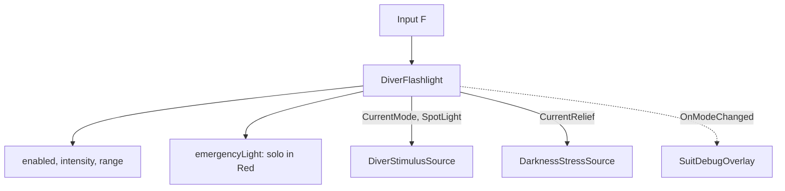

# Diver Flashlight
Ultima verifica: 2026-11-10

## Scopo e confini
Gestisce la torcia montata sullo scafandro del diver, permettendo la commutazione ciclica tra le modalità di illuminazione subacquea implementate (`Full`, `Low`, `Red`).
Dal 2026-10-13 la modalità spenta (`Off`) è diventata `Red`: le luci dello scafandro sono spente e resta accesa solo una spia rossa d'emergenza, invisibile alle creature (decisione di Manu: una modalità spenta separata sarebbe stata sempre peggiore della rossa).
Oltre alla funzione visiva essenziale per orientarsi nell'abisso oceanico, la torcia fornisce una quota normalizzata di sollievo dallo stress da oscurità (`CurrentRelief`), letta direttamente da `DarknessStressSource`.

## File e componenti
- `Assets/_Project/Code/Player/Equipment/DiverFlashlight.cs`: MonoBehaviour che controlla la sorgente luminosa Unity (`Light`), gestisce gli input e calcola il sollievo dallo stress.
- `FlashlightMode` (enum definito in `DiverFlashlight.cs`): Definisce i tre stati operativi reali:
  - `Full`: Fascio diretto ad alta intensità e massima portata (`fullIntensity: 55f`, `fullRange: 15f`, `fullRelief: 1f`).
  - `Low`: Luce diffusa / interna a ridotta intensità e corto raggio (`lowIntensity: 8f`, `lowRange: 4f`, `lowRelief: 0.4f`).
  - `Red`: Fascio spento (`spotLight.enabled = false`), spia d'emergenza accesa (`emergencyLight.enabled = true`), `redRelief: 0f`. Ex `Off`: stesso indice 2 dell'enum, quindi i valori serializzati restano validi.

## Dipendenze e flusso dati
- **Luce fisica**: Modifica `enabled`, `intensity` e `range` sul componente `Light` (URP Spot Light) e accende la spia `emergencyLight` solo in `Red`. Non modifica `spotAngle` né il tipo di luce. Se il riferimento alla `Light` è assente, lo stato logico e il calcolo del sollievo continuano a funzionare.
- **Darkness Stress**: Espone la proprietà `CurrentRelief` (1.0 in Full, 0.4 in Low, 0.0 in Red), letta da `DarknessStressSource` per mitigare l'accumulo di stress al buio.
- **Creature**: `DiverStimulusSource` legge `CurrentMode` e `SpotLight` (posizione, direzione, `spotAngle`) e ne fa lo stimolo di luce per le creature; in `Red` nessuno stimolo. Vedi [Creatures.md](file:///Z:/_PROJECTS/Unity/Project_Deep/documentation/Creatures.md).
- **Fotocellula**: `Photocell` (chiusa 1) legge `SpotLight` e scatta solo con intensità ≥ 200, cioè durante il lampo. Vedi [Environment.md](file:///Z:/_PROJECTS/Unity/Project_Deep/documentation/Environment.md).
- **Modulo flash**: in `SCN_Gameplay` `Chiusa1_Puzzle/FlashModule` (`SimpleInteractable`) chiama `UnlockFlash` e si spegne.
- **Overlay UI**: Notifica il cambio modalità tramite l'evento `OnModeChanged` a `SuitDebugOverlay`.



## Componenti

### DiverFlashlight
- **Responsabilità e ciclo di vita**:
  - `Awake()`: Se `spotLight` non è assegnato, tenta di risolverlo nei figli con `GetComponentInChildren<Light>(true)`. Chiama quindi `SetMode(initialMode)`.
  - `Update()` (controlli dal 2026-11-10, come da TASKS: F tenuto carica il flash, R = rossa):
    - **R** alterna `Red` e `Full`.
    - **F**, tocco (rilascio prima di `holdToChargeSeconds`): `CycleMode()`.
    - **F tenuto** con il flash sbloccato: dopo `holdToChargeSeconds` sale `FlashCharge` (0→1 in `flashChargeSeconds`). A carica piena si apre lo **sweet spot** (`FlashInSweetSpot`, per `sweetSpotSeconds`): rilasciando lì parte il lampo pieno; rilasciando prima parte un lampo debole; oltre la finestra il condensatore si scarica da solo con un lampo debole. Sul CRT del casco le tre tacche si riempiono in fila e l'ultima diventa verde nello sweet spot (vedi [SuitFeedback.md](file:///Z:/_PROJECTS/Unity/Project_Deep/documentation/SuitFeedback.md)). Senza modulo, una pressione lunga non fa nulla (prima del 2026-11-10 passava a `Red`).
    - A lampo finito (`flashDuration`) riporta la luce alla modalità corrente senza invocare `OnModeChanged`.
    - Con New Input System i tasti sono hardcoded (`fKey`, `rKey`); `toggleKey` e `redKey` valgono solo nel ramo legacy. I tempi della pressione usano `Time.unscaledTime`, il lampo `Time.time`.
  - `OnDisable()`: annulla pressione e carica, chiude un lampo in corso.
- **Campi Inspector**:
  - `Light spotLight` (default: `null`): Riferimento alla sorgente luminosa.
  - `Light emergencyLight` (default: `null`): Spia rossa d'emergenza, accesa solo in `Red`. Opzionale: se manca, `Red` spegne soltanto il fascio.
  - `FlashlightMode initialMode` (default: `FlashlightMode.Full`): Modalità attiva all'avvio.
  - `KeyCode toggleKey` (default: `KeyCode.F`): Tasto impiegato nel ramo legacy manager.
  - `KeyCode redKey` (default: `KeyCode.R`): Tasto della modalità rossa nel ramo legacy.
  - `float holdToChargeSeconds` (min 0.05, default: `0.35f`): Pressione oltre la quale F non cicla e, col flash sbloccato, inizia la carica. Ex `holdToRedSeconds` (`[FormerlySerializedAs]`).
  - **Flash (modulo a condensatore)**:
    - `bool flashUnlocked` (default: `false`): Lo sblocca `UnlockFlash()` alla raccolta del modulo.
    - `float flashChargeSeconds` (default: `1f`): tempo per riempire la carica.
    - `float sweetSpotSeconds` (min 0.05, default: `0.4f`): finestra a carica piena per il lampo pieno.
    - `float flashIntensity` (default: `800f`), `float flashRange` (default: `30f`): lampo pieno.
    - `float weakFlashIntensity` (default: `150f`, sotto la soglia 200 della fotocellula), `float weakFlashRange` (default: `12f`): lampo debole.
    - `float flashDuration` (default: `0.15f` s).
  - **Full - Fascio Diretto**:
    - `float fullIntensity` (default: `55f`).
    - `float fullRange` (default: `15f`).
    - `float fullRelief` (range: 0-1, default: `1f`).
  - **Low - Diffusa / Interna**:
    - `float lowIntensity` (default: `8f`).
    - `float lowRange` (default: `4f`).
    - `float lowRelief` (range: 0-1, default: `0.4f`).
  - **Red - Spia d'emergenza**:
    - `float redRelief` (range: 0-1, default: `0f`). Ex `offRelief`, migrato con `[FormerlySerializedAs]`.
  - **Debug (sola lettura)**:
    - `FlashlightMode currentMode`: Modalità corrente.
    - `float currentRelief`: Quota di sollievo corrente.
- **API pubbliche**:
  ```csharp
  FlashlightMode CurrentMode { get; }
  float CurrentRelief { get; }
  Light SpotLight { get; }   // fascio (può essere null), letto dagli stimoli delle creature
  bool FlashUnlocked { get; }
  float FlashCharge { get; }  // 0-1 mentre F è tenuto col flash sbloccato
  bool FlashInSweetSpot { get; } // carica piena, nella finestra del lampo pieno
  bool IsFlashing { get; }    // vero durante il lampo
  event Action<FlashlightMode> OnModeChanged;
  event Action OnFlashFired;  // all'inizio di ogni lampo
  void CycleMode();
  void SetMode(FlashlightMode mode);
  void UnlockFlash();
  void FireFlash(bool full = true); // ignorato se il flash non è sbloccato; false = lampo debole
  ```
  - `OnModeChanged`: Invocato a ogni chiamata a `SetMode(mode)`, anche qualora la modalità richiesta coincida con quella già attiva.
  - `CycleMode()`: dal 2026-11-10 `Full → Low → Full`; da `Red` va a `Full` (prima `Full → Low → Red → Full`).
  - `FireFlash()`: per `flashDuration` accende il fascio a `flashIntensity` e `flashRange`, anche da `Red`, e invoca `OnFlashFired`. `SetMode` durante il lampo aggiorna modalità e sollievo ma lascia la luce al massimo fino alla fine del lampo.
  - `SetMode(FlashlightMode mode)`: Imposta la modalità, applica `enabled`, `intensity` e `range` alla `Light` (se presente), accende `emergencyLight` solo in `Red`, assegna `currentRelief` e invoca `OnModeChanged`.
- **Riferimenti obbligatori e comportamento se mancanti**:
  - `spotLight`: Se non assegnato, viene ricercato in `Awake()` tramite `GetComponentInChildren<Light>(true)`. Se non è presente alcun componente `Light`, il sistema opera comunque a livello logico aggiornando `CurrentMode` e `CurrentRelief` senza generare errori o bloccare l'esecuzione.

## Setup in Unity
1. Posizionare una `Light` (tipo Spot) sul GameObject della torcia (es. `TorchPivot`).
2. Aggiungere il componente `DiverFlashlight` sul diver.
3. Assegnare la `Light` nel campo `Spot Light` (oppure posizionarla come figlia per la risoluzione automatica).
4. Configurare `Initial Mode` (tipicamente `Full`).
5. Opzionale: una `Light` Point rossa senza ombre come spia d'emergenza, assegnata a `Emergency Light` e spenta nel prefab (la accende `SetMode`).

## Configurazione verificata in prefab e scene
- Nel prefab [Player.prefab](file:///Z:/_PROJECTS/Unity/Project_Deep/Assets/_Project/Prefabs/Player.prefab):
  - Componente `DiverFlashlight` serializzato con:
    - `initialMode: 0` (`Full`).
    - `toggleKey: 102` (`KeyCode.F`).
    - `spotLight`: assegnato a `{fileID: 4979100799969987480}` nel pivot torcia.
    - `fullIntensity: 55`, `fullRange: 15`, `fullRelief: 1`.
    - `lowIntensity: 8`, `lowRange: 4`, `lowRelief: 0.4`.
    - `redRelief: 0`.
    - `emergencyLight`: `MainCamera/HelmetVisualPivot/EmergencyLight`, dentro il casco poco sopra e davanti all'occhio (locale (0.001, 0.236, -0.177), inclinata di 5.5° verso l'alto): Light Spot rossa (1, 0.08, 0.04), angolo 113°, interno 23.4°, range 0.3, intensità 0.5, senza ombre, componente disabilitato. Illumina la visiera dall'interno e segue la testa. Valori e posa authorati da Manu in `SCN_Gameplay` il 2026-10-13; la prima versione (Point, range 3, intensità 1.5 sotto `TorchPivot`) seguiva il ritardo della torcia.
- In `SCN_Gameplay` l'istanza del Player ha `initialMode: 2`, quindi dal 2026-10-13 il risveglio nella capsula parte in `Red` (spia rossa accesa).

## Estensione del sistema
- Esaurimento batteria: aggiunta di un contatore energetico che forza la transizione a `Red` o riduce progressivamente l'intensità luminosa.
- Feedback sonoro: sottoscrivere `OnModeChanged` per riprodurre un click meccanico dello switch ad ogni commutazione.

## Limiti e problemi noti
- Se la torcia viene messa in `Red` o in `Low` al di fuori di una `StressLightZone`, il sollievo scende rispettivamente a `0.0` o `0.4`, causando l'accumulo rapido dello stress da oscurità calcolato da `DarknessStressSource`.
- Sweet spot verificato in Play il 2026-11-10 con eventi di tastiera simulati (`InputSystem.QueueStateEvent`, non tastiera vera): rilascio a 1.55 s dalla pressione (carica 1, sweet spot) → lampo 800; a 0.8 s → 150; tenuto 2.4 s → scarica da sola a 150, carica a 0. Le tacche verdi sul CRT non sono state guardate a schermo. Nessun suono di carica; la torcia non trema durante la carica.
- Il tocco lungo non è stato provato con la tastiera vera (verificati in Play solo `SetMode` e gli stimoli); intensità e portata della spia rossa non sono state tarate a vista.

## Sistemi collegati
- [PlayerInput.md](file:///Z:/_PROJECTS/Unity/Project_Deep/documentation/PlayerInput.md)
- [Stress.md](file:///Z:/_PROJECTS/Unity/Project_Deep/documentation/Stress.md)
- [DarknessStress-docs.md](file:///Z:/_PROJECTS/Unity/Project_Deep/documentation/DarknessStress-docs.md)
- [SuitFeedback.md](file:///Z:/_PROJECTS/Unity/Project_Deep/documentation/SuitFeedback.md)
- [Creatures.md](file:///Z:/_PROJECTS/Unity/Project_Deep/documentation/Creatures.md)
