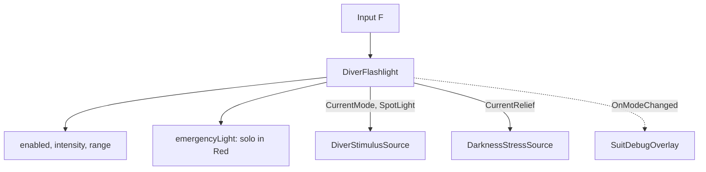

# Diver Flashlight
Ultima verifica: 2026-10-13

## Scopo e confini
Gestisce la torcia montata sullo scafandro del diver, permettendo la commutazione ciclica tra le modalità di illuminazione subacquea implementate (`Full`, `Low`, `Red`).
Dal 2026-10-13 la modalità spenta (`Off`) è diventata `Red`: le luci dello scafandro sono spente e resta accesa solo una spia rossa d'emergenza, invisibile alle creature (decisione di Manu: una modalità spenta separata sarebbe stata sempre peggiore della rossa).
Oltre alla funzione visiva essenziale per orientarsi nell'abisso oceanico, la torcia fornisce una quota normalizzata di sollievo dallo stress da oscurità (`CurrentRelief`), letta direttamente da `DarknessStressSource`.

## File e componenti
- `Assets/_Project/Code/Player/Equipment/DiverFlashlight.cs`: MonoBehaviour che controlla la sorgente luminosa Unity (`Light`), gestisce gli input e calcola il sollievo dallo stress.
- `FlashlightMode` (enum definito in `DiverFlashlight.cs`): Definisce i tre stati operativi reali:
  - `Full`: Fascio diretto ad alta intensità e massima portata (`fullIntensity: 55f`, `fullRange: 15f`, `fullRelief: 1f`).
  - `Low`: Luce diffusa / interna a ridotta intensità e corto raggio (`lowIntensity: 8f`, `lowRange: 4f`, `lowRelief: 0.4f`).
  - `Red`: Fascio spento (`spotLight.enabled = false`), spia d'emergenza accesa (`emergencyLight.enabled = true`), `redRelief: 0f`. Ex `Off`: stesso indice 2 dell'enum, quindi i valori serializzati restano validi.

## Dipendenze e flusso dati
- **Luce fisica**: Modifica `enabled`, `intensity` e `range` sul componente `Light` (URP Spot Light) e accende la spia `emergencyLight` solo in `Red`. Non modifica `spotAngle` né il tipo di luce. Se il riferimento alla `Light` è assente, lo stato logico e il calcolo del sollievo continuano a funzionare.
- **Darkness Stress**: Espone la proprietà `CurrentRelief` (1.0 in Full, 0.4 in Low, 0.0 in Red), letta da `DarknessStressSource` per mitigare l'accumulo di stress al buio.
- **Creature**: `DiverStimulusSource` legge `CurrentMode` e `SpotLight` (posizione, direzione, `spotAngle`) e ne fa lo stimolo di luce per le creature; in `Red` nessuno stimolo. Vedi [Creatures.md](file:///Z:/_PROJECTS/Unity/Project_Deep/documentation/Creatures.md).
- **Overlay UI**: Notifica il cambio modalità tramite l'evento `OnModeChanged` a `SuitDebugOverlay`.



## Componenti

### DiverFlashlight
- **Responsabilità e ciclo di vita**:
  - `Awake()`: Se `spotLight` non è assegnato, tenta di risolverlo nei figli con `GetComponentInChildren<Light>(true)`. Chiama quindi `SetMode(initialMode)`.
  - `Update()`: gestisce il tasto della torcia. Un tocco (rilascio prima di `holdToRedSeconds`) chiama `CycleMode()`; tenendo premuto, appena si supera `holdToRedSeconds` passa subito a `Red` senza aspettare il rilascio, e al rilascio non cicla. Con New Input System il tasto F è hardcoded (`Keyboard.current.fKey`); il campo serializzato `toggleKey` viene impiegato unicamente nel ramo legacy (`Input.GetKeyDown/GetKey/GetKeyUp(toggleKey)`). I tempi usano `Time.unscaledTime`.
  - `OnDisable()`: annulla una pressione in corso.
- **Campi Inspector**:
  - `Light spotLight` (default: `null`): Riferimento alla sorgente luminosa.
  - `Light emergencyLight` (default: `null`): Spia rossa d'emergenza, accesa solo in `Red`. Opzionale: se manca, `Red` spegne soltanto il fascio.
  - `FlashlightMode initialMode` (default: `FlashlightMode.Full`): Modalità attiva all'avvio.
  - `KeyCode toggleKey` (default: `KeyCode.F`): Tasto impiegato nel ramo legacy manager.
  - `float holdToRedSeconds` (min 0.05, default: `0.35f`): Durata della pressione oltre la quale si passa subito a `Red`.
  - **Full - Fascio Diretto**:
    - `float fullIntensity` (default: `55f`).
    - `float fullRange` (default: `15f`).
    - `float fullRelief` (range: 0-1, default: `1f`).
  - **Low - Diffusa / Interna**:
    - `float lowIntensity` (default: `8f`).
    - `float lowRange` (default: `4f`).
    - `float lowRelief` (range: 0-1, default: `0.4f`).
  - **Red - Spia d'emergenza**:
    - `float redRelief` (range: 0-1, default: `0f`). Ex `offRelief`, migrato con `[FormerlySerializedAs]`.
  - **Debug (sola lettura)**:
    - `FlashlightMode currentMode`: Modalità corrente.
    - `float currentRelief`: Quota di sollievo corrente.
- **API pubbliche**:
  ```csharp
  FlashlightMode CurrentMode { get; }
  float CurrentRelief { get; }
  Light SpotLight { get; }   // fascio (può essere null), letto dagli stimoli delle creature
  event Action<FlashlightMode> OnModeChanged;
  void CycleMode();
  void SetMode(FlashlightMode mode);
  ```
  - `OnModeChanged`: Invocato a ogni chiamata a `SetMode(mode)`, anche qualora la modalità richiesta coincida con quella già attiva.
  - `CycleMode()`: Esegue la transizione ciclica `Full → Low → Red → Full`.
  - `SetMode(FlashlightMode mode)`: Imposta la modalità, applica `enabled`, `intensity` e `range` alla `Light` (se presente), accende `emergencyLight` solo in `Red`, assegna `currentRelief` e invoca `OnModeChanged`.
- **Riferimenti obbligatori e comportamento se mancanti**:
  - `spotLight`: Se non assegnato, viene ricercato in `Awake()` tramite `GetComponentInChildren<Light>(true)`. Se non è presente alcun componente `Light`, il sistema opera comunque a livello logico aggiornando `CurrentMode` e `CurrentRelief` senza generare errori o bloccare l'esecuzione.

## Setup in Unity
1. Posizionare una `Light` (tipo Spot) sul GameObject della torcia (es. `TorchPivot`).
2. Aggiungere il componente `DiverFlashlight` sul diver.
3. Assegnare la `Light` nel campo `Spot Light` (oppure posizionarla come figlia per la risoluzione automatica).
4. Configurare `Initial Mode` (tipicamente `Full`).
5. Opzionale: una `Light` Point rossa senza ombre come spia d'emergenza, assegnata a `Emergency Light` e spenta nel prefab (la accende `SetMode`).

## Configurazione verificata in prefab e scene
- Nel prefab [Player.prefab](file:///Z:/_PROJECTS/Unity/Project_Deep/Assets/_Project/Prefabs/Player.prefab):
  - Componente `DiverFlashlight` serializzato con:
    - `initialMode: 0` (`Full`).
    - `toggleKey: 102` (`KeyCode.F`).
    - `spotLight`: assegnato a `{fileID: 4979100799969987480}` nel pivot torcia.
    - `fullIntensity: 55`, `fullRange: 15`, `fullRelief: 1`.
    - `lowIntensity: 8`, `lowRange: 4`, `lowRelief: 0.4`.
    - `redRelief: 0`.
    - `emergencyLight`: `PlayerCapsule/TorchPivot/EmergencyLight`, Light Point rossa (1, 0.08, 0.04), range 3, intensità 1.5, senza ombre, componente disabilitato (aggiunta il 2026-10-13, valori provvisori da tarare a vista).
- In `SCN_Gameplay` l'istanza del Player ha `initialMode: 2`, quindi dal 2026-10-13 il risveglio nella capsula parte in `Red` (spia rossa accesa).

## Estensione del sistema
- Esaurimento batteria: aggiunta di un contatore energetico che forza la transizione a `Red` o riduce progressivamente l'intensità luminosa.
- Feedback sonoro: sottoscrivere `OnModeChanged` per riprodurre un click meccanico dello switch ad ogni commutazione.

## Limiti e problemi noti
- Se la torcia viene messa in `Red` o in `Low` al di fuori di una `StressLightZone`, il sollievo scende rispettivamente a `0.0` o `0.4`, causando l'accumulo rapido dello stress da oscurità calcolato da `DarknessStressSource`.
- Il tocco lungo non è stato provato con la tastiera vera (verificati in Play solo `SetMode` e gli stimoli); intensità e portata della spia rossa non sono state tarate a vista.

## Sistemi collegati
- [PlayerInput.md](file:///Z:/_PROJECTS/Unity/Project_Deep/documentation/PlayerInput.md)
- [Stress.md](file:///Z:/_PROJECTS/Unity/Project_Deep/documentation/Stress.md)
- [DarknessStress-docs.md](file:///Z:/_PROJECTS/Unity/Project_Deep/documentation/DarknessStress-docs.md)
- [SuitFeedback.md](file:///Z:/_PROJECTS/Unity/Project_Deep/documentation/SuitFeedback.md)
- [Creatures.md](file:///Z:/_PROJECTS/Unity/Project_Deep/documentation/Creatures.md)
