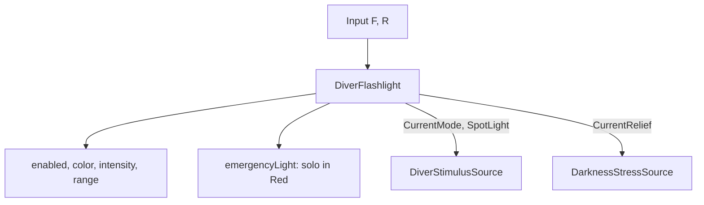

# Diver Flashlight
Ultima verifica: 2026-11-22

## Scopo e confini
Gestisce la torcia montata sullo scafandro del diver, permettendo la commutazione ciclica tra le modalità di illuminazione subacquea implementate (`Full`, `Low`, `Red`).
Dal 2026-10-13 la modalità spenta (`Off`) è diventata `Red`: le luci dello scafandro sono spente e resta accesa solo una spia rossa d'emergenza, invisibile alle creature (decisione di Manu: una modalità spenta separata sarebbe stata sempre peggiore della rossa).
Dal 2026-11-21 (flusso ristrutturato, vedi `Flusso-Slice.md` nel vault) **il flash a condensatore è tolto dal gioco** e il modulo trovato nella Z0 è il **modulo luce rossa**: sbloccato, `Red` accende un fascio rosso corto che la fauna non vede e che fa scattare la fotocellula della chiusa 1.
Oltre alla funzione visiva essenziale per orientarsi nell'abisso oceanico, la torcia fornisce una quota normalizzata di sollievo dallo stress da oscurità (`CurrentRelief`), letta direttamente da `DarknessStressSource`.

## File e componenti
- `Assets/_Project/Code/Player/Equipment/DiverFlashlight.cs`: MonoBehaviour che controlla la sorgente luminosa Unity (`Light`), gestisce gli input e calcola il sollievo dallo stress.
- `FlashlightMode` (enum definito in `DiverFlashlight.cs`): Definisce i tre stati operativi reali:
  - `Full`: Fascio diretto ad alta intensità e massima portata (`fullIntensity: 55f`, `fullRange: 15f`, `fullRelief: 1f`).
  - `Low`: Luce diffusa / interna a ridotta intensità e corto raggio (`lowIntensity: 8f`, `lowRange: 4f`, `lowRelief: 0.4f`).
  - `Red`: spia d'emergenza accesa (`emergencyLight.enabled = true`), `redRelief: 0f`. Senza modulo il fascio è spento; col modulo (`redUnlocked`) il fascio resta acceso in rosso (`redColor`, `redIntensity`, `redRange`). Nessuno stimolo per le creature in entrambi i casi. Ex `Off`: stesso indice 2 dell'enum, quindi i valori serializzati restano validi.

## Dipendenze e flusso dati
- **Luce fisica**: Modifica `enabled`, `color`, `intensity` e `range` sul componente `Light` (URP Spot Light) e accende la spia `emergencyLight` solo in `Red`. Non modifica `spotAngle` né il tipo di luce. Se il riferimento alla `Light` è assente, lo stato logico e il calcolo del sollievo continuano a funzionare.
- **Darkness Stress**: Espone la proprietà `CurrentRelief` (1.0 in Full, 0.4 in Low, 0.0 in Red), letta da `DarknessStressSource` per mitigare l'accumulo di stress al buio.
- **Creature**: `DiverStimulusSource` legge `CurrentMode` e `SpotLight` (posizione, direzione, `spotAngle`) e ne fa lo stimolo di luce per le creature; in `Red` nessuno stimolo. Vedi [Creatures.md](file:///Z:/_PROJECTS/Unity/Project_Deep/documentation/Creatures.md).
- **Fotocellula**: `Photocell` (chiusa 1) scatta quando `CurrentMode` è `Red` e il fascio acceso la colpisce (`IsLitByRedBeam`). Vedi [Environment.md](file:///Z:/_PROJECTS/Unity/Project_Deep/documentation/Environment.md).
- **Modulo luce rossa**: in `SCN_Gameplay` `Chiusa1_Puzzle/RedLightModule` (prefab `Prefabs/Puzzle/RedLightModule.prefab`, ex `FlashModule`, stesso GUID; il modello è ancora `FlashModuleVisual`; prompt «Monta il modulo luce rossa») chiama `UnlockRed` e si spegne.
- **Overlay UI**: `OnModeChanged` lo ascoltano `HelmetInstruments` e gli altri feedback del casco (`SuitDebugOverlay` non mostra più la torcia dal 2026-11-25).



## Componenti

### DiverFlashlight
- **Responsabilità e ciclo di vita**:
  - `Awake()`: Se `spotLight` non è assegnato, tenta di risolverlo nei figli con `GetComponentInChildren<Light>(true)`. Chiama quindi `SetMode(initialMode)`.
  - `Awake()`: risolve `spotLight`, ne salva il colore come colore del fascio normale, applica `initialMode`.
  - `Update()` (dal 2026-11-21):
    - **R** alterna `Red` e `Full`, solo con `redUnlocked`; verso `Red` è ignorato finché il modulo è in protezione (`redOverheated`).
    - **F** alla pressione: `CycleMode()`. Niente più pressione lunga né carica.
    - Con New Input System i tasti sono hardcoded (`fKey`, `rKey`); `toggleKey` e `redKey` valgono solo nel ramo legacy.
- **Campi Inspector**:
  - `Light spotLight` (default: `null`): Riferimento alla sorgente luminosa.
  - `Light emergencyLight` (default: `null`): Spia rossa d'emergenza, accesa solo in `Red`. Opzionale: se manca, `Red` spegne soltanto il fascio.
  - `FlashlightMode initialMode` (default: `FlashlightMode.Full`): Modalità attiva all'avvio.
  - `bool beamPowered` (default: `true`, dal 2026-11-25): falso = fascio spento (`spotLight.enabled` falso) finché qualcuno non chiama `PowerBeam()`; F e R cambiano modo ma il fascio resta spento. In `SCN_Gameplay` è falso sul `PlayerCapsule` (override di scena, il prefab resta `true`): in capsula niente fascio, c'è la luce ambra `CabinLight_Amber`; `HatchExit.onExited` → `PowerBeam`, e `CheatMenu.WarpTo` lo chiama a ogni teletrasporto.
  - `KeyCode toggleKey` (default: `KeyCode.F`): Tasto impiegato nel ramo legacy manager.
  - `KeyCode redKey` (default: `KeyCode.R`): Tasto della modalità rossa nel ramo legacy.
  - **Modulo luce rossa**:
    - `bool redUnlocked` (default: `false`): Lo sblocca `UnlockRed()` alla raccolta del modulo. Senza, R non fa niente e `Red` (per esempio da `initialMode`) è la sola spia.
  - **Full - Fascio Diretto**:
    - `float fullIntensity` (default: `55f`).
    - `float fullRange` (default: `15f`).
    - `float fullRelief` (range: 0-1, default: `1f`).
  - **Low - Diffusa / Interna**:
    - `float lowIntensity` (default: `8f`).
    - `float lowRange` (default: `4f`).
    - `float lowRelief` (range: 0-1, default: `0.4f`).
  - **Red - Fascio rosso**:
    - `float redIntensity` (default: `6f`), `float redRange` (default: `8f`): corto e fioco.
    - `Color redColor` (default: `(1, 0.08, 0.04)`).
    - `float redRelief` (range: 0-1, default: `0f`). Ex `offRelief`, migrato con `[FormerlySerializedAs]`.
  - **Surriscaldamento rossa** (dal 2026-11-22, decisione di Manu: lo svantaggio del rosso è lo stress più un limite di tempo, senza barre nuove):
    - `float redMaxSeconds` (default: `20f`, min 1): secondi di rosso continuo a stress zero prima della protezione.
    - `float stressHeatBoost` (default: `1f`): con stress pieno (`StressSystem.NormalizedStress` 1) scalda `1 + boost` volte più in fretta, cioè in 10 s.
    - `StressSystem stress` (default: `null` → `FindAnyObjectByType`; se manca il riscaldamento ignora lo stress).
    - `float redCooldownSeconds` (default: `10f`): da caldo a freddo a rosso spento. Dopo un surriscaldamento R non riaccende il rosso finché il calore non torna a 0.
    - `float flickerSeconds` (default: `4f`): ultimi secondi (in calore, `flickerSeconds / redMaxSeconds`) in cui il fascio sfarfalla (Perlin a 18 Hz) e cala fino a metà, sempre più spesso spento.
    - `AudioClip humClip` (default: `null` → ronzio sintetizzato in `SynthHum`, 1 s in loop, 100 Hz con armoniche), `float humVolume` (default: `0.35`): il ronzio parte a `humVolume` e cala a 0 col calore. `AudioSource` 2D aggiunta in `Awake`.
    - A calore 1: `redOverheated` vero, ronzio fermo, `SetMode(Low)`.
  - **Debug (sola lettura)**:
    - `FlashlightMode currentMode`: Modalità corrente.
    - `float currentRelief`: Quota di sollievo corrente.
    - `float redHeat` (0-1), `bool redOverheated`.
- **API pubbliche**:
  ```csharp
  FlashlightMode CurrentMode { get; }
  float CurrentRelief { get; }
  Light SpotLight { get; }   // fascio (può essere null), letto dagli stimoli delle creature
  bool RedUnlocked { get; }
  float RedHeat { get; } // 0 freddo, 1 surriscaldato
  event Action<FlashlightMode> OnModeChanged;
  void CycleMode();
  void SetMode(FlashlightMode mode);
  void UnlockRed(); // sblocca il rosso e riapplica la luce (se si è già in Red il fascio si accende)
  ```
  - `OnModeChanged`: Invocato a ogni chiamata a `SetMode(mode)`, anche qualora la modalità richiesta coincida con quella già attiva.
  - `CycleMode()`: dal 2026-11-10 `Full → Low → Full`; da `Red` va a `Full` (prima `Full → Low → Red → Full`).
  - `void PowerBeam()` (dal 2026-11-25): `beamPowered = true` e riapplica la luce. `bool BeamPowered { get; }`.
  - `SetMode(FlashlightMode mode)`: Imposta la modalità, applica `enabled` (falso anche se `beamPowered` è falso), `color`, `intensity` e `range` alla `Light` (se presente), accende `emergencyLight` solo in `Red`, assegna `currentRelief` e invoca `OnModeChanged`.
- **Riferimenti obbligatori e comportamento se mancanti**:
  - `spotLight`: Se non assegnato, viene ricercato in `Awake()` tramite `GetComponentInChildren<Light>(true)`. Se non è presente alcun componente `Light`, il sistema opera comunque a livello logico aggiornando `CurrentMode` e `CurrentRelief` senza generare errori o bloccare l'esecuzione.

## Setup in Unity
1. Posizionare una `Light` (tipo Spot) sul GameObject della torcia (es. `TorchPivot`).
2. Aggiungere il componente `DiverFlashlight` sul diver.
3. Assegnare la `Light` nel campo `Spot Light` (oppure posizionarla come figlia per la risoluzione automatica).
4. Configurare `Initial Mode` (tipicamente `Full`).
5. Opzionale: una `Light` Point rossa senza ombre come spia d'emergenza, assegnata a `Emergency Light` e spenta nel prefab (la accende `SetMode`).

## Configurazione verificata in prefab e scene
- Nel prefab [Player.prefab](file:///Z:/_PROJECTS/Unity/Project_Deep/Assets/_Project/Prefabs/Player.prefab):
  - Componente `DiverFlashlight` serializzato con:
    - `initialMode: 0` (`Full`).
    - `toggleKey: 102` (`KeyCode.F`).
    - `spotLight`: assegnato a `{fileID: 4979100799969987480}` nel pivot torcia.
    - `fullIntensity: 55`, `fullRange: 15`, `fullRelief: 1`.
    - `lowIntensity: 8`, `lowRange: 4`, `lowRelief: 0.4`.
    - `redRelief: 0`.
    - `emergencyLight`: `MainCamera/HelmetVisualPivot/EmergencyLight`, dentro il casco poco sopra e davanti all'occhio (locale (0.001, 0.236, -0.177), inclinata di 5.5° verso l'alto): Light Spot rossa (1, 0.08, 0.04), angolo 113°, interno 23.4°, range 0.3, intensità 0.5, senza ombre, componente disabilitato. Illumina la visiera dall'interno e segue la testa. Valori e posa authorati da Manu in `SCN_Gameplay` il 2026-10-13; la prima versione (Point, range 3, intensità 1.5 sotto `TorchPivot`) seguiva il ritardo della torcia.
- In `SCN_Gameplay` l'istanza del Player ha `initialMode: 2`, quindi dal 2026-10-13 il risveglio nella capsula parte in `Red` (spia rossa accesa).

## Estensione del sistema
- Esaurimento batteria: aggiunta di un contatore energetico che forza la transizione a `Red` o riduce progressivamente l'intensità luminosa.
- Feedback sonoro: sottoscrivere `OnModeChanged` per riprodurre un click meccanico dello switch ad ogni commutazione.

## Limiti e problemi noti
- Se la torcia viene messa in `Red` o in `Low` al di fuori di una `StressLightZone`, il sollievo scende rispettivamente a `0.0` o `0.4`, causando l'accumulo rapido dello stress da oscurità calcolato da `DarknessStressSource`.
- Il fascio rosso (6, 8 m) non è stato tarato a vista: da guardare in Game view nella Z0 e nella Z3. Il rosso è il modo di restare invisibili, ma non toglie l'ansia da buio (`redRelief` 0): il costo è voluto.
- Lo schermo della fotocellula mostra la luce ricevuta di qualunque colore: il fascio bianco riempie la barra senza aprire. Da vedere in playtest se si legge come «luce sbagliata».

## Verifica
- 2026-11-22, Play da codice (subagente, frame a passi): `RedHeat` sale di circa 0.051/s a stress 0.04; da 0.95 il fascio sfarfalla (intensità 0 nel campione), a 1 passa da solo a `Low` (intensità 8) con `redOverheated` vero, poi raffredda a 0.1/s. Nessun errore in console. Non verificati: il blocco di R con la tastiera vera, il ronzio all'ascolto, lo sfarfallio a vista.
- 2026-11-21, Play in `SCN_Gameplay`, chiamate dirette (non tastiera vera) col fascio puntato sulla fotocellula della chiusa 1 da 6 m: `Full` → non scatta; `Red` senza modulo → fascio spento, non scatta; `UnlockRed` → fascio rosso acceso (intensità 6, colore (1, 0.08, 0.04)), `IsLitByRedBeam` vero; `CycleMode` da `Red` → `Full` col colore normale. Raccolta del modulo e tasto R non provati a mano.

## Sistemi collegati
- [PlayerInput.md](file:///Z:/_PROJECTS/Unity/Project_Deep/documentation/PlayerInput.md)
- [Stress.md](file:///Z:/_PROJECTS/Unity/Project_Deep/documentation/Stress.md)
- [DarknessStress-docs.md](file:///Z:/_PROJECTS/Unity/Project_Deep/documentation/DarknessStress-docs.md)
- [SuitFeedback.md](file:///Z:/_PROJECTS/Unity/Project_Deep/documentation/SuitFeedback.md)
- [Creatures.md](file:///Z:/_PROJECTS/Unity/Project_Deep/documentation/Creatures.md)
