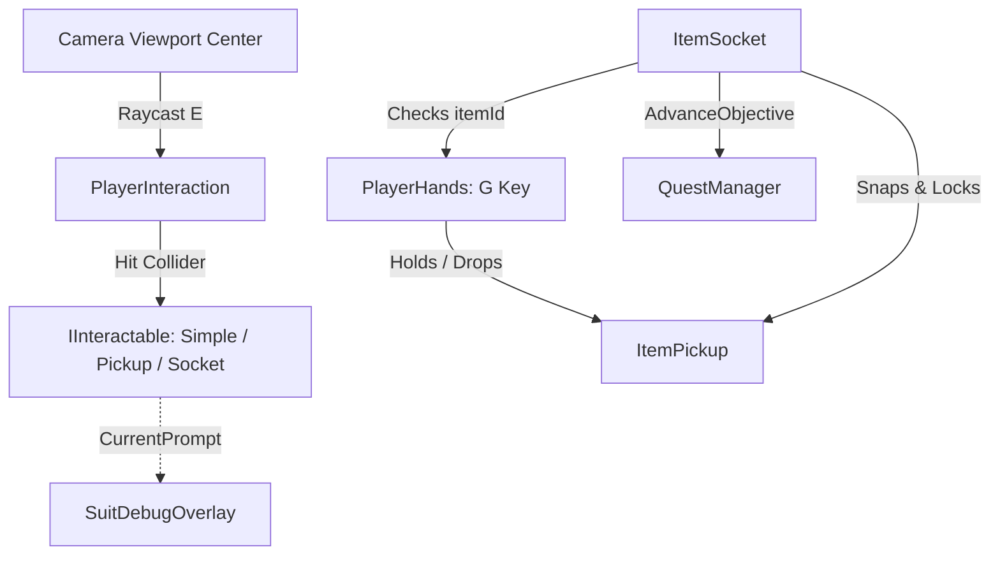

# Interaction System
Ultima verifica: 2026-11-11

## Scopo e confini
Gestisce l'interazione del diver con l'ambiente sottomarino: rilevamento tramite raycast visuale, visualizzazione dei prompt contestuali, attivazione di interruttori/oggetti generici (`SimpleInteractable`), raccolta e trasporto a mano di oggetti fisici (`ItemPickup`, `PlayerHands`) e loro alloggiamento in alloggiamenti specifici (`ItemSocket`).
Il sistema è collegato direttamente al sistema missioni (`QuestManager`) per avanzare gli obiettivi di gioco al completamento delle interazioni.

## File e componenti
- `Assets/_Project/Code/Interaction/IInteractable.cs`: Interfaccia contrattuale per qualsiasi oggetto interattivo nel mondo.
- `Assets/_Project/Code/Interaction/PlayerInteraction.cs`: Componente che esegue il raycast continuo dalla camera e intercetta il tasto di interazione ([E]).
- `Assets/_Project/Code/Interaction/PlayerHands.cs`: Gestore dell'oggetto trasportato nelle mani del diver, con presa e rilascio ([G]).
- `Assets/_Project/Code/Interaction/ItemPickup.cs`: Implementazione di `IInteractable` per oggetti raccoglibili, trasportabili e alloggiabili (es. celle energetiche).
- `Assets/_Project/Code/Interaction/ItemSocket.cs`: Alloggiamento che richiede uno specifico `acceptedItemId`, accoglie l'oggetto rilasciato dalle mani e notifica il puzzle/missione.
- `Assets/_Project/Code/Interaction/SimpleInteractable.cs`: Componente generico per pulsanti, valvole, leve o console con eventi Unity e avanzamento quest.

## Dipendenze e flusso dati
- **Camera Player**: `PlayerInteraction` proietta un raggio dal centro della viewport (`(0.5f, 0.5f, 0f)`).
- **Mani e Socket**: Quando il giocatore interagisce con un `ItemSocket`, questo interroga `PlayerHands`: se l'oggetto tenuto corrisponde all'`acceptedItemId`, l'oggetto viene rimosso dalle mani e vincolato allo snap point dello zoccolo.
- **Quest System**: `ItemPickup`, `ItemSocket` e `SimpleInteractable` possono avanzare uno specifico `questObjectiveId` in `QuestManager.Instance`.
- **UI / HUD**: `SuitDebugOverlay` osserva `PlayerInteraction` e `PlayerHands` per mostrare il prompt d'azione e il nome dell'oggetto tenuto.



## Componenti

### IInteractable
- **Interfaccia**:
  ```csharp
  public interface IInteractable
  {
      string PromptText { get; }
      bool CanInteract(GameObject user);
      void Interact(GameObject user);
  }
  ```

### PlayerInteraction
- **Responsabilità e ciclo di vita**:
  - `Awake()`: Risolve la camera di riferimento (`GetComponentInChildren<Camera>() ?? Camera.main`).
  - `Update()`: Chiama `PerformRaycast()` per aggiornare il target e `CheckInput()` per catturare il tasto `E` (`Keyboard.current.eKey` o `KeyCode.E`).
- **Campi Inspector**:
  - `float interactionDistance` (default: `2.6f` metri).
  - `LayerMask interactionLayers` (default: `~0` / Everything).
  - `KeyCode interactKey` (default: `KeyCode.E`).
  - `Camera playerCamera`: Camera usata per il raycast centrale.
  - `bool hasTarget` (debug sola lettura).
  - `string currentPrompt` (debug sola lettura).
- **API pubbliche**:
  - `event Action<IInteractable> OnTargetChanged`
  - `IInteractable CurrentTarget { get; }`
  - `bool HasTarget { get; }`
  - `string CurrentPrompt { get; }`

### PlayerHands
- **Responsabilità e ciclo di vita**:
  - `Awake()`: Se `holdPoint` è nullo, crea un GameObject `HoldPoint` posizionato a `(0.35, -0.32, 0.65)` rispetto alla camera.
  - `Update()`: Intercetta il tasto `G` (`Keyboard.current.gKey` o `KeyCode.G`) per chiamare `Drop()`.
- **Campi Inspector**:
  - `Transform holdPoint`: Punto di ancoraggio dell'oggetto nelle mani del diver.
  - `Vector3 defaultHoldOffset` (default: `(0.35f, -0.32f, 0.65f)`).
  - `KeyCode dropKey` (default: `KeyCode.G`).
  - `ItemPickup heldItem` (debug sola lettura).
- **API pubbliche**:
  - `event Action<ItemPickup> OnItemPickedUp`
  - `event Action<ItemPickup> OnItemDropped`
  - `ItemPickup CurrentItem { get; }`
  - `bool IsHoldingItem { get; }`
  - `bool Pickup(ItemPickup item)`: Assegna l'oggetto alle mani e ne disabilita la fisica.
  - `ItemPickup Drop()`: Rilascia l'oggetto riattivandone la gravità.
  - `ItemPickup ReleaseItemForSocket()`: Rilascia l'oggetto per alloggiarlo in un socket senza applicare spinte di caduta.

### ItemPickup
- **Responsabilità e ciclo di vita**:
  - Implementa `IInteractable`. Quando il giocatore preme [E], verifica se le mani sono libere ed esegue `hands.Pickup(this)`.
- **Campi Inspector**:
  - `string itemName` (default: `"Cella Energetica"`).
  - `string itemId` (default: `"power_cell"`): ID di matching per gli alloggiamenti.
  - `string pickupPrompt` (default: `"Raccogli Cella Energetica"`).
  - `string questObjectiveId`: ID obiettivo missioni opzionale.
  - `int questAdvanceAmount` (default: `1`).
- **API pubbliche**:
  - `void OnPickedUp(Transform holdParent)`: Disabilita `Rigidbody.isKinematic = true`, spegne i collider e imparenta al punto di presa.
  - `void OnDropped()`: Riabilita la fisica libera (`isKinematic = false`), riaccende i collider e applica un impulso in avanti.
  - `void OnSocketed(Transform snapPoint)`: Vincola l'oggetto nello zoccolo target e ne disattiva definitivamente l'interazione.

### ItemSocket
- **Responsabilità e ciclo di vita**:
  - Implementa `IInteractable`. Accetta solo l'oggetto con `itemId == acceptedItemId`.
- **Campi Inspector**:
  - `string acceptedItemId` (default: `"power_cell"`).
  - `Transform snapPoint`: Posizione esatta in cui alloggiare l'oggetto inserito.
  - `string emptyPrompt` (default: `"Inserisci Cella Energetica"`).
  - `string occupiedPrompt` (default: `"Slot Occupato"`).
  - `Light statusLight`: Luce di stato (es. LED dello zoccolo).
  - `Color emptyColor` (default: Rosso), `Color filledColor` (default: Verde).
  - `string questObjectiveId` (default: `"gen_power"`).
  - `int questAdvanceAmount` (default: `1`).
  - `UnityEvent<ItemPickup> onSocketFilled`: Evento per attivare macchinari, suoni o porte.
- **API pubbliche**:
  - `bool IsOccupied { get; }`
  - `ItemPickup SlottedItem { get; }`

### SimpleInteractable
- **Responsabilità e ciclo di vita**:
  - Implementa `IInteractable`. Attiva un evento generico (`UnityEvent onInteracted`) alla pressione di [E].
- **Campi Inspector**:
  - `string promptText` (default: `"Interagisci"`).
  - `bool isReusable` (default: `false`).
  - `bool isEnabled` (default: `true`).
  - `string questObjectiveId`: ID obiettivo opzionale.
  - `int questAdvanceAmount` (default: `1`).
  - `UnityEvent onInteracted`: Callback invocato all'interazione.
- **API pubbliche**:
  - `void SetInteractable(bool state)`: Abilita o disabilita l'interazione a runtime.
  - `public void SetPromptText(string text)`: Sostituisce `promptText` a runtime; accetta anche `null` e non modifica lo stato interagibile.

### PlayerGrab *(2026-11-10)*
Trascinamento fisico col crosshair, al posto del "prendi e ce l'hai in mano" per gli oggetti pesanti (celle nucleari). Non usa `PlayerHands`.
- **Responsabilità e ciclo di vita**:
  - `Awake()`: cerca `DiverController` sullo stesso oggetto e la camera (`playerCamera`, poi `GetComponentInChildren<Camera>()`, poi `Camera.main`).
  - `Update()`: alla pressione del tasto sinistro del mouse (`Mouse.current.leftButton`; ramo legacy `grabKey`) chiama `TryGrab()`; al rilascio `Release()`.
  - `FixedUpdate()`: bersaglio = camera + `forward × holdDistance`. Velocità cercata = distanza × `followStrength`, limitata a `maxFollowSpeed`; la forza per raggiungerla, applicata nel punto afferrato (`AddForceAtPosition`, quindi l'oggetto ruota appeso), è limitata a `maxForce`: con massa m l'accelerazione massima è `maxForce / m`, così gli oggetti pesanti arrivano lenti. Si stacca se il punto afferrato resta oltre `breakDistance` dal bersaglio, se l'oggetto entra in uno slot o si spegne.
  - Mentre trascina imposta `DiverController.SpeedMultiplier = 1 / (1 + massa / massForHalfSpeed)`; `Release()` lo rimette a 1. `OnDisable()` rilascia.
- **Campi Inspector**: `Camera playerCamera` (vuoto = risolta), `KeyCode grabKey` (`Mouse0`, solo legacy), `float grabDistance` (`3`), `float minHoldDistance` (`1.5`), `float breakDistance` (`2.5`), `float followStrength` (`6` 1/s), `float maxFollowSpeed` (`4` m/s), `float maxForce` (`400` N), `float massForHalfSpeed` (`40` kg), `Grabbable held` (debug).
- **API pubbliche**: `Grabbable Held { get; }`, `bool TryGrab()` (afferra il risultato di `FindTarget`), `Grabbable FindTarget(out RaycastHit targetHit)` (dal 2026-11-11: raycast dal centro della viewport entro `grabDistance`, trigger ignorati, salta i collider del diver e gli oggetti già in uno slot; non afferra, lo usa anche `InteractionCrosshair`), `void Release()`.

### Grabbable *(2026-11-10)*
Oggetto trascinabile. Implementa `IInteractable` solo per il prompt (E non fa nulla) e `IStimulusSource` per il bagliore.
- **Responsabilità e ciclo di vita**:
  - `Awake()`: sul `Rigidbody` spegne `useGravity`, imposta `linearDamping`/`angularDamping` ai valori in acqua, collisione `ContinuousDynamic`, interpolazione; salva posa iniziale e intensità della luce.
  - `FixedUpdate()`: aggiunge `Physics.gravity × gravityScale` (gravità ridotta in acqua); sotto `posizione iniziale − fallResetDepth` torna alla posa iniziale (caduto in un crepaccio o attraverso il terreno). Riapplica `Physics.IgnoreCollision` con il `CharacterController` del diver ogni volta che questo si riaccende: Unity dimentica l'ignore quando un collider si spegne (diver seduto, uscita dal portello, respawn). Il diver è una testa volante senza massa, gli oggetti non lo toccano.
  - `Update()`: intensità di `glowLight` = base + velocità × `glowPerSpeed`; se c'è `glowRenderer`, scrive `_Intensity` con un `MaterialPropertyBlock` = intensità del materiale × (1 + velocità × `glowRendererPerSpeed`).
  - `OnEnable`/`OnDisable`: si registra in `CreatureManager` (cercato in scena) se `stimulusReach > 0`. `EmitStimuli` aggiunge un `PointLight` `WeakLight` di portata `stimulusReach + velocità × stimulusPerSpeed`, `fromPlayer` vero mentre è trascinato: la cella ferma brilla poco, trascinata si vede da lontano (lanternfish, viperfish).
- **Campi Inspector**: `string itemId` (`"power_cell"`), `string promptText` (`"Tieni premuto il tasto sinistro per trascinare"`), `float gravityScale` (`0.3`), `float waterDrag` (`3`), `float waterAngularDrag` (`3`), `float fallResetDepth` (`40` m), `Light glowLight` (opzionale), `float glowPerSpeed` (`1.5`), `Renderer glowRenderer` (opzionale, materiale con `_Intensity`), `float glowRendererPerSpeed` (`0.5`), `float stimulusReach` (`6` m), `float stimulusPerSpeed` (`6` m per m/s).
- **API pubbliche**: `string ItemId`, `Rigidbody Body`, `bool IsHeld { get; internal set; }`, `bool IsSocketed`, `void Socket(Transform snapPoint)` (cinematico e bloccato sulla posa dello slot).
- **Riferimenti**: richiede `Rigidbody`. Senza `PlayerGrab` in scena non ignora il diver; senza `CreatureManager` nessuno stimolo.

### GrabSocket *(2026-11-10)*
Slot per oggetti trascinati, al posto di `ItemSocket` dove si usa il grab.
- **Responsabilità**: `OnTriggerStay` sul proprio collider (deve essere trigger): il primo `Grabbable` con `ItemId == acceptedItemId` non ancora inserito viene bloccato su `snapPoint` (`Grabbable.Socket`), la luce passa a `filledColor` e parte `onSocketed`. Una volta sola. La presa si stacca da sola (`PlayerGrab` vede `IsSocketed`).
- **Poggiamento fisico (dal 2026-11-11)**: con `requireSeating` acceso l'oggetto non si aggancia appena entra nel trigger. `OnTriggerStay` controlla che il centro dell'oggetto sia entro `seatRadius` in orizzontale ed entro `seatHeight` in verticale da `snapPoint` (lungo il suo alto), che l'inclinazione dal suo alto sia al massimo `maxTilt` e la velocità al massimo `maxSpeed`; finché è vero `IsAligned` è vero, e dopo `seatTime` secondi di fila parte `Insert` (lo snap finale corregge pochi centimetri). Se l'oggetto esce dal trigger, `FixedUpdate` azzera `IsAligned` dopo un passo fisico senza conferma. Spento, resta lo snap all'ingresso.
- **Campi Inspector**: `string acceptedItemId` (`"power_cell"`), `Transform snapPoint` (vuoto = se stesso), `bool requireSeating` (falso), `float seatRadius` (`0.05` m), `float seatHeight` (`0.06` m), `float maxTilt` (`12`°), `float maxSpeed` (`0.35` m/s), `float seatTime` (`0.15` s), `Light statusLight`, `Color emptyColor` (rosso), `Color filledColor` (verde), `UnityEvent onSocketed`, `Grabbable current` (debug).
- **API pubbliche**: `bool IsOccupied`, `Grabbable Current`, `bool IsAligned` (solo con `requireSeating`; lo legge `InteractionCrosshair` per il verde), `void Insert(Grabbable item)`.
- **Verifica (2026-11-11, Play da codice, `PowerSocket` della chiusa 1 con `requireSeating` acceso e i default)**: cella lasciata 25 cm sopra il connettore, 18 cm fuori centro → si ribalta, mai allineata, niente aggancio; dritta ma inclinata di 30° → si ribalta, niente aggancio; quasi dritta (4° e 2°) e a 2 cm dal centro → si aggancia sul connettore e la stazione si accende. La cella libera su un fondo arrotondato non sta in piedi da sola: va posata tenendola.

## Setup in Unity
1. Assicurarsi che `PlayerCapsule` abbia `PlayerInteraction` e `PlayerHands`.
2. Assegnare a entrambi la camera principale o lasciare che la individuino in `Awake()`.
3. Su qualsiasi oggetto interattivo aggiungere un `Collider` e il componente desiderato (`SimpleInteractable`, `ItemPickup`, o `ItemSocket`).

## Configurazione verificata in prefab e scene
- Nel prefab [Player.prefab](file:///Z:/_PROJECTS/Unity/Project_Deep/Assets/_Project/Prefabs/Player.prefab):
  - `PlayerInteraction` e `PlayerHands` stanno sul `PlayerCapsule` dal 2026-10-13 (prima esistevano solo come componenti aggiunti nell'istanza di `SCN_Gameplay`): `interactionDistance` 2.6, `interactionLayers` tutti, `playerCamera` e `holdPoint` vuoti, risolti in `Awake()`.
- Nella scena `Prototype.unity` (rimossa il 2026-10-07 nel commit `f0fb87b`, recuperabile dalla storia di Git; configurazione non riverificata dopo la rimozione):
  - Le celle energetiche (`ItemPickup`) con `itemId = "power_cell"` e gli alloggiamenti del generatore (`ItemSocket`) con `acceptedItemId = "power_cell"` sono disposti nel settore d'inizio.

- Nella scena `SCN_Gameplay.unity` il portello della capsula (`MSH_Hatch_Door`) usa `SimpleInteractable` → `HatchDoor.Open`, con un trigger figlio `HatchInteractVolume` come bersaglio del raycast. Dettagli in [Environment.md](file:///Z:/_PROJECTS/Unity/Project_Deep/documentation/Environment.md).

- `SCN_Gameplay`, chiusa 1 (2026-11-10): `PlayerCapsule` ha `PlayerGrab` (default). `Chiusa1_Puzzle/PowerCell` (ex `PowerCell_Gen_1` del blockout, `ItemPickup` rimosso): `Rigidbody` massa 80 (30 nella prima prova: Manu la trovava troppo leggera), `CapsuleCollider`, `Grabbable` con `stimulusReach` 10 (default 6) e `glowLight` = `CellGlowLight` colorata blu Cherenkov `(0.25, 0.55, 1)`. `Chiusa1_Puzzle/O2Station_1/PowerSocket` (ex `Socket_Gen_A`, `ItemSocket` rimosso): `BoxCollider` trigger di 1.2 m per lato, `GrabSocket` con `statusLight` = `SocketStatusLight`, `onSocketed → OxygenRefillStation.PowerOn` della stazione.
  - Verificato in Play il 2026-11-10, da codice e non con mouse e tastiera: `TryGrab` a 2.75 m prende la cella, il diver scende a velocità 0.57; dopo 5 s la cella resta appesa a 0.4 m dal bersaglio, ferma. Cella messa nel trigger dello slot: si blocca, la stazione si accende, l'ossigeno del diver dentro la stazione sale da 0.47 a 1.0 e il checkpoint passa a `RespawnPoint`. Provato da Manu con mouse e tastiera il 2026-11-10: la sequenza funziona; cella troppo leggera e lanternfish indifferenti (il loro nido era a z −14 con guinzaglio 12 m, la cella a z −72). Modello definitivo di Manu montato la sera del 2026-11-10: `PowerCell` a scala 1 (prima 0.35 × 0.45 × 0.35 del graybox), `MeshRenderer`/`MeshFilter` del graybox e il guscio provvisorio `GlowShell` tolti; figlio `Visual` a y locale −0.45 con l'istanza di `Assets/_Project/Assets/Models/NuclearCell/NuclearCell.fbx` (0.44 × 0.90 × 0.43 m, pivot alla base; mesh `MSH_Body` radice, `MSH_Cover`, `MSH_CellGlow`, `MSH_Connectors`, `MSH_HandRails`, `MSH_InneruelCells`, `MSH_OuterFuelCells`, `MSH_Rivets`, `MSH_RodsStacks`). Materiali in `NuclearCell/Materials/`: `M_NuclearCell` (URP Lit opaco, remap del materiale FBX `MTL_NuclearCell`; base, metallic-smoothness, normal di Painter), `M_NuclearCell_Cover` su `MSH_Cover` (stesso Lit con alpha clip 0.5 e due facce: l'alpha della texture fa i fori), `M_NuclearCell_Rods` su `MSH_InneruelCells`, `MSH_OuterFuelCells`, `MSH_RodsStacks` (copia di `M_NuclearCell` con emissione blu notte (0.02, 0.07, 0.18): la luce della cella sta al centro del fascio e non illumina le facce delle barre verso il giocatore, che senza emissione erano sagome nere contro il bagliore; prima prova a (0.08, 0.25, 0.5) giudicata troppo piatta in Scene view; valore attuale approvato da Manu in Play il 2026-11-10), `M_NuclearCell_Glow` su `MSH_CellGlow` (shader `Deeplonauts/CherenkovGlow` con `_EmissionMap` = emissione di Painter, `_MaskMap` = alpha dell'albedo, `_Color` bianco ×2, `_Intensity` 2, `_FresnelPower` 1; assegnato a `Grabbable.glowRenderer`, senza ombre; la mesh ha le normali verso l'interno, quindi con `Cull Back` si vedono solo le facce dietro le barre). Override per renderer sull'istanza, quindi i nomi delle mesh non vanno cambiati in Blender. Texture: normal come Normal Map, metallic-smoothness lineare. `CapsuleCollider` raggio 0.21, altezza 0.9, centro (0, 0, −0.039). Lo shader `CherenkovGlow` ha `_EmissionMap` (RGB) e `_MaskMap` (A) opzionali, bianche di default. Prima del modello: guscio provvisorio a capsula con `M_CherenkovGlow`, tolto. Corretti con massa 80 e il nido `Nest_Lanternfish_Chiusa1` (vedi [Creatures.md](file:///Z:/_PROJECTS/Unity/Project_Deep/documentation/Creatures.md)); da riprovare.
- Correzione del 2026-11-10: `ItemPickup` non ha `questObjectiveId` né `questAdvanceAmount` (i campi veri sono `itemId`, `itemName`, `isCarried`, `heldLocalOffset`, `heldLocalRotation`, `heldScaleFactor`); la sezione sopra li elencava.

Il binding Localization verso `SetPromptText` è pianificato ma non verificato in scena o Play Mode.

## Sistemi collegati
- [PlayerInput.md](file:///Z:/_PROJECTS/Unity/Project_Deep/documentation/PlayerInput.md)
- [SuitFeedback.md](file:///Z:/_PROJECTS/Unity/Project_Deep/documentation/SuitFeedback.md)
- [Quests.md](file:///Z:/_PROJECTS/Unity/Project_Deep/documentation/Quests.md)
