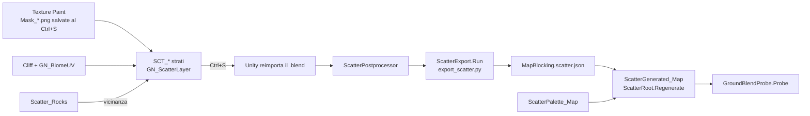

# Scatter procedurale
Ultima verifica: 2026-11-18

## Scopo e confini
Distribuisce flora (penne di mare, coralli bambù, spugne di vetro) e rocce minori (piccole e medie) sulla mappa (`MapBlocking.blend`) tramite Geometry Nodes in Blender e ricostruisce ogni istanza in Unity come vero prefab con LOD, collider, materiali di gioco e `GroundBlendProbe`.

La densità di ogni strato si dipinge in Blender in Texture Paint direttamente sul terreno (`Cliff`) su maschere PNG in scala di grigi `4096 × 4096` proiettate dall'alto (0,1 m/px): il bianco aggiunge istanze, il nero le cancella. I punti vengono distribuiti a densità piena sulla superficie e filtrati solo dopo tramite maschera, pendenza e regola di vicinanza ad altri strati; in questo modo dipingere una zona non sposta mai le istanze nel resto della mappa. Al salvataggio del `.blend`, Unity esporta in background le istanze valutate in un file `.scatter.json` e rigenera la radice dedicata in scena senza toccare gli oggetti piazzati a mano. Il dressing manuale resta per strutture, punti d'interesse e ritocchi singoli.

Zone della mappa (nomenclatura del 2026-11-18): Z0 Tutorial (crinale), Z1 Center (hub), Z2 Lizardfish (lobo ovest), Z3 Viperfish (braccio est), Z4 Leviathan (gola e Torre).

Stato:
- **Implementato e verificato in Blender e all'export (2026-11-18, spec v1.1):** preparazione automatica del `.blend` con `scatter_setup.py`; proiezione UV dinamica `GN_BiomeUV` in coda allo stack del `Cliff`; salvataggio automatico delle maschere al `Ctrl+S` (`scatter_masks_save.py`); gruppo `GN_ScatterLayer` con interfaccia a pannelli, filtro per maschera dipinta, pendenza, regola di vicinanza (`Nessuna` / `Vicino` / `Lontano` con `Sfuma` e raggio anti-copertura verso l'alto) e `Surface Offset` locale proporzionale alla scala; 5 strati Point Cloud (`SCT_Rocks_Small`, `SCT_Rocks_Medium`, `SCT_Pens`, `SCT_Bamboo`, `SCT_Sponges`) e 4 maschere PNG `4096 × 4096` in `MapBlocking_Masks~/`, inizializzate sul fondo della Z2 Lizardfish; `export_scatter.py` deterministico con controllo delle maschere mancanti; palette `ScatterPalette_Map.asset` con 11 voci collegate ai prefab Unity.
- **Implementato e verificato in Unity (2026-11-17 / 2026-11-18):** pipeline `ScatterExport` / `ScatterPostprocessor`, `ScatterRoot` e `ScatterPalette`, conversione di matrice Blender → Unity, rigenerazione automatica al salvataggio del `.blend` sulla prova iniziale da 56 istanze in Z2 e aggiornamento delle `GroundBlendProbe` dopo la rigenerazione.
- **Implementato, da verificare in Editor e Play Mode (2026-11-18):** rigenerazione automatica in `SCN_Gameplay` con i 5 nuovi strati `SCT_*` (127 istanze in Z2), verifica in Play Mode, pittura manuale delle maschere in Texture Paint sul `Cliff` (T7) e controllo visivo del layout dei nodi nell'editor di Blender (T8).
- **Pianificato:** dressing della zona Z3 Viperfish (prossimo passo), conversione procedurale del crinale (Z0), shader del fondale che legge una copia ridotta delle maschere dei biomi, riordino della gerarchia dei 532 oggetti piazzati a mano in `SCN_Gameplay`.

## File e componenti
Script C# e Python:
1. [ScatterRoot.cs](file:///Z:/_PROJECTS/Unity/Project_Deep/Assets/_Project/Code/Environment/Scatter/ScatterRoot.cs) (`Deeploration.Environment`): componente sulla radice in scena che legge il `.scatter.json` e istanzia i prefab della palette.
2. [ScatterPalette.cs](file:///Z:/_PROJECTS/Unity/Project_Deep/Assets/_Project/Code/Environment/Scatter/ScatterPalette.cs) (`Deeploration.Environment`): `ScriptableObject` che associa il nome dell'oggetto sorgente di Blender al prefab Unity e a un eventuale offset di rotazione.
3. [ScatterPipeline.cs](file:///Z:/_PROJECTS/Unity/Project_Deep/Assets/_Project/Code/Editor/Scatter/ScatterPipeline.cs) (`Deeploration.Editor`, solo Editor): contiene `ScatterExport` (lancio di Blender in background e voci di menu) e `ScatterPostprocessor` (`AssetPostprocessor` che intercetta il reimport di `.blend` e `.scatter.json`).
4. [export_scatter.py](file:///Z:/_PROJECTS/Unity/Project_Deep/Assets/_Project/Code/Editor/Scatter/export_scatter.py): script Python eseguito da Blender in background per scrivere `<mappa>.scatter.json` dal depsgraph valutato.
5. [scatter_setup.py](file:///Z:/_PROJECTS/Unity/Project_Deep/Assets/_Project/Code/Editor/Scatter/scatter_setup.py): script Python idempotente da riga di comando che costruisce nel `.blend` i gruppi Geometry Nodes (`GN_ScatterLayer`, `GN_BiomeUV`), lo script `scatter_masks_save.py`, le collection, i 5 strati `SCT_*` e le maschere PNG iniziali.

Asset e dati in progetto:
- [ScatterPalette_Map.asset](file:///Z:/_PROJECTS/Unity/Project_Deep/Assets/_Project/Entities/Profiles/ScatterPalette_Map.asset): palette canonica della mappa con 11 voci (penne A/B/C, roccia piccola, roccia media, coralli bambù A/B/C, spugne di vetro A/B/C).
- `Assets/_Project/Assets/Models/Blends/MapBlocking.blend`: file Blender della mappa con i gruppi `GN_ScatterLayer` e `GN_BiomeUV`, il text block `scatter_masks_save.py`, la collection `ScatterSources` (esclusa dal view layer) e la collection `Scatter` con gli oggetti Point Cloud `SCT_*`.
- `Assets/_Project/Assets/Models/Blends/MapBlocking.scatter.json`: asset JSON versionato con le trasformazioni esportate da Blender.
- `Assets/_Project/Assets/Models/Blends/MapBlocking_Masks~/`: cartella ignorata da Unity (suffisso `~`) e tracciata da Git contenente le maschere `Mask_Rocks.png`, `Mask_Pens.png`, `Mask_Bamboo.png` e `Mask_Sponges.png` (`4096 × 4096`, scala di grigi `Non-Color`).

## Dipendenze e flusso dati


1. **In Blender:** sul `Cliff` il modificatore `GN_BiomeUV` calcola l'attributo UV `BiomeUV` dalla posizione valutata dopo la `Subdivision`. Quando l'utente dipinge in Texture Paint e preme `Ctrl+S`, l'handler `save_pre` di `scatter_masks_save.py` salva su disco tutte le immagini `Mask_*` modificate (`is_dirty`) prima che Blender scriva il file `.blend`.
2. **Reimport in Unity:** `ScatterPostprocessor.OnPostprocessAllAssets` rileva il reimport di un `.blend` che ha già accanto un file `.scatter.json`, lo accoda in `PendingBlends` e pianifica `Flush` su `EditorApplication.delayCall` (fuori dal ciclo di import).
3. **Esportazione in background:** `Flush` chiama `ScatterExport.Run(blendPath)`, che avvia `blender.exe --background --factory-startup <blend> --python export_scatter.py`. Lo script valuta il depsgraph, raccoglie tutte le istanze il cui sorgente appartiene a `ScatterSources`, le ordina in modo deterministico e confronta il nuovo JSON con quello su disco. Se il contenuto è identico stampa `SCATTER_OK <n> invariato` senza riscrivere il file; se è cambiato scrive `<nome>.scatter.json.tmp`, lo sostituisce atomicamente a `<nome>.scatter.json` e `ScatterExport.Run` chiama `AssetDatabase.ImportAsset`.
4. **Rigenerazione in scena:** il reimport del `.scatter.json` viene intercettato da `ScatterPostprocessor`, che trova tutte le `ScatterRoot` nelle scene aperte con `autoRegenerate == true` e `instances` uguale al `TextAsset` aggiornato, chiama `root.Regenerate()` e marca la scena come modificata (`MarkSceneDirty`).
5. **Sonde del terreno:** al termine di `Flush` (sia dopo una rigenerazione sia dopo il reimport di un `.blend`, perché la forma del terreno può essere cambiata sotto rocce esistenti) e al termine di `ScatterExport.RegenerateAll()`, `ScatterPostprocessor.RefreshGroundProbes()` esegue `Physics.SyncTransforms()` e chiama `Probe()` su tutte le `GroundBlendProbe` attive in scena.

## Componenti

### ScatterRoot
- **Responsabilità e ciclo di vita:** `MonoBehaviour` (`[DisallowMultipleComponent]`, namespace `Deeploration.Environment`) posto sul GameObject radice in scena (`ScatterGenerated_Map`) che contiene come figli tutte le istanze generate. Non ha ciclo di vita runtime (`Awake`, `Start`, `Update` assenti): la generazione avviene interamente in Editor tramite `Regenerate()`, così in build gli oggetti sono già presenti nella scena salvata e sul componente restano solo i riferimenti serializzati. La radice deve avere la stessa trasformazione dell'istanza della mappa (in genere nell'origine con rotazione identità e scala 1).
- **Campi Inspector:**

| Campo | Tipo | Default nel codice | Significato |
|---|---|---|---|
| `instances` | `TextAsset` | `null` | File `<blend>.scatter.json` prodotto da `export_scatter.py`. |
| `palette` | `ScatterPalette` | `null` | Palette che associa i nomi degli oggetti sorgente di Blender ai prefab Unity. |
| `autoRegenerate` | `bool` | `true` | Se attivo, rigenera automaticamente i figli quando `instances` viene reimportato. |

- **API pubbliche:**
  - `public static Matrix4x4 BlenderToUnity(Vector3 p, Quaternion q, Vector3 s)`: converte una trasformazione dallo spazio mondo di Blender (destrorso, Z su) allo spazio di Unity (sinistrorso, Y su) tramite il cambio di base `(x, y, z) → (-x, z, -y)` (`M_unity = C · M_blender · C⁻¹`). Disponibile anche fuori da `#if UNITY_EDITOR`.
  - `public int Regenerate()` (solo `#if UNITY_EDITOR`): distrugge tutti i figli correnti e ricrea le istanze dei prefab in un solo gruppo di Undo (`"Rigenera scatter"`). Compone la trasformazione convertita con `entry.rotationOffset` e con `localRotation` / `localScale` del prefab di partenza. Ritorna il numero di GameObject creati, oppure `-1` se la validazione iniziale fallisce (in quel caso i figli esistenti non vengono toccati). Nessun evento.
- **Riferimenti obbligatori e comportamento se mancanti:**
  - Se il GameObject fa parte di un'istanza di prefab (`PrefabUtility.IsPartOfPrefabInstance(gameObject)`), `Regenerate()` registra un `Debug.LogError` e ritorna `-1` senza modificare i figli.
  - `instances` e `palette` sono obbligatori: se uno dei due è `null`, se il testo JSON non è deserializzabile o se `data.instances` è `null`, `Regenerate()` registra un `Debug.LogError` e ritorna `-1` lasciando intatti i figli precedenti.
  - Se un nome `asset` nel JSON non ha una voce attiva nella palette, le sue istanze vengono saltate e viene emesso un singolo `Debug.LogWarning` riepilogativo per nome con il conteggio delle istanze ignorate. Voci JSON con array `p`, `q` o `s` incompleti vengono saltate silenziosamente.

### ScatterPalette e ScatterPalette.Entry
- **Responsabilità e ciclo di vita:** `ScatterPalette` è uno `ScriptableObject` (`[CreateAssetMenu(menuName = "Deeplonauts/Scatter Palette", fileName = "ScatterPalette")]`, namespace `Deeploration.Environment`) che mappa i nomi degli oggetti sorgente nella collection `ScatterSources` del `.blend` ai prefab Unity. `ScatterPalette.Entry` è la classe serializzabile (`[Serializable]`) che rappresenta una singola associazione nella lista.
- **Campi Inspector di `ScatterPalette`:**

| Campo | Tipo | Default nel codice | Significato |
|---|---|---|---|
| `entries` | `List<Entry>` | lista vuota (`new List<Entry>()`) | Elenco delle associazioni sorgente Blender → prefab Unity. |

- **Campi Inspector di `ScatterPalette.Entry`:**

| Campo | Tipo | Default nel codice | Significato |
|---|---|---|---|
| `sourceName` | `string` | `null` (vuoto in Inspector) | Nome esatto dell'oggetto sorgente in Blender (es. `SM_SeaPen_A`). |
| `prefab` | `GameObject` | `null` | Prefab Unity da istanziare sotto `ScatterRoot`. |
| `rotationOffset` | `Vector3` | `(0, 0, 0)` | Correzione in gradi Eulero applicata se gli assi del prefab differiscono da quelli del sorgente in Blender. |
| `enabled` | `bool` | `true` | Se disattivato, la voce viene ignorata durante la ricerca. |

- **API pubbliche:**
  - `public Entry Find(string sourceName)`: restituisce la prima `Entry` non nulla nella lista `entries` con `enabled == true`, `prefab != null` e `e.sourceName == sourceName`; ritorna `null` se non trovata. Nessun evento.
- **Riferimenti obbligatori e comportamento se mancanti:**
  - Una `Entry` con `prefab == null` o `enabled == false` viene ignorata da `Find` come se non esistesse, causando il warning di sorgente mancante in `ScatterRoot.Regenerate()`. La palette deve puntare ai prefab completi in `Assets/_Project/Prefabs/...` e non agli FBX grezzi, che sono privi dei materiali di gioco, dei collider e di `GroundBlendProbe`.

### ScatterExport
- **Responsabilità e ciclo di vita:** classe statica Editor (`#if UNITY_EDITOR`, namespace `Deeploration.Editor` in [ScatterPipeline.cs](file:///Z:/_PROJECTS/Unity/Project_Deep/Assets/_Project/Code/Editor/Scatter/ScatterPipeline.cs)) che gestisce il percorso dell'eseguibile di Blender in `EditorPrefs`, esegue l'esportazione in background con timeout di 120 secondi e fornisce i comandi nel menu `Deeplonauts/Scatter/`.
- **Costanti e proprietà (nessun campo Inspector):**
  - `public const string BlenderPathKey = "Deeplonauts.Scatter.BlenderPath"`: chiave in `EditorPrefs`.
  - Default interno `DefaultBlender`: `@"Z:\Blender\stable\blender-5.3.0-stable.02f0899d78e3\blender.exe"`.
  - Script eseguito: `"Assets/_Project/Code/Editor/Scatter/export_scatter.py"`, timeout `120000` ms.
- **API pubbliche e voci di menu:**
  - `public static string BlenderPath { get; set; }`: legge o salva in `EditorPrefs` il percorso di `blender.exe` (con fallback a `DefaultBlender`).
  - `public static string JsonPathFor(string blendAssetPath)`: restituisce il percorso del JSON associato sostituendo l'estensione `.blend` con `.scatter.json`.
  - `public static bool Run(string blendAssetPath)`: lancia Blender con `--background --factory-startup "<blend>" --python "<export_scatter.py>"`, mostra una progress bar, inoltra ogni riga `SCATTER_WARN` su `Debug.LogWarning` e, se l'uscita contiene `SCATTER_OK` senza la parola `invariato`, forza il reimport del JSON con `AssetDatabase.ImportAsset(..., ImportAssetOptions.ForceUpdate)`. Ritorna `true` se l'export ha avuto successo, `false` in caso di errore o timeout.
  - `public static void RegenerateAll()` (menu `Deeplonauts/Scatter/Rigenera tutto`): chiama `Regenerate()` su tutte le `ScatterRoot` nelle scene caricate, marca le scene modificate come dirty e chiama `ScatterPostprocessor.RefreshGroundProbes()`.
  - Menu `Deeplonauts/Scatter/Esporta dal .blend selezionato` (`ExportSelected`, privato): chiama `Run` sull'asset `.blend` selezionato nella finestra Project (utilizzato anche per creare il primo `.scatter.json` di un `.blend`).
  - Menu `Deeplonauts/Scatter/Imposta percorso Blender` (`SetBlenderPath`, privato): apre un pannello di selezione file per scegliere `blender.exe` e aggiorna `BlenderPath`.
- **Riferimenti obbligatori e comportamento se mancanti:**
  - Se il file `BlenderPath` non esiste su disco, se il processo non parte, se supera i 120 secondi (nel qual caso viene terminato con `proc.Kill()`) o se termina con `exitCode != 0` o senza `SCATTER_OK` nello standard output, `Run` scrive un `Debug.LogError` (con gli ultimi 2000 caratteri dell'output) e ritorna `false`, lasciando invariato il file `.scatter.json` precedente.

### ScatterPostprocessor
- **Responsabilità e ciclo di vita:** sottoclasse di `AssetPostprocessor` (`#if UNITY_EDITOR`, namespace `Deeploration.Editor` in [ScatterPipeline.cs](file:///Z:/_PROJECTS/Unity/Project_Deep/Assets/_Project/Code/Editor/Scatter/ScatterPipeline.cs)). Intercetta i reimport di file `.blend` e `.scatter.json` in `OnPostprocessAllAssets`, accumula i percorsi in due `HashSet<string>` statici (`PendingBlends` e `PendingJsons`) per deduplicare reimport multipli nello stesso aggiornamento dell'AssetDatabase, e rimanda l'esecuzione del processo esterno e della rigenerazione a `EditorApplication.delayCall` (`Flush`). Se l'Editor sta compilando, aggiornando o cambiando stato di Play Mode, `Flush` si riaccoda al `delayCall` successivo.
- **Campi Inspector:** nessuno.
- **API pubbliche:**
  - `public static void RefreshGroundProbes()`: chiama `Physics.SyncTransforms()` e invoca `Probe()` su ogni `GroundBlendProbe` trovata con `Object.FindObjectsByType<GroundBlendProbe>(FindObjectsSortMode.None)`.
  - `public static List<ScatterRoot> LoadedRoots()`: restituisce tutte le `ScatterRoot` (incluse quelle disattivate, `includeInactive = true`) presenti nelle scene attualmente caricate in `EditorSceneManager`.
- **Riferimenti obbligatori e comportamento se mancanti:**
  - Un file `.blend` reimportato viene aggiunto a `PendingBlends` solo se esiste già su disco il corrispondente `<nome>.scatter.json` (`File.Exists(ScatterExport.JsonPathFor(path))`); i `.blend` di modelli o creature che non hanno uno scatter JSON vengono ignorati.
  - Se una `ScatterRoot` in scena ha `autoRegenerate == false`, `Flush` non la rigenera automaticamente al reimport del JSON.

### export_scatter.py
- **Responsabilità:** script Python eseguito da Blender in background (`blender --background <file.blend> --python export_scatter.py`) che legge tutte le istanze generate da Geometry Nodes e scrive `<nome>.scatter.json` accanto al `.blend`.
- **Funzionamento e regole di filtro:**
  1. Cerca la collection `ScatterSources`: se manca, stampa `SCATTER_ERROR collection 'ScatterSources' assente` ed esce con codice `2`. Raccoglie in un insieme i nomi di tutti gli oggetti contenuti in `ScatterSources` e nelle sue sotto-collection (`root.all_objects`).
  2. Ottiene il depsgraph valutato (`bpy.context.evaluated_depsgraph_get()`, che usa il livello di suddivisione della viewport, pari a quello importato da Unity) e scorre `dg.object_instances`.
  3. Tiene solo gli elementi con `inst.is_instance == True`, il cui oggetto originale (`inst.object.original.name`) appartiene a `ScatterSources`, e il cui genitore (`inst.parent.original`) esiste, non ha `hide_render == True` e non è esso stesso un oggetto dentro `ScatterSources` (escludendo così copie di backup nascoste del terreno o sorgenti annidati).
  4. Scompone `inst.matrix_world.decompose()` in posizione `p = [x, y, z]`, rotazione quaternione `q = [w, x, y, z]` e scala `s = [x, y, z]`, arrotondando ogni componente a 5 cifre decimali.
  5. Controlla tutte le immagini in `bpy.data.images` il cui nome inizia con `Mask_`: se il file indicato da `bpy.path.abspath(img.filepath)` non esiste su disco, stampa `SCATTER_WARN maschera mancante: <nome> <percorso>` senza interrompere l'esportazione.
  6. Ordina la lista delle istanze per `(host, asset, p[0], p[1], p[2])` per garantire un output deterministico.
  7. Se il file `<nome>.scatter.json` esiste già e il suo testo coincide esattamente con il nuovo JSON, stampa `SCATTER_OK <n> invariato` e termina senza toccare il disco. Altrimenti scrive `<nome>.scatter.json.tmp`, lo rinomina atomicamente con `os.replace` e stampa `SCATTER_OK <n> <percorso>`.

### scatter_setup.py
- **Responsabilità:** script Python idempotente da riga di comando (`blender --background <mappa.blend> --python scatter_setup.py [-- --rebuild-group]`) che prepara o aggiorna la struttura dello scatter a strati dentro `MapBlocking.blend`.
- **Operazioni eseguite (crea solo ciò che non esiste già):**
  1. `setup_biome_uv(cl)`: aggiunge il layer UV statico `BiomeUV` sulla mesh del `Cliff` e lo rende la UV attiva (quella su cui dipinge Texture Paint in modalità *Single Image*; la UV di render resta `UVMap`), crea il gruppo `GN_BiomeUV` e aggiunge il modificatore `BiomeUV` in fondo allo stack del `Cliff`.
  2. `setup_save_script()`: scrive e registra il text block `scatter_masks_save.py` con `use_module = True`.
  3. `setup_group()`: crea o aggiorna l'interfaccia a pannelli del gruppo `GN_ScatterLayer` (preservando gli identificatori dei socket esistenti). Se il gruppo è nuovo o se è passato l'argomento `--rebuild-group`, svuota e ricostruisce tutti i nodi interni organizzati in 6 frame numerati da sinistra a destra.
  4. `sources_split(src_root)`: suddivide gli oggetti di `ScatterSources` nelle sotto-collection `ScatterSources_RocksSmall`, `ScatterSources_RocksMedium`, `ScatterSources_Pens` (rimuovendo la vecchia `ScatterSources_Rocks` se vuota) e importa il `LOD2` dagli FBX di `BambooFan` e `GlassSponge` (`Assets/_Project/Materials/Environment/Organisms/`) nelle sotto-collection `ScatterSources_Bamboo` e `ScatterSources_Sponges` con rotazione applicata; esclude `ScatterSources` dal view layer (`lc.exclude = True`).
  5. Crea la gerarchia di collection `Scatter/Scatter_Rocks/{Scatter_Rocks_Small, Scatter_Rocks_Medium}` e `Scatter/Scatter_Flora`.
  6. Crea le maschere PNG `4096 × 4096` (`Non-Color`, fake user attivo) in `//MapBlocking_Masks~/`: `Mask_Rocks`, `Mask_Pens`, `Mask_Bamboo`, `Mask_Sponges`, riempite inizialmente con `z2_fill(cl)` (raycast BVH sul fondo della Z2 Lizardfish sotto quota `z < 0`, riquadro Blender `x 55..150`, `y 145..240`).
  7. Crea gli oggetti strato `SCT_Rocks_Small`, `SCT_Rocks_Medium`, `SCT_Pens`, `SCT_Bamboo`, `SCT_Sponges` di tipo **Point Cloud** (`bpy.data.pointclouds.new`, che Unity ignora nell'import FBX senza creare GameObject né warning sulle tangenti), blocca le loro trasformazioni (`lock_location`, `lock_rotation`, `lock_scale`) e imposta gli input dei modificatori tramite `getattr(mod.properties.inputs, it.identifier).value`.
  8. Disattiva in viewport e render l'eventuale vecchio oggetto di prova `Scatter_Z2` senza cancellarlo. Se Blender gira in `--background`, salva il `.blend` e stampa `SETUP_OK`.

### Gruppo GN_ScatterLayer
Gruppo Geometry Nodes principale applicato a ogni oggetto strato `SCT_*`. Il grafo è diviso in 6 riquadri (`NodeFrame`) disposti in ordine da sinistra a destra: `1 · Punti sul terreno`, `2 · Maschera dipinta`, `3 · Pendenza`, `4 · Vicinanza`, `5 · Filtro dei punti`, `6 · Istanze e variazione`.

#### Input del modificatore per pannello

| Pannello | Nome input | Tipo socket | Default | Limiti / Subtype | Significato |
|---|---|---|---|---|---|
| **Asset** | `Superficie` | `Object` (`NodeSocketObject`) | `Cliff` (impostato da script) | — | Oggetto terreno su cui distribuire i punti, letto in spazio `RELATIVE`. |
| **Asset** | `Collection` | `Collection` (`NodeSocketCollection`) | vuota | — | Sotto-collection di `ScatterSources` con le mesh da istanziare (`Separate Children` e `Reset Children` attivi). |
| **Asset** | `Seed` | `Int` (`NodeSocketInt`) | `0` | — | Seme base dello strato; il grafo somma offset fissi (`+101`, `+202`, `+303`, `+404`, `+505`) per decorrelare maschera, sfumatura, scelta asset, rotazione e scala. |
| **Densità e maschera** | `Densità` | `Float` (`NodeSocketFloat`) | `0.01` | `0.0 .. 10.0` | Istanze per m² (`Density Max` del Poisson Disk) dove la maschera è bianca (valore 1). |
| **Densità e maschera** | `Maschera` | `Image` (`NodeSocketImage`) | vuota | — | Immagine `Mask_*` in scala di grigi: il bianco tiene i punti, il nero li scarta. Se vuota, il campionamento dà 0 e lo strato non genera istanze. |
| **Densità e maschera** | `Distanza minima` | `Float` (`NodeSocketFloat`) | `0.0` m | `0.0 .. 50.0`, `DISTANCE` | Distanza minima Poisson Disk (`Distance Min`) fra due punti dello stesso strato. |
| **Vicinanza** | `Regola` | `Menu` (`NodeSocketMenu`) | `Nessuna` | `Nessuna`, `Vicino`, `Lontano` | Modalità di filtro rispetto alla collection `Bersaglio`. |
| **Vicinanza** | `Bersaglio` | `Collection` (`NodeSocketCollection`) | vuota | — | Collection di altri strati (es. `Scatter_Rocks`) da cui misurare la distanza. Non deve contenere lo strato corrente. |
| **Vicinanza** | `Distanza min` | `Float` (`NodeSocketFloat`) | `0.2` m | `0.0 .. 100.0`, `DISTANCE` | Soglia interna in metri dalla superficie del bersaglio (usata sia da `Vicino` sia da `Lontano`). |
| **Vicinanza** | `Distanza max` | `Float` (`NodeSocketFloat`) | `2.0` m | `0.0 .. 100.0`, `DISTANCE` | Soglia esterna in metri dalla superficie del bersaglio (usata solo da `Vicino`). |
| **Vicinanza** | `Sfuma` | `Bool` (`NodeSocketBool`) | `True` | — | Solo con `Vicino`: fa calare linearmente la probabilità di sopravvivenza del punto da 1 (a `Distanza min`) a 0 (a `Distanza max`). |
| **Variazione** | `Scala` | `Float` (`NodeSocketFloat`) | `1.0` | `0.0 .. 100.0` | Moltiplicatore di scala uniforme dell'istanza. |
| **Variazione** | `Scala casuale` | `Float` (`NodeSocketFloat`) | `0.3` | `0.0 .. 1.0`, `FACTOR` | Variazione uniforme casuale `±` attorno a 1 prima di moltiplicare per `Scala` (`Scala × (1 + rand(-val, +val))`). |
| **Variazione** | `Rotazione casuale` | `Vector` (`NodeSocketVector`) | `(0°, 0°, 360°)` (`(0, 0, 2π)`) | `EULER` | Ampiezza massima `(X, Y, Z)` della rotazione casuale locale sommata all'orientamento base del punto. |
| **Variazione** | `Allinea alla normale` | `Bool` (`NodeSocketBool`) | `True` | — | Se attivo, orienta l'asse Z dell'istanza lungo la normale della faccia del terreno prima di applicare `Rotazione casuale`; se spento, parte dall'orientamento verticale del mondo. |
| **Variazione** | `Surface Offset` | `Float` (`NodeSocketFloat`) | `0.0` m | `-10.0 .. 10.0`, `DISTANCE` | Traslazione lungo l'asse Z locale dell'istanza (`Translate Instances` con `Local Space = True`), proporzionale alla scala dell'istanza (valori negativi interrano la base delle rocce). |
| **Filtri** | `Pendenza max` | `Float` (`NodeSocketFloat`) | `40°` (`0.6981` rad) | `0° .. 180°`, `ANGLE` | Inclinazione massima ammessa della superficie rispetto alla verticale del mondo. |

#### Regole di distribuzione e filtro in ordine
1. **Distribuzione invariante (`1 · Punti sul terreno`):** `Object Info` legge `Superficie` in spazio `RELATIVE` e alimenta `Distribute Points on Faces` in modalità `POISSON` con `Density Max = Densità`, `Distance Min = Distanza minima` e `Seed = Seed`, senza alcuno socket `Selection`. I punti candidati e i loro ID restano fissi indipendentemente dalla maschera dipinta (stabilità G5).
2. **Filtro maschera (`2 · Maschera dipinta`):** dalla posizione mondo `(x_b, y_b, z_b)` del punto un nodo `Vector Math (MULTIPLY_ADD)` calcola le coordinate UV della proiezione ortogonale dall'alto:
   `U = (215 - x_b) / 400`, `V = (345 - y_b) / 400`
   (quadrato di 400 × 400 m che copre `x` Unity `-215..185` e `z` Unity `-345..55`). Il nodo `Image Texture` (`interpolation = Linear`, `extension = CLIP`) campiona `Maschera` in `(U, V)`. Il punto supera il filtro se `Random Value(FLOAT, 0..1, Seed + 101) < Color`. Se nessuna immagine è assegnata a `Maschera`, l'uscita colore vale `0` e nessun punto supera il test (`0 < 0` è falso).
3. **Filtro pendenza (`3 · Pendenza`):** separa la componente `Z` della normale del punto (`Normal.z`) e la confronta con `cos(Pendenza max)`. Il punto supera il filtro se `Normal.z >= cos(Pendenza max)`. Con valori sotto 90° vengono esclusi automaticamente anche pareti verticali, sottosquadri e soffitti.
4. **Filtro vicinanza (`4 · Vicinanza`):**
   - La collection `Bersaglio` viene letta con `Collection Info` (`RELATIVE`), convertita in mesh con `Realize Instances` e passata a `Geometry Proximity` (`target_element = FACES`), che misura la distanza senza segno `d` tra il punto e la faccia più vicina del bersaglio.
   - **Raggio verso l'alto «Coperto dal bersaglio»:** poiché `Geometry Proximity` restituisce una distanza senza segno, un punto sul terreno situato *dentro* o *sotto* una roccia grande può trovarsi a una distanza dalla superficie della roccia superiore a `Distanza min`. Per escluderlo, un nodo `Raycast` (`label = "Coperto dal bersaglio"`) lancia un raggio dalla posizione del punto in direzione `(0, 0, 1)` (+Z mondo) con lunghezza `10.0` m contro la geometria realizzata del bersaglio: `free = NOT(Is Hit)`. Il requisito `free == True` è posto in `AND` sia con il ramo `Vicino` sia con il ramo `Lontano`, scartando tutti i punti coperti dal bersaglio.
   - **Controllo bersaglio vuoto:** `Attribute Domain Size (MESH)` conta le facce (`Face Count`) della geometria realizzata del bersaglio (`has = Face Count > 0`).
   - **Menu `Regola` (`Menu Switch`):**
     - `Nessuna`: restituisce sempre `True`.
     - `Vicino`: richiede `has == True`, `Distanza min <= d <= Distanza max`, `free == True` e il superamento di `Sfuma`. Se `Sfuma` è attivo, calcola `inv = 1 - (d - Distanza min) / (Distanza max - Distanza min)` e tiene il punto se `Random Value(FLOAT, 0..1, Seed + 202) < inv`; se `Sfuma` è spento tiene tutti i punti nella fascia. **Se il bersaglio è vuoto (`has == False`), `Vicino` scarta tutti i punti.**
     - `Lontano`: richiede `(d >= Distanza min OR NOT has) AND free`. **Se il bersaglio è vuoto (`has == False`), `Lontano` tiene tutti i punti** (come se la regola fosse `Nessuna`).
5. **Cancellazione e istanziazione (`5 · Filtro dei punti` e `6 · Istanze e variazione`):** i tre booleani (maschera, pendenza, vicinanza) vengono combinati con `AND`, negati con `NOT` e passati a `Delete Geometry` (`domain = POINT`). Sui punti superstiti `Instance on Points` (`Pick Instance = True`) sceglie un figlio casuale di `Collection` (`Seed + 303`), applica la rotazione (`Allinea alla normale` + `Rotazione casuale` locale con `Seed + 404`) e la scala (`Seed + 505`), e infine `Translate Instances` in spazio locale sposta ogni istanza lungo il proprio asse Z di `Surface Offset`.

### Modificatore GN_BiomeUV
- **Responsabilità:** gruppo Geometry Nodes (`GN_BiomeUV`) applicato come ultimo modificatore (`BiomeUV`) in fondo allo stack dell'oggetto `Cliff` in `MapBlocking.blend`.
- **Perché serve:** il `Cliff` usa un modificatore `Subdivision` con edge crease, che sposta i vertici suddivisi fino a 17 m rispetto all'interpolazione lineare di una UV map statica sulla mesh di base. `setup_biome_uv` crea comunque un layer UV statico `BiomeUV` sulla mesh base (necessario a Blender per poter selezionare la UV map nella modalità *Single Image* di Texture Paint), ma il modificatore `GN_BiomeUV` in coda allo stack sovrascrive l'attributo `BiomeUV` (`FLOAT2` su dominio `CORNER`) calcolando la proiezione esatta `U = (215 - x_b) / 400`, `V = (345 - y_b) / 400` dalla posizione mondo valutata (`Self Object` → `Object Info (ORIGINAL)` → `Transform Point` → `Vector Math (MULTIPLY_ADD)` → `Store Named Attribute`). Lo scarto rispetto alla formula analitica di `GN_ScatterLayer` scende così a meno di `0.02 mm`, senza alterare i 1208 triangoli del `Cliff` importato da Unity.

### Text block scatter_masks_save.py
- **Responsabilità:** script Python incorporato nel file `MapBlocking.blend` (`bpy.data.texts["scatter_masks_save.py"]`) con *Register* attivo (`use_module = True`).
- **Funzionamento:** registra un handler `@persistent` `scatter_save_masks` in `bpy.app.handlers.save_pre` (rimuovendo prima eventuali versioni precedenti dello stesso handler per evitare duplicati). A ogni `Ctrl+S`, prima che Blender scriva il `.blend` su disco, l'handler scorre `bpy.data.images` e chiama `img.save()` su ogni immagine il cui nome inizia con `Mask_`, che ha `img.is_dirty == True` e un `img.filepath` valido.
- **Requisito Auto Run:** Blender esegue i text block registrati all'apertura del file solo se *Auto Run Python Scripts* è abilitato (in *Edit > Preferences > Save & Load*, oppure cliccando *Allow Execution* nel popup di sicurezza del file). Durante l'export in background da Unity (`--factory-startup` senza `-y`) lo script non viene eseguito, il che è voluto perché l'export si limita a leggere i PNG già salvati su disco.

## Setup in Unity
1. **Verificare il percorso di Blender:** l'eseguibile predefinito è `Z:\Blender\stable\blender-5.3.0-stable.02f0899d78e3\blender.exe`. Su una macchina con percorso diverso, selezionare `Deeplonauts/Scatter/Imposta percorso Blender` e indicare `blender.exe`.
2. **Creare o configurare la palette:** creare un asset `ScatterPalette` (*Create > Deeplonauts > Scatter Palette*, in progetto `Assets/_Project/Entities/Profiles/ScatterPalette_Map.asset`) e compilare la lista `entries` inserendo per ogni oggetto di `ScatterSources` il `sourceName` esatto di Blender e il relativo `prefab` da `Assets/_Project/Prefabs/`.
3. **Generare il primo `.scatter.json`:** per un `.blend` nuovo che non ha ancora accanto il file `<nome>.scatter.json`, selezionare l'asset `.blend` nella finestra Project ed eseguire `Deeplonauts/Scatter/Esporta dal .blend selezionato`. Dal momento in cui `<nome>.scatter.json` esiste su disco, ogni successivo salvataggio del `.blend` farà partire l'export automaticamente.
4. **Configurare la radice in scena:** nella scena (`SCN_Gameplay`) creare un GameObject vuoto fuori dall'istanza del `.blend` (es. `ScatterGenerated_Map`), con la stessa trasformazione dell'istanza della mappa (`Position (0, 0, 0)`, `Rotation (0, 0, 0)`, `Scale (1, 1, 1)`), aggiungere il componente `ScatterRoot` e assegnare:
   - `instances` = `MapBlocking.scatter.json`
   - `palette` = `ScatterPalette_Map.asset`
   - `autoRegenerate` = `true`
5. **Forzare la rigenerazione dopo modifiche alla palette:** le modifiche a `ScatterPalette` non attivano il postprocessor del JSON; usare `Deeplonauts/Scatter/Rigenera tutto` per ricreare tutte le istanze nelle scene aperte e aggiornare le `GroundBlendProbe`.

## Guida d'uso in Blender

### Dipingere una maschera
1. Selezionare l'oggetto terreno `Cliff` e passare in modalità **Texture Paint**.
2. Nel pannello del tool a destra (*Active Tool > Texture Slots*), impostare **Mode** su `Single Image`.
3. Scegliere l'immagine dello strato che si vuole dipingere (es. `Mask_Rocks`, `Mask_Pens`, `Mask_Bamboo`, `Mask_Sponges`) e assicurarsi che la **UV Map** selezionata sia `BiomeUV`.
4. Dipingere direttamente sul `Cliff` nella **vista 3D**:
   - **Bianco (forza 1.0):** densità massima prevista dallo strato.
   - **Grigio:** densità intermedia (probabilità proporzionale alla luminosità del pixel).
   - **Nero (colore 0.0):** cancella le istanze in quell'area.
5. Non dipingere dentro l'Image Editor 2D: per via dell'orientamento degli assi tra Blender e Unity, la texture vista in 2D appare ruotata di 180° rispetto alla vista dall'alto della mappa.

### Salvare il file e le maschere
- **Con Auto Run Python Scripts attivo** (*Edit > Preferences > Save & Load > Auto Run Python Scripts*): basta premere `Ctrl+S`. Lo script `scatter_masks_save.py` salva automaticamente tutti i file `Mask_*.png` modificati nella cartella `MapBlocking_Masks~/` prima di salvare `MapBlocking.blend`, e Unity aggiorna subito la scena.
- **Senza Auto Run Python Scripts:** all'apertura Blender mostra un avviso di sicurezza e lo script non gira. In questo caso, dopo aver dipinto bisogna salvare la maschera a mano nell'Image Editor con `Alt+S` (oppure *Image > Save* / *Image > Save All Images*) prima di premere `Ctrl+S`.

### Aggiungere un nuovo tipo di asset
1. **Aggiungere le mesh sorgenti in Blender:** dentro la collection `ScatterSources`, creare una sotto-collection (es. `ScatterSources_NewAsset`) e inserirvi gli oggetti mesh con il pivot alla base e Z verso l'alto. Il nome di ogni oggetto in Blender deve coincidere con il `sourceName` che verrà messo nella palette Unity. Basta una mesh leggera (es. il `LOD2`), perché serve solo come segnaposto visivo e per i calcoli di vicinanza in Blender.
2. **Creare lo strato:** nella collection `Scatter/Scatter_Flora` (o `Scatter/Scatter_Rocks`), duplicare con `Shift+D` un oggetto strato esistente `SCT_*` e rinominarlo `SCT_<NuovoStrato>`. Le trasformazioni dell'oggetto sono bloccate nell'origine: non serve spostarlo.
3. **Impostare il modificatore:** nel pannello Modifiers di `SCT_<NuovoStrato>`, cambiare `Collection` (puntando alla nuova sotto-collection di `ScatterSources`), `Maschera` (scegliendo una `Mask_*` esistente o creandone una nuova `4096 × 4096` `Non-Color` salvata in `MapBlocking_Masks~/`) e `Seed`. Regolare a piacere `Densità`, `Distanza minima`, `Scala` e `Surface Offset`.
4. **Aggiungere la voce in Unity:** aprire `Assets/_Project/Entities/Profiles/ScatterPalette_Map.asset`, aggiungere una riga in `Entries` per ogni nuovo oggetto sorgente con `sourceName` uguale al nome in Blender e `prefab` collegato al prefab in `Assets/_Project/Prefabs/`, quindi lanciare `Deeplonauts/Scatter/Rigenera tutto` (o salvare il `.blend`).

### Usare la regola di vicinanza
Nel pannello **Vicinanza** del modificatore di uno strato:
- `Nessuna`: lo strato ignora gli altri strati.
- `Vicino`: genera le istanze solo attorno agli oggetti della collection `Bersaglio` (es. `Scatter_Rocks`), a una distanza dalla loro superficie compresa tra `Distanza min` e `Distanza max`. Con `Sfuma` attivo, gli oggetti sono più fitti vicino alla roccia (`Distanza min`) e si diradano fino a zero a `Distanza max`.
- `Lontano`: tiene le istanze a una distanza di almeno `Distanza min` dalla superficie degli oggetti in `Bersaglio` (es. per evitare che le penne di mare compenetrino le rocce).
- In entrambi i modi (`Vicino` e `Lontano`), un raggio verso l'alto scarta automaticamente i punti sul terreno che finiscono sotto o dentro una roccia del bersaglio.
- **Attenzione:** non impostare mai come `Bersaglio` una collection che contiene lo strato stesso (es. `Scatter_Rocks` come bersaglio di `SCT_Rocks_Small`), altrimenti si crea una dipendenza circolare in Blender.

### Aggiornare i nodi del gruppo senza perdere i valori
Se `scatter_setup.py` viene aggiornato con nuove modifiche ai nodi di `GN_ScatterLayer`, eseguire da terminale:
```powershell
Z:\Blender\stable\blender-5.3.0-stable.02f0899d78e3\blender.exe --background Assets/_Project/Assets/Models/Blends/MapBlocking.blend --python Assets/_Project/Code/Editor/Scatter/scatter_setup.py -- --rebuild-group
```
Il comando salva il `.blend`: va lanciato con il file chiuso in Blender. Con il file aperto, eseguire lo stesso script dalla Python Console o dal Text Editor: da interfaccia ricostruisce sempre i nodi e non salva: si controlla e si salva con `Ctrl+S`.

L'opzione `--rebuild-group` ricostruisce i nodi interni di `GN_ScatterLayer` mantenendo intatti i socket dell'interfaccia, così tutti gli strati `SCT_*` conservano i valori impostati nei loro modificatori e le maschere su disco non vengono sovrascritte.

## Configurazione verificata in prefab e scene

### Strati e maschere in `MapBlocking.blend` (verificati il 2026-11-18)
Oggetti strato di tipo Point Cloud con trasformazioni bloccate all'origine e modificatore `Scatter` (`GN_ScatterLayer`), tutti con `Superficie = Cliff`:

| Strato (`SCT_*`) | Collection | Sorgenti (`ScatterSources_*`) | Maschera | Densità | Dist. minima | Seed | Regola di vicinanza | Altri parametri | Conteggio Z2 |
|---|---|---|---|---|---|---|---|---|---|
| `SCT_Rocks_Small` | `Scatter/Scatter_Rocks/Scatter_Rocks_Small` | `ScatterSources_RocksSmall` (`SM_SmallRock_low`) | `Mask_Rocks` | `0.004` | `0.0` m | `1` | `Nessuna` | default | `15` |
| `SCT_Rocks_Medium` | `Scatter/Scatter_Rocks/Scatter_Rocks_Medium` | `ScatterSources_RocksMedium` (`SM_MediumRock_low`) | `Mask_Rocks` | `0.004` | `0.0` m | `2` | `Nessuna` | `Surface Offset = -0.15` m | `17` |
| `SCT_Pens` | `Scatter/Scatter_Flora` | `ScatterSources_Pens` (`SM_SeaPen_A/B/C`) | `Mask_Pens` | `0.003` | `0.0` m | `3` | `Lontano` da `Scatter_Rocks`, `Distanza min = 0.3` m | default | `11` |
| `SCT_Bamboo` | `Scatter/Scatter_Flora` | `ScatterSources_Bamboo` (`SM_BambooFan_A/B/C`) | `Mask_Bamboo` | `0.15` | `0.6` m | `4` | `Vicino` a `Scatter_Rocks`, `0.1`–`2.0` m, `Sfuma = True` | `Allinea alla normale = False` | `43` |
| `SCT_Sponges` | `Scatter/Scatter_Flora` | `ScatterSources_Sponges` (`SM_GlassSponge_A/B/C`) | `Mask_Sponges` | `0.25` | `0.4` m | `5` | `Vicino` a `Scatter_Rocks`, `0.05`–`1.5` m, `Sfuma = True` | default | `41` |

- **Vecchio strato di prova `Scatter_Z2`:** disattivato in viewport e render (`hide_viewport = True`, `hide_render = True`, modificatori spenti) ma non cancellato; `export_scatter.py` ignora gli host con `hide_render`.
- **Maschere (`Assets/_Project/Assets/Models/Blends/MapBlocking_Masks~/`):** `Mask_Rocks.png`, `Mask_Pens.png`, `Mask_Bamboo.png`, `Mask_Sponges.png`, tutte `4096 × 4096` PNG `Non-Color` con `use_fake_user = True`. Il contenuto iniziale di prova generato da `z2_fill` copre il fondo della Z2 Lizardfish sotto quota `z < 0` (riquadro Blender `x 55..150`, `y 145..240`).
- **Terreno `Cliff`:** layer UV `BiomeUV` sulla mesh base e modificatore `BiomeUV` (`GN_BiomeUV`) in coda allo stack dopo `Subdivision` (livello 1 in viewport, 2 in render; 1208 triangoli importati in Unity).

### Palette `ScatterPalette_Map.asset` (verificata il 2026-11-18)
11 voci attive (`enabled = 1`, `rotationOffset = (0, 0, 0)` su tutte):

| `sourceName` (Blender) | Prefab collegato (`Assets/_Project/Prefabs/...`) |
|---|---|
| `SM_SeaPen_A` | `Organisms/SM_SeaPen_A.prefab` |
| `SM_SeaPen_B` | `Organisms/SM_SeaPen_B.prefab` |
| `SM_SeaPen_C` | `Organisms/SM_SeaPen_C.prefab` |
| `SM_SmallRock_low` | `Rocks/SM_SmallRock_low.prefab` |
| `SM_MediumRock_low` | `Rocks/SM_MediumRock_low.prefab` |
| `SM_BambooFan_A` | `Organisms/SM_BambooFan_A.prefab` |
| `SM_BambooFan_B` | `Organisms/SM_BambooFan_B.prefab` |
| `SM_BambooFan_C` | `Organisms/SM_BambooFan_C.prefab` |
| `SM_GlassSponge_A` | `Organisms/SM_GlassSponge_A.prefab` |
| `SM_GlassSponge_B` | `Organisms/SM_GlassSponge_B.prefab` |
| `SM_GlassSponge_C` | `Organisms/SM_GlassSponge_C.prefab` |

### Scena `SCN_Gameplay.unity`
- Radice `ScatterGenerated_Map` nell'origine con `ScatterRoot` (`instances = MapBlocking.scatter.json`, `palette = ScatterPalette_Map.asset`, `autoRegenerate = true`), separata dalla gerarchia del modello `MapBlocking` (che conserva intatti i 531 figli del `Cliff` e i 532 oggetti di dressing a mano).
- **Stato di verifica in scena:** verificata il 2026-11-18 con la prova precedente da 56 istanze (rocce e penne in Z2); la rigenerazione in `SCN_Gameplay` con il nuovo JSON da 127 istanze (5 strati `SCT_*`) non è ancora stata eseguita in Editor.

## Estensione del sistema
- **Nuovo bioma o zona (es. Z3 Viperfish):** non richiede né nuovi strati né nuovo codice; basta dipingere di bianco le maschere `Mask_Rocks`, `Mask_Pens`, `Mask_Bamboo`, `Mask_Sponges` sull'area della Z3 sul `Cliff` e salvare con `Ctrl+S`. Se una zona richiede densità o regole diverse per gli stessi asset, si può duplicare uno strato `SCT_*` e assegnargli una maschera dedicata.
- **Nuovo tipo di organismo o roccia:** seguire la procedura in *Guida d'uso in Blender > Aggiungere un nuovo tipo di asset* (sotto-collection in `ScatterSources`, duplicazione di un Point Cloud `SCT_*`, voce in `ScatterPalette_Map.asset`).
- **Shader del fondale guidato dalle maschere (pianificato):** la proiezione `BiomeUV` (`U = (x_u + 215) / 400`, `V = (z_u + 345) / 400`) è già espressa in coordinate mondo Unity fissate. Uno script di bake potrà impacchettare fino a 4 maschere `Mask_*.png` nei canali RGBA di una texture a risoluzione ridotta (es. `1024 × 1024`) dentro `Assets/_Project/` per variare colore e rugosità del fondale sotto la flora senza portare in build i PNG `4096 × 4096`.

## Limiti e problemi noti
- **Compatibilità API Python di Blender 5.3:** in Blender 5.3 gli input di un modificatore Geometry Nodes non si possono più scrivere tramite dizionario `mod[identifier] = value`; va usato `getattr(mod.properties.inputs, it.identifier).value = value` (adottato in `scatter_setup.py`). Inoltre i nodi `FunctionNodeCompare` e `FunctionNodeRandomValue` espongono in `node.inputs` solo i socket relativi al `data_type` attualmente selezionato (es. `inputs["Min"]`, `inputs["Max"]`, `inputs["Seed"]` invece di indici numerici fissi dei tipi nascosti).
- **Immagini impacchettate non salvate da `wm.save_mainfile`:** in Blender un'immagine modificata in Texture Paint (`is_dirty == True`) non viene riscritta su disco né dentro il `.blend` dal semplice salvataggio del file principale; per questo le maschere sono file PNG esterni nella cartella `MapBlocking_Masks~/` salvati dall'handler `save_pre` di `scatter_masks_save.py`. Se *Auto Run Python Scripts* è disattivato in Blender, `Ctrl+S` non salva i PNG e occorre premere `Alt+S` nell'Image Editor.
- **Unity senza focus:** quando la finestra dell'Editor di Unity è in background, `EditorApplication.delayCall` non viene eseguito subito; al salvataggio del `.blend` in Blender, l'esportazione e la rigenerazione in Unity partono non appena Unity torna in primo piano.
- **Bersaglio della vicinanza solo in Blender:** la regola di vicinanza legge solo le collection di Blender (es. `Scatter_Rocks`) e non conosce le rocce piazzate a mano unicamente nella scena Unity (come quelle attuali del crinale in Z0).
- **Dipendenza circolare nel bersaglio di vicinanza:** se `Bersaglio` punta a una collection che contiene lo strato stesso (direttamente o come sotto-collection), Blender rileva un ciclo di dipendenza e disattiva la valutazione del bersaglio.
- **Strato nascosto = strato vuoto in Unity:** l'export valuta il depsgraph del viewport, quindi uno strato `SCT_*` nascosto (`H`, occhio nell'Outliner, collection esclusa) non produce istanze e al `Ctrl+S` sparisce dalla scena Unity. Uno strato nascosto per lavorare va riacceso prima di salvare.
- **`scatter_setup.py` e maschere esistenti:** se un PNG `Mask_*` esiste già su disco lo script lo carica e non lo riscrive mai; crea solo le maschere mancanti.
- **Raggio «Coperto dal bersaglio» lungo +Z mondo:** il nodo `Raycast` che scarta i punti coperti dal bersaglio spara sempre lungo `(0, 0, 1)` per `10 m`. Se uno strato bersaglio generasse una roccia su un soffitto o su una sporgenza sovrastante entro 10 m sulla stessa verticale, il raggio la colpirebbe e scarterebbe anche il punto sul pavimento sottostante.
- **Parametri interni di `GN_ScatterLayer` rispetto alla spec v1.1:**
  - `Distribute Points on Faces` usa sempre `distribute_method = "POISSON"` (con `Distanza minima = 0` si comporta comunque come una distribuzione casuale a densità `Density Max`).
  - `Image Texture` della maschera usa `interpolation = "Linear"` (invece di `Closest` indicato nella nota descrittiva della spec), producendo una transizione morbida sul bordo dei tratti dipinti.
  - Se in `Vicino` con `Sfuma` attivo l'utente imposta `Distanza max == Distanza min`, la divisione per `span = 0` nel nodo `Math (DIVIDE)` di Blender restituisce `0`, quindi `inv = 1` e i punti esattamente alla distanza soglia vengono tenuti con probabilità 1.
  - L'indice casuale dell'asset in `Instance on Points` è estratto tra `0` e `9999` (10 000 valori): per una collection con 3 varianti (A/B/C), l'indice `0` ha una frequenza di `3334 / 10000` contro `3333 / 10000` delle altre due (scarto dello `0.01%`, trascurabile).
- **Composizione di scala non uniforme in `ScatterRoot`:** in `ScatterRoot.Regenerate()`, rotazione e scala vengono estratte dalle colonne della matrice `BlenderToUnity` e composte con `entry.rotationOffset` e `baseRot` del prefab. Con scala non uniforme e un prefab che ha già una rotazione non identità alla radice, la composizione TRS è approssimata (commentato come `shortcut` nel codice; tutti gli strati attuali usano scala uniforme).
- **Secondo `Flush` a vuoto e scene dirty:** quando `ScatterExport.Run` chiama `AssetDatabase.ImportAsset` sul JSON appena scritto dentro `ScatterPostprocessor.Flush()`, Unity invoca sincronamente `OnPostprocessAllAssets` che riempie `PendingJsons` e pianifica un secondo `delayCall` a `Flush`. Il primo `Flush` consuma subito `PendingJsons` alla riga successiva, quindi il secondo `Flush` gira a vuoto senza effetti collaterali. Inoltre, se un `.blend` viene reimportato con scatter invariato (`regenerated == false`), `RefreshGroundProbes()` aggiorna le sonde in memoria senza marcare la scena come dirty.
- **Griglia del prato di penne a runtime:** `DiverStimulusSource` costruisce la griglia delle `SeaPenTouchGlow` una sola volta in `Start()`; le penne generate da `ScatterRoot` in Editor vengono lette regolarmente all'avvio del Play Mode.

## Verifica

### Verifiche eseguite il 2026-11-18 (Blender 5.3 e pipeline di export)
- **Proiezione `GN_BiomeUV` e oggetti Point Cloud (passo 1, copia di prova `MapScatterTest.blend`):**
  - Verificato che una UV statica sulla mesh base del `Cliff` accumula uno scarto fino a `17 m` dopo il modificatore `Subdivision` a causa degli edge crease. Con il modificatore `GN_BiomeUV` in coda allo stack lo scarto massimo tra l'attributo `BiomeUV` su `CORNER` e la proiezione analitica del punto valutato scende a `0.02 mm`; il `Cliff` importato in Unity resta di `1208` triangoli.
  - Verificato che gli oggetti strato `SCT_*` di tipo **Point Cloud** con modificatore Geometry Nodes non vengono esportati nell'FBX da Unity: nessun GameObject `SCT_*` nel modello importato e nessun warning sulle tangenti (T15 passato).
- **Costruzione ed esecuzione su `MapBlocking.blend` (`scatter_setup.py`):**
  - Eseguito `scatter_setup.py` in Blender 5.3 (`SETUP_OK`): creati `GN_BiomeUV`, `scatter_masks_save.py`, `GN_ScatterLayer`, sotto-collection `ScatterSources_*` (con import del `LOD2` di bambù e spugne), 4 maschere `4096 × 4096` `Non-Color` in `MapBlocking_Masks~/` (fondo Z2 sotto quota 0) e i 5 strati `SCT_*`. Nessun warning sui nodi.
  - **Conteggi delle istanze generate in Z2:** `SCT_Rocks_Small` = `15`, `SCT_Rocks_Medium` = `17`, `SCT_Pens` = `11`, `SCT_Bamboo` = `43`, `SCT_Sponges` = `41` (totale `127` istanze).
  - **Controllo geometrico della flora e della vicinanza (T10, T11):**
    - `0` istanze di flora (penne, bambù, spugne) coperte da rocce (verificato il filtro del raggio verso l'alto «Coperto dal bersaglio»).
    - Distanza effettiva dalla superficie della roccia più vicina: `SCT_Bamboo` fra `0.11 m` e `1.78 m` (soglie impostate `0.1`–`2.0 m`); `SCT_Sponges` fra `0.09 m` e `1.34 m` (soglie impostate `0.05`–`1.5 m`).
  - **Test della regola di vicinanza su `SCT_Pens` a densità `0.05` (T10, T11, T12):**
    - `Nessuna`: `214` istanze.
    - `Lontano` (`0.3 m` da `Scatter_Rocks`): `210` istanze.
    - `Vicino` (`0.2`–`2.0 m`, `Sfuma` spento): `36` istanze.
    - `Vicino` (`0.2`–`2.0 m`, `Sfuma` attivo): `20` istanze.
    - Bersaglio vuoto (nessuna roccia nel bersaglio): `Vicino` = `0` istanze, `Lontano` = `214` istanze (identico a `Nessuna`).
- **Esportazione JSON (`export_scatter.py`) e palette:**
  - Eseguito `export_scatter.py` su `MapBlocking.blend`: esito `SCATTER_OK`, `127` istanze scritte in `MapBlocking.scatter.json`, tutte contenute nel riquadro della Z2 Lizardfish, con campo `host` valorizzato coi nomi `SCT_*`. Secondo lancio consecutivo senza modifiche: `SCATTER_OK 127 invariato` e file non riscritto (T16).
  - Verificata `ScatterPalette_Map.asset`: tutte le 11 voci (`SM_SeaPen_A/B/C`, `SM_SmallRock_low`, `SM_MediumRock_low`, `SM_BambooFan_A/B/C`, `SM_GlassSponge_A/B/C`) sono attive e puntano ai prefab in `Assets/_Project/Prefabs/`.

### Verifiche precedenti in Unity Editor (2026-11-17 / 2026-11-18 mattina)
- **T1 (2026-11-17):** prova `ScatterSpike` passata (corrispondenza posizione entro 2 cm e asse su entro 1° tra Blender e Unity).
- **T2 (2026-11-18):** prima prova in Z2 su `MapBlocking.blend` con 56 istanze (rocce e penne): salvataggio del `.blend` → export e rigenerazione automatici in `SCN_Gameplay`, tutte le 56 istanze a contatto col terreno (scarto massimo `0.4 mm`), dressing a mano intatto (`531` figli del `Cliff` e `532` oggetti aggiunti).

### Non ancora verificato
- Rigenerazione in `SCN_Gameplay` in Unity Editor dopo il salvataggio di `MapBlocking.blend` con i 5 nuovi strati `SCT_*` (127 istanze, inclusi bambù e spugne) e controllo delle `GroundBlendProbe` sulle nuove rocce.
- Prova in Play Mode in `SCN_Gameplay` con le nuove istanze generate (collisioni sulle rocce, ondeggiamento nello shader `Deeplonauts/Coral`, `SeaPenTouchGlow` sulle penne generate).
- Pittura manuale delle maschere in Texture Paint sul `Cliff` da parte di Manu e verifica della precisione del pennello su pareti inclinate e bordi con Bevel (T7) e del salvataggio al `Ctrl+S` con Auto Run (T19).
- Controllo visivo della leggibilità del grafo `GN_ScatterLayer` nell'editor dei nodi di Blender (T8).

## Sistemi collegati
- [Coral.md](file:///Z:/_PROJECTS/Unity/Project_Deep/documentation/Coral.md): shader `Deeplonauts/Coral` e componente `SeaPenTouchGlow` usati dai prefab di penne di mare (`SM_SeaPen_A/B/C`), coralli bambù (`SM_BambooFan_A/B/C`) e spugne di vetro (`SM_GlassSponge_A/B/C`) istanziati da `ScatterRoot`.
- [EnvironmentShading.md](file:///Z:/_PROJECTS/Unity/Project_Deep/documentation/EnvironmentShading.md): `GroundBlendProbe` presente sui prefab delle rocce (`SM_SmallRock_low`, `SM_MediumRock_low`), ricalibrata da `ScatterPostprocessor.RefreshGroundProbes()` dopo ogni rigenerazione o modifica del terreno.
- [Creatures.md](file:///Z:/_PROJECTS/Unity/Project_Deep/documentation/Creatures.md): `DiverStimulusSource` rileva in `Start()` le `SeaPenTouchGlow` istanziate dallo scatter per emettere gli stimoli luminosi al passaggio del sub, mentre le creature evitano i collider delle rocce generate sul layer Default.
