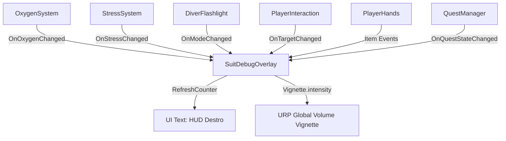

# Suit Feedback & Debug Overlay
Ultima verifica: 2026-10-26

## Scopo e confini
Rappresenta l'anello di congiunzione tra le letture dei sistemi interni della tuta (`OxygenSystem`, `StressSystem`, `DiverFlashlight`), le interazioni fisiche (`PlayerHands`, `PlayerInteraction`), la progressione narrativa (`QuestManager`) e i canali percettivi del giocatore.
Attualmente gestisce:
1. Il rendering dell'HUD di testo informativo (ancorato nell'angolo superiore destro del display).
2. Il feedback visivo a tutto schermo tramite post-processing URP, controllando direttamente l'intensità della `Vignette` nel `VolumeProfile` in base al livello normalizzato di stress.

## File e componenti
- `Assets/_Project/Code/Player/Feedback/SuitDebugOverlay.cs`: Controller unificato di feedback diegetico/debug e post-processing URP.
- `Assets/_Project/Code/Player/Feedback/HelmetInstruments.cs`: strumenti 3D del casco (gauge O₂ con quadrante pressione, CRT, spie), pilotati da codice.

## Dipendenze e flusso dati
- **Tuta e Vitali**: Sottoscrive `OnOxygenChanged` (`OxygenSystem`), `OnStressChanged` (`StressSystem`), `OnModeChanged` (`DiverFlashlight`).
- **Interazione e Mani**: Sottoscrive `OnTargetChanged` (`PlayerInteraction`) e `OnItemPickedUp`/`OnItemDropped` (`PlayerHands`).
- **Missioni**: Sottoscrive `OnQuestStateChanged` (`QuestManager`).
- **Rendering URP**: Modifica `Vignette.intensity.value` sul componente `Volume` della scena.

## Componenti

### SuitDebugOverlay
- **Responsabilità e ciclo di vita**:
  - `Awake()`: Auto-scoperta delle dipendenze mancanti via `FindFirstObjectByType` (`OxygenSystem`, `StressSystem`, `DiverFlashlight`, `PlayerInteraction`, `PlayerHands`, `QuestManager.Instance`). Configura il `Text` su `VerticalWrapMode.Overflow` / `HorizontalWrapMode.Overflow`. Recupera la `Vignette` dal `VolumeProfile` e ne forza `overrideState = true`.
  - `OnEnable()` / `OnDisable()`: Registrazione e disiscrizione da tutti gli eventi dei sistemi collegati per evitare memory leak.
  - `Update()`: Interpola lo stress visualizzato (`displayedStress`) con risposta esponenziale indipendente dal frame rate (`1f - Mathf.Exp(-vignetteResponse * Time.deltaTime)`), calcola l'intensità della vignetta tra `minimumVignetteIntensity` e `maximumVignetteIntensity`, e aggiorna il testo dell'HUD.
- **Campi Inspector**:
  - **Sistemi Tuta**:
    - `OxygenSystem oxygen`: Riferimento al serbatoio O₂.
    - `StressSystem stress`: Riferimento al monitor dello stress.
    - `DiverFlashlight flashlight`: Riferimento alla torcia.
    - `PlayerInteraction interaction`: Riferimento al raycast delle interazioni.
    - `PlayerHands hands`: Riferimento all'inventario delle mani.
    - `QuestManager questManager`: Riferimento al tracciamento obiettivi.
  - **UI**:
    - `Text counter`: Componente Text (uGUI) per la stampa del testo informativo.
  - **Feedback Vignetta URP**:
    - `Volume volume`: Riferimento al `Global Volume` con profilo post-processing URP.
    - `float minimumVignetteIntensity` (range: 0-1, default: `0.2f`): Intensità della vignetta a riposo (stress 0%).
    - `float maximumVignetteIntensity` (range: 0-1, default: `0.4f`): Intensità della vignetta al culmine del panico (stress 100%).
    - `float vignetteResponse` (range: 1-20, default: `7f`): Reattività dell'effetto visivo.
- **API pubbliche**:
  - Il componente non espone API pubbliche di manipolazione diretta, operando in modalità Observer / Consumer su eventi.
- **Riferimenti obbligatori e comportamento se mancanti**:
  - Tutti i riferimenti ai sistemi della tuta prevedono fallback automatico in `Awake()`. Se `volume` o `vignette` sono assenti, la regolazione post-processing viene semplicemente ignorata senza eccezioni.

### HelmetInstruments
Implementato e verificato in Play il 2026-10-26. Sostituisce l'overlay 2D `HelmetHud` (stesso giorno, rimosso): gli strumenti sono mesh 3D nel casco (`Helmet.fbx`), come nel concept di Manu, e il codice li muove. Non fatti: bussola (la mesh c'è, `Cylinder.007`/`.008` con `PH_Compass`, ma non è pilotata), schermo comunicazioni a scomparsa, menu di pausa, crepa sul vetro, localizzazione dei testi, materiali definitivi (tutti `PH_*` placeholder).
- **Responsabilità e ciclo di vita**: sull'istanza `Helmet` del `Player.prefab`. `Awake()` trova `OxygenSystem` e `DiverFlashlight` (`FindFirstObjectByType`) e memorizza la posa di riposo delle lancette; `Start()` allinea le lancette ai valori attuali; `Update()` ruota le lancette con smorzamento, accende le spie e riscrive i testi del CRT.
- **Lancette**: due perni vuoti nel modello (`Needle_O2_Pivot`, `Needle_Press_Pivot`), con asse Y verso l'alto e Z verso chi guarda; il codice li ruota attorno a Z a partire dalla posa di riposo (positivo = senso orario visto da chi guarda). La scala va dal verde (0, in basso a sinistra) al rosso (1, in basso a destra) su `sweepDegrees` (270°): l'ossigeno usa `1 - NormalizedOxygen` (la lancetta si sposta mentre si consuma), la pressione `InverseLerp(gaugeMinDepth, gaugeMaxDepth, profondità)`. In fascia arancione o rossa la lancetta trema.
- **Spie**: `MSH_Lamp_O2` e `MSH_Lamp_Press`, emissione scritta con `MaterialPropertyBlock` (`_EmissionColor`): spenta in fascia verde, gialla fissa, arancione lampeggiante, rossa veloce. O₂ dalle `OxygenLevel`, pressione da `orangeDepth` e `redDepth`.
- **CRT**: testi `TextMeshPro` (3D) figli di `CTR_Texts`, davanti a `MSH_CTR_Screen`: profondità (lampeggia in rosso oltre `redDepth`), etichette `PROFONDITÀ` e `LUCE`, modalità torcia (PIENA, BASSA, ROSSA) e tre tacche (`LightBar_0-2`, emissione per renderer). In torcia `Red` tutti i testi e le tacche passano al rosso d'emergenza. I testi sono italiani fissi: font e traduzioni si cambiano su questi `TMP_Text`.
- **Campi Inspector**: `oxygen`, `flashlight`, `depthSource` (default transform dell'`OxygenSystem`); `oxygenNeedle`, `pressureNeedle`; `oxygenLamp`, `pressureLamp`, `lampIntensity` (3); `depthLabel`, `depthValue`, `lightLabel`, `lightValue`, `lightBars`, `barIntensity` (2); `sweepDegrees` (270), `needleResponse` (6); `startDepth` (2040), `metersPerUnit` (2: metri di profondità per metro di scena), `orangeDepth` (2200), `redDepth` (2400), `gaugeMinDepth` (1800), `gaugeMaxDepth` (2600).
- **API pubbliche**: nessuna, osservatore in sola lettura.
- **Riferimenti mancanti**: ogni riferimento nullo viene ignorato (la parte relativa non si aggiorna); senza `OxygenSystem` la lancetta O₂ resta a pieno e la profondità a `startDepth`.
- **Modello e materiali**: `Assets/_Project/Assets/Models/Helmet/Helmet.fbx`, esportato da `Desktop/Deeplonauts/Blend/Helmet.blend` (oggetti della collection `COL_HelmetStatic` più `MSH_Visor`, assi Blender di default: avanti -Z, su Y). Nel .blend: testi 3D tolti, `MSH_PressDial_*` (sfondo e tre archi verde/arancione/rosso), `MSH_Needle_Press` con perno `Needle_Press_Pivot`, `Needle_O2_Pivot` che porta la lancetta esistente (`Cube.001`), due spie, `MSH_CTR_Screen`. I materiali sono rinominati `PH_*` (placeholder temporanei, da sostituire con le texture di Painter) e estratti in `Assets/_Project/Assets/Models/Helmet/Materials_Placeholder/`: URP Lit, con emissione per le fasce, le lancette, le spie e lo schermo (parola chiave `_EMISSION` e `globalIlluminationFlags` = `RealtimeEmissive`; senza il flag Unity le perde alla reimportazione). `PH_Glass` è trasparente (alpha 0.1). Il .blend precedente è in `Helmet.blend1`.
- **Setup**: dopo una nuova esportazione dell'FBX, perni, spie e testi restano collegati solo se i nomi non cambiano; i testi `CTR_Texts` sono nel prefab e vanno riposizionati a mano se lo schermo si sposta.
- **Limiti**: i testi usano le risorse essenziali di TextMeshPro, importate il 2026-10-26 in `Assets/TextMesh Pro/`; l'azione "pressione arancione aumenta il consumo di O₂" del GDD non è implementata; il vetro riflette la torcia sullo schermo del CRT (placeholder).

## Layout e Contenuto dell'HUD a Schermo
1. **Parametri Vitali**:
   - `O₂  XX.X%`
   - `STRESS  XX%`
   - `TORCH  [FULL / LOW / RED]` (mostra il singolo stato corrente della torcia in maiuscolo, oppure `[N/A]` se il riferimento a `DiverFlashlight` non è presente)
2. **Stato Oggetto Trasportato**:
   - `MANI: [NOME_OGGETTO] (Premi G per lasciare)` in verde quando occupate.
3. **Checklist Missione**:
   - `-- TITOLO MISSIONE --`
   - `[x] / [ ] Descrizione Obiettivo (corrente/richiesto)` in giallo/verde.
4. **Prompt Interazione Contestuale**:
   - `>> [E] Azione <<` in celeste quando si punta un oggetto interattivo.

## Setup in Unity
1. Aggiungere `SuitDebugOverlay` su un GameObject canvas dedicato o sul Player.
2. Collegare il componente `Text` (ancorato in alto a destra, `Anchor Max: (1, 1)`, `Pivot: (1, 1)`, allineamento a destra).
3. Trascinare il `Global Volume` della scena nel campo `Volume`.

## Configurazione verificata in prefab e scene
- In [Player.prefab](file:///Z:/_PROJECTS/Unity/Project_Deep/Assets/_Project/Prefabs/Player.prefab):
  - Il testo dell'HUD è allineato nell'angolo superiore destro con margine di 24 px.
  - Il `Volume` post-processing è agganciato al profilo globale con `Vignette` attiva.

## Estensione del sistema
- Sostituzione con HUD diegetico: proiettare le stringhe o i valori numerici su display all'interno della visiera 3D del casco del diver anziché sul canvas a schermo.

## Limiti e problemi noti
- Se il `VolumeProfile` non include un override `Vignette`, `profile.TryGet(out vignette)` restituirà `false` e la vignetta non verrà pilotata.

## Sistemi collegati
- [Oxygen.md](file:///Z:/_PROJECTS/Unity/Project_Deep/documentation/Oxygen.md)
- [Stress.md](file:///Z:/_PROJECTS/Unity/Project_Deep/documentation/Stress.md)
- [Flashlight.md](file:///Z:/_PROJECTS/Unity/Project_Deep/documentation/Flashlight.md)
- [Interaction.md](file:///Z:/_PROJECTS/Unity/Project_Deep/documentation/Interaction.md)
- [Quests.md](file:///Z:/_PROJECTS/Unity/Project_Deep/documentation/Quests.md)
