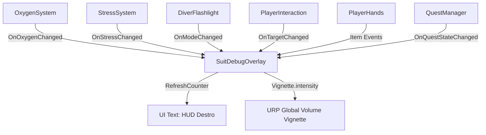

# Suit Feedback & Debug Overlay
Ultima verifica: 2026-11-08

## Scopo e confini
Rappresenta l'anello di congiunzione tra le letture dei sistemi interni della tuta (`OxygenSystem`, `StressSystem`, `DiverFlashlight`), le interazioni fisiche (`PlayerHands`, `PlayerInteraction`), la progressione narrativa (`QuestManager`) e i canali percettivi del giocatore.
Attualmente gestisce:
1. Il rendering dell'HUD di testo informativo (ancorato nell'angolo superiore destro del display).
2. Il feedback visivo a tutto schermo tramite post-processing URP, controllando direttamente l'intensità della `Vignette` nel `VolumeProfile` in base al livello normalizzato di stress.

## File e componenti
- `Assets/_Project/Code/Player/Feedback/SuitDebugOverlay.cs`: Controller unificato di feedback diegetico/debug e post-processing URP.
- `Assets/_Project/Code/Player/Feedback/HelmetInstruments.cs`: strumenti 3D del casco (gauge O₂ con quadrante pressione, CRT, spie), pilotati da codice.
- `Assets/_Project/Code/Player/Feedback/HelmetDamage.cs`: crepe sul vetro del casco a ogni morso, con allarme e scricchiolii (bozza).
- `Assets/_Project/Materials/Player/T_HelmetCracks.png` e `M_HelmetCrack.mat`: atlante 2x2 di crepe generato proceduralmente (linee bianche su alfa) e materiale `Universal Render Pipeline/Unlit` trasparente, senza culling, colore (0.78, 0.84, 0.9, 0.5).

## Dipendenze e flusso dati
- **Tuta e Vitali**: Sottoscrive `OnOxygenChanged` (`OxygenSystem`), `OnStressChanged` (`StressSystem`), `OnModeChanged` (`DiverFlashlight`).
- **Interazione e Mani**: Sottoscrive `OnTargetChanged` (`PlayerInteraction`) e `OnItemPickedUp`/`OnItemDropped` (`PlayerHands`).
- **Missioni**: Sottoscrive `OnQuestStateChanged` (`QuestManager`).
- **Rendering URP**: Modifica `Vignette.intensity.value` sul componente `Volume` della scena.

## Componenti

### SuitDebugOverlay
- **Responsabilità e ciclo di vita**:
  - `Awake()`: Auto-scoperta delle dipendenze mancanti via `FindFirstObjectByType` (`OxygenSystem`, `StressSystem`, `DiverFlashlight`, `PlayerInteraction`, `PlayerHands`, `QuestManager.Instance`). Configura il `Text` su `VerticalWrapMode.Overflow` / `HorizontalWrapMode.Overflow`. Recupera la `Vignette` dal `VolumeProfile` e ne forza `overrideState = true`.
  - `OnEnable()` / `OnDisable()`: Registrazione e disiscrizione da tutti gli eventi dei sistemi collegati per evitare memory leak.
  - `Update()`: Interpola lo stress visualizzato (`displayedStress`) con risposta esponenziale indipendente dal frame rate (`1f - Mathf.Exp(-vignetteResponse * Time.deltaTime)`), calcola l'intensità della vignetta tra `minimumVignetteIntensity` e `maximumVignetteIntensity`, e aggiorna il testo dell'HUD.
- **Campi Inspector**:
  - **Sistemi Tuta**:
    - `OxygenSystem oxygen`: Riferimento al serbatoio O₂.
    - `StressSystem stress`: Riferimento al monitor dello stress.
    - `DiverFlashlight flashlight`: Riferimento alla torcia.
    - `PlayerInteraction interaction`: Riferimento al raycast delle interazioni.
    - `PlayerHands hands`: Riferimento all'inventario delle mani.
    - `QuestManager questManager`: Riferimento al tracciamento obiettivi.
  - **UI**:
    - `Text counter`: Componente Text (uGUI) per la stampa del testo informativo.
  - **Feedback Vignetta URP**:
    - `Volume volume`: Riferimento al `Global Volume` con profilo post-processing URP.
    - `float minimumVignetteIntensity` (range: 0-1, default: `0.2f`): Intensità della vignetta a riposo (stress 0%).
    - `float maximumVignetteIntensity` (range: 0-1, default: `0.4f`): Intensità della vignetta al culmine del panico (stress 100%).
    - `float vignetteResponse` (range: 1-20, default: `7f`): Reattività dell'effetto visivo.
- **API pubbliche**:
  - Il componente non espone API pubbliche di manipolazione diretta, operando in modalità Observer / Consumer su eventi.
- **Riferimenti obbligatori e comportamento se mancanti**:
  - Tutti i riferimenti ai sistemi della tuta prevedono fallback automatico in `Awake()`. Se `volume` o `vignette` sono assenti, la regolazione post-processing viene semplicemente ignorata senza eccezioni.

### HelmetInstruments
Implementato e verificato in Play il 2026-10-26. Sostituisce l'overlay 2D `HelmetHud` (stesso giorno, rimosso): gli strumenti sono mesh 3D nel casco (`Helmet.fbx`), come nel concept di Manu, e il codice li muove. Bussola e scale rosse con la torcia rossa aggiunte e verificate in Play il 2026-10-26 (rotta 206°, torcia `Full` e `Red`). Non fatti: tacche intermedie sul nastro della bussola, schermo comunicazioni a scomparsa, menu di pausa, crepa sul vetro, localizzazione dei testi, materiali definitivi (tutti `PH_*` placeholder).
- **Responsabilità e ciclo di vita**: sull'istanza `Helmet` del `Player.prefab`. `Awake()` trova `OxygenSystem` e `DiverFlashlight` (`FindFirstObjectByType`) e memorizza la posa di riposo delle lancette; `Start()` allinea le lancette ai valori attuali; `Update()` ruota le lancette con smorzamento, accende le spie e riscrive i testi del CRT.
- **Lancette**: due perni vuoti nel modello (`Needle_O2_Pivot`, `Needle_Press_Pivot`), con asse Y verso l'alto e Z verso chi guarda; il codice li ruota attorno a Z a partire dalla posa di riposo (positivo = senso orario visto da chi guarda). La scala va dal verde (0, in basso a sinistra) al rosso (1, in basso a destra) su `sweepDegrees` (270°): l'ossigeno usa `1 - NormalizedOxygen` (la lancetta si sposta mentre si consuma), la pressione `InverseLerp(gaugeMinDepth, gaugeMaxDepth, profondità)`. In fascia arancione o rossa la lancetta trema.
- **Spie**: `MSH_Lamp_O2` e `MSH_Lamp_Press`, emissione scritta con `MaterialPropertyBlock` (`_EmissionColor`): spenta in fascia verde, gialla fissa, arancione lampeggiante, rossa veloce. O₂ dalle `OxygenLevel`, pressione da `orangeDepth` e `redDepth`. Con la torcia `Red` le tre fasce diventano rosso d'emergenza a 0.35, 0.65 e 1 di intensità.
- **Luce rossa sulle scale**: in `Awake()` cerca nei renderer figli le sottomesh con `greenScale`, `orangeScale`, `redScale` (gli archi del gauge O₂ in `Cylinder.004` e i `MSH_PressDial_*`). Con la torcia `Red` scrive `_BaseColor` ed `_EmissionColor` per sottomesh (`SetPropertyBlock(block, index)`) con tre rossi a 0.12, 0.4 e 1 di intensità, così le fasce restano leggibili per luminosità; con le altre modalità il blocco si svuota e torna il materiale. Scrive solo al cambio di modalità. Dopo il texturing in Painter i tre campi vanno ripuntati sui materiali nuovi.
- **Bussola**: nastro ad arco `Cylinder.007` (`compassStrip`). La mesh è un arco nel piano XY locale con centro `compassCenter` (0, -0.019, 0.046) e faccia interna a raggio ≈ 0.10; +X locale è la sinistra di chi guarda. `Awake()` crea a runtime quattro `TextMeshPro` (N, E, S, O, font e materiale di `depthLabel`) figli di `Helmet`. Ogni frame la lettera di un punto cardinale va sull'arco in proporzione allo scarto dalla rotta (`compassWindowHalf` 75° di rotta su `compassArcHalf` 45° di arco, destra = più a est), rivolta verso il centro, e sfuma verso i bordi della finestra. La rotta è lo yaw di `headingSource` (default `Camera.main`). L'emissione del nastro scende a 0.12 dell'inchiostro, ambra o rosso con la torcia `Red`, per far leggere le lettere.
- **CRT**: testi `TextMeshPro` (3D) figli di `CTR_Texts`, davanti a `MSH_CTR_Screen`: profondità (lampeggia in rosso oltre `redDepth`), etichette `DEPTH` e `LIGHT`, modalità torcia (FULL, LOW, RED, scritte in `HelmetInstruments`) e tre tacche (`LightBar_0-2`, emissione per renderer). In torcia `Red` tutti i testi e le tacche passano al rosso d'emergenza. I testi sono fissi, senza localizzazione: dal 2026-11-08 sono in inglese (prima `PROFONDITÀ`, `LUCE`, `PIENA/BASSA/ROSSA`) e `DepthLabel` è a fontSize 0.066. Font e traduzioni si cambiano su questi `TMP_Text`. Font (prova del 2026-10-26): Jersey 25 per i titoli (`DepthValue` e le lettere della bussola, che copiano il font di `depthValue`), Jersey 15 per il corpo (`DepthLabel`, `LightLabel`, `LightValue`). TTF da Google Fonts (licenza OFL, `Jersey_OFL.txt`) e font asset TMP dinamici SDFAA 1024 in `Assets/_Project/Assets/Fonts/`; il glifo `₂` non c'è. Il 2026-10-26 le etichette e la modalità torcia sono passate a fontSize 0.056 (da 0.035), con i testi e le tacche risistemati dentro lo schermo; la scocca del CRT (`Cube.003`), `MSH_CTR_Screen` e `CTR_Texts` sono alzati di 0.022 verso l'alto della camera (override nel prefab, non nel .blend), perché il fondo dello schermo usciva dal campo visivo. Se si riesporta l'FBX con il CRT spostato in Blender, questi override vanno tolti.
- **Campi Inspector**: `oxygen`, `flashlight`, `depthSource` (default transform dell'`OxygenSystem`); `oxygenNeedle`, `pressureNeedle`; `oxygenLamp`, `pressureLamp`, `lampIntensity` (3); `depthLabel`, `depthValue`, `lightLabel`, `lightValue`, `lightBars`, `barIntensity` (2); `greenScale`, `orangeScale`, `redScale` (nel prefab: `PH_Seg_Green`, `PH_Seg_Orange`, `PH_Seg_Red`); `compassStrip` (nel prefab: `Cylinder.007`), `headingSource`, `compassCenter`, `compassRadius` (0.097), `compassArcHalf` (45), `compassWindowHalf` (75), `compassLetterHeight` (0.009); `sweepDegrees` (270), `needleResponse` (6); `startDepth` (2040), `metersPerUnit` (2: metri di profondità per metro di scena), `orangeDepth` (2200), `redDepth` (2400), `gaugeMinDepth` (1800), `gaugeMaxDepth` (2600).
- **API pubbliche**: nessuna, osservatore in sola lettura.
- **Riferimenti mancanti**: ogni riferimento nullo viene ignorato (la parte relativa non si aggiorna); senza `OxygenSystem` la lancetta O₂ resta a pieno e la profondità a `startDepth`.
- **Modello e materiali**: `Assets/_Project/Assets/Models/Helmet/Helmet.fbx`, esportato da `Desktop/Deeplonauts/Blend/Helmet.blend` (oggetti della collection `COL_HelmetStatic` più `MSH_Visor`, assi Blender di default: avanti -Z, su Y). Nel .blend: testi 3D tolti, `MSH_PressDial_*` (sfondo e tre archi verde/arancione/rosso), `MSH_Needle_Press` con perno `Needle_Press_Pivot`, `Needle_O2_Pivot` che porta la lancetta esistente (`Cube.001`), due spie, `MSH_CTR_Screen`. I materiali sono rinominati `PH_*` (placeholder temporanei, da sostituire con le texture di Painter) e estratti in `Assets/_Project/Assets/Models/Helmet/Materials_Placeholder/`: URP Lit, con emissione per le fasce, le lancette, le spie e lo schermo (parola chiave `_EMISSION` e `globalIlluminationFlags` = `RealtimeEmissive`; senza il flag Unity le perde alla reimportazione). `PH_Glass` è trasparente (alpha 0.1). Il .blend precedente è in `Helmet.blend1`.
- **Setup**: dopo una nuova esportazione dell'FBX, perni, spie e testi restano collegati solo se i nomi non cambiano; i testi `CTR_Texts` sono nel prefab e vanno riposizionati a mano se lo schermo si sposta.
- **Limiti**: i testi usano le risorse essenziali di TextMeshPro, importate il 2026-10-26 in `Assets/TextMesh Pro/`; l'azione "pressione arancione aumenta il consumo di O₂" del GDD non è implementata; il vetro riflette la torcia sullo schermo del CRT (placeholder); il nastro della bussola è in cima al campo visivo e con il casco a riposo si vede solo la fascia bassa delle lettere; se il nastro cambia forma nel .blend, `compassCenter` e `compassRadius` vanno rimisurati dai vertici della mesh.

### HelmetDamage
Implementato il 2026-11-08 (bozza); verificato in Play con tre morsi simulati, vedi *Verifica*.
- **Responsabilità e ciclo di vita**: sul GameObject `Helmet` (figlio di `MainCamera/HelmetVisualPivot`), accanto a `HelmetInstruments`. In `Awake` risolve camera (genitori) e `DiverBiteReceiver` (se vuoto, `FindFirstObjectByType`), aggiunge un `AudioSource` 2D e genera i suoni sintetici; in `OnEnable`/`OnDisable` si iscrive e si toglie da `DiverBiteReceiver.OnBitten`. A ogni morso (`AddCrack`):
  1. le crepe già presenti si allargano di `growPerBite`, fino a `maxGrowth` volte la loro dimensione iniziale;
  2. una crepa nuova nasce nel punto d'impatto: centro della visuale più uno scarto casuale entro `impactJitter` (viewport), a `glassDistance` dall'occhio lungo quel raggio, quad rivolto alla camera con rotazione casuale, una delle 4 crepe dell'atlante, lato `crackSize × sizeVariation`;
  3. suona lo schiocco di vetro; al morso numero `criticalBites` anche l'allarme (tre bip);
  4. dal secondo morso il vetro scricchiola ogni `creakInterval` secondi (intervallo dimezzato e volume pieno da critico, al 60% prima).
  Le crepe sono figlie di `Helmet`, quindi seguono l'ondeggiare del casco, e restano fino a `ResetDamage`. Nessun effetto su ossigeno o stress oltre a quelli del morso.
- **Campi Inspector**:

| Campo | Tipo | Default | Significato |
|---|---|---|---|
| `biteReceiver` | `DiverBiteReceiver` | null | Chi riceve i morsi; vuoto = cercato in scena. Prefab: `PlayerCapsule` |
| `viewCamera` | `Camera` | null | Camera del sub; vuoto = fra i genitori. Prefab: `MainCamera` |
| `crackMaterial` | `Material` | null | Materiale delle crepe; vuoto = avviso in console e nessuna crepa. Prefab: `M_HelmetCrack` |
| `crackSize` | float ≥ 0.01 | 0.09 | Lato di una crepa nuova (m) |
| `sizeVariation` | `Vector2` | (0.8, 1.25) | Moltiplicatore casuale della dimensione |
| `impactJitter` | float [0, 0.5] | 0.12 | Raggio (viewport) attorno al centro per il punto d'impatto |
| `growPerBite` | float ≥ 1 | 1.25 | Allargamento delle crepe vecchie a ogni morso |
| `maxGrowth` | float ≥ 1 | 1.8 | Allargamento massimo rispetto alla dimensione iniziale |
| `glassDistance` | float ≥ 0.15 | 0.39 | Distanza dall'occhio lungo il raggio (la visiera è a 0.407 m sull'asse) |
| `criticalBites` | int ≥ 1 | 3 | Morsi dopo i quali il vetro è critico |
| `creakInterval` | `Vector2` | (5, 12) | Secondi fra due scricchiolii dal secondo morso |
| `crackClip`, `creakClip`, `alarmClip` | `AudioClip` | null | Suoni di design; vuoti = sintetici |
| `crackVolume`, `creakVolume`, `alarmVolume` | float [0, 1] | 0.8, 0.35, 0.5 | Volumi |

- **API pubbliche**: `int Bites { get; }`; `bool Critical { get; }` (da `criticalBites`); `event Action<int> OnDamageChanged` (a ogni crepa e alla riparazione, con il numero di morsi); `void AddCrack()`; `void ResetDamage()` (toglie le crepe, per la riparazione alla stazione di aggancio, non ancora collegata).
- **Suoni sintetici**: schiocco (clic di 4 ms, rumore passa-alto, risonanze a 3150 e 4720 Hz, tonfo a 90 Hz; 0.7 s), scricchiolio (impulsi di attrito da 18 a 45 al secondo filtrati, 1.3 s), allarme (tre bip a 1.1 kHz).
- **Riferimenti obbligatori**: `crackMaterial` e una camera. Senza `DiverBiteReceiver` non riceve morsi, ma `AddCrack` resta chiamabile.
- **Limiti**: distanza fissa invece di un raggio sulla visiera, perché la mesh di `Helmet.fbx` non è leggibile a runtime: dove una crepa supera il bordo dell'apertura, parte delle linee si disegna sopra la cornice del casco. L'apertura della visiera non è centrata sulla camera, e l'impatto (centro della visuale, dove arriva la testa della lucertola) cade verso il suo bordo destro. Texture e suoni sono provvisori.

## Layout e Contenuto dell'HUD a Schermo
1. **Parametri Vitali**:
   - `O₂  XX.X%`
   - `STRESS  XX%`
   - `TORCH  [FULL / LOW / RED]` (mostra il singolo stato corrente della torcia in maiuscolo, oppure `[N/A]` se il riferimento a `DiverFlashlight` non è presente)
2. **Stato Oggetto Trasportato**:
   - `MANI: [NOME_OGGETTO] (Premi G per lasciare)` in verde quando occupate.
3. **Checklist Missione**:
   - `-- TITOLO MISSIONE --`
   - `[x] / [ ] Descrizione Obiettivo (corrente/richiesto)` in giallo/verde.
4. **Prompt Interazione Contestuale**:
   - `>> [E] Azione <<` in celeste quando si punta un oggetto interattivo.

## Setup in Unity
1. Aggiungere `SuitDebugOverlay` su un GameObject canvas dedicato o sul Player.
2. Collegare il componente `Text` (ancorato in alto a destra, `Anchor Max: (1, 1)`, `Pivot: (1, 1)`, allineamento a destra).
3. Trascinare il `Global Volume` della scena nel campo `Volume`.

## Configurazione verificata in prefab e scene
- In [Player.prefab](file:///Z:/_PROJECTS/Unity/Project_Deep/Assets/_Project/Prefabs/Player.prefab):
  - Il testo dell'HUD è allineato nell'angolo superiore destro con margine di 24 px.
  - Il `Volume` post-processing è agganciato al profilo globale con `Vignette` attiva.
  - `HelmetDamage` su `MainCamera/HelmetVisualPivot/Helmet`, con `biteReceiver` = `PlayerCapsule`, `viewCamera` = `MainCamera`, `crackMaterial` = `M_HelmetCrack`, `crackSize` 0.09 (2026-11-08).

## Estensione del sistema
- Sostituzione con HUD diegetico: proiettare le stringhe o i valori numerici su display all'interno della visiera 3D del casco del diver anziché sul canvas a schermo.

## Limiti e problemi noti
- Se il `VolumeProfile` non include un override `Vignette`, `profile.TryGet(out vignette)` restituirà `false` e la vignetta non verrà pilotata.

## Verifica
- **HelmetDamage (2026-11-08)**, Play in `SCN_Gameplay`, creature disattivate, tre `DiverBiteReceiver.ReceiveBite` a 2 s di distanza: `Bites` 1, 2, 3, `Critical` vero al terzo, tre quad `Crack_*` sotto `Helmet`, a 0.39 m dall'occhio, con lato 0.140 e 0.134 m (le prime due, allargate) e 0.088 m (l'ultima). Screenshot `Assets/Screenshots/HelmetCracks_Test_20261108.png`: crepe visibili sul vetro, le vecchie si allargano, la cornice ne copre una parte. Un primo tentativo le metteva a 0.53 m (dietro la visiera), perché `ViewportPointToRay` parte dal piano near: corretto partendo dall'occhio. Non verificato dal vivo: suoni (schiocco, allarme, scricchiolii) e resa durante un vero attacco della lucertola.

## Sistemi collegati
- [Creatures.md](file:///Z:/_PROJECTS/Unity/Project_Deep/documentation/Creatures.md) (`DiverBiteReceiver.OnBitten`)
- [Oxygen.md](file:///Z:/_PROJECTS/Unity/Project_Deep/documentation/Oxygen.md)
- [Stress.md](file:///Z:/_PROJECTS/Unity/Project_Deep/documentation/Stress.md)
- [Flashlight.md](file:///Z:/_PROJECTS/Unity/Project_Deep/documentation/Flashlight.md)
- [Interaction.md](file:///Z:/_PROJECTS/Unity/Project_Deep/documentation/Interaction.md)
- [Quests.md](file:///Z:/_PROJECTS/Unity/Project_Deep/documentation/Quests.md)
