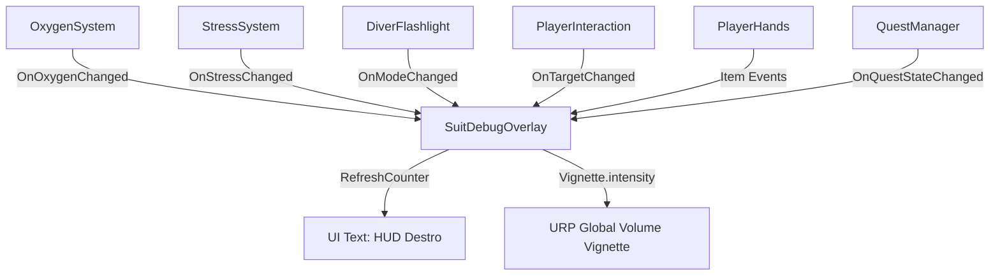

# Suit Feedback & Debug Overlay
Ultima verifica: 2026-11-24

## Scopo e confini
Rappresenta l'anello di congiunzione tra le letture dei sistemi interni della tuta (`OxygenSystem`, `StressSystem`, `DiverFlashlight`), le interazioni fisiche (`PlayerHands`, `PlayerInteraction`), la progressione narrativa (`QuestManager`) e i canali percettivi del giocatore.
Attualmente gestisce:
1. Il rendering dell'HUD di testo informativo (ancorato nell'angolo superiore destro del display).
2. Il feedback visivo a tutto schermo tramite post-processing URP, controllando direttamente l'intensità della `Vignette` nel `VolumeProfile` in base al livello normalizzato di stress.

## File e componenti
- `Assets/_Project/Code/Player/Feedback/SuitDebugOverlay.cs`: Controller unificato di feedback diegetico/debug e post-processing URP.
- `Assets/_Project/Code/Player/Feedback/HelmetInstruments.cs`: strumenti 3D del casco (gauge O₂ con quadrante pressione, CRT, spie), pilotati da codice.
- `Assets/_Project/Code/Player/Feedback/InteractionCrosshair.cs`: mirino del casco (punto, anello esagonale e due ganasce 3D davanti alla camera): anello sugli interattivi, ganasce sugli oggetti trascinabili (vincono le ganasce se il bersaglio è entrambe le cose).
- `Assets/_Project/Assets/Models/Helmet/Crosshair/`: `T_Crosshair_Dot.png` (punto tondo, 128 px; per qualche ora del 2026-11-23 nucleo esagonale, tornato tondo perché sotto il filtro a 12 px l'esagono non si legge), `T_Crosshair_Ring.png` (dal 2026-11-23 esagono vuoto regolare a punte destra e sinistra, tratto 6/40 della larghezza, 128 px; prima anello tondo da 64 px), `T_Crosshair_Jaw.png` (ganascia sinistra 16 × 40, 128 px, dal 2026-11-23; spezzata al centro da una fessura orizzontale di 6 unità, 6 px a schermo, così le due ganasce sono quattro lati di esagono), tutte bianco su alfa e generate in Python; nucleo e ganascia dalla tavola Figma «Grab — tre direzioni e nucleo maggiorato», proposta 01 Ganasce a 1:1. `M_Crosshair.mat`, `M_Crosshair_Ring.mat` e `M_Crosshair_Jaw.mat` (copia di `M_Crosshair` con la ganascia) (URP Unlit trasparente, coda 3500).
- `Assets/_Project/Code/Player/Feedback/HelmetDamage.cs`: crepe sul vetro del casco a ogni morso, con allarme e scricchiolii (bozza).
- `Assets/_Project/Materials/Player/T_HelmetCracks.png` e `M_HelmetCrack.mat`: atlante 2x2 di crepe generato proceduralmente (linee bianche su alfa) e materiale `Universal Render Pipeline/Unlit` trasparente, senza culling, colore (0.78, 0.84, 0.9, 0.5).

## Dipendenze e flusso dati
- **Tuta e Vitali**: Sottoscrive `OnOxygenChanged` (`OxygenSystem`), `OnStressChanged` (`StressSystem`), `OnModeChanged` (`DiverFlashlight`).
- **Interazione e Mani**: Sottoscrive `OnTargetChanged` (`PlayerInteraction`) e `OnItemPickedUp`/`OnItemDropped` (`PlayerHands`).
- **Missioni**: Sottoscrive `OnQuestStateChanged` (`QuestManager`).
- **Rendering URP**: Modifica `Vignette.intensity.value` sul componente `Volume` della scena.



## Componenti

### SuitDebugOverlay
- **Responsabilità e ciclo di vita**:
  - `Awake()`: Auto-scoperta delle dipendenze mancanti via `FindFirstObjectByType` (`OxygenSystem`, `StressSystem`, `DiverFlashlight`, `PlayerInteraction`, `PlayerHands`, `QuestManager.Instance`). Configura il `Text` su `VerticalWrapMode.Overflow` / `HorizontalWrapMode.Overflow`. Recupera la `Vignette` dal `VolumeProfile` e ne forza `overrideState = true`.
  - `OnEnable()` / `OnDisable()`: Registrazione e disiscrizione da tutti gli eventi dei sistemi collegati per evitare memory leak.
  - `Update()`: Interpola lo stress visualizzato (`displayedStress`) con risposta esponenziale indipendente dal frame rate (`1f - Mathf.Exp(-vignetteResponse * Time.deltaTime)`), calcola l'intensità della vignetta tra `minimumVignetteIntensity` e `maximumVignetteIntensity`, e aggiorna il testo dell'HUD.
- **Campi Inspector**:
  - **Sistemi Tuta**:
    - `OxygenSystem oxygen`: Riferimento al serbatoio O₂.
    - `StressSystem stress`: Riferimento al monitor dello stress.
    - `DiverFlashlight flashlight`: Riferimento alla torcia.
    - `PlayerInteraction interaction`: Riferimento al raycast delle interazioni.
    - `PlayerHands hands`: Riferimento all'inventario delle mani.
    - `QuestManager questManager`: Riferimento al tracciamento obiettivi.
  - **UI**:
    - `Text counter`: Componente Text (uGUI) per la stampa del testo informativo.
  - **Feedback Vignetta URP**:
    - `Volume volume`: Riferimento al `Global Volume` con profilo post-processing URP.
    - `float minimumVignetteIntensity` (range: 0-1, default: `0.2f`): Intensità della vignetta a riposo (stress 0%).
    - `float maximumVignetteIntensity` (range: 0-1, default: `0.4f`): Intensità della vignetta al culmine del panico (stress 100%).
    - `float vignetteResponse` (range: 1-20, default: `7f`): Reattività dell'effetto visivo.
- **API pubbliche**:
  - Il componente non espone API pubbliche di manipolazione diretta, operando in modalità Observer / Consumer su eventi.
- **Riferimenti obbligatori e comportamento se mancanti**:
  - Tutti i riferimenti ai sistemi della tuta prevedono fallback automatico in `Awake()`. Se `volume` o `vignette` sono assenti, la regolazione post-processing viene semplicemente ignorata senza eccezioni.

### HelmetInstruments
Implementato e verificato in Play il 2026-10-26. Sostituisce l'overlay 2D `HelmetHud` (stesso giorno, rimosso): gli strumenti sono mesh 3D nel casco (`Helmet.fbx`), come nel concept di Manu, e il codice li muove. Bussola e scale rosse con la torcia rossa aggiunte e verificate in Play il 2026-10-26 (rotta 206°, torcia `Full` e `Red`). Intercardinali e tacche sulla bussola aggiunte il 2026-11-24 (compilato, non ancora verificato in Play). Non fatti: schermo comunicazioni a scomparsa, menu di pausa, crepa sul vetro, localizzazione dei testi, materiali definitivi (tutti `PH_*` placeholder).
- **Responsabilità e ciclo di vita**: sull'istanza `Helmet` del `Player.prefab`. `Awake()` trova `OxygenSystem` e `DiverFlashlight` (`FindFirstObjectByType`) e memorizza la posa di riposo delle lancette; `Start()` allinea le lancette ai valori attuali; `Update()` ruota le lancette con smorzamento, accende le spie e riscrive i testi del CRT.
- **Lancette**: due perni vuoti nel modello (`Needle_O2_Pivot`, `Needle_Press_Pivot`), con asse Y verso l'alto e Z verso chi guarda; il codice li ruota attorno a Z a partire dalla posa di riposo (positivo = senso orario visto da chi guarda). La scala va dal verde (0, in basso a sinistra) al rosso (1, in basso a destra) su `sweepDegrees` (270°): l'ossigeno usa `1 - NormalizedOxygen` (la lancetta si sposta mentre si consuma), la pressione `InverseLerp(gaugeMinDepth, gaugeMaxDepth, profondità)`. In fascia arancione o rossa la lancetta trema.
- **Spie**: `MSH_Lamp_O2` e `MSH_Lamp_Press`, emissione scritta con `MaterialPropertyBlock` (`_EmissionColor`): spenta in fascia verde, gialla fissa, arancione lampeggiante, rossa veloce. O₂ dalle `OxygenLevel`, pressione da `orangeDepth` e `redDepth`. Con la torcia `Red` le tre fasce diventano rosso d'emergenza a 0.35, 0.65 e 1 di intensità.
- **Luce rossa sulle scale**: in `Awake()` cerca nei renderer figli le sottomesh con `greenScale`, `orangeScale`, `redScale` (gli archi del gauge O₂ in `Cylinder.004` e i `MSH_PressDial_*`). Con la torcia `Red` scrive `_BaseColor` ed `_EmissionColor` per sottomesh (`SetPropertyBlock(block, index)`) con tre rossi a 0.12, 0.4 e 1 di intensità, così le fasce restano leggibili per luminosità; con le altre modalità il blocco si svuota e torna il materiale. Scrive solo al cambio di modalità. Dopo il texturing in Painter i tre campi vanno ripuntati sui materiali nuovi.
- **Bussola**: dal 2026-11-24 (sera) lo schermo è `MSH_CompassScreen` (`compassStrip`) del modello separato `SM_Compass.fbx` (telaio `MSH_CompassChassist` con `PH_Metal`, schermo con `PH_Compass`, vetro `MSH_CompassGlass` con `PH_Glass`; posa nel prefab `(-0.0001, 0.1169, -0.0281)`, rot `(17.2, 0, 0)` dopo fine-tuning di Manu), rifatto da Manu in `Helmet.blend` più basso del vecchio nastro; `Cylinder.007` e `Cylinder.008` di `Helmet.fbx` sono disattivati nel prefab. Lo schermo è un arco nel piano XY locale (unità del FBX, 1/100 di metro: i figli hanno scala 100) con centro `compassCenter` `(0, 0.001724, 0.000018)` (10 mm sopra il bordo basso `−0.000082`) e raggio `compassRadius` `0.00164`, tra il vetro bombato e lo schermo; la Z centra la fila di lettere (`compassLetterHeight` `0.009`) nella fascia di schermo dentro l'inquadratura. +X locale è la destra di chi guarda e +Z l'alto (sul vecchio `Cylinder.007` erano sinistra e −Z: il codice è stato invertito con la mesh). Lo schermo è leggermente conico (`dr/dz ≈ −0.14`, raggio da 0.1671 sul bordo basso a 0.1629 sul bordo alto in unità Blender): `UpdateCompass` inclina la normale delle lettere di `+0.14` lungo `+Z` locale così restano parallele alla superficie dello schermo senza farsi tagliare in cima né toccare il vetro in basso. `Awake()` crea a runtime i `TextMeshPro` figli di `Helmet` (font e materiale di `depthValue`): otto lettere fisse in inglese N NE E SE S SW W NW (`shortcut`: da localizzare con la tabella quando serve; le intercardinali sono alte `compassMinorScale` delle cardinali) e, se `compassTickStep` > 0, una tacca `|` ogni 15° fra le direzioni (alta `compassTickScale` delle cardinali, non grassetto, saltate dove c'è una lettera). Ogni frame ogni lettera e tacca va sull'arco in proporzione allo scarto dalla rotta (`compassWindowHalf` 75° di rotta su `compassArcHalf` 32° di arco, lo schermo copre circa ±35°, destra = più a est), rivolta verso il centro, e sfuma verso i bordi della finestra. La rotta è lo yaw di `headingSource` (default `Camera.main`). L'emissione del nastro scende a 0.12 dell'inchiostro, ambra o rosso con la torcia `Red`, per far leggere le lettere.
- **Layout del CRT dal 2026-11-22** (rework dopo il playtest di Manu: icona che usciva dallo schermo, profondità troppo piccola; mockup approvato in chat): due metà. Sopra `DepthLabel` (fontSize 0.07, `(−0.0145, 0.0165)`) e `DepthValue` (0.12, `(−0.0162, 0.01275)`, rect alto 0.013, alzato e ingrandito il 2026-11-22 dopo il primo passaggio, x più a sinistra per compensare il margine del glifo Jersey 25, testo `0000<size=60%> M</size>`, M più piccola). Sotto `LightModeIcon` grande a sinistra (centro `(−0.0075, −0.0085)`, scala 0.014) e a destra `LightLabel` (0.06, `(0.0012, −0.0027)`) e `LightValue` (0.08, `(0.0012, −0.0068)`). Coordinate nel piano di `CRT_Notice` (origine al centro dello schermo, W 0.033 × H 0.035, margine ≈ 2 mm), posizioni top-left dei rect; tutti i testi a fontSize fisso. Le tre tacche `LightBar_0-2` sono deprecate: oggetti disattivati nel prefab e `lightBars` vuoto (il codice le gestisce ancora se ripopolate). Non c'è il separatore orizzontale del mockup. Dal 2026-11-22 `PH_Screen` (solo `MSH_CTR_Screen`) ha speculare e riflessi d'ambiente spenti: i riflessi della torcia e di `EmergencyLight` cadevano sulle cifre. Il paragrafo seguente descrive lo storico.
- **CRT**: testi `TextMeshPro` (3D) figli di `CTR_Texts`, davanti a `MSH_CTR_Screen`: profondità (lampeggia in rosso oltre `redDepth`), etichette `DEPTH` e `LIGHT`, modalità torcia (FULL, LOW, RED, scritte in `HelmetInstruments`) e tre tacche (`LightBar_0-2`, emissione per renderer). Dal 2026-11-21 accanto alle tacche c'è l'icona della modalità (`LightValue/LightModeIcon`, quad Unlit con `M_PhotocellScreen_Icon`, posizione locale `(0.0125, −0.0095, −0.0002)`, scala 0.013 (a 0.015 il raggio alto copriva la L di FULL); fino al 2026-11-21 `(0.004, …)` scala 0.006, illeggibile su portatile): `modeIcons[(int)mode]` in `_BaseMap` e il colore dell'inchiostro in `_BaseColor` via `MaterialPropertyBlock`. Icone `T_TorchMode_Full/Low/Red` (dal 2026-11-22 esagoni di Manu: raggi lunghi, raggi corti, raggi corti con barra orizzontale e tre raggi alternati attaccati al corpo, corretta il 2026-11-23; prima lampada IEC 60417), le stesse dello schermo della fotocellula. Non emette come le tacche: in Scene view risulta un po' più fioca, da giudicare in gioco. La carica del flash (`FLASH` e tacche che si riempiono, dal 2026-11-10) è tolta il 2026-11-21 con il flash. In torcia `Red` tutti i testi e le tacche passano al rosso d'emergenza. I testi sono fissi, senza localizzazione: dal 2026-11-08 sono in inglese (prima `PROFONDITÀ`, `LUCE`, `PIENA/BASSA/ROSSA`) e `DepthLabel` è a fontSize 0.066. Font e traduzioni si cambiano su questi `TMP_Text`. Font (prova del 2026-10-26): Jersey 25 per i titoli (`DepthValue` e le lettere della bussola, che copiano il font di `depthValue`), Jersey 15 per il corpo (`DepthLabel`, `LightLabel`, `LightValue`). TTF da Google Fonts (licenza OFL, `Jersey_OFL.txt`) e font asset TMP dinamici SDFAA 1024 in `Assets/_Project/Assets/Fonts/`; il glifo `₂` non c'è. Il 2026-10-26 le etichette e la modalità torcia sono passate a fontSize 0.056 (da 0.035), con i testi e le tacche risistemati dentro lo schermo; la scocca del CRT (`Cube.003`), `MSH_CTR_Screen` e `CTR_Texts` sono alzati di 0.022 verso l'alto della camera (override nel prefab, non nel .blend), perché il fondo dello schermo usciva dal campo visivo. Se si riesporta l'FBX con il CRT spostato in Blender, questi override vanno tolti.
- **Campi Inspector**: `oxygen`, `flashlight`, `depthSource` (default transform dell'`OxygenSystem`); `oxygenNeedle`, `pressureNeedle`; `oxygenLamp`, `pressureLamp`, `lampIntensity` (3); `depthLabel`, `depthValue`, `lightLabel`, `lightValue`, `lightBars` (vuoto nel prefab dal 2026-11-22), `barIntensity` (2), `lightIcon` (opzionale, dal 2026-11-21), `modeIcons` (3 texture in ordine Full, Low, Red); `noticeRoot`, `noticeIcon`, `noticeTitle`, `noticeKey` (opzionali, dal 2026-11-22), `noticeSeconds` (4), `redTitle`, `redKey`, `lightsTitle`, `lightsKey`; `greenScale`, `orangeScale`, `redScale` (nel prefab: `PH_Seg_Green`, `PH_Seg_Orange`, `PH_Seg_Red`); `compassStrip` (nel prefab: `SM_Compass/MSH_CompassScreen`), `headingSource`, `compassCenter` (`(0, 0.001724, 0.000018)`), `compassRadius` (`0.00164`), `compassArcHalf` (`32`), `compassWindowHalf` (`75`), `compassLetterHeight` (`0.009`), `compassMinorScale` (`0.65`), `compassTickStep` (`15`), `compassTickScale` (`0.6`); `sweepDegrees` (270), `needleResponse` (6); `startDepth` (2040), `metersPerUnit` (2: metri di profondità per metro di scena), `orangeDepth` (2200), `redDepth` (2400), `gaugeMinDepth` (1800), `gaugeMaxDepth` (2600).
- **Avvisi sul CRT** (dal 2026-11-22, richiesta di Manu: il tasto si mostra solo sugli schermi del mondo, H.E.L.M. dirà il perché): per `noticeSeconds` (4 s, tempo non scalato) il CRT nasconde `depthLabel`, `depthValue`, `lightLabel`, `lightValue` (con la sua icona) e `lightBars` (`SetActive`) e mostra `noticeRoot` con icona grande, titolo e tasto, poi ripristina. Due avvisi:
  - **Modulo rosso**: scatta da solo quando `DiverFlashlight.RedUnlocked` passa a vero (letto in `Update`, lo stato iniziale si legge in `Start`, quindi niente avviso se si parte già sbloccati): icona `modeIcons[2]`, `redTitle` («RED MODULE ONLINE»), `redKey` («[R] USE», fino al 2026-11-22 «[R] TO USE»), titolo e icona in rosso d'emergenza anche con la torcia in Full.
  - **Torcia**: `ShowLightsNotice()`, chiamato da `PlayerWakeUpSequence.onCompleted` a fine risveglio in capsula: icona `modeIcons[0]`, `lightsTitle` («LIGHTS ONLINE»), `lightsKey` («[F] CYCLE», fino al 2026-11-22 «[F] CYCLE LIGHTS»), col colore dell'inchiostro corrente.
  - Il tasto è nel testo, scritto a mano: R ed F sono fissi anche in `DiverFlashlight`. Se si introduce il rebinding, il carattere va letto dal binding.
  - Prefab: `CTR_Texts/CRT_Notice` (inattivo), stesso orientamento di `LightValue`, al centro di `MSH_CTR_Screen` (schermo ≈ 33 × 35 mm); figli `NoticeIcon` (copia di `LightModeIcon`, `(0, 0.0085)`, scala 0.015), `NoticeTitle` (`(0, −0.0045)`, rect 0.030 × 0.014, fontSize 0.066 fisso, a capo attivo e lineSpacing −10: «RED MODULE / ONLINE» e «LIGHTS / ONLINE» su due righe), `NoticeKey` (`(0, −0.0128)`, rect 0.030 × 0.0055, fontSize 0.055 fisso, colore dell'inchiostro pieno dal 2026-11-22, prima `dim`, illeggibile in modalità Red), copie di `LightValue` (Jersey 15) centrate. Rifatto il 2026-11-22 dopo il playtest di Manu: con l'auto-size su una riga titolo e icona erano illeggibili (prima icona scala 0.42·H, titolo fino a 0.075 su una riga). Le coordinate sono nel piano di `CRT_Notice`, origine al centro dello schermo (W 0.033 × H 0.035).
- **API pubbliche**:
  ```csharp
  void ShowLightsNotice(); // avviso della torcia
  void ShowNotice(Texture2D icon, string title, string key, bool red = false); // senza noticeRoot non fa niente; un avviso nuovo sostituisce quello in corso
  ```
- **Riferimenti mancanti**: ogni riferimento nullo viene ignorato (la parte relativa non si aggiorna); senza `OxygenSystem` la lancetta O₂ resta a pieno e la profondità a `startDepth`.
- **Modello e materiali**: `Assets/_Project/Assets/Models/Helmet/Helmet.fbx`, esportato da `Desktop/Deeplonauts/Blend/Helmet.blend` (oggetti della collection `COL_HelmetStatic` più `MSH_Visor`, assi Blender di default: avanti -Z, su Y). Nel .blend: testi 3D tolti, `MSH_PressDial_*` (sfondo e tre archi verde/arancione/rosso), `MSH_Needle_Press` con perno `Needle_Press_Pivot`, `Needle_O2_Pivot` che porta la lancetta esistente (`Cube.001`), due spie, `MSH_CTR_Screen`. I materiali sono rinominati `PH_*` (placeholder temporanei, da sostituire con le texture di Painter) e estratti in `Assets/_Project/Assets/Models/Helmet/Materials_Placeholder/`: URP Lit, con emissione per le fasce, le lancette, le spie e lo schermo (parola chiave `_EMISSION` e `globalIlluminationFlags` = `RealtimeEmissive`; senza il flag Unity le perde alla reimportazione). `PH_Glass` è trasparente (alpha 0.1). Il .blend precedente è in `Helmet.blend1`.
- **Setup**: dopo una nuova esportazione dell'FBX, perni, spie e testi restano collegati solo se i nomi non cambiano; i testi `CTR_Texts` sono nel prefab e vanno riposizionati a mano se lo schermo si sposta.
- **Limiti**: i testi usano le risorse essenziali di TextMeshPro, importate il 2026-10-26 in `Assets/TextMesh Pro/`; l'azione "pressione arancione aumenta il consumo di O₂" del GDD non è implementata; il vetro riflette la torcia sullo schermo del CRT (placeholder); lo schermo della bussola esce in parte dal bordo alto dell'inquadratura e le lettere stanno nella sua parte bassa (verificato in Play il 2026-11-24 con cattura della Game view, rotta 206°: S e SW leggibili, ordine corretto, non provato a mano da Manu); `Helmet.blend` non contiene più le parti preparate per Unity (perni delle lancette, `MSH_PressDial_*`, spie, `MSH_CTR_Screen`, materiali `PH_*`): non riesportare `Helmet.fbx` da lì finché non vengono ripristinate, altrimenti il prefab perde quei riferimenti; il glifo `|` delle tacche dipende dal font di `depthValue` (Jersey 25) e il suo centro verticale può non coincidere con quello delle lettere; se il nastro cambia forma nel .blend, `compassCenter` e `compassRadius` vanno rimisurati dai vertici della mesh.

### InteractionCrosshair *(2026-11-11, ganasce dal 2026-11-23)*
- **Responsabilità e ciclo di vita**: mirino 3D (regola di Manu: niente HUD su Canvas 2D). In `Awake` risolve `PlayerInteraction` e `PlayerGrab` sui genitori se mancano e salva la scala piena dell'anello e le posizioni locali delle ganasce (posa di mira). In `LateUpdate` tre quantità indipendenti vanno verso 1 o 0 a `response` al secondo: `interactAmount` (`PlayerInteraction.HasTarget` e nessun trascinabile), `grabAmount` (`PlayerGrab.Held` non nullo o `PlayerGrab.FindTarget` trova un `Grabbable` libero), `heldAmount` (`PlayerGrab.Held` non nullo). `HasTarget` = interattivo o trascinabile. Nucleo con alfa da `idleDotAlpha` a 1 sul massimo fra `interactAmount` e `grabAmount`; anello da `ringIdleScale` a scala piena con alfa `interactAmount` (dal 2026-11-23 solo per gli interattivi); ganasce con alfa `grabAmount`, spostate in x locale verso l'esterno di `jawSpread × (1 − grabAmount)` mentre compaiono e verso il nucleo di `jawClose × heldAmount` mentre si trascina; renderer spenti a 0. Se un oggetto è sia interattivo sia trascinabile (per esempio una cella) si vedono solo le ganasce: insieme all'anello formavano un simbolo illeggibile (Manu, 2026-11-23). Colori via `MaterialPropertyBlock` (`_BaseColor`). Mentre si trascina qualcosa, se un `GrabSocket` della scena (cercati in `Awake`) ha `IsAligned` vero, punto e anello passano ad `alignedColor` (dal 2026-11-23 anche le ganasce; colori lasciati invariati per scelta di Manu): verde quando la cella è posata bene, come nel mockup. Verificato in Play da codice il 2026-11-11: cella tenuta sul connettore → punto verde, spostata di 1.5 m → di nuovo ambra.
- **Campi Inspector**: `PlayerInteraction interaction`, `PlayerGrab grab` (vuoti: cercati sui genitori), `Renderer dot`, `Renderer ring`, `Renderer jawLeft`, `Renderer jawRight` (quad nella posa di mira; vuoti: niente ganasce), `Color color` (ambra `(1, 0.6, 0.15, 1)`), `Color alignedColor` (verde `(0.3, 1, 0.45, 1)`, dal 2026-11-11), `float idleDotAlpha` (`0.35`), `float ringIdleScale` (`0.4`), `float response` (`10`), `float jawSpread` (`0.001` m locali, circa 6 px), `float jawClose` (`0.001` m locali, circa 6 px: chiuse, i bracci di sopra e di sotto si toccano e l'esagono si chiude attorno al punto, lasciando solo le fessure ai lati; a 3 px aperte e chiuse si distinguevano poco).
- **API pubbliche**: `bool HasTarget { get; }`.
- **Limiti**: una `RaycastAll` in più a frame (quella di `FindTarget`). Il mirino è a 0.3 m dall'occhio, tra la camera (near 0.14) e la visiera: geometria più vicina di 0.3 m lo coprirebbe.

### HelmetDamage
Implementato il 2026-11-08 (bozza); verificato in Play con tre morsi simulati, vedi *Verifica*.
- **Responsabilità e ciclo di vita**: sul GameObject `Helmet` (figlio di `MainCamera/HelmetVisualPivot`), accanto a `HelmetInstruments`. In `Awake` risolve camera (genitori) e `DiverBiteReceiver` (se vuoto, `FindFirstObjectByType`), aggiunge un `AudioSource` 2D e genera i suoni sintetici; in `OnEnable`/`OnDisable` si iscrive e si toglie da `DiverBiteReceiver.OnBitten`. A ogni morso (`AddCrack`):
  1. le crepe già presenti si allargano di `growPerBite`, fino a `maxGrowth` volte la loro dimensione iniziale;
  2. una crepa nuova nasce nel punto d'impatto: direzione casuale dal centro della visuale, a una distanza (viewport) fra `impactRing.x` e `impactRing.y`, quindi verso i bordi con il centro libero (dal 2026-11-23: prima cadeva entro `impactJitter` dal centro e copriva la visuale), a `glassDistance` dall'occhio lungo quel raggio, quad rivolto alla camera con rotazione casuale, una delle 4 crepe dell'atlante, lato `crackSize × sizeVariation`;
  3. suona lo schiocco di vetro; al morso numero `criticalBites` anche l'allarme (tre bip);
  4. dal secondo morso il vetro scricchiola ogni `creakInterval` secondi (intervallo dimezzato e volume pieno da critico, al 60% prima).
  Le crepe sono figlie di `Helmet`, quindi seguono l'ondeggiare del casco, e restano fino a `ResetDamage`, che dal 2026-11-23 chiamano `OxygenRefillStation` (aggancio a stazione accesa) e `DiverRespawn.Respawn` (prima le crepe restavano anche dopo la morte). Nessun effetto su ossigeno o stress oltre a quelli del morso.
- **Campi Inspector**:

| Campo | Tipo | Default | Significato |
|---|---|---|---|
| `biteReceiver` | `DiverBiteReceiver` | null | Chi riceve i morsi; vuoto = cercato in scena. Prefab: `PlayerCapsule` |
| `viewCamera` | `Camera` | null | Camera del sub; vuoto = fra i genitori. Prefab: `MainCamera` |
| `crackMaterial` | `Material` | null | Materiale delle crepe; vuoto = avviso in console e nessuna crepa. Prefab: `M_HelmetCrack` |
| `crackSize` | float ≥ 0.01 | 0.09 | Lato di una crepa nuova (m) |
| `sizeVariation` | `Vector2` | (0.8, 1.25) | Moltiplicatore casuale della dimensione |
| `impactRing` | Vector2 | (0.25, 0.42) | Distanza minima e massima (viewport) dal centro per il punto d'impatto; sostituisce `impactJitter` dal 2026-11-23 |
| `growPerBite` | float ≥ 1 | 1.25 | Allargamento delle crepe vecchie a ogni morso |
| `maxGrowth` | float ≥ 1 | 1.8 | Allargamento massimo rispetto alla dimensione iniziale |
| `glassDistance` | float ≥ 0.15 | 0.39 | Distanza dall'occhio lungo il raggio (la visiera è a 0.407 m sull'asse) |
| `criticalBites` | int ≥ 1 | 3 | Morsi dopo i quali il vetro è critico |
| `creakInterval` | `Vector2` | (5, 12) | Secondi fra due scricchiolii dal secondo morso |
| `crackClip`, `creakClip`, `alarmClip` | `AudioClip` | null | Suoni di design; vuoti = sintetici |
| `crackVolume`, `creakVolume`, `alarmVolume` | float [0, 1] | 0.8, 0.35, 0.5 | Volumi |

- **API pubbliche**: `int Bites { get; }`; `bool Critical { get; }` (da `criticalBites`); `event Action<int> OnDamageChanged` (a ogni crepa e alla riparazione, con il numero di morsi); `void AddCrack()`; `void ResetDamage()` (toglie le crepe e azzera i morsi; la chiamano `OxygenRefillStation` all'aggancio e `DiverRespawn.Respawn`, dal 2026-11-23).
- **Suoni sintetici**: schiocco (clic di 4 ms, rumore passa-alto, risonanze a 3150 e 4720 Hz, tonfo a 90 Hz; 0.7 s), scricchiolio (impulsi di attrito da 18 a 45 al secondo filtrati, 1.3 s), allarme (tre bip a 1.1 kHz).
- **Riferimenti obbligatori**: `crackMaterial` e una camera. Senza `DiverBiteReceiver` non riceve morsi, ma `AddCrack` resta chiamabile.
- **Limiti**: distanza fissa invece di un raggio sulla visiera, perché la mesh di `Helmet.fbx` non è leggibile a runtime: dove una crepa supera il bordo dell'apertura, parte delle linee si disegna sopra la cornice del casco. L'apertura della visiera non è centrata sulla camera, e l'impatto (centro della visuale, dove arriva la testa della lucertola) cade verso il suo bordo destro. Texture e suoni sono provvisori.

## Layout e Contenuto dell'HUD a Schermo
1. **Parametri Vitali**:
   - `O₂  XX.X%`
   - `STRESS  XX%`
   - `TORCH  [FULL / LOW / RED]` (mostra il singolo stato corrente della torcia in maiuscolo, oppure `[N/A]` se il riferimento a `DiverFlashlight` non è presente)
2. **Stato Oggetto Trasportato**:
   - `MANI: [NOME_OGGETTO] (Premi G per lasciare)` in verde quando occupate.
3. **Checklist Missione**:
   - `-- TITOLO MISSIONE --`
   - `[x] / [ ] Descrizione Obiettivo (corrente/richiesto)` in giallo/verde.
4. **Prompt Interazione Contestuale**:
   - `>> [E] Azione <<` in celeste quando si punta un oggetto interattivo.

## Setup in Unity
1. Aggiungere `SuitDebugOverlay` su un GameObject canvas dedicato o sul Player.
2. Collegare il componente `Text` (ancorato in alto a destra, `Anchor Max: (1, 1)`, `Pivot: (1, 1)`, allineamento a destra).
3. Trascinare il `Global Volume` della scena nel campo `Volume`.

## Configurazione verificata in prefab e scene
- In [Player.prefab](file:///Z:/_PROJECTS/Unity/Project_Deep/Assets/_Project/Prefabs/Player.prefab):
  - Il testo dell'HUD è allineato nell'angolo superiore destro con margine di 24 px.
  - Il `Volume` post-processing è agganciato al profilo globale con `Vignette` attiva.
  - `SCN_Gameplay` (2026-11-11, override di scena sull'istanza del Player, non nel prefab): `MainCamera/InteractionCrosshair` a z locale 0.3 con `InteractionCrosshair` (`interaction` e `grab` = `PlayerCapsule`), figli `Dot` (quad 0.0013 m, circa 7 px; `idleDotAlpha` 0.6 in scena, dopo una cattura in Game view in cui il punto a 0.35 e 0.0009 m non si vedeva) e `Ring` (quad 0.0045 m, circa 28 px con FOV verticale 32.9 a 1080p), senza collider né ombre. Dal 2026-11-23 (1 px a 1080p = 0.000164 m a 0.3 m con FOV 32.9): `Dot` a 0.00109 m (punto tondo da 6 px = 2 celle, ridotto da 12 px su feedback di Manu; l'esagono si leggeva solo da 24 px = 8 celle del filtro `AnalogLook` a pixel 3, troppo grande per Manu), `Ring` a 0.007 m (esagono largo 40 px, tratto 6 px = 2 celle), `JawLeft` e `JawRight` (copie di `Dot` con `M_Crosshair_Jaw`, ganasce alla misura della tavola, larghe 46 px in tutto: quad 0.00724 m, x locale ∓0.00246 = ∓15 px, la destra ruotata di 180° su z), `jawClose` 0.001. Dimensioni ridotte due volte il 2026-11-23 su feedback (anello 48 → 40 px, ganasce 1.3× → 1×).
  - Vetro del visore (2026-11-24, prova): `MainCamera/HelmetVisualPivot/Helmet/MSH_Visor` con `M_VisorGlass` (`Assets/_Project/Assets/Models/Helmet/Materials_Placeholder/`, shader `Deeplonauts/VisorGlass`: unlit additivo, `Cull Front` perché la camera è dentro il guscio, Fresnel che schiarisce solo dove il vetro è di taglio, centro libero; `_Color` grigio freddo (0.55, 0.6, 0.65), `_Intensity` 0.35, `_RimPower` 3), ombre spente. Prima aveva il `Lit.mat` del pacchetto URP e non si vedeva perché le sue facce, viste da dentro, erano scartate dal back-face culling. La mesh non ha UV: niente sporco a texture. Si spegne disattivando `MSH_Visor`. Distanza dalla camera 0.25-0.41 m, oltre il near clip 0.14: i bordi non vengono tagliati. Catturato in Play a 0.08 (invisibile), 0.6 (velo grigio su tutto, toglie contrasto) e 0.35 (scelto: centro libero; quel che si vede è soprattutto uno schiarimento sopra il bordo scuro del casco). Il bagliore copre anche il bordo opaco del casco: o la mesh del visore sporge oltre l'apertura o il casco non la nasconde, non indagato. Il giudizio finale è di Manu.
  - `HelmetDamage` su `MainCamera/HelmetVisualPivot/Helmet`, con `biteReceiver` = `PlayerCapsule`, `viewCamera` = `MainCamera`, `crackMaterial` = `M_HelmetCrack`, `crackSize` 0.09 (2026-11-08).

## Estensione del sistema
- Sostituzione con HUD diegetico: proiettare le stringhe o i valori numerici su display all'interno della visiera 3D del casco del diver anziché sul canvas a schermo.

## Limiti e problemi noti
- Se il `VolumeProfile` non include un override `Vignette`, `profile.TryGet(out vignette)` restituirà `false` e la vignetta non verrà pilotata.

## Verifica
- **HelmetDamage (2026-11-08)**, Play in `SCN_Gameplay`, creature disattivate, tre `DiverBiteReceiver.ReceiveBite` a 2 s di distanza: `Bites` 1, 2, 3, `Critical` vero al terzo, tre quad `Crack_*` sotto `Helmet`, a 0.39 m dall'occhio, con lato 0.140 e 0.134 m (le prime due, allargate) e 0.088 m (l'ultima). Screenshot `Assets/Screenshots/HelmetCracks_Test_20261108.png`: crepe visibili sul vetro, le vecchie si allargano, la cornice ne copre una parte. Un primo tentativo le metteva a 0.53 m (dietro la visiera), perché `ViewportPointToRay` parte dal piano near: corretto partendo dall'occhio. Non verificato dal vivo: suoni (schiocco, allarme, scricchiolii) e resa durante un vero attacco della lucertola.

- **InteractionCrosshair (2026-11-11)**, Play in `SCN_Gameplay` da codice (sessione headless): sguardo sulla `PowerCell` a 2.6 m → `FindTarget` = `PowerCell`, `HasTarget` vero, anello acceso a scala 0.0045; sguardo opposto → `HasTarget` falso, anello spento. Non verificato a vista in Game view.
- **InteractionCrosshair (2026-11-23)**, catture da codice della camera del Player a 1920 × 1080 col post-processing, in Edit mode con i renderer forzati: anello esagonale, ganasce in mira e ganasce chiuse leggibili sotto il filtro; a `jawClose` 0.0008 le ganasce chiuse si saldavano al nucleo, portato a 0.0005. Nucleo esagonale provato a 12, 18, 21 e 24 px: solo da 24 px accenna l'esagono, ma è troppo grande; il punto torna tondo da 12 px. Ganasce spezzate al centro: in cattura aperte sono quattro angoli di esagono, chiuse (6 px) si saldano sopra e sotto in un esagono con due fessure ai lati. Non provato in Play con un oggetto vero (logica dei tre stati non eseguita).

## Sistemi collegati
- [Creatures.md](file:///Z:/_PROJECTS/Unity/Project_Deep/documentation/Creatures.md) (`DiverBiteReceiver.OnBitten`)
- [Oxygen.md](file:///Z:/_PROJECTS/Unity/Project_Deep/documentation/Oxygen.md)
- [Stress.md](file:///Z:/_PROJECTS/Unity/Project_Deep/documentation/Stress.md)
- [Flashlight.md](file:///Z:/_PROJECTS/Unity/Project_Deep/documentation/Flashlight.md)
- [Interaction.md](file:///Z:/_PROJECTS/Unity/Project_Deep/documentation/Interaction.md)
- [Quests.md](file:///Z:/_PROJECTS/Unity/Project_Deep/documentation/Quests.md)
